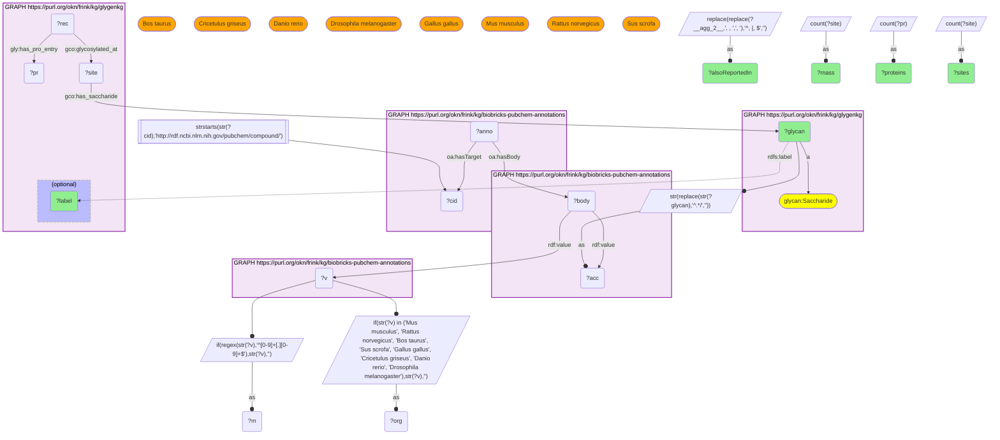
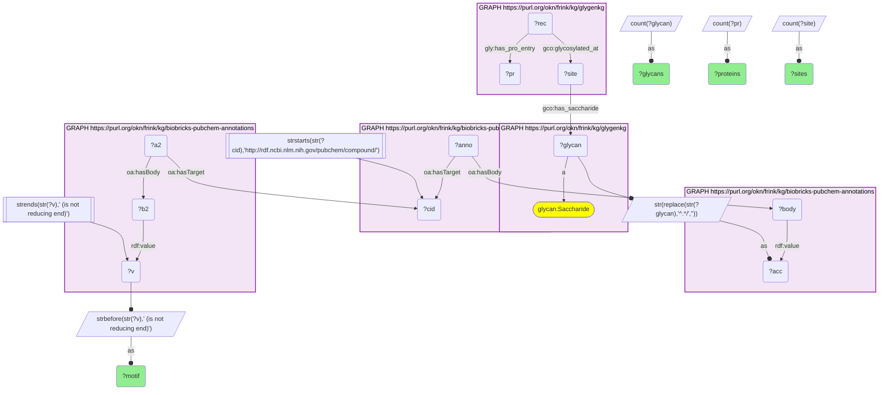

# C28-Q1: glygenkg×biobricks-pubchem-annotations (GlyTouCan accession) — PubChem's GlyTouCan records add a mass (from disaccharides up) and the organisms each glycan is reported in; its motif annotations place Type 2 LacNAc on 34 human glycoproteins

- **Date:** 2026-10-13
- **Model:** claude-opus-5-5
- **SPARQL endpoint:** https://apps.okn.us/federation/sparql
- **Generated by:** mcp-okn v0.1.0 (build 9b39cc6)
- **Contents:** 2 queries · 2 query diagrams

## Knowledge graphs used

- `glygenkg` — <https://purl.org/okn/frink/kg/glygenkg>
- `biobricks-pubchem-annotations` — <https://purl.org/okn/frink/kg/biobricks-pubchem-annotations>

## Conversation

👤 **User**

GlyGen's KG names its glycans only by a GlyTouCan accession and a composition label. For the glycans it attaches at the most human protein sites, what can PubChem's annotations add (mass, and other organisms the glycan is reported in)? And which glycan motifs that PubChem annotates are most widespread across GlyGen's glycoproteins?

---

🧠 **Assistant**

**PubChem's GlyTouCan record gives each glycan a mass and the organisms it has been reported in, which glygenkg (human only, label only) does not hold. Its motif annotations put the Type 2 LacNAc unit on 115 of the bridged glycans and 34 human glycoproteins.**

**Most-attached bridged glycans:**

| GlyTouCan | GlyGen label | Sites | Proteins | Mass (PubChem) | Also reported in (model organisms) |
|---|---|---|---|---|---|
| G49108TO | HexNAc1 (O-linked, O-GlcNAc) | 14,003 | 3,540 | — | rat, fruit fly, mouse |
| G57321FI | HexNAc1 (Other, Other) | 1,801 | 450 | — | rat, cow, Chinese hamster, fruit fly, mouse |
| G70994MS | HexNAc1 (O-linked, O-GlcNAc) | 620 | 264 | — | mouse, fruit fly, rat |
| G71142DF | Hex1 (Other, Other) | 75 | 37 | — | mouse |
| G00031MO | Hex1HexNAc1 (O-linked, Core 1) | 62 | 10 | 383.14 | rat, pig, mouse, cow, Chinese hamster, fruit fly |
| G01614ZM | Hex1HexNAc1NeuAc2 (O-linked, Core 1) | 30 | 9 | 965.33 | cow, rat, mouse, zebrafish, Chinese hamster |
| G65562ZE | Hex1HexNAc1NeuAc1 (O-linked, Core 1) | 28 | 8 | 674.24 | pig, cow, Chinese hamster, zebrafish, mouse, rat |
| G84467IZ | Hex5HexNAc4NeuAc2 (N-linked, Biantennary) | 23 | 13 | 2222.78 | rat, cow, chicken, mouse |
| G82348BZ | Hex3HexNAc2dHex1 (N-linked, Core-fucosylated) | 21 | 12 | 1056.39 | chicken, Chinese hamster, fruit fly, mouse, rat |

**The site counts are dominated by single sugars.** One O-GlcNAc accession (G49108TO) is on 14,003 sites across 3,540 proteins, and the three HexNAc1 entries together account for 16,424 site assignments. Those monosaccharides have no mass in their GlyTouCan record; the mass appears from the disaccharides up. The mass is the free glycan's monoisotopic mass: Hex1HexNAc1 (Gal + GalNAc minus one water) works out to 383.14, the value PubChem gives. Two Core 1 isomers, G65562ZE and G56682BC, share 674.24, so mass alone does not separate them; the GlyTouCan accession does.

**The organism list is the new information.** glygenkg holds one taxon, human. PubChem's GlyTouCan record says where else each structure has been reported: the common N- and O-linked glycans in the table are also reported in mouse and rat, so a model-organism glycomics result can be matched to the human sites GlyGen records. The organism column shows only eight model species; the record also carries higher taxa (Mammalia, Vertebrata) and other organisms, listed in the full result below.

**Motifs:**

| Motif (PubChem annotation) | Glycans | Sites | Proteins |
|---|---|---|---|
| Type 2 LN (LacNAc) | 115 | 417 | 34 |
| 3-Sialyl-LN (type 2) | 27 | 88 | 10 |
| Lewis x | 11 | 20 | 6 |
| LacdiNAc | 32 | 85 | 5 |
| 6-Sialyl-GalNAc | 7 | 17 | 3 |
| Sialylated LDN | 7 | 17 | 3 |
| Type 2 LN2 | 8 | 15 | 3 |
| 4'-sulfated LDN | 7 | 19 | 2 |
| Blood group H (type 2) | 3 | 3 | 2 |
| Sialyl Lewis x | 1 | 3 | 1 |
| Fucosylated LDN | 1 | 1 | 1 |

**Motif coverage is thin.** Motifs belong to the larger N- and O-glycans, and GlyGen assigns those to comparatively few sites: Type 2 LacNAc reaches 417 sites on 34 proteins, while a single O-GlcNAc accession reaches 14,003. The motif labels are PubChem's own, reproduced as stored ("is not reducing end" means the motif sits on an antenna, not at the reducing terminus).

**Join form.** glygenkg's glycan IRI `http://glygen.org/glycan/{accession}` ends in the GlyTouCan accession. biobricks-pubchem-annotations holds the same accession as a plain `rdf:value` string in the body of PubChem's GlyTouCan annotation, and that annotation's `oa:hasTarget` is the PubChem compound. Mass and organisms are read from that same body; motifs come from the compound's other annotations.

## SPARQL queries executed

#### Query 1

_2026-10-14T05:01:36+00:00 · `glygenkg`, `biobricks-pubchem-annotations`_

```sparql
PREFIX gly: <https://sparql.glygen.org/ontology/>
PREFIX gco: <http://purl.jp/bio/12/glyco/conjugate#>
PREFIX glycan: <http://purl.jp/bio/12/glyco/glycan#>
PREFIX faldo: <http://www.biohackathon.org/resource/faldo#>
PREFIX up: <http://purl.uniprot.org/core/>
PREFIX skos: <http://www.w3.org/2004/02/skos/core#>
PREFIX rdfs: <http://www.w3.org/2000/01/rdf-schema#>
PREFIX rdf: <http://www.w3.org/1999/02/22-rdf-syntax-ns#>
PREFIX oa: <http://www.w3.org/ns/oa#>
# The bridged glycans GlyGen attaches at the most human protein sites, with PubChem's
# GlyTouCan record for each: mass, and the model organisms it is also reported in.
SELECT ?glycan ?label ?sites ?proteins (MAX(?m) AS ?mass)
       (REPLACE(REPLACE(GROUP_CONCAT(DISTINCT ?org; SEPARATOR=", "), ", , ", ", "), "^, |, $", "") AS ?alsoReportedIn) WHERE {
  { SELECT ?glycan ?body ?label (COUNT(DISTINCT ?site) AS ?sites) (COUNT(DISTINCT ?pr) AS ?proteins) WHERE {
      { SELECT DISTINCT ?glycan ?body ?cid WHERE {
    { SELECT DISTINCT ?glycan ?body WHERE {
        { SELECT DISTINCT ?glycan ?acc WHERE { GRAPH <https://purl.org/okn/frink/kg/glygenkg> { ?glycan a glycan:Saccharide . } BIND(STR(REPLACE(STR(?glycan),'^.*/','')) AS ?acc) } }
        GRAPH <https://purl.org/okn/frink/kg/biobricks-pubchem-annotations> { ?body rdf:value ?acc . } } }
    GRAPH <https://purl.org/okn/frink/kg/biobricks-pubchem-annotations> { ?anno oa:hasBody ?body ; oa:hasTarget ?cid . }
    FILTER(STRSTARTS(STR(?cid),'http://rdf.ncbi.nlm.nih.gov/pubchem/compound/')) } }
      GRAPH <https://purl.org/okn/frink/kg/glygenkg> { ?site gco:has_saccharide ?glycan . ?rec gco:glycosylated_at ?site ; gly:has_pro_entry ?pr .
        OPTIONAL { ?glycan rdfs:label ?label } }
  } GROUP BY ?glycan ?body ?label ORDER BY DESC(?sites) LIMIT 15 }
  GRAPH <https://purl.org/okn/frink/kg/biobricks-pubchem-annotations> { ?body rdf:value ?v . }
  BIND(IF(REGEX(STR(?v),'^[0-9]+[.][0-9]+$'), STR(?v), "") AS ?m)
  BIND(IF(STR(?v) IN ("Mus musculus", "Rattus norvegicus", "Bos taurus", "Sus scrofa", "Gallus gallus", "Cricetulus griseus", "Danio rerio", "Drosophila melanogaster"), STR(?v), "") AS ?org)
} GROUP BY ?glycan ?label ?sites ?proteins ORDER BY DESC(?sites)
```



_15 row(s) — showing first 3_

| glycan | label | sites | proteins | mass | alsoReportedIn |
| --- | --- | --- | --- | --- | --- |
| http://glygen.org/glycan/G49108TO | HexNAc1 (O-linked, O-GlcNAc) | 14003 | 3540 |  | Rattus norvegicus, Drosophila melanogaster, Mus musculus |
| http://glygen.org/glycan/G57321FI | HexNAc1 (Other, Other) | 1801 | 450 |  | Rattus norvegicus, Bos taurus, Cricetulus griseus, Drosophila melanogaster, Mus musculus |
| http://glygen.org/glycan/G70994MS | HexNAc1 (O-linked, O-GlcNAc) | 620 | 264 |  | Mus musculus, Drosophila melanogaster, Rattus norvegicus |

#### Query 2

_2026-10-14T05:01:37+00:00 · `glygenkg`, `biobricks-pubchem-annotations`_

```sparql
PREFIX gly: <https://sparql.glygen.org/ontology/>
PREFIX gco: <http://purl.jp/bio/12/glyco/conjugate#>
PREFIX glycan: <http://purl.jp/bio/12/glyco/glycan#>
PREFIX faldo: <http://www.biohackathon.org/resource/faldo#>
PREFIX up: <http://purl.uniprot.org/core/>
PREFIX skos: <http://www.w3.org/2004/02/skos/core#>
PREFIX rdfs: <http://www.w3.org/2000/01/rdf-schema#>
PREFIX rdf: <http://www.w3.org/1999/02/22-rdf-syntax-ns#>
PREFIX oa: <http://www.w3.org/ns/oa#>
# PubChem's motif annotations ('... (is not reducing end)') on the bridged glycans: how
# widespread is each motif across the human glycoprotein sites GlyGen records?
SELECT ?motif (COUNT(DISTINCT ?glycan) AS ?glycans) (COUNT(DISTINCT ?site) AS ?sites)
       (COUNT(DISTINCT ?pr) AS ?proteins) WHERE {
  { SELECT DISTINCT ?glycan ?body ?cid WHERE {
    { SELECT DISTINCT ?glycan ?body WHERE {
        { SELECT DISTINCT ?glycan ?acc WHERE { GRAPH <https://purl.org/okn/frink/kg/glygenkg> { ?glycan a glycan:Saccharide . } BIND(STR(REPLACE(STR(?glycan),'^.*/','')) AS ?acc) } }
        GRAPH <https://purl.org/okn/frink/kg/biobricks-pubchem-annotations> { ?body rdf:value ?acc . } } }
    GRAPH <https://purl.org/okn/frink/kg/biobricks-pubchem-annotations> { ?anno oa:hasBody ?body ; oa:hasTarget ?cid . }
    FILTER(STRSTARTS(STR(?cid),'http://rdf.ncbi.nlm.nih.gov/pubchem/compound/')) } }
  GRAPH <https://purl.org/okn/frink/kg/biobricks-pubchem-annotations> { ?a2 oa:hasTarget ?cid ; oa:hasBody ?b2 . ?b2 rdf:value ?v . }
  FILTER(STRENDS(STR(?v),' (is not reducing end)'))
  BIND(STRBEFORE(STR(?v),' (is not reducing end)') AS ?motif)
  GRAPH <https://purl.org/okn/frink/kg/glygenkg> { ?site gco:has_saccharide ?glycan . ?rec gco:glycosylated_at ?site ; gly:has_pro_entry ?pr . }
} GROUP BY ?motif ORDER BY DESC(?proteins) DESC(?sites)
```



_11 row(s)_

| motif | glycans | sites | proteins |
| --- | --- | --- | --- |
| Type 2 LN | 115 | 417 | 34 |
| 3-Sialyl-LN (type 2) | 27 | 88 | 10 |
| Lewis x | 11 | 20 | 6 |
| LacdiNAc | 32 | 85 | 5 |
| 6-Sialyl-GalNAc | 7 | 17 | 3 |
| Sialylated LDN | 7 | 17 | 3 |
| Type 2 LN2 | 8 | 15 | 3 |
| 4'-sulfated LDN | 7 | 19 | 2 |
| Blood group H (type 2) | 3 | 3 | 2 |
| Sialyl Lewis x | 1 | 3 | 1 |
| Fucosylated LDN | 1 | 1 | 1 |
