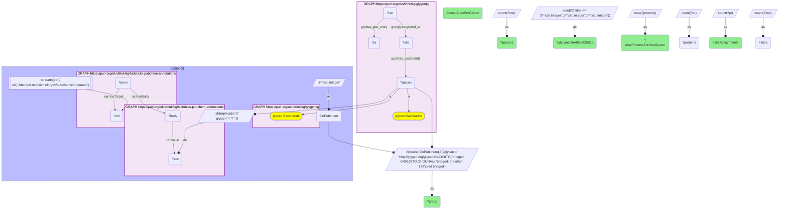

```mermaid
graph TD
classDef projected fill:lightgreen;
classDef literal fill:orange;
classDef iri fill:yellow;
  q0v16("?acc")
  q0v19("?anno")
  q0v18("?body")
  q0v13("?bridgedGlycans"):::projected 
  q0v15("?cid")
  q0v3("?g")
  q0v10("?g2")
  q0v17("?glycan")
  q0v1("?glycansTotal"):::projected 
  q0v9("?p")
  q0v22("?pr")
  q0v11("?proteinsWithBridgedGlycan"):::projected 
  q0v4("?proteinsWithGlycan"):::projected 
  q0v7("?r")
  q0v20("?rec")
  q0v8("?s")
  q0v21("?site")
  q0v12("?sitesWithBridgedGlycan"):::projected 
  q0v5("?sitesWithGlycan"):::projected 
  subgraph q0graph0["GRAPH https://purl.org/okn/frink/kg/glygenkg"]
    style q0graph0 fill:#f3e5f5,stroke:#8e24aa,stroke-width:2px,color:#000;
    q0graph0c2(["glycan:Saccharide"]):::iri 
    q0v3 --"a"--> q0graph0c2
  end
  q0bind0[/"count(?glycan)"/]
  q0bind0 --as--o q0v1
  subgraph q0graph1["GRAPH https://purl.org/okn/frink/kg/glygenkg"]
    style q0graph1 fill:#f3e5f5,stroke:#8e24aa,stroke-width:2px,color:#000;
    q0v7 --"gco:glycosylated_at"--> q0v8
    q0v7 --"gly:has_pro_entry"--> q0v9
    q0v8 --"gco:has_saccharide"--> q0v10
  end
  q0bind1[/"count(?glycan)"/]
  q0bind1 --as--o q0v5
  q0bind2[/"count(?site)"/]
  q0bind2 --as--o q0v4
  q0f0[["strstarts(str(?cid),'http://rdf.ncbi.nlm.nih.gov/pubchem/compound/')"]]
  q0f0 --> q0v15
  subgraph q0graph2["GRAPH https://purl.org/okn/frink/kg/glygenkg"]
    style q0graph2 fill:#f3e5f5,stroke:#8e24aa,stroke-width:2px,color:#000;
    q0graph2c2(["glycan:Saccharide"]):::iri 
    q0v17 --"a"--> q0graph2c2
  end
  q0bind3[/"str(replace(str(?glycan),'^.*/',''))"/]
  q0v17 --o q0bind3
  q0bind3 --as--o q0v16
  subgraph q0graph3["GRAPH https://purl.org/okn/frink/kg/biobricks-pubchem-annotations"]
    style q0graph3 fill:#f3e5f5,stroke:#8e24aa,stroke-width:2px,color:#000;
    q0v18 --"rdf:value"--> q0v16
  end
  subgraph q0graph4["GRAPH https://purl.org/okn/frink/kg/biobricks-pubchem-annotations"]
    style q0graph4 fill:#f3e5f5,stroke:#8e24aa,stroke-width:2px,color:#000;
    q0v19 --"oa:hasBody"--> q0v18
    q0v19 --"oa:hasTarget"--> q0v15
  end
  subgraph q0optional0["(optional)"]
  style q0optional0 fill:#bbf,stroke-dasharray: 5 5,color:#000;
    subgraph q0graph5["GRAPH https://purl.org/okn/frink/kg/glygenkg"]
      style q0graph5 fill:#f3e5f5,stroke:#8e24aa,stroke-width:2px,color:#000;
      q0v20 --"gco:glycosylated_at"--> q0v21
      q0v20 --"gly:has_pro_entry"--> q0v22
      q0v21 --"gco:has_saccharide"--> q0v17
    end
  end
  q0bind4[/"count(?glycan)"/]
  q0bind4 --as--o q0v13
  q0bind5[/"count(?site)"/]
  q0bind5 --as--o q0v12
  q0bind6[/"count(?pr)"/]
  q0bind6 --as--o q0v11
```

```mermaid
graph TD
classDef projected fill:lightgreen;
classDef literal fill:orange;
classDef iri fill:yellow;
  q1v33("?a2")
  q1v25("?acc")
  q1v27("?anno")
  q1v34("?b2")
  q1v26("?body")
  q1v9("?bridgedGlycans"):::projected 
  q1v24("?cid")
  q1v23("?glycan")
  q1v29("?hasChebi")
  q1v31("?hasClass")
  q1v22("?hasMass")
  q1v30("?hasMotif")
  q1v32("?hasWurcs")
  q1v21("?inMouse")
  q1v20("?inRat")
  q1v19("?nonMammal")
  q1v7("?reportedInMouse"):::projected 
  q1v6("?reportedInRat"):::projected 
  q1v5("?reportedOutsideMammals"):::projected 
  q1v28("?v")
  q1v35("?w")
  q1v1("?withCHEBI"):::projected 
  q1v3("?withClass"):::projected 
  q1v8("?withMass"):::projected 
  q1v2("?withMotif"):::projected 
  q1v4("?withWURCS"):::projected 
  q1f0[["strstarts(str(?cid),'http://rdf.ncbi.nlm.nih.gov/pubchem/compound/')"]]
  q1f0 --> q1v24
  subgraph q1graph0["GRAPH https://purl.org/okn/frink/kg/glygenkg"]
    style q1graph0 fill:#f3e5f5,stroke:#8e24aa,stroke-width:2px,color:#000;
    q1graph0c2(["glycan:Saccharide"]):::iri 
    q1v23 --"a"--> q1graph0c2
  end
  q1bind0[/"str(replace(str(?glycan),'^.*/',''))"/]
  q1v23 --o q1bind0
  q1bind0 --as--o q1v25
  subgraph q1graph1["GRAPH https://purl.org/okn/frink/kg/biobricks-pubchem-annotations"]
    style q1graph1 fill:#f3e5f5,stroke:#8e24aa,stroke-width:2px,color:#000;
    q1v26 --"rdf:value"--> q1v25
  end
  subgraph q1graph2["GRAPH https://purl.org/okn/frink/kg/biobricks-pubchem-annotations"]
    style q1graph2 fill:#f3e5f5,stroke:#8e24aa,stroke-width:2px,color:#000;
    q1v27 --"oa:hasBody"--> q1v26
    q1v27 --"oa:hasTarget"--> q1v24
  end
  subgraph q1graph3["GRAPH https://purl.org/okn/frink/kg/biobricks-pubchem-annotations"]
    style q1graph3 fill:#f3e5f5,stroke:#8e24aa,stroke-width:2px,color:#000;
    q1v26 --"rdf:value"--> q1v28
  end
  q1bind1[/"max(if(strstarts(str(?w),'WURCS='),'1^^xsd:integer','0^^xsd:integer'))"/]
  q1bind1 --as--o q1v22
  q1bind2[/"max(if(regex(str(?w),'^(N|O)-linked'),'1^^xsd:integer','0^^xsd:integer'))"/]
  q1bind2 --as--o q1v21
  q1bind3[/"max(if(strends(str(?w),'(is not reducing end)'),'1^^xsd:integer','0^^xsd:integer'))"/]
  q1bind3 --as--o q1v20
  q1bind4[/"max(if(strstarts(str(?w),'CHEBI:'),'1^^xsd:integer','0^^xsd:integer'))"/]
  q1bind4 --as--o q1v19
  q1f1[["strstarts(str(?cid),'http://rdf.ncbi.nlm.nih.gov/pubchem/compound/')"]]
  q1f1 --> q1v24
  subgraph q1graph4["GRAPH https://purl.org/okn/frink/kg/glygenkg"]
    style q1graph4 fill:#f3e5f5,stroke:#8e24aa,stroke-width:2px,color:#000;
    q1graph4c2(["glycan:Saccharide"]):::iri 
    q1v23 --"a"--> q1graph4c2
  end
  q1bind5[/"str(replace(str(?glycan),'^.*/',''))"/]
  q1v23 --o q1bind5
  q1bind5 --as--o q1v25
  subgraph q1graph5["GRAPH https://purl.org/okn/frink/kg/biobricks-pubchem-annotations"]
    style q1graph5 fill:#f3e5f5,stroke:#8e24aa,stroke-width:2px,color:#000;
    q1v26 --"rdf:value"--> q1v25
  end
  subgraph q1graph6["GRAPH https://purl.org/okn/frink/kg/biobricks-pubchem-annotations"]
    style q1graph6 fill:#f3e5f5,stroke:#8e24aa,stroke-width:2px,color:#000;
    q1v27 --"oa:hasBody"--> q1v26
    q1v27 --"oa:hasTarget"--> q1v24
  end
  subgraph q1graph7["GRAPH https://purl.org/okn/frink/kg/biobricks-pubchem-annotations"]
    style q1graph7 fill:#f3e5f5,stroke:#8e24aa,stroke-width:2px,color:#000;
    q1v33 --"oa:hasBody"--> q1v34
    q1v33 --"oa:hasTarget"--> q1v24
    q1v34 --"rdf:value"--> q1v35
  end
  q1bind6[/"max(if(strstarts(str(?w),'WURCS='),'1^^xsd:integer','0^^xsd:integer'))"/]
  q1bind6 --as--o q1v32
  q1bind7[/"max(if(regex(str(?w),'^(N|O)-linked'),'1^^xsd:integer','0^^xsd:integer'))"/]
  q1bind7 --as--o q1v31
  q1bind8[/"max(if(strends(str(?w),'(is not reducing end)'),'1^^xsd:integer','0^^xsd:integer'))"/]
  q1bind8 --as--o q1v30
  q1bind9[/"max(if(strstarts(str(?w),'CHEBI:'),'1^^xsd:integer','0^^xsd:integer'))"/]
  q1bind9 --as--o q1v29
  q1bind10[/"max(if(strstarts(str(?w),'WURCS='),'1^^xsd:integer','0^^xsd:integer'))"/]
  q1bind10 --as--o q1v9
  q1bind11[/"max(if(regex(str(?w),'^(N|O)-linked'),'1^^xsd:integer','0^^xsd:integer'))"/]
  q1bind11 --as--o q1v8
  q1bind12[/"max(if(strends(str(?w),'(is not reducing end)'),'1^^xsd:integer','0^^xsd:integer'))"/]
  q1bind12 --as--o q1v7
  q1bind13[/"max(if(strstarts(str(?w),'CHEBI:'),'1^^xsd:integer','0^^xsd:integer'))"/]
  q1bind13 --as--o q1v6
  q1bind14[/"sum(?hasWurcs)"/]
  q1bind14 --as--o q1v4
  q1bind15[/"sum(?hasClass)"/]
  q1bind15 --as--o q1v3
  q1bind16[/"sum(?hasMotif)"/]
  q1bind16 --as--o q1v2
  q1bind17[/"sum(?hasChebi)"/]
  q1bind17 --as--o q1v1
```

# C28-Q2: glygenkg×biobricks-pubchem-annotations — 180 of GlyGen's 1,248 glycans (14%) are annotated in PubChem under their GlyTouCan accession; they reach 3,852 of 4,564 glycoproteins, 3,540 of them through one O-GlcNAc entry

- **Date:** 2026-10-13
- **Model:** claude-opus-5-5
- **SPARQL endpoint:** https://apps.okn.us/federation/sparql
- **Generated by:** mcp-okn v0.1.0 (build 9b39cc6)
- **Contents:** 3 queries · 3 query diagrams

## Knowledge graphs used

- `glygenkg` — <https://purl.org/okn/frink/kg/glygenkg>
- `biobricks-pubchem-annotations` — <https://purl.org/okn/frink/kg/biobricks-pubchem-annotations>

## Conversation

👤 **User**

Same crosswalk, coverage angle: how many of glygenkg's glycans does biobricks-pubchem-annotations annotate under their GlyTouCan accession, what share of GlyGen's glycan-bearing sites and proteins do they account for, and which kinds of information does PubChem supply for them?

---

🧠 **Assistant**

**180 of glygenkg's 1,248 glycans (14.4%) are annotated in biobricks-pubchem-annotations under their GlyTouCan accession. They reach 17,374 of glygenkg's 62,732 glycan-bearing sites and 3,852 of its 4,564 glycan-bearing proteins, but almost all of that reach comes from one entry: O-GlcNAc (G49108TO), on 3,540 proteins.**

| Measure | Count |
|---|---|
| glygenkg glycans | 1,248 |
| annotated in PubChem under their GlyTouCan accession | 180 |
| glygenkg sites with a glycan | 62,732 |
| of which carry a bridged glycan | 17,374 |
| glygenkg proteins with a glycan-bearing site | 4,564 |
| of which carry a bridged glycan | 3,852 |

**Bridged versus unbridged:**

| Group | Glycans | Site assignments | Mean sites per glycan | Glycans on ≤3 sites | Most proteins for one glycan |
|---|---|---|---|---|---|
| bridged: G49108TO (O-GlcNAc) | 1 | 14,003 | 14,003 | 0 | 3,540 |
| bridged: the other 179 | 179 | 3,371 | 18.8 | 118 | 450 |
| not bridged | 1,067 | 45,358 | 42.5 | 498 | 519 |

**Read the protein coverage with this split in mind.** The 84% protein figure is O-GlcNAc's: that one accession is on 3,540 proteins. Set it aside and the other 179 bridged glycans are, if anything, less widely attached than the unbridged ones (a mean of 18.8 sites each against 42.5, and two-thirds of them on three sites or fewer). The bridge does not pick out GlyGen's most common glycans; it picks out the ones PubChem happens to annotate.

**What PubChem supplies for the 180:**

| Information | Bridged glycans |
|---|---|
| WURCS structure | 180 |
| mass (in the GlyTouCan record) | 173 |
| glycan class (N-/O-linked subtype) | 169 |
| CHEBI id | 154 |
| motif | 126 |
| reported in mouse | 57 |
| reported in rat | 57 |
| reported outside mammals (insects, birds, amphibians, viruses, bacteria, fungi, plants or nematodes) | 52 |

**What it adds that glygenkg lacks.** glygenkg names a glycan by its accession and a composition label and holds no structure, mass or taxonomy. PubChem supplies a machine-readable WURCS structure for all 180, a mass for 173, and the organisms in which each structure has been reported. The seven without a mass are all single sugars (HexNAc1, Hex1 and dHex1 entries); their GlyTouCan record carries no mass.

**Relation to the CHEBI route.** The ubergraph route (a GlyTouCan cross-reference on a CHEBI class, recipe GC1) reaches 208 glycans; checked separately, 175 of them are among these 180, 33 are reached only through ubergraph and 5 only through PubChem. PubChem's own annotations list a CHEBI id for 154. Only the PubChem route reaches a data graph.

**Join form.** The GlyTouCan accession, the local name of glygenkg's glycan IRI, matches a plain `rdf:value` string in biobricks-pubchem-annotations. The body holding it belongs to PubChem's GlyTouCan annotation, whose `oa:hasTarget` is the compound `http://rdf.ncbi.nlm.nih.gov/pubchem/compound/CID{n}`. Drive from glygenkg's 1,248 glycans; the accession lookup is indexed and fast.

## SPARQL queries executed

#### Query 1

_2026-10-14T05:01:37+00:00 · `glygenkg`, `biobricks-pubchem-annotations`_

```sparql
PREFIX gly: <https://sparql.glygen.org/ontology/>
PREFIX gco: <http://purl.jp/bio/12/glyco/conjugate#>
PREFIX glycan: <http://purl.jp/bio/12/glyco/glycan#>
PREFIX faldo: <http://www.biohackathon.org/resource/faldo#>
PREFIX up: <http://purl.uniprot.org/core/>
PREFIX skos: <http://www.w3.org/2004/02/skos/core#>
PREFIX rdfs: <http://www.w3.org/2000/01/rdf-schema#>
PREFIX rdf: <http://www.w3.org/1999/02/22-rdf-syntax-ns#>
PREFIX oa: <http://www.w3.org/ns/oa#>
# Coverage: glygenkg glycans, those PubChem annotates under their GlyTouCan accession,
# and the share of glygenkg's glycan-bearing sites and proteins they account for.
SELECT ?glycansTotal ?bridgedGlycans ?sitesWithGlycan ?sitesWithBridgedGlycan ?proteinsWithGlycan ?proteinsWithBridgedGlycan WHERE {
  { SELECT (COUNT(DISTINCT ?g) AS ?glycansTotal) WHERE { GRAPH <https://purl.org/okn/frink/kg/glygenkg> { ?g a glycan:Saccharide } } }
  { SELECT (COUNT(DISTINCT ?s) AS ?sitesWithGlycan) (COUNT(DISTINCT ?p) AS ?proteinsWithGlycan) WHERE {
      GRAPH <https://purl.org/okn/frink/kg/glygenkg> { ?s gco:has_saccharide ?g2 . ?r gco:glycosylated_at ?s ; gly:has_pro_entry ?p } } }
  { SELECT (COUNT(DISTINCT ?glycan) AS ?bridgedGlycans) (COUNT(DISTINCT ?site) AS ?sitesWithBridgedGlycan) (COUNT(DISTINCT ?pr) AS ?proteinsWithBridgedGlycan) WHERE {
      { SELECT DISTINCT ?glycan ?body ?cid WHERE {
    { SELECT DISTINCT ?glycan ?body WHERE {
        { SELECT DISTINCT ?glycan ?acc WHERE { GRAPH <https://purl.org/okn/frink/kg/glygenkg> { ?glycan a glycan:Saccharide . } BIND(STR(REPLACE(STR(?glycan),'^.*/','')) AS ?acc) } }
        GRAPH <https://purl.org/okn/frink/kg/biobricks-pubchem-annotations> { ?body rdf:value ?acc . } } }
    GRAPH <https://purl.org/okn/frink/kg/biobricks-pubchem-annotations> { ?anno oa:hasBody ?body ; oa:hasTarget ?cid . }
    FILTER(STRSTARTS(STR(?cid),'http://rdf.ncbi.nlm.nih.gov/pubchem/compound/')) } }
      OPTIONAL { GRAPH <https://purl.org/okn/frink/kg/glygenkg> { ?site gco:has_saccharide ?glycan . ?rec gco:glycosylated_at ?site ; gly:has_pro_entry ?pr } } } }
}
```



_1 row(s)_

| glycansTotal | bridgedGlycans | sitesWithGlycan | sitesWithBridgedGlycan | proteinsWithGlycan | proteinsWithBridgedGlycan |
| --- | --- | --- | --- | --- | --- |
| 1248 | 180 | 62732 | 17374 | 4564 | 3852 |

#### Query 2

_2026-10-14T05:01:38+00:00 · `glygenkg`, `biobricks-pubchem-annotations`_

```sparql
PREFIX gly: <https://sparql.glygen.org/ontology/>
PREFIX gco: <http://purl.jp/bio/12/glyco/conjugate#>
PREFIX glycan: <http://purl.jp/bio/12/glyco/glycan#>
PREFIX faldo: <http://www.biohackathon.org/resource/faldo#>
PREFIX up: <http://purl.uniprot.org/core/>
PREFIX skos: <http://www.w3.org/2004/02/skos/core#>
PREFIX rdfs: <http://www.w3.org/2000/01/rdf-schema#>
PREFIX rdf: <http://www.w3.org/1999/02/22-rdf-syntax-ns#>
PREFIX oa: <http://www.w3.org/ns/oa#>
# What PubChem adds per bridged glycan. Mass and organisms come from the GlyTouCan record
# body; structure (WURCS), class, motifs and CHEBI from the compound's other annotations.
SELECT (COUNT(?glycan) AS ?bridgedGlycans) (SUM(?hasMass) AS ?withMass)
       (SUM(?inMouse) AS ?reportedInMouse) (SUM(?inRat) AS ?reportedInRat) (SUM(?nonMammal) AS ?reportedOutsideMammals)
       (SUM(?hasWurcs) AS ?withWURCS) (SUM(?hasClass) AS ?withClass) (SUM(?hasMotif) AS ?withMotif) (SUM(?hasChebi) AS ?withCHEBI) WHERE {
  { SELECT ?glycan (MAX(IF(REGEX(STR(?v),'^[0-9]+[.][0-9]+$'),1,0)) AS ?hasMass)
            (MAX(IF(STR(?v) = "Mus musculus",1,0)) AS ?inMouse) (MAX(IF(STR(?v) = "Rattus norvegicus",1,0)) AS ?inRat)
            (MAX(IF(STR(?v) IN ("Insecta", "Aves", "Amphibia", "Viruses", "Bacteria", "Fungi", "Embryophyta", "Nematoda"),1,0)) AS ?nonMammal) WHERE {
      { SELECT DISTINCT ?glycan ?body ?cid WHERE {
    { SELECT DISTINCT ?glycan ?body WHERE {
        { SELECT DISTINCT ?glycan ?acc WHERE { GRAPH <https://purl.org/okn/frink/kg/glygenkg> { ?glycan a glycan:Saccharide . } BIND(STR(REPLACE(STR(?glycan),'^.*/','')) AS ?acc) } }
        GRAPH <https://purl.org/okn/frink/kg/biobricks-pubchem-annotations> { ?body rdf:value ?acc . } } }
    GRAPH <https://purl.org/okn/frink/kg/biobricks-pubchem-annotations> { ?anno oa:hasBody ?body ; oa:hasTarget ?cid . }
    FILTER(STRSTARTS(STR(?cid),'http://rdf.ncbi.nlm.nih.gov/pubchem/compound/')) } }
      GRAPH <https://purl.org/okn/frink/kg/biobricks-pubchem-annotations> { ?body rdf:value ?v . } } GROUP BY ?glycan }
  { SELECT ?glycan (MAX(IF(STRSTARTS(STR(?w),'WURCS='),1,0)) AS ?hasWurcs) (MAX(IF(REGEX(STR(?w),'^(N|O)-linked'),1,0)) AS ?hasClass)
            (MAX(IF(STRENDS(STR(?w),'(is not reducing end)'),1,0)) AS ?hasMotif) (MAX(IF(STRSTARTS(STR(?w),'CHEBI:'),1,0)) AS ?hasChebi) WHERE {
      { SELECT DISTINCT ?glycan ?body ?cid WHERE {
    { SELECT DISTINCT ?glycan ?body WHERE {
        { SELECT DISTINCT ?glycan ?acc WHERE { GRAPH <https://purl.org/okn/frink/kg/glygenkg> { ?glycan a glycan:Saccharide . } BIND(STR(REPLACE(STR(?glycan),'^.*/','')) AS ?acc) } }
        GRAPH <https://purl.org/okn/frink/kg/biobricks-pubchem-annotations> { ?body rdf:value ?acc . } } }
    GRAPH <https://purl.org/okn/frink/kg/biobricks-pubchem-annotations> { ?anno oa:hasBody ?body ; oa:hasTarget ?cid . }
    FILTER(STRSTARTS(STR(?cid),'http://rdf.ncbi.nlm.nih.gov/pubchem/compound/')) } }
      GRAPH <https://purl.org/okn/frink/kg/biobricks-pubchem-annotations> { ?a2 oa:hasTarget ?cid ; oa:hasBody ?b2 . ?b2 rdf:value ?w . } } GROUP BY ?glycan }
}
```



_1 row(s)_

| bridgedGlycans | withMass | reportedInMouse | reportedInRat | reportedOutsideMammals | withWURCS | withClass | withMotif | withCHEBI |
| --- | --- | --- | --- | --- | --- | --- | --- | --- |
| 180 | 173 | 57 | 57 | 52 | 180 | 169 | 126 | 154 |

#### Query 3

_2026-10-14T05:01:38+00:00 · `glygenkg`, `biobricks-pubchem-annotations`_

```sparql
PREFIX gly: <https://sparql.glygen.org/ontology/>
PREFIX gco: <http://purl.jp/bio/12/glyco/conjugate#>
PREFIX glycan: <http://purl.jp/bio/12/glyco/glycan#>
PREFIX faldo: <http://www.biohackathon.org/resource/faldo#>
PREFIX up: <http://purl.uniprot.org/core/>
PREFIX skos: <http://www.w3.org/2004/02/skos/core#>
PREFIX rdfs: <http://www.w3.org/2000/01/rdf-schema#>
PREFIX rdf: <http://www.w3.org/1999/02/22-rdf-syntax-ns#>
PREFIX oa: <http://www.w3.org/ns/oa#>
# Bridged versus unbridged glycans: how widely each group is attached, and how much of the
# bridged group's reach comes from the single most-attached glycan (O-GlcNAc, G49108TO).
SELECT ?group (COUNT(?glycan) AS ?glycans) (SUM(?sites) AS ?siteAssignments) (AVG(?sites) AS ?meanSitesPerGlycan)
       (SUM(IF(?sites <= 3, 1, 0)) AS ?glycansOnAtMost3Sites) (MAX(?proteins) AS ?maxProteinsForOneGlycan) WHERE {
  { SELECT ?glycan (COUNT(DISTINCT ?site) AS ?sites) (COUNT(DISTINCT ?pr) AS ?proteins) WHERE {
      GRAPH <https://purl.org/okn/frink/kg/glygenkg> { ?glycan a glycan:Saccharide . ?site gco:has_saccharide ?glycan . ?rec gco:glycosylated_at ?site ; gly:has_pro_entry ?pr }
  } GROUP BY ?glycan }
  OPTIONAL { { SELECT DISTINCT ?glycan (1 AS ?inPubchem) WHERE { { SELECT DISTINCT ?glycan ?body ?cid WHERE {
    { SELECT DISTINCT ?glycan ?body WHERE {
        { SELECT DISTINCT ?glycan ?acc WHERE { GRAPH <https://purl.org/okn/frink/kg/glygenkg> { ?glycan a glycan:Saccharide . } BIND(STR(REPLACE(STR(?glycan),'^.*/','')) AS ?acc) } }
        GRAPH <https://purl.org/okn/frink/kg/biobricks-pubchem-annotations> { ?body rdf:value ?acc . } } }
    GRAPH <https://purl.org/okn/frink/kg/biobricks-pubchem-annotations> { ?anno oa:hasBody ?body ; oa:hasTarget ?cid . }
    FILTER(STRSTARTS(STR(?cid),'http://rdf.ncbi.nlm.nih.gov/pubchem/compound/')) } } } } }
  BIND(IF(BOUND(?inPubchem), IF(?glycan = <http://glygen.org/glycan/G49108TO>, "bridged: G49108TO (O-GlcNAc)", "bridged: the other 179"), "not bridged") AS ?group)
} GROUP BY ?group ORDER BY ?group
```



_3 row(s)_

| group | glycans | siteAssignments | meanSitesPerGlycan | glycansOnAtMost3Sites | maxProteinsForOneGlycan |
| --- | --- | --- | --- | --- | --- |
| bridged: G49108TO (O-GlcNAc) | 1 | 14003 | 14003.0 | 0 | 3540 |
| bridged: the other 179 | 179 | 3371 | 18.8324 | 118 | 450 |
| not bridged | 1067 | 45358 | 42.5098 | 498 | 519 |
