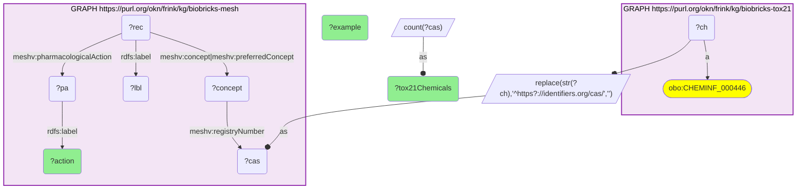

# C29-Q1: biobricks-mesh×biobricks-tox21 (CAS) — MeSH pharmacological actions of Tox21 chemicals: anti-bacterial agents (23) lead, then antineoplastics and enzyme inhibitors (11 each)

- **Date:** 2026-10-13
- **Model:** claude-opus-5-5
- **SPARQL endpoint:** https://apps.okn.us/federation/sparql
- **Generated by:** mcp-okn v0.1.0 (build 3195263)
- **Contents:** 1 query · 1 query diagram

## Knowledge graphs used

- `biobricks-tox21` — <https://purl.org/okn/frink/kg/biobricks-tox21>
- `biobricks-mesh` — <https://purl.org/okn/frink/kg/biobricks-mesh>

## Conversation

👤 **User**

Which MeSH pharmacological actions are most common among chemicals screened in Tox21, joined on the CAS registry number?

---

🧠 **Assistant**

**Through their CAS numbers, Tox21 chemicals pick up MeSH pharmacological actions, and the library's mix shows clearly: anti-bacterial agents lead (23 chemicals), followed by antineoplastic agents and enzyme inhibitors (11 each), then insecticides, vasodilators, antihypertensives and local anti-infectives (10 each).**

| MeSH pharmacological action | Tox21 chemicals | Example |
|---|---|---|
| Anti-Bacterial Agents | 23 | Spiramycin |
| Antineoplastic Agents | 11 | sulindac sulfone |
| Enzyme Inhibitors | 11 | safingol |
| Insecticides | 10 | Mevinphos |
| Vasodilator Agents | 10 | urapidil |
| Antihypertensive Agents | 10 | bis(p-chlorophenyl)acetic acid |
| Anti-Infective Agents, Local | 10 | malachite green |
| Carcinogens | 9 | 2-toluidine |
| Serotonin Receptor Agonists | 8 | 2,5-Dimethoxy-4-Methylamphetamine |
| Anti-Arrhythmia Agents | 8 | talinolol |
| Anti-Inflammatory Agents, Non-Steroidal | 8 | Ibuprofen |
| Herbicides | 7 | 2,4-Dichlorophenoxyacetic Acid |

The full 20 rows are in the result table below.

**What the join adds.** biobricks-tox21 carries a chemical's CAS number, name and screening context but no statement of what the chemical is for. MeSH's pharmacological actions supply that, so a Tox21 hit list can be grouped into drugs, pesticides, dyes and industrial reagents before interpreting activity.

**Coverage is thin at this level.** Only a minority of the matched chemicals carry any pharmacological action (see the coverage question), so the counts are small; absence of an action is not evidence that a chemical has none.

**Join form.** Tox21's CAS node IRI `http://identifiers.org/cas/{CAS}` is reduced to the bare CAS string and matched to `meshv:registryNumber` on a MeSH concept; the record (descriptor or supplementary chemical record) is reached through `meshv:concept` or `meshv:preferredConcept`.

## SPARQL queries executed

#### Query 1

_2026-10-14T06:48:18+00:00 · `biobricks-tox21`, `biobricks-mesh`_

```sparql
PREFIX biolink: <https://w3id.org/biolink/vocab/>
PREFIX rdfs: <http://www.w3.org/2000/01/rdf-schema#>
PREFIX skos: <http://www.w3.org/2004/02/skos/core#>
PREFIX up: <http://purl.uniprot.org/core/>
PREFIX obo: <http://purl.obolibrary.org/obo/>
PREFIX schema: <http://schema.org/>
PREFIX meshv: <http://id.nlm.nih.gov/mesh/vocab#>
# MeSH pharmacological actions of Tox21-screened chemicals, joined on the CAS registry number.
# A record (descriptor or supplementary concept record) reaches its CAS number through any of its concepts.
SELECT ?action (COUNT(DISTINCT ?cas) AS ?tox21Chemicals) (SAMPLE(?lbl) AS ?example) WHERE {
  { SELECT DISTINCT ?ch ?cas WHERE { GRAPH <https://purl.org/okn/frink/kg/biobricks-tox21> { ?ch a obo:CHEMINF_000446 } BIND(REPLACE(STR(?ch),'^https?://identifiers.org/cas/','') AS ?cas) } }
  GRAPH <https://purl.org/okn/frink/kg/biobricks-mesh> { ?concept meshv:registryNumber ?cas . ?rec meshv:concept|meshv:preferredConcept ?concept ; rdfs:label ?lbl ; meshv:pharmacologicalAction ?pa . ?pa rdfs:label ?action }
} GROUP BY ?action ORDER BY DESC(?tox21Chemicals) LIMIT 20
```



_20 row(s)_

| action | tox21Chemicals | example |
| --- | --- | --- |
| Anti-Bacterial Agents | 23 | Spiramycin |
| Antineoplastic Agents | 11 | sulindac sulfone |
| Enzyme Inhibitors | 11 | safingol |
| Insecticides | 10 | Mevinphos |
| Vasodilator Agents | 10 | urapidil |
| Antihypertensive Agents | 10 | bis(p-chlorophenyl)acetic acid |
| Anti-Infective Agents, Local | 10 | malachite green |
| Carcinogens | 9 | 2-toluidine |
| Serotonin Receptor Agonists | 8 | 2,5-Dimethoxy-4-Methylamphetamine |
| Anti-Arrhythmia Agents | 8 | talinolol |
| Anti-Inflammatory Agents, Non-Steroidal | 8 | Ibuprofen |
| Indicators and Reagents | 7 | sulfamic acid |
| Herbicides | 7 | 2,4-Dichlorophenoxyacetic Acid |
| Hallucinogens | 7 | N-Methyl-3,4-methylenedioxyamphetamine |
| Fluorescent Dyes | 7 | Fluoresceins |
| Coloring Agents | 7 | Allura Red AC Dye |
| Neuroprotective Agents | 6 | fructose-1,6-diphosphate |
| Surface-Active Agents | 6 | tetradecyltrimethylammonium |
| Detergents | 5 | zwittergent 3-12 |
| Cholinesterase Inhibitors | 5 | Monocrotophos |
