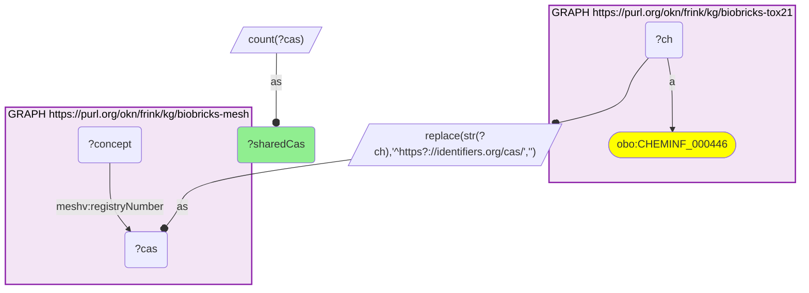
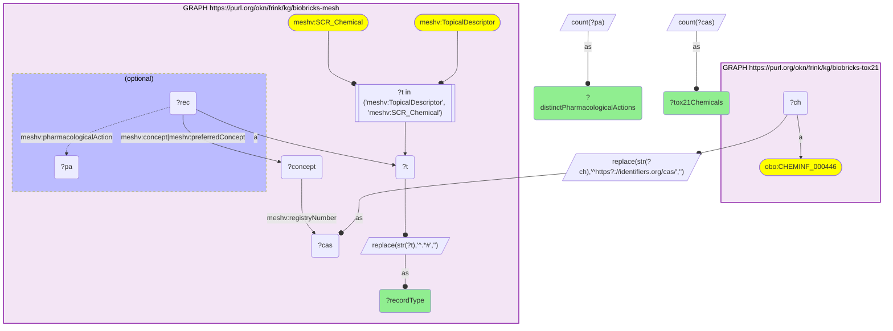
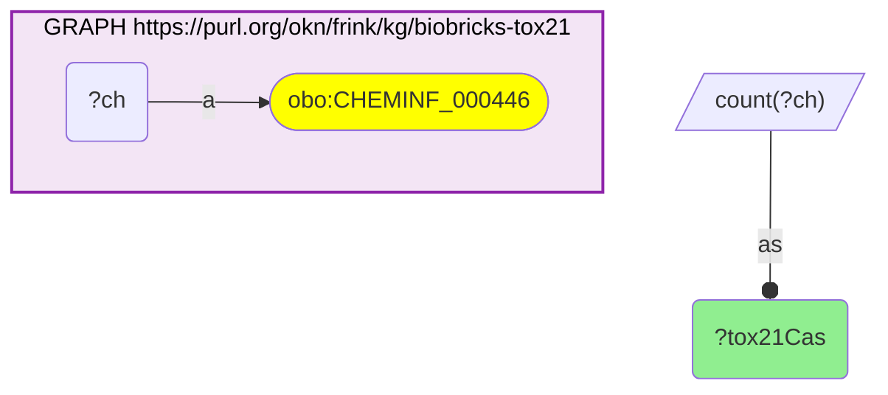

# C29-Q2: biobricks-mesh×biobricks-tox21 — 1,103 of Tox21's 8,947 CAS numbers (12.3%) have a MeSH record, 944 of them through a supplementary chemical record

- **Date:** 2026-10-13
- **Model:** claude-opus-5-5
- **SPARQL endpoint:** https://apps.okn.us/federation/sparql
- **Generated by:** mcp-okn v0.1.0 (build 3195263)
- **Contents:** 3 queries · 3 query diagrams

## Knowledge graphs used

- `biobricks-tox21` — <https://purl.org/okn/frink/kg/biobricks-tox21>
- `biobricks-mesh` — <https://purl.org/okn/frink/kg/biobricks-mesh>

## Conversation

👤 **User**

Same crosswalk, coverage angle: how many Tox21 chemicals have a MeSH record on the CAS number, and is that record a descriptor or a supplementary chemical record?

---

🧠 **Assistant**

**1,103 of Tox21's 8,947 CAS numbers (12.3%) have a MeSH record. Most of them (944) come through a supplementary chemical record rather than a main descriptor (154); some CAS numbers sit on both.**

| Measure | Count |
|---|---|
| Tox21 CAS numbers | 8,947 |
| with a MeSH registry-number match | 1,103 |

| MeSH record type | Tox21 chemicals | Distinct pharmacological actions |
|---|---|---|
| SCR_Chemical (supplementary concept record) | 944 | 130 |
| TopicalDescriptor | 154 | 126 |

**Why the share is low.** MeSH's registry-number field holds a CAS number for only some records; it can hold other registry codes instead. A Tox21 chemical without a CAS match may still be in MeSH under its name.

**This completes the MeSH–Tox CAS trio.** biobricks-mesh already joined ICE and ToxCast on the same key; Tox21 was the missing member.

**Join form.** Bare CAS string (from Tox21's `http://identifiers.org/cas/{CAS}` node) = `meshv:registryNumber` literal on a MeSH concept. No babel hop is needed.

## SPARQL queries executed

#### Query 1

_2026-10-14T06:48:18+00:00 · `biobricks-tox21`, `biobricks-mesh`_

```sparql
PREFIX biolink: <https://w3id.org/biolink/vocab/>
PREFIX rdfs: <http://www.w3.org/2000/01/rdf-schema#>
PREFIX skos: <http://www.w3.org/2004/02/skos/core#>
PREFIX up: <http://purl.uniprot.org/core/>
PREFIX obo: <http://purl.obolibrary.org/obo/>
PREFIX schema: <http://schema.org/>
PREFIX meshv: <http://id.nlm.nih.gov/mesh/vocab#>
SELECT (COUNT(DISTINCT ?cas) AS ?sharedCas) WHERE {
  { SELECT DISTINCT ?ch ?cas WHERE { GRAPH <https://purl.org/okn/frink/kg/biobricks-tox21> { ?ch a obo:CHEMINF_000446 } BIND(REPLACE(STR(?ch),'^https?://identifiers.org/cas/','') AS ?cas) } }
  GRAPH <https://purl.org/okn/frink/kg/biobricks-mesh> { ?concept meshv:registryNumber ?cas }
}
```



_1 row(s)_

| sharedCas |
| --- |
| 1103 |

#### Query 2

_2026-10-14T06:48:19+00:00 · `biobricks-tox21`, `biobricks-mesh`_

```sparql
PREFIX biolink: <https://w3id.org/biolink/vocab/>
PREFIX rdfs: <http://www.w3.org/2000/01/rdf-schema#>
PREFIX skos: <http://www.w3.org/2004/02/skos/core#>
PREFIX up: <http://purl.uniprot.org/core/>
PREFIX obo: <http://purl.obolibrary.org/obo/>
PREFIX schema: <http://schema.org/>
PREFIX meshv: <http://id.nlm.nih.gov/mesh/vocab#>
# Which kind of MeSH record carries the shared CAS numbers.
SELECT ?recordType (COUNT(DISTINCT ?cas) AS ?tox21Chemicals) (COUNT(DISTINCT ?pa) AS ?distinctPharmacologicalActions) WHERE {
  { SELECT DISTINCT ?ch ?cas WHERE { GRAPH <https://purl.org/okn/frink/kg/biobricks-tox21> { ?ch a obo:CHEMINF_000446 } BIND(REPLACE(STR(?ch),'^https?://identifiers.org/cas/','') AS ?cas) } }
  GRAPH <https://purl.org/okn/frink/kg/biobricks-mesh> { ?concept meshv:registryNumber ?cas . ?rec meshv:concept|meshv:preferredConcept ?concept ; a ?t .
    FILTER(?t IN (meshv:TopicalDescriptor, meshv:SCR_Chemical)) BIND(REPLACE(STR(?t),'^.*#','') AS ?recordType)
    OPTIONAL { ?rec meshv:pharmacologicalAction ?pa } }
} GROUP BY ?recordType ORDER BY DESC(?tox21Chemicals)
```



_2 row(s)_

| recordType | tox21Chemicals | distinctPharmacologicalActions |
| --- | --- | --- |
| SCR_Chemical | 944 | 130 |
| TopicalDescriptor | 154 | 126 |

#### Query 3

_2026-10-14T06:48:19+00:00 · `biobricks-tox21`_

```sparql
PREFIX biolink: <https://w3id.org/biolink/vocab/>
PREFIX rdfs: <http://www.w3.org/2000/01/rdf-schema#>
PREFIX skos: <http://www.w3.org/2004/02/skos/core#>
PREFIX up: <http://purl.uniprot.org/core/>
PREFIX obo: <http://purl.obolibrary.org/obo/>
PREFIX schema: <http://schema.org/>
SELECT (COUNT(DISTINCT ?ch) AS ?tox21Cas) WHERE { GRAPH <https://purl.org/okn/frink/kg/biobricks-tox21> { ?ch a obo:CHEMINF_000446 } }
```



_1 row(s)_

| tox21Cas |
| --- |
| 8947 |
