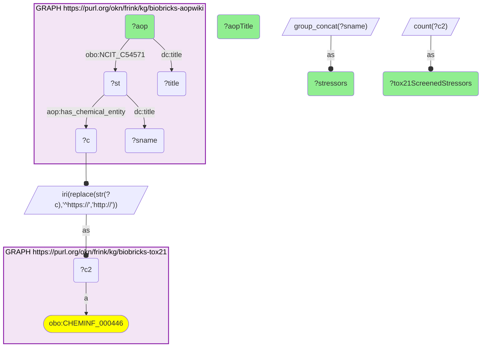

# C30-Q1: biobricks-aopwiki×biobricks-tox21 (CAS) — AOPs ranked by Tox21-screened stressors: COX1 inhibition → renal failure and CYP2E1 activation → neurodegeneration (11 each), PPARα activation (8)

- **Date:** 2026-10-13
- **Model:** claude-opus-5-5
- **SPARQL endpoint:** https://apps.okn.us/federation/sparql
- **Generated by:** mcp-okn v0.1.0 (build 3195263)
- **Contents:** 1 query · 1 query diagram

## Knowledge graphs used

- `biobricks-aopwiki` — <https://purl.org/okn/frink/kg/biobricks-aopwiki>
- `biobricks-tox21` — <https://purl.org/okn/frink/kg/biobricks-tox21>

## Conversation

👤 **User**

Which Adverse Outcome Pathways have the most chemical stressors that were screened in Tox21, joined on the CAS number?

---

🧠 **Assistant**

**Two Adverse Outcome Pathways have the most stressors that Tox21 screened: cyclooxygenase-1 inhibition leading to renal failure (11, mostly NSAIDs) and CYP2E1 activation leading to neurodegeneration (11: volatile anaesthetics, ethanol, acetaminophen, isoniazid and other CYP2E1 substrates). PPARα activation leading to liver tumours in rodents follows with 8 (fibrates, the plasticiser DEHP and other PPARα agonists).**

| AOP | Tox21-screened stressors | Stressors (from the returned list) |
|---|---|---|
| 177 COX1 inhibition → renal failure and mortality | 11 | meloxicam, nimesulide, indomethacin, celecoxib, ibuprofen |
| 260 CYP2E1 activation → neurodegeneration | 11 | ethanol, acetaminophen, isoniazid, halothane, isoflurane |
| 37 PPARα activation → hepatocellular adenomas and carcinomas (rodents) | 8 | DEHP, fenofibrate, clofibrate, bezafibrate |
| 242 Lysyl oxidase inhibition → chronic fish toxicity | 7 | ferbam, disulfiram, mancozeb, thiram, ziram |
| 261 L-type calcium channel blockade → heart failure | 7 | diltiazem, verapamil, nifedipine |
| 10 GABA picrotoxin-site binding → epileptic seizures | 6 | picrotoxin, fipronil, dieldrin, lindane |
| 187 Anticoagulant rodenticides → coagulopathy | 6 | warfarin, diphacinone, chlorophacinone |
| 263 Uncoupling of oxidative phosphorylation → growth inhibition | 6 | triclosan, pentachlorophenol, 2,4-dinitrophenol |

**What the join is for.** AOP-Wiki states the mechanism a chemical triggers; Tox21 says it was in the screening library, where its assay activity can be read. Each row is a set of chemicals with a shared documented mechanism and existing high-throughput data, the starting point for checking whether the assays recapitulate the AOP.

**AOP titles** are AOP-Wiki's own; some name rodent- or fish-specific outcomes, which cell-based Tox21 assays address mainly at the molecular-initiating-event level.

**Join form.** AOP-Wiki stressors point to a CAS hub node `https://identifiers.org/cas/{CAS}` (`aop:has_chemical_entity`); switching the scheme to `http` gives Tox21's CAS node. AOPs reach their stressors through `NCIT_C54571`.

## SPARQL queries executed

#### Query 1

_2026-10-14T06:48:19+00:00 · `biobricks-aopwiki`, `biobricks-tox21`_

```sparql
PREFIX biolink: <https://w3id.org/biolink/vocab/>
PREFIX rdfs: <http://www.w3.org/2000/01/rdf-schema#>
PREFIX skos: <http://www.w3.org/2004/02/skos/core#>
PREFIX up: <http://purl.uniprot.org/core/>
PREFIX obo: <http://purl.obolibrary.org/obo/>
PREFIX schema: <http://schema.org/>
PREFIX aop: <http://aopkb.org/aop_ontology#>
PREFIX dc: <http://purl.org/dc/elements/1.1/>
# Adverse Outcome Pathways ranked by how many of their chemical stressors Tox21 screened.
SELECT ?aop (SAMPLE(?title) AS ?aopTitle) (COUNT(DISTINCT ?c2) AS ?tox21ScreenedStressors)
       (GROUP_CONCAT(DISTINCT ?sname; SEPARATOR="; ") AS ?stressors) WHERE {
  GRAPH <https://purl.org/okn/frink/kg/biobricks-aopwiki> { ?aop obo:NCIT_C54571 ?st ; dc:title ?title . ?st aop:has_chemical_entity ?c ; dc:title ?sname }
  BIND(IRI(REPLACE(STR(?c),'^https://','http://')) AS ?c2)
  GRAPH <https://purl.org/okn/frink/kg/biobricks-tox21> { ?c2 a obo:CHEMINF_000446 }
} GROUP BY ?aop ORDER BY DESC(?tox21ScreenedStressors) ?aop LIMIT 15
```



_15 row(s)_

| aop | aopTitle | tox21ScreenedStressors | stressors |
| --- | --- | --- | --- |
| https://identifiers.org/aop/177 | Cyclooxygenase 1 (COX1) inhibition leading to renal failure and mortality | 11 | Meloxicam; nimesulide; Clofibrate; Indomethacin; flunixin meglumine; Celecoxib; Phenylbutazone; Ibuprofen; Carprofen; Diclofenac sodium; Ketoprofen |
| https://identifiers.org/aop/260 | CYP2E1 activation and formation of protein adducts leading to neurodegeneration | 11 | Chlorzoxazone; Ethanol; Acetaminophen; Isoniazid; Halothane; Methoxyflurane; Isoflurane; Sevoflurane; Enflurane |
| https://identifiers.org/aop/37 | PPARα activation leading to hepatocellular adenomas and carcinomas in rodents | 8 | Bis(2-ethylhexyl) phthalate; Fenofibrate; pirinixic acid; Nafenopin; Clofibrate; ciprofibrate; Bezafibrate; Gemfibrozil |
| https://identifiers.org/aop/242 | Inhibition of lysyl oxidase leading to enhanced chronic fish toxicity | 7 | Ferbam; Disulfiram; Mancozeb; Maneb; Thiram; Ziram; Nabam-sodium |
| https://identifiers.org/aop/261 | L-type calcium channel blockade leading to heart failure via decrease in cardiac contractility | 7 | Diltiazem; Nitrendipine; Nimodipine; Verapamil; Felodipine; Nifedipine; Nisoldipine |
| https://identifiers.org/aop/10 | Binding to the picrotoxin site of ionotropic GABA receptors leading to epileptic seizures in adult brain | 6 | Picrotoxin; Heptachlor; Fipronil; Endosulfan; Dieldrin; Lindane |
| https://identifiers.org/aop/187 | Anticoagulant rodenticide inhibition of vitamin K epoxide reductase resulting coagulopathy and hemorrhage | 6 | coumatetralyl; diphacinone; coumachlor; Warfarin; pindone; chlorophacinone |
| https://identifiers.org/aop/263 | Uncoupling of oxidative phosphorylation leading to  growth inhibition via decreased cell proliferation | 6 | Triclosan; Dinoseb; Pentachlorophenol; 2,4-Dinitrophenol; 3,5-Dichlorophenol; Emodin |
| https://identifiers.org/aop/201 | Juvenile hormone receptor agonism leading to male offspring induction associated population decline | 5 | kinoprene; DIOFENOLAN; pyriproxyfen; (7S)-Hydroprene; fenoxycarb |
| https://identifiers.org/aop/277 | Impaired IL-1R1 signaling leading to Impaired T-Cell Dependent Antibody Response | 5 | minocycline; (-)-Epigallocatechin gallate; Dexamethasone; curcumin; iguratimod |
| https://identifiers.org/aop/38 | Protein Alkylation leading to Liver Fibrosis | 5 | Dimethyl nitrosamine; Thioacetamide; Allyl Alcohol; Carbon tetrachloride; Retinol |
| https://identifiers.org/aop/106 | Chemical binding to tubulin in oocytes leading to aneuploid offspring | 4 | Colchicine; Nocodazole; Vinblastine sulfate; Benomyl |
| https://identifiers.org/aop/152 | Interference with thyroid serum binding protein transthyretin and subsequent adverse human neurodevelopmental toxicity  | 4 | Triclopyr; Clonixin; Tetrabromobisphenol A; 2,2',4,4'-Tetrahydroxybenzophenone |
| https://identifiers.org/aop/154 | Inhibition of Calcineurin Activity Leading to Impaired T-Cell Dependent Antibody Response | 4 | Pimecrolimus; Gossypol; Kaempferol; Tacrolimus (also FK506) |
| https://identifiers.org/aop/175 | Thyroperoxidase inhibition leading to altered amphibian metamorphosis | 4 | Propylthiouracil; Methimazole; 2,2',4,4'-Tetrahydroxybenzophenone; Mercaptobenzothiazole |
