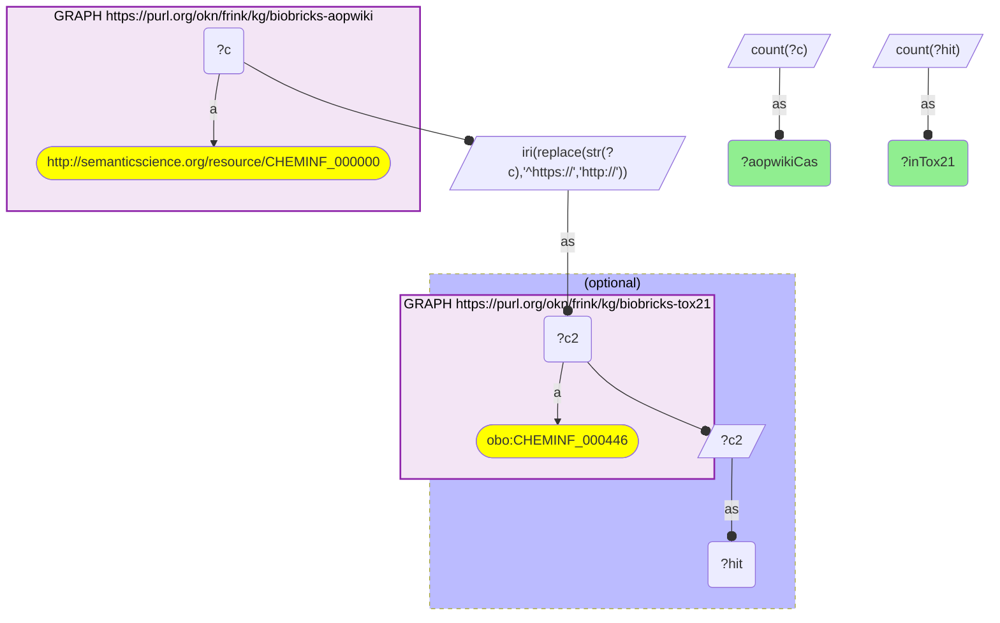
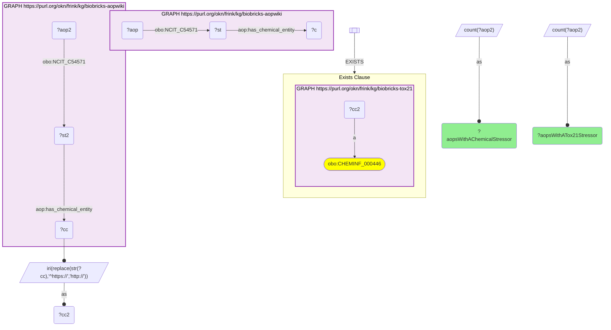

# C30-Q2: biobricks-aopwiki×biobricks-tox21 — 285 of AOP-Wiki's 391 CAS-keyed chemicals (73%) are in Tox21; 98 of 126 AOPs with a chemical stressor have at least one

- **Date:** 2026-10-13
- **Model:** claude-opus-5-5
- **SPARQL endpoint:** https://apps.okn.us/federation/sparql
- **Generated by:** mcp-okn v0.1.0 (build 3195263)
- **Contents:** 2 queries · 2 query diagrams

## Knowledge graphs used

- `biobricks-aopwiki` — <https://purl.org/okn/frink/kg/biobricks-aopwiki>
- `biobricks-tox21` — <https://purl.org/okn/frink/kg/biobricks-tox21>

## Conversation

👤 **User**

Same crosswalk, coverage angle: how many AOP-Wiki chemicals are Tox21 chemicals, and how many AOPs have at least one Tox21-screened stressor?

---

🧠 **Assistant**

**285 of AOP-Wiki's 391 CAS-keyed chemicals (73%) are in Tox21, and 98 of the 126 AOPs that have a chemical stressor (78%) have at least one Tox21-screened stressor.**

| Measure | Count |
|---|---|
| AOP-Wiki chemicals (CAS hub nodes) | 391 |
| in Tox21 | 285 |
| AOPs with a chemical stressor | 126 |
| AOPs with at least one Tox21-screened stressor | 98 |

**This completes the AOP-Wiki–Tox CAS links.** AOP-Wiki already joined ToxCast on the CAS number; Tox21 was missing, although the two share most of their chemicals. For most AOPs with a chemical stressor, some high-throughput screening data now exists one join away.

**Join form.** `https://identifiers.org/cas/{CAS}` (AOP-Wiki) → `http://identifiers.org/cas/{CAS}` (Tox21). Only the scheme changes.

## SPARQL queries executed

#### Query 1

_2026-10-14T06:48:19+00:00 · `biobricks-aopwiki`, `biobricks-tox21`_

```sparql
PREFIX biolink: <https://w3id.org/biolink/vocab/>
PREFIX rdfs: <http://www.w3.org/2000/01/rdf-schema#>
PREFIX skos: <http://www.w3.org/2004/02/skos/core#>
PREFIX up: <http://purl.uniprot.org/core/>
PREFIX obo: <http://purl.obolibrary.org/obo/>
PREFIX schema: <http://schema.org/>
PREFIX aop: <http://aopkb.org/aop_ontology#>
PREFIX dc: <http://purl.org/dc/elements/1.1/>
SELECT (COUNT(DISTINCT ?c) AS ?aopwikiCas) (COUNT(DISTINCT ?hit) AS ?inTox21) WHERE {
  GRAPH <https://purl.org/okn/frink/kg/biobricks-aopwiki> { ?c a <http://semanticscience.org/resource/CHEMINF_000000> }
  BIND(IRI(REPLACE(STR(?c),'^https://','http://')) AS ?c2)
  OPTIONAL { GRAPH <https://purl.org/okn/frink/kg/biobricks-tox21> { ?c2 a obo:CHEMINF_000446 } BIND(?c2 AS ?hit) }
}
```



_1 row(s)_

| aopwikiCas | inTox21 |
| --- | --- |
| 391 | 285 |

#### Query 2

_2026-10-14T06:48:20+00:00 · `biobricks-aopwiki`, `biobricks-tox21`_

```sparql
PREFIX biolink: <https://w3id.org/biolink/vocab/>
PREFIX rdfs: <http://www.w3.org/2000/01/rdf-schema#>
PREFIX skos: <http://www.w3.org/2004/02/skos/core#>
PREFIX up: <http://purl.uniprot.org/core/>
PREFIX obo: <http://purl.obolibrary.org/obo/>
PREFIX schema: <http://schema.org/>
PREFIX aop: <http://aopkb.org/aop_ontology#>
PREFIX dc: <http://purl.org/dc/elements/1.1/>
SELECT ?aopsWithAChemicalStressor ?aopsWithATox21Stressor WHERE {
  { SELECT (COUNT(DISTINCT ?aop) AS ?aopsWithAChemicalStressor) WHERE { GRAPH <https://purl.org/okn/frink/kg/biobricks-aopwiki> { ?aop obo:NCIT_C54571 ?st . ?st aop:has_chemical_entity ?c } } }
  { SELECT (COUNT(DISTINCT ?aop2) AS ?aopsWithATox21Stressor) WHERE { GRAPH <https://purl.org/okn/frink/kg/biobricks-aopwiki> { ?aop2 obo:NCIT_C54571 ?st2 . ?st2 aop:has_chemical_entity ?cc }
      BIND(IRI(REPLACE(STR(?cc),'^https://','http://')) AS ?cc2)
      FILTER EXISTS { GRAPH <https://purl.org/okn/frink/kg/biobricks-tox21> { ?cc2 a obo:CHEMINF_000446 } } } }
}
```



_1 row(s)_

| aopsWithAChemicalStressor | aopsWithATox21Stressor |
| --- | --- |
| 126 | 98 |
