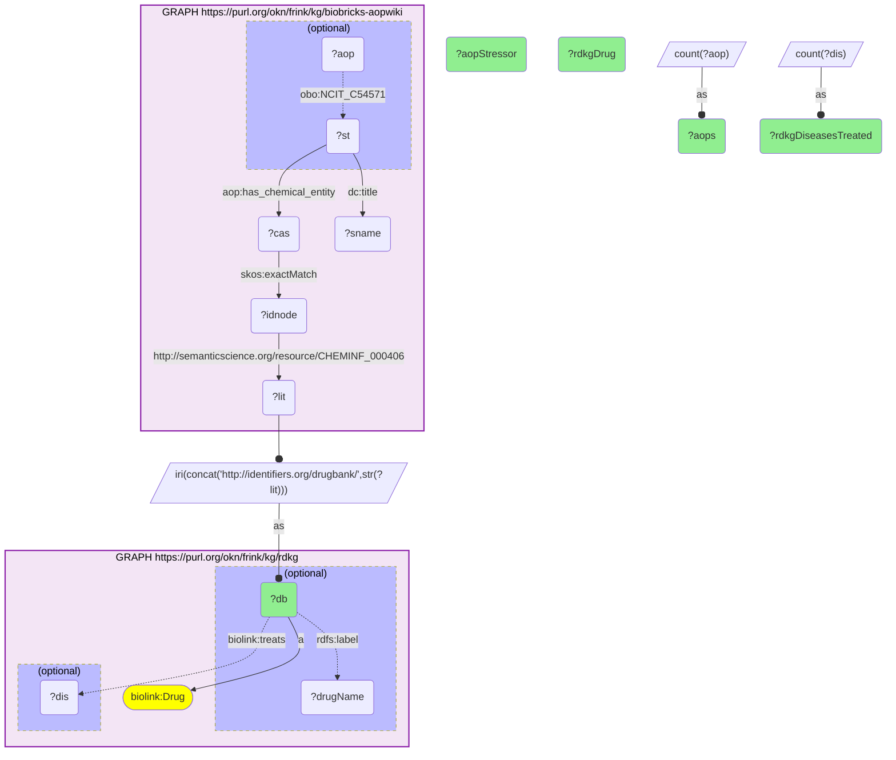

# C31-Q1: biobricks-aopwiki×rdkg (DrugBank) — AOP stressors that are RDKG drugs: azacitidine (8 AOPs, 48 RDKG diseases treated), methimazole and propylthiouracil (5 AOPs each), tamoxifen (3, 43)

- **Date:** 2026-10-13
- **Model:** claude-opus-5-5
- **SPARQL endpoint:** https://apps.okn.us/federation/sparql
- **Generated by:** mcp-okn v0.1.0 (build 3195263)
- **Contents:** 1 query · 1 query diagram

## Knowledge graphs used

- `biobricks-aopwiki` — <https://purl.org/okn/frink/kg/biobricks-aopwiki>
- `rdkg` — <https://purl.org/okn/frink/kg/rdkg>

## Conversation

👤 **User**

Which AOP-Wiki chemical stressors are also drugs in RDKG, joined on the DrugBank id, and how many AOPs and RDKG diseases does each touch?

---

🧠 **Assistant**

**Several AOP-Wiki stressors are drugs RDKG uses for rare diseases. Azacitidine appears as a stressor in 8 AOPs and treats 48 RDKG diseases; methimazole and propylthiouracil each appear in 5 AOPs; tamoxifen in 3 AOPs while treating 43 RDKG diseases.**

| Drug (RDKG) | AOP stressor name | AOPs | RDKG diseases treated |
|---|---|---|---|
| Azacitidine | 5-Azacytidine | 8 | 48 |
| Methimazole | Methimazole | 5 | 7 |
| Propylthiouracil | Propylthiouracil | 5 | 5 |
| Tamoxifen | Tamoxifen | 3 | 43 |
| Ketoconazole | Ketoconazole | 3 | 31 |
| Clofibrate | Clofibrate | 3 | 2 |
| Temozolomide | Temozolomide | 2 | 71 |
| Letrozole | Letrozole | 2 | 52 |
| Decitabine | Decitabine | 2 | 45 |
| Phenobarbital | Phenobarbital | 2 | 24 |

**Two views of the same molecule.** RDKG records what a drug is used to treat; AOP-Wiki records which adverse pathways it is a reference stressor for. Methimazole and propylthiouracil are antithyroid drugs, and AOP-Wiki uses them as model thyroperoxidase inhibitors. Azacitidine and decitabine are DNA-methylation inhibitors used in myeloid cancers; AOP-Wiki lists both as stressors of its mitochondrial ATP-synthase pathways, among others. The join lets a safety question about a rare-disease drug start from the documented mechanisms.

**Join form.** AOP-Wiki stressor → `aop:has_chemical_entity` → CAS hub → `skos:exactMatch` → DrugBank id node, whose `CHEMINF_000406` literal is the bare DrugBank id; rebuild `http://identifiers.org/drugbank/{id}`, RDKG's drug IRI.

## SPARQL queries executed

#### Query 1

_2026-10-14T06:48:20+00:00 · `biobricks-aopwiki`, `rdkg`_

```sparql
PREFIX biolink: <https://w3id.org/biolink/vocab/>
PREFIX rdfs: <http://www.w3.org/2000/01/rdf-schema#>
PREFIX skos: <http://www.w3.org/2004/02/skos/core#>
PREFIX up: <http://purl.uniprot.org/core/>
PREFIX obo: <http://purl.obolibrary.org/obo/>
PREFIX schema: <http://schema.org/>
PREFIX aop: <http://aopkb.org/aop_ontology#>
PREFIX dc: <http://purl.org/dc/elements/1.1/>
# AOP-Wiki chemical stressors that RDKG lists as drugs: stressor -> CAS hub -> DrugBank id-node.
SELECT ?db (SAMPLE(?sname) AS ?aopStressor) (SAMPLE(?drugName) AS ?rdkgDrug) (COUNT(DISTINCT ?aop) AS ?aops) (COUNT(DISTINCT ?dis) AS ?rdkgDiseasesTreated) WHERE {
  GRAPH <https://purl.org/okn/frink/kg/biobricks-aopwiki> { ?st aop:has_chemical_entity ?cas ; dc:title ?sname . ?cas skos:exactMatch ?idnode . ?idnode <http://semanticscience.org/resource/CHEMINF_000406> ?lit .
     OPTIONAL { ?aop obo:NCIT_C54571 ?st } }
  BIND(IRI(CONCAT('http://identifiers.org/drugbank/', STR(?lit))) AS ?db)
  GRAPH <https://purl.org/okn/frink/kg/rdkg> { ?db a biolink:Drug . OPTIONAL { ?db rdfs:label ?drugName } OPTIONAL { ?db biolink:treats ?dis } }
} GROUP BY ?db ORDER BY DESC(?aops) DESC(?rdkgDiseasesTreated) LIMIT 15
```



_15 row(s)_

| db | aopStressor | rdkgDrug | aops | rdkgDiseasesTreated |
| --- | --- | --- | --- | --- |
| http://identifiers.org/drugbank/DB00928 | 5-Azacytidine | Azacitidine | 8 | 48 |
| http://identifiers.org/drugbank/DB00763 | Methimazole | Methimazole | 5 | 7 |
| http://identifiers.org/drugbank/DB00550 | Propylthiouracil | Propylthiouracil | 5 | 5 |
| http://identifiers.org/drugbank/DB00675 | Tamoxifen | Tamoxifen | 3 | 43 |
| http://identifiers.org/drugbank/DB01026 | Ketoconazole | Ketoconazole | 3 | 31 |
| http://identifiers.org/drugbank/DB00636 | Clofibrate | Clofibrate | 3 | 2 |
| http://identifiers.org/drugbank/DB00853 | Temozolomide | Temozolomide | 2 | 71 |
| http://identifiers.org/drugbank/DB01006 | Letrozole | Letrozole | 2 | 52 |
| http://identifiers.org/drugbank/DB01262 | Decitabine | Decitabine | 2 | 45 |
| http://identifiers.org/drugbank/DB01174 | Phenobarbital | Phenobarbital | 2 | 24 |
| http://identifiers.org/drugbank/DB00783 | 17beta-Estradiol | Estradiol | 2 | 16 |
| http://identifiers.org/drugbank/DB01039 | Fenofibrate | Fenofibrate | 2 | 13 |
| http://identifiers.org/drugbank/DB00176 | Fluvoxamine | Fluvoxamine | 2 | 9 |
| http://identifiers.org/drugbank/DB00499 | Flutamide | Flutamide | 2 | 6 |
| http://identifiers.org/drugbank/DB00481 | Raloxifene | Raloxifene | 2 | 6 |
