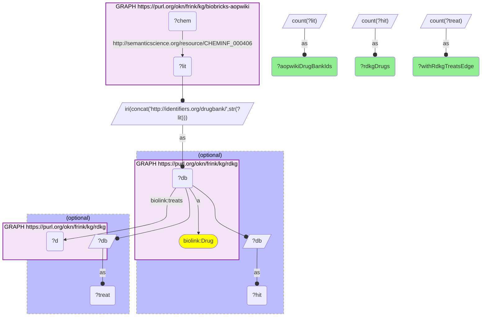

# C31-Q2: biobricks-aopwiki×rdkg — 124 of AOP-Wiki's 210 DrugBank ids are RDKG drugs; 117 of those have an RDKG treats edge

- **Date:** 2026-10-13
- **Model:** claude-opus-5-5
- **SPARQL endpoint:** https://apps.okn.us/federation/sparql
- **Generated by:** mcp-okn v0.1.0 (build 3195263)
- **Contents:** 1 query · 1 query diagram

## Knowledge graphs used

- `biobricks-aopwiki` — <https://purl.org/okn/frink/kg/biobricks-aopwiki>
- `rdkg` — <https://purl.org/okn/frink/kg/rdkg>

## Conversation

👤 **User**

Same crosswalk, coverage angle: how many of AOP-Wiki's DrugBank ids are RDKG drugs, and how many of those does RDKG link to a disease it treats?

---

🧠 **Assistant**

**124 of AOP-Wiki's 210 DrugBank ids are RDKG drugs, and RDKG links 117 of those to at least one disease they treat.**

| Measure | Count |
|---|---|
| AOP-Wiki DrugBank ids | 210 |
| RDKG drugs among them | 124 |
| with an RDKG `treats` edge | 117 |

**What it adds.** AOP-Wiki already joined spoke-okn on DrugBank (DB1); RDKG brings the rare-disease side, so most AOP stressors that are approved drugs can now be read against their therapeutic use.

**Join form.** Bare DrugBank literal (`CHEMINF_000406` on an AOP-Wiki id node) → `http://identifiers.org/drugbank/{id}` = RDKG `biolink:Drug` node. No babel hop.

## SPARQL queries executed

#### Query 1

_2026-10-14T06:48:21+00:00 · `biobricks-aopwiki`, `rdkg`_

```sparql
PREFIX biolink: <https://w3id.org/biolink/vocab/>
PREFIX rdfs: <http://www.w3.org/2000/01/rdf-schema#>
PREFIX skos: <http://www.w3.org/2004/02/skos/core#>
PREFIX up: <http://purl.uniprot.org/core/>
PREFIX obo: <http://purl.obolibrary.org/obo/>
PREFIX schema: <http://schema.org/>
SELECT (COUNT(DISTINCT ?lit) AS ?aopwikiDrugBankIds) (COUNT(DISTINCT ?hit) AS ?rdkgDrugs) (COUNT(DISTINCT ?treat) AS ?withRdkgTreatsEdge) WHERE {
  GRAPH <https://purl.org/okn/frink/kg/biobricks-aopwiki> { ?chem <http://semanticscience.org/resource/CHEMINF_000406> ?lit }
  BIND(IRI(CONCAT('http://identifiers.org/drugbank/', STR(?lit))) AS ?db)
  OPTIONAL { GRAPH <https://purl.org/okn/frink/kg/rdkg> { ?db a biolink:Drug } BIND(?db AS ?hit) }
  OPTIONAL { GRAPH <https://purl.org/okn/frink/kg/rdkg> { ?db biolink:treats ?d } BIND(?db AS ?treat) }
}
```



_1 row(s)_

| aopwikiDrugBankIds | rdkgDrugs | withRdkgTreatsEdge |
| --- | --- | --- |
| 210 | 124 | 117 |
