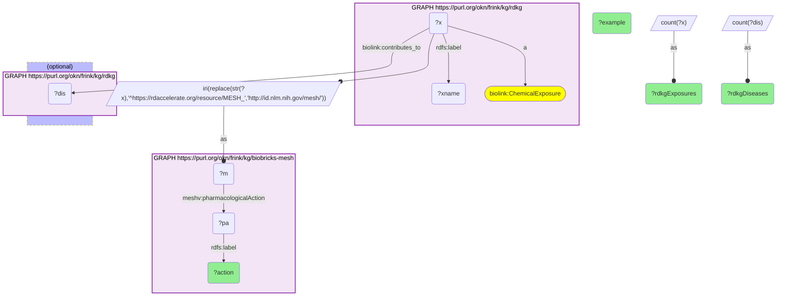

# C32-Q1: biobricks-mesh×rdkg (MeSH) — RDKG chemical exposures by MeSH pharmacological action: insecticides (35 exposures, 58 diseases), herbicides (21, 51), cholinesterase inhibitors (17, 41); air pollutants reach the most diseases (83)

- **Date:** 2026-10-13
- **Model:** claude-opus-5-5
- **SPARQL endpoint:** https://apps.okn.us/federation/sparql
- **Generated by:** mcp-okn v0.1.0 (build 3195263)
- **Contents:** 1 query · 1 query diagram

## Knowledge graphs used

- `rdkg` — <https://purl.org/okn/frink/kg/rdkg>
- `biobricks-mesh` — <https://purl.org/okn/frink/kg/biobricks-mesh>

## Conversation

👤 **User**

RDKG keys its chemical exposures on MeSH ids. Which MeSH pharmacological actions are most common among them, and to how many RDKG diseases do those exposures contribute?

---

🧠 **Assistant**

**RDKG's chemical exposures are mostly agrochemicals and pollutants by MeSH pharmacological action: insecticides (35 exposures, contributing to 58 RDKG diseases), herbicides (21, 51) and cholinesterase inhibitors (17, 41). Air pollutants are fewer (6) but reach the most diseases (83).**

| MeSH pharmacological action | RDKG exposures | RDKG diseases they contribute to | Example |
|---|---|---|---|
| Insecticides | 35 | 58 | 1,3-dichloro-1-propene |
| Herbicides | 21 | 51 | triclopyr |
| Cholinesterase Inhibitors | 17 | 41 | Dichlorvos |
| Trace Elements | 15 | 36 | Boron |
| Carcinogens | 15 | 52 | methyl tert-butyl ether |
| Fungicides, Industrial | 10 | 29 | tetrachloroisophthalonitrile |
| Anti-Bacterial Agents | 8 | 2 | cefuroxime axetil |
| Solvents | 7 | 36 | Chloroform |
| Environmental Pollutants | 7 | 52 | perfluorononanoic acid |
| Air Pollutants | 6 | 83 | methyl tert-butyl ether |

**What the join adds.** RDKG names each exposure and links it to diseases it contributes to, but does not classify the chemical. MeSH supplies the classification, so RDKG's exposure–disease edges can be grouped by chemical class (pesticides versus pollutants versus drugs) without hand-curation.

**Overlaps.** A chemical can carry several actions (methyl tert-butyl ether is both a carcinogen and an air pollutant here), so the rows overlap.

**Join form.** RDKG's exposure IRI `https://rdaccelerate.org/resource/MESH_{id}` holds a MeSH descriptor (`D…`) or supplementary record (`C…`) id; rewriting it to `http://id.nlm.nih.gov/mesh/{id}` gives the biobricks-mesh node.

## SPARQL queries executed

#### Query 1

_2026-10-14T06:48:21+00:00 · `rdkg`, `biobricks-mesh`_

```sparql
PREFIX biolink: <https://w3id.org/biolink/vocab/>
PREFIX rdfs: <http://www.w3.org/2000/01/rdf-schema#>
PREFIX skos: <http://www.w3.org/2004/02/skos/core#>
PREFIX up: <http://purl.uniprot.org/core/>
PREFIX obo: <http://purl.obolibrary.org/obo/>
PREFIX schema: <http://schema.org/>
PREFIX meshv: <http://id.nlm.nih.gov/mesh/vocab#>
# MeSH pharmacological actions of RDKG's chemical exposures, with the number of RDKG diseases
# those exposures contribute to.
SELECT ?action (COUNT(DISTINCT ?x) AS ?rdkgExposures) (COUNT(DISTINCT ?dis) AS ?rdkgDiseases) (SAMPLE(?xname) AS ?example) WHERE {
  GRAPH <https://purl.org/okn/frink/kg/rdkg> { ?x a biolink:ChemicalExposure ; rdfs:label ?xname }
  BIND(IRI(REPLACE(STR(?x),'^https://rdaccelerate.org/resource/MESH_','http://id.nlm.nih.gov/mesh/')) AS ?m)
  GRAPH <https://purl.org/okn/frink/kg/biobricks-mesh> { ?m meshv:pharmacologicalAction ?pa . ?pa rdfs:label ?action }
  OPTIONAL { GRAPH <https://purl.org/okn/frink/kg/rdkg> { ?x biolink:contributes_to ?dis } }
} GROUP BY ?action ORDER BY DESC(?rdkgExposures) LIMIT 15
```



_15 row(s)_

| action | rdkgExposures | rdkgDiseases | example |
| --- | --- | --- | --- |
| Insecticides | 35 | 58 | 1,3-dichloro-1-propene |
| Herbicides | 21 | 51 | triclopyr |
| Cholinesterase Inhibitors | 17 | 41 | Dichlorvos |
| Trace Elements | 15 | 36 | Boron |
| Carcinogens | 15 | 52 | methyl tert-butyl ether |
| Fungicides, Industrial | 10 | 29 | tetrachloroisophthalonitrile |
| Anti-Bacterial Agents | 8 | 2 | cefuroxime axetil |
| Solvents | 7 | 36 | Chloroform |
| Environmental Pollutants | 7 | 52 | perfluorononanoic acid |
| Air Pollutants | 6 | 83 | methyl tert-butyl ether |
| Teratogens | 6 | 29 | bromoform |
| Anthelmintics | 6 | 21 | hexachloroethane |
| Mutagens | 5 | 10 | 1,3-butadiene |
| Enzyme Inhibitors | 5 | 25 | fumonisin B1 |
| Anti-Inflammatory Agents, Non-Steroidal | 4 | 3 | teriflunomide |
