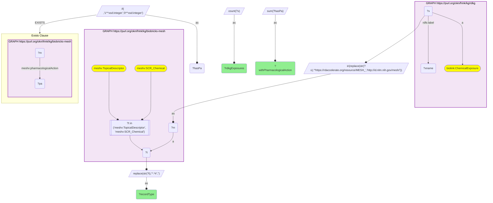

# C32-Q2: biobricks-mesh×rdkg — all 474 RDKG chemical exposures resolve to a MeSH record (297 descriptors, 177 supplementary chemical records); 186 carry a pharmacological action

- **Date:** 2026-10-13
- **Model:** claude-opus-5-5
- **SPARQL endpoint:** https://apps.okn.us/federation/sparql
- **Generated by:** mcp-okn v0.1.0 (build 3195263)
- **Contents:** 1 query · 1 query diagram

## Knowledge graphs used

- `rdkg` — <https://purl.org/okn/frink/kg/rdkg>
- `biobricks-mesh` — <https://purl.org/okn/frink/kg/biobricks-mesh>

## Conversation

👤 **User**

Same crosswalk, coverage angle: how many of RDKG's chemical exposures resolve to a biobricks-mesh record, of which kind, and how many carry a pharmacological action?

---

🧠 **Assistant**

**All 474 of RDKG's chemical exposures resolve to a biobricks-mesh record: 297 to a main descriptor and 177 to a supplementary chemical record. 186 of them carry at least one MeSH pharmacological action.**

| MeSH record type | RDKG exposures | With a pharmacological action |
|---|---|---|
| TopicalDescriptor | 297 | 130 |
| SCR_Chemical | 177 | 56 |

**Why it was missed.** RDKG mints its own IRIs for chemical exposures (`https://rdaccelerate.org/resource/MESH_…`), so the MeSH id is hidden inside a non-MeSH IRI and no shared-IRI scan sees it. One rewrite exposes all 474.

**What MeSH adds beyond classification.** Each record brings MeSH's tree position (via `meshv:treeNumber`), synonyms and, for supplementary records, the descriptor it maps to, so an exposure can be generalised to its chemical class.

**Join form.** `https://rdaccelerate.org/resource/MESH_{id}` → `http://id.nlm.nih.gov/mesh/{id}`.

## SPARQL queries executed

#### Query 1

_2026-10-14T06:48:21+00:00 · `rdkg`, `biobricks-mesh`_

```sparql
PREFIX biolink: <https://w3id.org/biolink/vocab/>
PREFIX rdfs: <http://www.w3.org/2000/01/rdf-schema#>
PREFIX skos: <http://www.w3.org/2004/02/skos/core#>
PREFIX up: <http://purl.uniprot.org/core/>
PREFIX obo: <http://purl.obolibrary.org/obo/>
PREFIX schema: <http://schema.org/>
PREFIX meshv: <http://id.nlm.nih.gov/mesh/vocab#>
SELECT ?recordType (COUNT(?x) AS ?rdkgExposures) (SUM(?hasPa) AS ?withPharmacologicalAction) WHERE {
  { SELECT DISTINCT ?x ?recordType ?hasPa WHERE {
    GRAPH <https://purl.org/okn/frink/kg/rdkg> { ?x a biolink:ChemicalExposure ; rdfs:label ?xname }
  BIND(IRI(REPLACE(STR(?x),'^https://rdaccelerate.org/resource/MESH_','http://id.nlm.nih.gov/mesh/')) AS ?m)
    GRAPH <https://purl.org/okn/frink/kg/biobricks-mesh> { ?m a ?t FILTER(?t IN (meshv:TopicalDescriptor, meshv:SCR_Chemical)) }
    BIND(REPLACE(STR(?t),'^.*#','') AS ?recordType)
    BIND(IF(EXISTS { GRAPH <https://purl.org/okn/frink/kg/biobricks-mesh> { ?m meshv:pharmacologicalAction ?pa } }, 1, 0) AS ?hasPa) } }
} GROUP BY ?recordType
```



_2 row(s)_

| recordType | rdkgExposures | withPharmacologicalAction |
| --- | --- | --- |
| SCR_Chemical | 177 | 56 |
| TopicalDescriptor | 297 | 130 |
