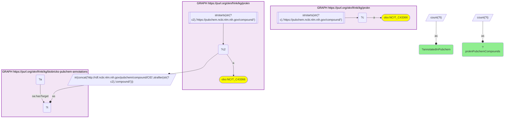
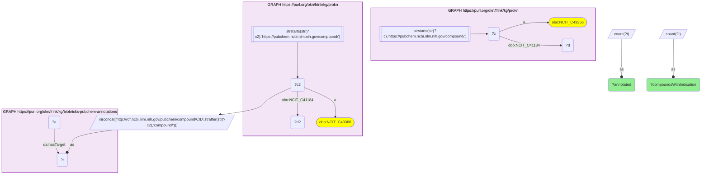

# C33-Q2: prokn×biobricks-pubchem-annotations — 188,837 of ProKN's 327,951 PubChem-keyed compounds (58%) are annotated; 2,001 of the 2,010 with an indication (99.6%)

- **Date:** 2026-10-13
- **Model:** claude-opus-5-5
- **SPARQL endpoint:** https://apps.okn.us/federation/sparql
- **Generated by:** mcp-okn v0.1.0 (build 3195263)
- **Contents:** 2 queries · 2 query diagrams

## Knowledge graphs used

- `prokn` — <https://purl.org/okn/frink/kg/prokn>
- `biobricks-pubchem-annotations` — <https://purl.org/okn/frink/kg/biobricks-pubchem-annotations>

## Conversation

👤 **User**

Same crosswalk, coverage angle: how many of ProKN's PubChem-keyed compounds have PubChem annotations, overall and among compounds with a disease indication?

---

🧠 **Assistant**

**188,837 of ProKN's 327,951 PubChem-keyed compounds (58%) are annotated in biobricks-pubchem-annotations. Among the 2,010 that carry a disease indication, 2,001 are (99.6%).**

| ProKN compounds (PubChem-keyed) | Count |
|---|---|
| all | 327,951 |
| with a PubChem annotation | 188,837 |
| with a disease indication | 2,010 |
| with an indication and a PubChem annotation | 2,001 |

**Coverage depends on the kind of compound.** Across all ProKN compounds 58% are annotated, but among compounds with a disease indication, essentially drugs, 99.6% are. The unannotated compounds lie outside that drug set.

**This is the largest chemical join in the catalog.** It needs no identifier mapping: ProKN keys these compounds on the PubChem CID itself.

**Join form.** `https://pubchem.ncbi.nlm.nih.gov/compound/{cid}` (ProKN) → `http://rdf.ncbi.nlm.nih.gov/pubchem/compound/CID{cid}` (annotation target).

## SPARQL queries executed

#### Query 1

_2026-10-14T06:53:08+00:00 · `prokn`, `biobricks-pubchem-annotations`_

```sparql
PREFIX biolink: <https://w3id.org/biolink/vocab/>
PREFIX rdfs: <http://www.w3.org/2000/01/rdf-schema#>
PREFIX skos: <http://www.w3.org/2004/02/skos/core#>
PREFIX up: <http://purl.uniprot.org/core/>
PREFIX obo: <http://purl.obolibrary.org/obo/>
PREFIX oa: <http://www.w3.org/ns/oa#>
PREFIX coso: <http://w3id.org/coso/v1/contaminoso#>
PREFIX sockg: <https://idir.uta.edu/sockg-ontology#>
PREFIX aop: <http://aopkb.org/aop_ontology#>
PREFIX dc: <http://purl.org/dc/elements/1.1/>
PREFIX meshv: <http://id.nlm.nih.gov/mesh/vocab#>
PREFIX spoke: <https://purl.org/okn/frink/kg/spoke-okn/schema/>
SELECT ?proknPubchemCompounds ?annotatedInPubchem WHERE {
  { SELECT (COUNT(DISTINCT ?c) AS ?proknPubchemCompounds) WHERE { GRAPH <https://purl.org/okn/frink/kg/prokn> { ?c a obo:NCIT_C43366 FILTER(STRSTARTS(STR(?c),'https://pubchem.ncbi.nlm.nih.gov/compound/')) } } }
  { SELECT (COUNT(DISTINCT ?t) AS ?annotatedInPubchem) WHERE {
      { SELECT DISTINCT ?t WHERE { GRAPH <https://purl.org/okn/frink/kg/prokn> { ?c2 a obo:NCIT_C43366 FILTER(STRSTARTS(STR(?c2),'https://pubchem.ncbi.nlm.nih.gov/compound/')) }
          BIND(IRI(CONCAT('http://rdf.ncbi.nlm.nih.gov/pubchem/compound/CID', STRAFTER(STR(?c2),'compound/'))) AS ?t) } }
      GRAPH <https://purl.org/okn/frink/kg/biobricks-pubchem-annotations> { ?a oa:hasTarget ?t } } }
}
```



_1 row(s)_

| proknPubchemCompounds | annotatedInPubchem |
| --- | --- |
| 327951 | 188837 |

#### Query 2

_2026-10-14T06:53:09+00:00 · `prokn`, `biobricks-pubchem-annotations`_

```sparql
PREFIX biolink: <https://w3id.org/biolink/vocab/>
PREFIX rdfs: <http://www.w3.org/2000/01/rdf-schema#>
PREFIX skos: <http://www.w3.org/2004/02/skos/core#>
PREFIX up: <http://purl.uniprot.org/core/>
PREFIX obo: <http://purl.obolibrary.org/obo/>
PREFIX oa: <http://www.w3.org/ns/oa#>
PREFIX coso: <http://w3id.org/coso/v1/contaminoso#>
PREFIX sockg: <https://idir.uta.edu/sockg-ontology#>
PREFIX aop: <http://aopkb.org/aop_ontology#>
PREFIX dc: <http://purl.org/dc/elements/1.1/>
PREFIX meshv: <http://id.nlm.nih.gov/mesh/vocab#>
PREFIX spoke: <https://purl.org/okn/frink/kg/spoke-okn/schema/>
# The same split for ProKN compounds that carry a disease indication.
SELECT ?compoundsWithIndication ?annotated WHERE {
  { SELECT (COUNT(DISTINCT ?c) AS ?compoundsWithIndication) WHERE { GRAPH <https://purl.org/okn/frink/kg/prokn> { ?c a obo:NCIT_C43366 ; obo:NCIT_C41184 ?d FILTER(STRSTARTS(STR(?c),'https://pubchem.ncbi.nlm.nih.gov/compound/')) } } }
  { SELECT (COUNT(DISTINCT ?t) AS ?annotated) WHERE {
      { SELECT DISTINCT ?t WHERE { GRAPH <https://purl.org/okn/frink/kg/prokn> { ?c2 a obo:NCIT_C43366 ; obo:NCIT_C41184 ?d2 FILTER(STRSTARTS(STR(?c2),'https://pubchem.ncbi.nlm.nih.gov/compound/')) }
          BIND(IRI(CONCAT('http://rdf.ncbi.nlm.nih.gov/pubchem/compound/CID', STRAFTER(STR(?c2),'compound/'))) AS ?t) } }
      GRAPH <https://purl.org/okn/frink/kg/biobricks-pubchem-annotations> { ?a oa:hasTarget ?t } } }
}
```



_1 row(s)_

| compoundsWithIndication | annotated |
| --- | --- |
| 2010 | 2001 |
