# C34-Q1: biohealth×prokn (chemicals via Babel) — substances with the most literature 'treats' assertions in BioHealth: ethanol (1,769 conditions), dexamethasone (1,701), cyclophosphamide (1,568); ProKN's curated indications run 0–358

- **Date:** 2026-10-13
- **Model:** claude-opus-5-5
- **SPARQL endpoint:** https://apps.okn.us/federation/sparql
- **Generated by:** mcp-okn v0.1.0 (build 3195263)
- **Contents:** 1 query · 1 query diagram

## Knowledge graphs used

- `biohealth` — <https://purl.org/okn/frink/kg/biohealth>
- `babel` — <https://purl.org/okn/frink/kg/babel>
- `prokn` — <https://purl.org/okn/frink/kg/prokn>

## Conversation

👤 **User**

Which BioHealth substances that reach a ProKN compound through Babel have the most literature 'treats' assertions, and how many indications does ProKN record for them?

---

🧠 **Assistant**

**BioHealth's literature statements and ProKN's curated indications measure different things. The substances BioHealth most often says "treat" something are ethanol (1,769 conditions), dexamethasone (1,701) and cyclophosphamide (1,568); ProKN records 39, 358 and 0 indications for them.**

| BioHealth substance | Conditions it "treats" (BioHealth) | ProKN indications |
|---|---|---|
| Ethanol | 1,769 | 39 |
| Dexamethasone | 1,701 | 358 |
| Cyclophosphamide | 1,568 | 0 |
| Water | 1,544 | 24 |
| Methotrexate | 1,501 | 151 |
| Hydrocortisone | 1,454 | 180 |
| Cyclosporine | 1,438 | 4 |
| Aspirin | 1,433 | 162 |
| Oxygen | 1,418 | 85 |
| prednisolone | 1,329 | 247 |
| Melatonin | 1,302 | 73 |
| Cisplatin | 1,290 | 130 |

**What the literature counts mean.** BioHealth's "treats" statements are extracted from PubMed text, so any substance mentioned as part of a treatment shows up: ethanol, water and oxygen rank high because they appear as vehicles, solvents or supportive care, not as therapies. A large count marks a heavily studied substance, not a validated indication.

**Where ProKN shows 0 or 4.** Cyclophosphamide and cyclosporine reach ProKN through babel, but on records that carry few or no indication edges. ProKN may hold the drug's indications on another record, so treat its count here as a lower bound.

**Join form.** BioHealth node `https://biohealthkg.proto-okn.net/kg/node/{CUI}` (restricted to chemical semantic types) → `http://identifiers.org/umls/{CUI}` → babel clique → ChEMBL / PubChem / DrugCentral / HMDB member → ProKN IRI in that form.

## SPARQL queries executed

#### Query 1

_2026-10-14T06:59:22+00:00 · `biohealth`, `babel`, `prokn`_

```sparql
PREFIX biolink: <https://w3id.org/biolink/vocab/>
PREFIX rdfs: <http://www.w3.org/2000/01/rdf-schema#>
PREFIX rdf: <http://www.w3.org/1999/02/22-rdf-syntax-ns#>
PREFIX obo: <http://purl.obolibrary.org/obo/>
PREFIX spoke: <https://purl.org/okn/frink/kg/spoke-okn/schema/>
# BioHealth substances that reach a ProKN compound through babel, ranked by how many conditions
# BioHealth's literature statements say they treat; ProKN's curated indication count alongside.
SELECT ?ent (SAMPLE(?bl) AS ?substance) ?bhTreated (COUNT(DISTINCT ?ind) AS ?proknIndications) WHERE {
  { SELECT ?ent (COUNT(DISTINCT ?o) AS ?bhTreated) WHERE {
      { SELECT DISTINCT ?ent WHERE { { SELECT DISTINCT ?ent ?member WHERE {
    { SELECT DISTINCT ?ent ?pref WHERE {
        { SELECT DISTINCT ?ent ?src WHERE { GRAPH <https://purl.org/okn/frink/kg/biohealth> { ?ent <https://w3id.org/biolink/vocab/category> ?c } FILTER(REGEX(STR(?c), 'semtype/(.*_)?(orch|phsu|inch|antb|clnd|hops|horm|lipd|strd|carb|nnon|elii|vita|opco|chvs|chvf)(_|$)')) BIND(IRI(CONCAT('http://identifiers.org/umls/', STRAFTER(STR(?ent),'/kg/node/'))) AS ?src) } }
        GRAPH <https://purl.org/okn/frink/kg/babel> { ?src <http://www.w3.org/2004/02/skos/core#exactMatch> ?pref } } }
    GRAPH <https://purl.org/okn/frink/kg/babel> { ?member <http://www.w3.org/2004/02/skos/core#exactMatch> ?pref } } }
        FILTER(REGEX(STR(?member),'^http://(identifiers\\.org/(chembl\\.compound|pubchem\\.compound|hmdb)|drugcentral\\.org/drugcard)/'))
  BIND(IRI(REPLACE(REPLACE(REPLACE(REPLACE(STR(?member),
    '^http://identifiers.org/chembl.compound/','https://www.ebi.ac.uk/chembl/explore/compound/'),
    '^http://identifiers.org/pubchem.compound/','https://pubchem.ncbi.nlm.nih.gov/compound/'),
    '^http://drugcentral.org/drugcard/','https://drugcentral.org/drugcard/'),
    '^http://identifiers.org/hmdb/','https://hmdb.ca/metabolites/')) AS ?cpd)
  GRAPH <https://purl.org/okn/frink/kg/prokn> { ?cpd a ?ptype } } }
      GRAPH <https://purl.org/okn/frink/kg/biohealth> { ?st rdf:subject ?ent ; rdf:predicate biolink:treats ; rdf:object ?o }
  } GROUP BY ?ent ORDER BY DESC(?bhTreated) LIMIT 15 }
  { SELECT DISTINCT ?ent ?cpd WHERE { { SELECT DISTINCT ?ent ?member WHERE {
    { SELECT DISTINCT ?ent ?pref WHERE {
        { SELECT DISTINCT ?ent ?src WHERE { GRAPH <https://purl.org/okn/frink/kg/biohealth> { ?ent <https://w3id.org/biolink/vocab/category> ?c } FILTER(REGEX(STR(?c), 'semtype/(.*_)?(orch|phsu|inch|antb|clnd|hops|horm|lipd|strd|carb|nnon|elii|vita|opco|chvs|chvf)(_|$)')) BIND(IRI(CONCAT('http://identifiers.org/umls/', STRAFTER(STR(?ent),'/kg/node/'))) AS ?src) } }
        GRAPH <https://purl.org/okn/frink/kg/babel> { ?src <http://www.w3.org/2004/02/skos/core#exactMatch> ?pref } } }
    GRAPH <https://purl.org/okn/frink/kg/babel> { ?member <http://www.w3.org/2004/02/skos/core#exactMatch> ?pref } } }
    FILTER(REGEX(STR(?member),'^http://(identifiers\\.org/(chembl\\.compound|pubchem\\.compound|hmdb)|drugcentral\\.org/drugcard)/'))
  BIND(IRI(REPLACE(REPLACE(REPLACE(REPLACE(STR(?member),
    '^http://identifiers.org/chembl.compound/','https://www.ebi.ac.uk/chembl/explore/compound/'),
    '^http://identifiers.org/pubchem.compound/','https://pubchem.ncbi.nlm.nih.gov/compound/'),
    '^http://drugcentral.org/drugcard/','https://drugcentral.org/drugcard/'),
    '^http://identifiers.org/hmdb/','https://hmdb.ca/metabolites/')) AS ?cpd)
  GRAPH <https://purl.org/okn/frink/kg/prokn> { ?cpd a ?ptype } } }
  GRAPH <https://purl.org/okn/frink/kg/biohealth> { OPTIONAL { ?ent rdfs:label ?bl } }
  OPTIONAL { GRAPH <https://purl.org/okn/frink/kg/prokn> { ?cpd obo:NCIT_C41184 ?ind } }
} GROUP BY ?ent ?bhTreated ORDER BY DESC(?bhTreated)
```

```mermaid
graph TD
classDef projected fill:lightgreen;
classDef literal fill:orange;
classDef iri fill:yellow;
  q0v3("?bhTreated"):::projected 
  q0v17("?bl")
  q0v11("?c")
  q0v10("?cpd")
  q0v4("?ent"):::projected 
  q0v18("?ind")
  q0v9("?member")
  q0v16("?o")
  q0v13("?pref")
  q0v1("?proknIndications"):::projected 
  q0v14("?ptype")
  q0v12("?src")
  q0v15("?st")
  q0v2("?substance"):::projected 
  q0f0[["regex(str(?member),'^http://(identifiers\.org/(chembl\.compound|pubchem\.compound|hmdb)|drugcentral\.org/drugcard)/')"]]
  q0f0 --> q0v9
  q0f1[["regex(str(?c),'semtype/(.*_)?(orch|phsu|inch|antb|clnd|hops|horm|lipd|strd|carb|nnon|elii|vita|opco|chvs|chvf)(_|$)')"]]
  q0f1 --> q0v11
  subgraph q0graph0["GRAPH https://purl.org/okn/frink/kg/biohealth"]
    style q0graph0 fill:#f3e5f5,stroke:#8e24aa,stroke-width:2px,color:#000;
    q0v4 --"biolink:category"--> q0v11
  end
  q0bind0[/"iri(concat('http://identifiers.org/umls/',strafter(str(?ent),'/kg/node/')))"/]
  q0v4 --o q0bind0
  q0bind0 --as--o q0v12
  subgraph q0graph1["GRAPH https://purl.org/okn/frink/kg/babel"]
    style q0graph1 fill:#f3e5f5,stroke:#8e24aa,stroke-width:2px,color:#000;
    q0v12 --"skos:exactMatch"--> q0v13
  end
  subgraph q0graph2["GRAPH https://purl.org/okn/frink/kg/babel"]
    style q0graph2 fill:#f3e5f5,stroke:#8e24aa,stroke-width:2px,color:#000;
    q0v9 --"skos:exactMatch"--> q0v13
  end
  q0bind1[/"iri(replace(replace(replace(replace(str(?member),'^http://identifiers.org/chembl.compound/','https://www.ebi.ac.uk/chembl/explore/compound/'),'^http://identifiers.org/pubchem.compound/','https://pubchem.ncbi.nlm.nih.gov/compound/'),'^http://drugcentral.org/drugcard/','https://drugcentral.org/drugcard/'),'^http://identifiers.org/hmdb/','https://hmdb.ca/metabolites/'))"/]
  q0v9 --o q0bind1
  q0bind1 --as--o q0v10
  subgraph q0graph3["GRAPH https://purl.org/okn/frink/kg/prokn"]
    style q0graph3 fill:#f3e5f5,stroke:#8e24aa,stroke-width:2px,color:#000;
    q0v10 --"a"--> q0v14
  end
  subgraph q0graph4["GRAPH https://purl.org/okn/frink/kg/biohealth"]
    style q0graph4 fill:#f3e5f5,stroke:#8e24aa,stroke-width:2px,color:#000;
    q0graph4c2(["biolink:treats"]):::iri 
    q0v15 --"rdf:predicate"--> q0graph4c2
    q0v15 --"rdf:object"--> q0v16
    q0v15 --"rdf:subject"--> q0v4
  end
  q0f2[["regex(str(?member),'^http://(identifiers\.org/(chembl\.compound|pubchem\.compound|hmdb)|drugcentral\.org/drugcard)/')"]]
  q0f2 --> q0v9
  q0f3[["regex(str(?c),'semtype/(.*_)?(orch|phsu|inch|antb|clnd|hops|horm|lipd|strd|carb|nnon|elii|vita|opco|chvs|chvf)(_|$)')"]]
  q0f3 --> q0v11
  subgraph q0graph5["GRAPH https://purl.org/okn/frink/kg/biohealth"]
    style q0graph5 fill:#f3e5f5,stroke:#8e24aa,stroke-width:2px,color:#000;
    q0v4 --"biolink:category"--> q0v11
  end
  q0bind2[/"iri(concat('http://identifiers.org/umls/',strafter(str(?ent),'/kg/node/')))"/]
  q0v4 --o q0bind2
  q0bind2 --as--o q0v12
  subgraph q0graph6["GRAPH https://purl.org/okn/frink/kg/babel"]
    style q0graph6 fill:#f3e5f5,stroke:#8e24aa,stroke-width:2px,color:#000;
    q0v12 --"skos:exactMatch"--> q0v13
  end
  subgraph q0graph7["GRAPH https://purl.org/okn/frink/kg/babel"]
    style q0graph7 fill:#f3e5f5,stroke:#8e24aa,stroke-width:2px,color:#000;
    q0v9 --"skos:exactMatch"--> q0v13
  end
  q0bind3[/"iri(replace(replace(replace(replace(str(?member),'^http://identifiers.org/chembl.compound/','https://www.ebi.ac.uk/chembl/explore/compound/'),'^http://identifiers.org/pubchem.compound/','https://pubchem.ncbi.nlm.nih.gov/compound/'),'^http://drugcentral.org/drugcard/','https://drugcentral.org/drugcard/'),'^http://identifiers.org/hmdb/','https://hmdb.ca/metabolites/'))"/]
  q0v9 --o q0bind3
  q0bind3 --as--o q0v10
  subgraph q0graph8["GRAPH https://purl.org/okn/frink/kg/prokn"]
    style q0graph8 fill:#f3e5f5,stroke:#8e24aa,stroke-width:2px,color:#000;
    q0v10 --"a"--> q0v14
  end
  subgraph q0graph9["GRAPH https://purl.org/okn/frink/kg/biohealth"]
    style q0graph9 fill:#f3e5f5,stroke:#8e24aa,stroke-width:2px,color:#000;
    subgraph q0optionalgraph90["(optional)"]
    style q0optionalgraph90 fill:#bbf,stroke-dasharray: 5 5,color:#000;
      q0v4 -."rdfs:label".-> q0v17
    end
  end
  subgraph q0optional1["(optional)"]
  style q0optional1 fill:#bbf,stroke-dasharray: 5 5,color:#000;
    subgraph q0graph10["GRAPH https://purl.org/okn/frink/kg/prokn"]
      style q0graph10 fill:#f3e5f5,stroke:#8e24aa,stroke-width:2px,color:#000;
      q0v10 --"obo:NCIT_C41184"--> q0v18
    end
  end
```



_15 row(s)_

| ent | substance | bhTreated | proknIndications |
| --- | --- | --- | --- |
| https://biohealthkg.proto-okn.net/kg/node/C0001962 | Ethanol | 1769 | 39 |
| https://biohealthkg.proto-okn.net/kg/node/C0011777 | Dexamethasone | 1701 | 358 |
| https://biohealthkg.proto-okn.net/kg/node/C0010583 | Cyclophosphamide | 1568 | 0 |
| https://biohealthkg.proto-okn.net/kg/node/C0043047 | Water | 1544 | 24 |
| https://biohealthkg.proto-okn.net/kg/node/C0025677 | Methotrexate | 1501 | 151 |
| https://biohealthkg.proto-okn.net/kg/node/C0020268 | Hydrocortisone | 1454 | 180 |
| https://biohealthkg.proto-okn.net/kg/node/C0010592 | Cyclosporine | 1438 | 4 |
| https://biohealthkg.proto-okn.net/kg/node/C0004057 | Aspirin | 1433 | 162 |
| https://biohealthkg.proto-okn.net/kg/node/C0030054 | Oxygen | 1418 | 85 |
| https://biohealthkg.proto-okn.net/kg/node/C0032950 | prednisolone | 1329 | 247 |
| https://biohealthkg.proto-okn.net/kg/node/C0025219 | Melatonin | 1302 | 73 |
| https://biohealthkg.proto-okn.net/kg/node/C0008838 | Cisplatin | 1290 | 130 |
| https://biohealthkg.proto-okn.net/kg/node/C0032952 | Prednisone | 1273 | 253 |
| https://biohealthkg.proto-okn.net/kg/node/C0393022 | rituximab | 1241 | 131 |
| https://biohealthkg.proto-okn.net/kg/node/C0039601 | Testosterone | 1238 | 45 |
