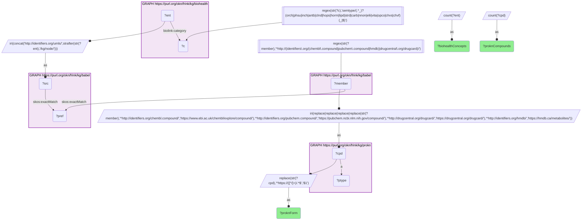
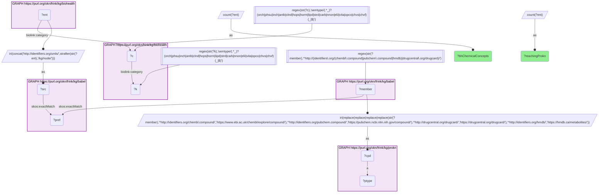

# C34-Q2: biohealth×prokn — 8,488 of BioHealth's 58,135 chemical concepts reach a ProKN compound through Babel (7,062 via a PubChem record, 6,494 via ChEMBL, 2,104 via DrugCentral)

- **Date:** 2026-10-13
- **Model:** claude-opus-5-5
- **SPARQL endpoint:** https://apps.okn.us/federation/sparql
- **Generated by:** mcp-okn v0.1.0 (build 3195263)
- **Contents:** 2 queries · 2 query diagrams

## Knowledge graphs used

- `biohealth` — <https://purl.org/okn/frink/kg/biohealth>
- `babel` — <https://purl.org/okn/frink/kg/babel>
- `prokn` — <https://purl.org/okn/frink/kg/prokn>

## Conversation

👤 **User**

Same crosswalk, coverage angle: how many of BioHealth's chemical concepts reach ProKN through Babel, and through which ProKN identifier form?

---

🧠 **Assistant**

**8,488 of BioHealth's 58,135 chemical concepts reach a ProKN compound through babel. They land on ProKN's PubChem records (7,062 concepts), ChEMBL records (6,494) and DrugCentral drugs (2,104); most land on more than one form.**

| Measure | Count |
|---|---|
| BioHealth concepts with a chemical semantic type | 58,135 |
| reaching a ProKN compound | 8,488 |

| ProKN identifier form | BioHealth concepts | ProKN compounds |
|---|---|---|
| PubChem (`pubchem.ncbi.nlm.nih.gov`) | 7,062 | 6,917 |
| ChEMBL (`www.ebi.ac.uk`) | 6,494 | 6,324 |
| DrugCentral (`drugcentral.org`) | 2,104 | 2,045 |

**Why only 15%.** BioHealth's chemical concepts are UMLS concepts named in the literature, and many are classes, mixtures or preparations rather than single compounds; babel can map only those whose clique holds a compound id ProKN uses.

**Scoping.** BioHealth's concepts carry their UMLS semantic type on `biolink:category`; the source set is restricted to chemical types (organic and inorganic chemicals, pharmacologic substances, antibiotics, hormones, lipids, vitamins and others). Without it, the input (all 250,976 concepts) is too large for the babel lookup.

**Join form.** CUI → `http://identifiers.org/umls/{CUI}` → babel → ProKN compound IRI.

## SPARQL queries executed

#### Query 1

_2026-10-14T06:59:23+00:00 · `biohealth`, `babel`, `prokn`_

```sparql
PREFIX biolink: <https://w3id.org/biolink/vocab/>
PREFIX rdfs: <http://www.w3.org/2000/01/rdf-schema#>
PREFIX rdf: <http://www.w3.org/1999/02/22-rdf-syntax-ns#>
PREFIX obo: <http://purl.obolibrary.org/obo/>
PREFIX spoke: <https://purl.org/okn/frink/kg/spoke-okn/schema/>
SELECT ?proknForm (COUNT(DISTINCT ?ent) AS ?biohealthConcepts) (COUNT(DISTINCT ?cpd) AS ?proknCompounds) WHERE {
  { SELECT DISTINCT ?ent ?member WHERE {
    { SELECT DISTINCT ?ent ?pref WHERE {
        { SELECT DISTINCT ?ent ?src WHERE { GRAPH <https://purl.org/okn/frink/kg/biohealth> { ?ent <https://w3id.org/biolink/vocab/category> ?c } FILTER(REGEX(STR(?c), 'semtype/(.*_)?(orch|phsu|inch|antb|clnd|hops|horm|lipd|strd|carb|nnon|elii|vita|opco|chvs|chvf)(_|$)')) BIND(IRI(CONCAT('http://identifiers.org/umls/', STRAFTER(STR(?ent),'/kg/node/'))) AS ?src) } }
        GRAPH <https://purl.org/okn/frink/kg/babel> { ?src <http://www.w3.org/2004/02/skos/core#exactMatch> ?pref } } }
    GRAPH <https://purl.org/okn/frink/kg/babel> { ?member <http://www.w3.org/2004/02/skos/core#exactMatch> ?pref } } }
  FILTER(REGEX(STR(?member),'^http://(identifiers\\.org/(chembl\\.compound|pubchem\\.compound|hmdb)|drugcentral\\.org/drugcard)/'))
  BIND(IRI(REPLACE(REPLACE(REPLACE(REPLACE(STR(?member),
    '^http://identifiers.org/chembl.compound/','https://www.ebi.ac.uk/chembl/explore/compound/'),
    '^http://identifiers.org/pubchem.compound/','https://pubchem.ncbi.nlm.nih.gov/compound/'),
    '^http://drugcentral.org/drugcard/','https://drugcentral.org/drugcard/'),
    '^http://identifiers.org/hmdb/','https://hmdb.ca/metabolites/')) AS ?cpd)
  GRAPH <https://purl.org/okn/frink/kg/prokn> { ?cpd a ?ptype }
  BIND(REPLACE(STR(?cpd),'^https://([^/]+)/.*$','$1') AS ?proknForm)
} GROUP BY ?proknForm ORDER BY DESC(?biohealthConcepts)
```



_3 row(s)_

| proknForm | biohealthConcepts | proknCompounds |
| --- | --- | --- |
| pubchem.ncbi.nlm.nih.gov | 7062 | 6917 |
| www.ebi.ac.uk | 6494 | 6324 |
| drugcentral.org | 2104 | 2045 |

#### Query 2

_2026-10-14T06:59:23+00:00 · `biohealth`, `babel`, `prokn`_

```sparql
PREFIX biolink: <https://w3id.org/biolink/vocab/>
PREFIX rdfs: <http://www.w3.org/2000/01/rdf-schema#>
PREFIX rdf: <http://www.w3.org/1999/02/22-rdf-syntax-ns#>
PREFIX obo: <http://purl.obolibrary.org/obo/>
PREFIX spoke: <https://purl.org/okn/frink/kg/spoke-okn/schema/>
SELECT ?bhChemicalConcepts ?reachingProkn WHERE {
  { SELECT (COUNT(DISTINCT ?c) AS ?bhChemicalConcepts) WHERE { GRAPH <https://purl.org/okn/frink/kg/biohealth> { ?c biolink:category ?k } FILTER(REGEX(STR(?k), 'semtype/(.*_)?(orch|phsu|inch|antb|clnd|hops|horm|lipd|strd|carb|nnon|elii|vita|opco|chvs|chvf)(_|$)')) } }
  { SELECT (COUNT(DISTINCT ?ent) AS ?reachingProkn) WHERE { { SELECT DISTINCT ?ent ?member WHERE {
    { SELECT DISTINCT ?ent ?pref WHERE {
        { SELECT DISTINCT ?ent ?src WHERE { GRAPH <https://purl.org/okn/frink/kg/biohealth> { ?ent <https://w3id.org/biolink/vocab/category> ?c } FILTER(REGEX(STR(?c), 'semtype/(.*_)?(orch|phsu|inch|antb|clnd|hops|horm|lipd|strd|carb|nnon|elii|vita|opco|chvs|chvf)(_|$)')) BIND(IRI(CONCAT('http://identifiers.org/umls/', STRAFTER(STR(?ent),'/kg/node/'))) AS ?src) } }
        GRAPH <https://purl.org/okn/frink/kg/babel> { ?src <http://www.w3.org/2004/02/skos/core#exactMatch> ?pref } } }
    GRAPH <https://purl.org/okn/frink/kg/babel> { ?member <http://www.w3.org/2004/02/skos/core#exactMatch> ?pref } } }
    FILTER(REGEX(STR(?member),'^http://(identifiers\\.org/(chembl\\.compound|pubchem\\.compound|hmdb)|drugcentral\\.org/drugcard)/'))
  BIND(IRI(REPLACE(REPLACE(REPLACE(REPLACE(STR(?member),
    '^http://identifiers.org/chembl.compound/','https://www.ebi.ac.uk/chembl/explore/compound/'),
    '^http://identifiers.org/pubchem.compound/','https://pubchem.ncbi.nlm.nih.gov/compound/'),
    '^http://drugcentral.org/drugcard/','https://drugcentral.org/drugcard/'),
    '^http://identifiers.org/hmdb/','https://hmdb.ca/metabolites/')) AS ?cpd)
  GRAPH <https://purl.org/okn/frink/kg/prokn> { ?cpd a ?ptype } } }
}
```



_1 row(s)_

| bhChemicalConcepts | reachingProkn |
| --- | --- |
| 58135 | 8488 |
