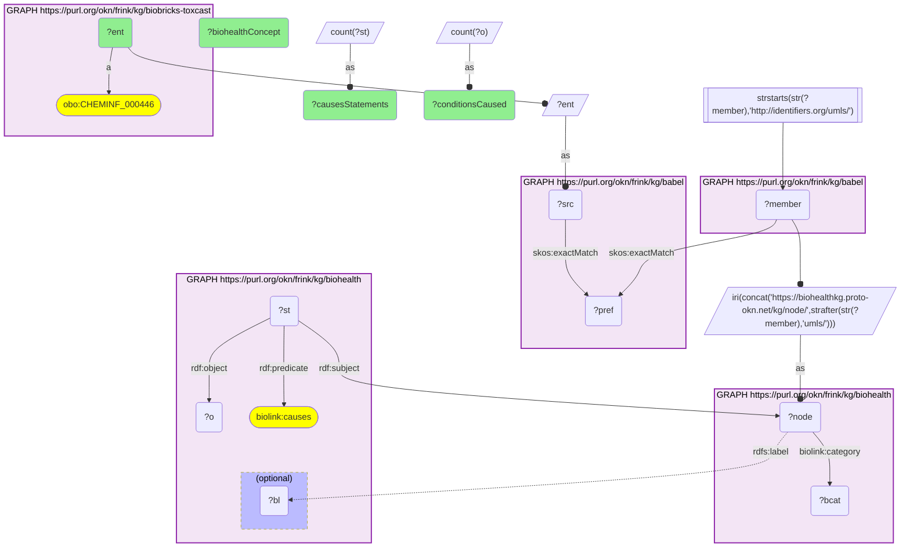

# C35-Q1: biohealth×biobricks-toxcast (CAS→UMLS via Babel) — ToxCast chemicals with the most literature 'causes' assertions in BioHealth: ethanol (1,559 conditions), glucose (746), cisplatin (701), cocaine (596)

- **Date:** 2026-10-13
- **Model:** claude-opus-5-5
- **SPARQL endpoint:** https://apps.okn.us/federation/sparql
- **Generated by:** mcp-okn v0.1.0 (build 3195263)
- **Contents:** 1 query · 1 query diagram

## Knowledge graphs used

- `biobricks-toxcast` — <https://purl.org/okn/frink/kg/biobricks-toxcast>
- `babel` — <https://purl.org/okn/frink/kg/babel>
- `biohealth` — <https://purl.org/okn/frink/kg/biohealth>

## Conversation

👤 **User**

Which ToxCast chemicals, mapped to BioHealth UMLS concepts through Babel, have the most literature assertions that they cause a condition?

---

🧠 **Assistant**

**Mapped to BioHealth through babel, the ToxCast chemicals with the most literature assertions that they cause something are ethanol (1,559 conditions), glucose (746), cisplatin (701) and cocaine (596).**

| CAS | BioHealth concept | Conditions it "causes" |
|---|---|---|
| 64-17-5 | Ethanol | 1,559 |
| 58367-01-4 | Glucose | 746 |
| 15663-27-1 | Cisplatin | 701 |
| 50-36-2 | Cocaine | 596 |
| 59865-13-3 | Cyclosporine | 567 |
| 50-02-2 | Dexamethasone | 556 |
| 50-18-0 | Cyclophosphamide | 549 |
| 59-05-2 | Methotrexate | 509 |
| 51-41-2 | Norepinephrine | 508 |
| 50-78-2 | Aspirin | 483 |

**What the join gives.** ToxCast measures what a chemical does in high-throughput assays; BioHealth collects what the published literature says it causes. Read together, an assay hit can be checked against reported effects. The ranking reflects how much a chemical is studied (drugs and endogenous compounds such as noradrenaline and dopamine lead), not how toxic it is.

**Join form.** ToxCast CAS node `http://identifiers.org/cas/{CAS}` → babel clique → `http://identifiers.org/umls/{CUI}` member → BioHealth node. "Causes" statements are reified (`rdf:predicate biolink:causes`).

## SPARQL queries executed

#### Query 1

_2026-10-14T06:59:24+00:00 · `biobricks-toxcast`, `babel`, `biohealth`_

```sparql
PREFIX biolink: <https://w3id.org/biolink/vocab/>
PREFIX rdfs: <http://www.w3.org/2000/01/rdf-schema#>
PREFIX rdf: <http://www.w3.org/1999/02/22-rdf-syntax-ns#>
PREFIX obo: <http://purl.obolibrary.org/obo/>
PREFIX spoke: <https://purl.org/okn/frink/kg/spoke-okn/schema/>
# ToxCast chemicals (CAS) mapped to BioHealth UMLS concepts through babel, ranked by how many
# conditions BioHealth's literature statements say the chemical causes.
SELECT ?ent (SAMPLE(?bl) AS ?biohealthConcept) (COUNT(DISTINCT ?o) AS ?conditionsCaused) (COUNT(DISTINCT ?st) AS ?causesStatements) WHERE {
  { SELECT DISTINCT ?ent ?node WHERE { { SELECT DISTINCT ?ent ?member WHERE {
    { SELECT DISTINCT ?ent ?pref WHERE {
        { SELECT DISTINCT ?ent ?src WHERE { GRAPH <https://purl.org/okn/frink/kg/biobricks-toxcast> { ?ent a <http://purl.obolibrary.org/obo/CHEMINF_000446> } BIND(?ent AS ?src) } }
        GRAPH <https://purl.org/okn/frink/kg/babel> { ?src <http://www.w3.org/2004/02/skos/core#exactMatch> ?pref } } }
    GRAPH <https://purl.org/okn/frink/kg/babel> { ?member <http://www.w3.org/2004/02/skos/core#exactMatch> ?pref } } }
    FILTER(STRSTARTS(STR(?member),'http://identifiers.org/umls/'))
  BIND(IRI(CONCAT('https://biohealthkg.proto-okn.net/kg/node/', STRAFTER(STR(?member),'umls/'))) AS ?node)
  GRAPH <https://purl.org/okn/frink/kg/biohealth> { ?node <https://w3id.org/biolink/vocab/category> ?bcat } } }
  GRAPH <https://purl.org/okn/frink/kg/biohealth> { ?st rdf:subject ?node ; rdf:predicate biolink:causes ; rdf:object ?o . OPTIONAL { ?node rdfs:label ?bl } }
} GROUP BY ?ent ORDER BY DESC(?conditionsCaused) LIMIT 15
```



_15 row(s)_

| ent | biohealthConcept | conditionsCaused | causesStatements |
| --- | --- | --- | --- |
| http://identifiers.org/cas/64-17-5 | Ethanol | 1559 | 1559 |
| http://identifiers.org/cas/58367-01-4 | Glucose | 746 | 746 |
| http://identifiers.org/cas/15663-27-1 | Cisplatin | 701 | 701 |
| http://identifiers.org/cas/50-36-2 | Cocaine | 596 | 596 |
| http://identifiers.org/cas/59865-13-3 | Cyclosporine | 567 | 567 |
| http://identifiers.org/cas/50-02-2 | Dexamethasone | 556 | 556 |
| http://identifiers.org/cas/50-18-0 | Cyclophosphamide | 549 | 549 |
| http://identifiers.org/cas/59-05-2 | Methotrexate | 509 | 509 |
| http://identifiers.org/cas/51-41-2 | Norepinephrine | 508 | 508 |
| http://identifiers.org/cas/50-78-2 | Aspirin | 483 | 483 |
| http://identifiers.org/cas/54-11-5 | Nicotine | 477 | 477 |
| http://identifiers.org/cas/51-61-6 | Dopamine | 457 | 457 |
| http://identifiers.org/cas/51-43-4 | Epinephrine | 453 | 453 |
| http://identifiers.org/cas/51-45-6 | Histamine | 434 | 434 |
| http://identifiers.org/cas/51-21-8 | Fluorouracil | 422 | 422 |
