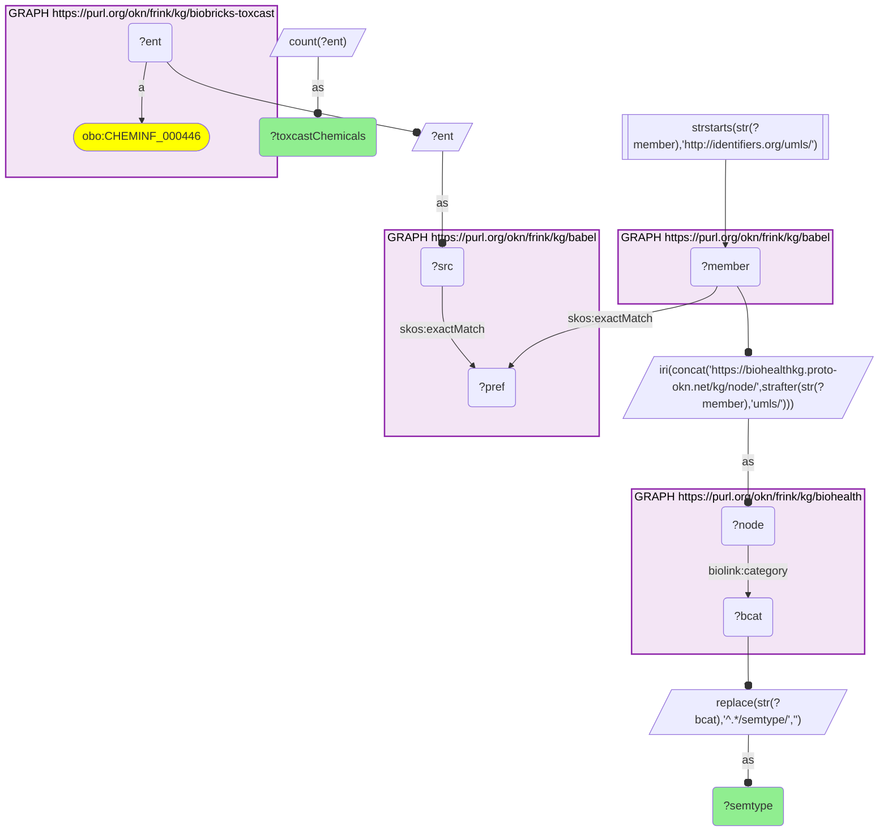
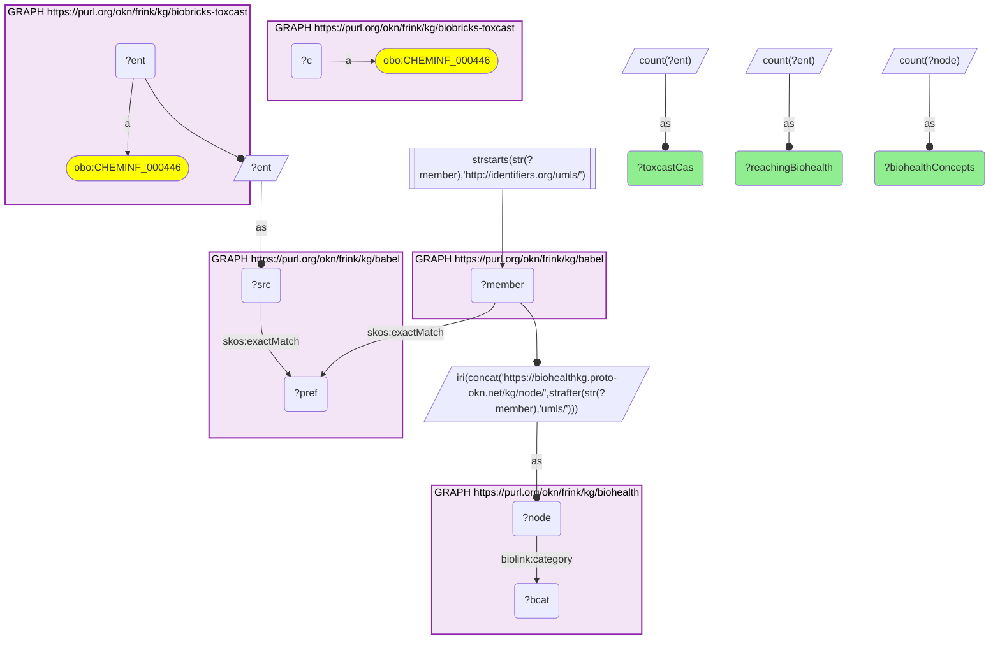

# C35-Q2: biohealth×biobricks-toxcast — 4,400 of ToxCast's 9,542 CAS numbers reach a BioHealth concept, most of them organic chemicals (2,507) and pharmacologic substances (482)

- **Date:** 2026-10-13
- **Model:** claude-opus-5-5
- **SPARQL endpoint:** https://apps.okn.us/federation/sparql
- **Generated by:** mcp-okn v0.1.0 (build 3195263)
- **Contents:** 2 queries · 2 query diagrams

## Knowledge graphs used

- `biobricks-toxcast` — <https://purl.org/okn/frink/kg/biobricks-toxcast>
- `babel` — <https://purl.org/okn/frink/kg/babel>
- `biohealth` — <https://purl.org/okn/frink/kg/biohealth>

## Conversation

👤 **User**

Same crosswalk, coverage angle: how many ToxCast chemicals reach a BioHealth concept through Babel, and of which UMLS semantic type?

---

🧠 **Assistant**

**4,400 of ToxCast's 9,542 CAS numbers reach a BioHealth concept through babel, landing on 4,496 concepts. By UMLS semantic type they are mostly organic chemicals (2,507) and pharmacologic substances (482).**

| Measure | Count |
|---|---|
| ToxCast CAS numbers | 9,542 |
| reaching a BioHealth concept | 4,400 |
| BioHealth concepts reached | 4,496 |

| UMLS semantic type (BioHealth `biolink:category`) | ToxCast chemicals |
|---|---|
| orch (organic chemical) | 2,507 |
| phsu (pharmacologic substance) | 482 |
| hops (hazardous or poisonous substance) | 386 |
| orch_phsu_orch (organic chemical and pharmacologic substance) | 208 |
| orch_phsu_phsu | 104 |
| lipd (lipid) | 87 |
| bacs (biologically active substance) | 81 |

**What it adds.** BioHealth had no chemical-level link to the tox screening graphs; this and the Tox21 crosswalk give it one, so literature-reported effects and screening data meet on the same chemical.

**Join form.** CAS → babel → UMLS → BioHealth node.

## SPARQL queries executed

#### Query 1

_2026-10-14T06:59:24+00:00 · `biobricks-toxcast`, `babel`, `biohealth`_

```sparql
PREFIX biolink: <https://w3id.org/biolink/vocab/>
PREFIX rdfs: <http://www.w3.org/2000/01/rdf-schema#>
PREFIX rdf: <http://www.w3.org/1999/02/22-rdf-syntax-ns#>
PREFIX obo: <http://purl.obolibrary.org/obo/>
PREFIX spoke: <https://purl.org/okn/frink/kg/spoke-okn/schema/>
SELECT ?semtype (COUNT(DISTINCT ?ent) AS ?toxcastChemicals) WHERE {
  { SELECT DISTINCT ?ent ?member WHERE {
    { SELECT DISTINCT ?ent ?pref WHERE {
        { SELECT DISTINCT ?ent ?src WHERE { GRAPH <https://purl.org/okn/frink/kg/biobricks-toxcast> { ?ent a <http://purl.obolibrary.org/obo/CHEMINF_000446> } BIND(?ent AS ?src) } }
        GRAPH <https://purl.org/okn/frink/kg/babel> { ?src <http://www.w3.org/2004/02/skos/core#exactMatch> ?pref } } }
    GRAPH <https://purl.org/okn/frink/kg/babel> { ?member <http://www.w3.org/2004/02/skos/core#exactMatch> ?pref } } }
  FILTER(STRSTARTS(STR(?member),'http://identifiers.org/umls/'))
  BIND(IRI(CONCAT('https://biohealthkg.proto-okn.net/kg/node/', STRAFTER(STR(?member),'umls/'))) AS ?node)
  GRAPH <https://purl.org/okn/frink/kg/biohealth> { ?node <https://w3id.org/biolink/vocab/category> ?bcat }
  BIND(REPLACE(STR(?bcat),'^.*/semtype/','') AS ?semtype)
} GROUP BY ?semtype ORDER BY DESC(?toxcastChemicals) LIMIT 12
```



_12 row(s) — showing first 3_

| semtype | toxcastChemicals |
| --- | --- |
| orch | 2507 |
| phsu | 482 |
| hops | 386 |

#### Query 2

_2026-10-14T06:59:24+00:00 · `biobricks-toxcast`, `babel`, `biohealth`_

```sparql
PREFIX biolink: <https://w3id.org/biolink/vocab/>
PREFIX rdfs: <http://www.w3.org/2000/01/rdf-schema#>
PREFIX rdf: <http://www.w3.org/1999/02/22-rdf-syntax-ns#>
PREFIX obo: <http://purl.obolibrary.org/obo/>
PREFIX spoke: <https://purl.org/okn/frink/kg/spoke-okn/schema/>
SELECT ?toxcastCas ?reachingBiohealth ?biohealthConcepts WHERE {
  { SELECT (COUNT(DISTINCT ?c) AS ?toxcastCas) WHERE { GRAPH <https://purl.org/okn/frink/kg/biobricks-toxcast> { ?c a <http://purl.obolibrary.org/obo/CHEMINF_000446> } } }
  { SELECT (COUNT(DISTINCT ?ent) AS ?reachingBiohealth) (COUNT(DISTINCT ?node) AS ?biohealthConcepts) WHERE { { SELECT DISTINCT ?ent ?member WHERE {
    { SELECT DISTINCT ?ent ?pref WHERE {
        { SELECT DISTINCT ?ent ?src WHERE { GRAPH <https://purl.org/okn/frink/kg/biobricks-toxcast> { ?ent a <http://purl.obolibrary.org/obo/CHEMINF_000446> } BIND(?ent AS ?src) } }
        GRAPH <https://purl.org/okn/frink/kg/babel> { ?src <http://www.w3.org/2004/02/skos/core#exactMatch> ?pref } } }
    GRAPH <https://purl.org/okn/frink/kg/babel> { ?member <http://www.w3.org/2004/02/skos/core#exactMatch> ?pref } } }
    FILTER(STRSTARTS(STR(?member),'http://identifiers.org/umls/'))
  BIND(IRI(CONCAT('https://biohealthkg.proto-okn.net/kg/node/', STRAFTER(STR(?member),'umls/'))) AS ?node)
  GRAPH <https://purl.org/okn/frink/kg/biohealth> { ?node <https://w3id.org/biolink/vocab/category> ?bcat } } }
}
```



_1 row(s)_

| toxcastCas | reachingBiohealth | biohealthConcepts |
| --- | --- | --- |
| 9542 | 4400 | 4496 |
