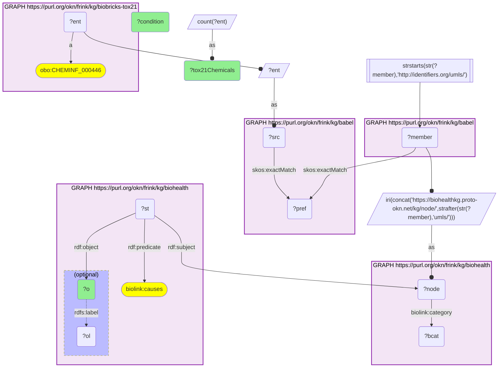

# C36-Q1: biohealth×biobricks-tox21 (CAS→UMLS via Babel) — conditions BioHealth's literature says Tox21 chemicals cause: apoptosis (1,080 chemicals), toxic effect (1,009), oxidative stress (713), hepatotoxicity (464)

- **Date:** 2026-10-13
- **Model:** claude-opus-5-5
- **SPARQL endpoint:** https://apps.okn.us/federation/sparql
- **Generated by:** mcp-okn v0.1.0 (build 3195263)
- **Contents:** 1 query · 1 query diagram

## Knowledge graphs used

- `biobricks-tox21` — <https://purl.org/okn/frink/kg/biobricks-tox21>
- `babel` — <https://purl.org/okn/frink/kg/babel>
- `biohealth` — <https://purl.org/okn/frink/kg/biohealth>

## Conversation

👤 **User**

Which conditions does BioHealth's literature most often say are caused by Tox21 chemicals, mapped through Babel to UMLS?

---

🧠 **Assistant**

**The conditions BioHealth's literature most often says Tox21 chemicals cause are generic cellular and toxic effects: apoptosis (1,080 chemicals), toxic effect (1,009), oxidative stress (713) and cell death (684). Hepatotoxicity (464) is the most frequent organ-specific outcome.**

| BioHealth condition | Tox21 chemicals asserted to cause it |
|---|---|
| Apoptosis | 1,080 |
| Toxic effect | 1,009 |
| Oxidative Stress | 713 |
| Adverse effects | 702 |
| Cell Death | 684 |
| cytotoxicity | 637 |
| DNA Damage | 567 |
| Lesion | 521 |
| Hepatotoxicity | 464 |
| Disease | 404 |
| Falls | 387 |
| Inflammation | 385 |
| Neoplasms | 376 |

**What it shows.** The literature describes chemical effects mostly in mechanistic, cell-level terms, the same terms Tox21's cell-based assays measure (cytotoxicity, oxidative stress, DNA damage). That makes BioHealth a natural cross-check for Tox21 activity calls. Generic concepts such as "Disease", "Lesion" and "Falls" come straight from the text-mined statements and are best filtered out before analysis.

**Join form.** Tox21 CAS node → babel → UMLS → BioHealth node; reified `biolink:causes` statements.

## SPARQL queries executed

#### Query 1

_2026-10-14T06:59:25+00:00 · `biobricks-tox21`, `babel`, `biohealth`_

```sparql
PREFIX biolink: <https://w3id.org/biolink/vocab/>
PREFIX rdfs: <http://www.w3.org/2000/01/rdf-schema#>
PREFIX rdf: <http://www.w3.org/1999/02/22-rdf-syntax-ns#>
PREFIX obo: <http://purl.obolibrary.org/obo/>
PREFIX spoke: <https://purl.org/okn/frink/kg/spoke-okn/schema/>
# Conditions that BioHealth's literature statements say are caused by Tox21 chemicals (CAS mapped
# to UMLS through babel), ranked by the number of distinct Tox21 chemicals.
SELECT ?o (SAMPLE(?ol) AS ?condition) (COUNT(DISTINCT ?ent) AS ?tox21Chemicals) WHERE {
  { SELECT DISTINCT ?ent ?node WHERE { { SELECT DISTINCT ?ent ?member WHERE {
    { SELECT DISTINCT ?ent ?pref WHERE {
        { SELECT DISTINCT ?ent ?src WHERE { GRAPH <https://purl.org/okn/frink/kg/biobricks-tox21> { ?ent a <http://purl.obolibrary.org/obo/CHEMINF_000446> } BIND(?ent AS ?src) } }
        GRAPH <https://purl.org/okn/frink/kg/babel> { ?src <http://www.w3.org/2004/02/skos/core#exactMatch> ?pref } } }
    GRAPH <https://purl.org/okn/frink/kg/babel> { ?member <http://www.w3.org/2004/02/skos/core#exactMatch> ?pref } } }
    FILTER(STRSTARTS(STR(?member),'http://identifiers.org/umls/'))
  BIND(IRI(CONCAT('https://biohealthkg.proto-okn.net/kg/node/', STRAFTER(STR(?member),'umls/'))) AS ?node)
  GRAPH <https://purl.org/okn/frink/kg/biohealth> { ?node <https://w3id.org/biolink/vocab/category> ?bcat } } }
  GRAPH <https://purl.org/okn/frink/kg/biohealth> { ?st rdf:subject ?node ; rdf:predicate biolink:causes ; rdf:object ?o . OPTIONAL { ?o rdfs:label ?ol } }
} GROUP BY ?o ORDER BY DESC(?tox21Chemicals) LIMIT 15
```



_15 row(s)_

| o | condition | tox21Chemicals |
| --- | --- | --- |
| https://biohealthkg.proto-okn.net/kg/node/C0162638 | Apoptosis | 1080 |
| https://biohealthkg.proto-okn.net/kg/node/C0600688 | Toxic effect | 1009 |
| https://biohealthkg.proto-okn.net/kg/node/C0242606 | Oxidative Stress | 713 |
| https://biohealthkg.proto-okn.net/kg/node/C0879626 | Adverse effects | 702 |
| https://biohealthkg.proto-okn.net/kg/node/C0007587 | Cell Death | 684 |
| https://biohealthkg.proto-okn.net/kg/node/C0596402 | cytotoxicity | 637 |
| https://biohealthkg.proto-okn.net/kg/node/C0012860 | DNA Damage | 567 |
| https://biohealthkg.proto-okn.net/kg/node/C0221198 | Lesion | 521 |
| https://biohealthkg.proto-okn.net/kg/node/C0235378 | Hepatotoxicity | 464 |
| https://biohealthkg.proto-okn.net/kg/node/C0012634 | Disease | 404 |
| https://biohealthkg.proto-okn.net/kg/node/C0085639 | Falls | 387 |
| https://biohealthkg.proto-okn.net/kg/node/C0038435 | Stress | 385 |
| https://biohealthkg.proto-okn.net/kg/node/C0021368 | Inflammation | 385 |
| https://biohealthkg.proto-okn.net/kg/node/C1260954 | Morphologically altered structure | 382 |
| https://biohealthkg.proto-okn.net/kg/node/C0027651 | Neoplasms | 376 |
