# C37-Q1: biohealth×rdkg (chemicals via Babel) — RDKG's drugs with the most curated treats edges against BioHealth's literature: dexamethasone 290 vs 1,701, cyclophosphamide 272 vs 1,568, prednisone 229 vs 1,273

- **Date:** 2026-10-13
- **Model:** claude-opus-5-5
- **SPARQL endpoint:** https://apps.okn.us/federation/sparql
- **Generated by:** mcp-okn v0.1.0 (build 3195263)
- **Contents:** 1 query · 1 query diagram

## Knowledge graphs used

- `rdkg` — <https://purl.org/okn/frink/kg/rdkg>
- `babel` — <https://purl.org/okn/frink/kg/babel>
- `biohealth` — <https://purl.org/okn/frink/kg/biohealth>

## Conversation

👤 **User**

For RDKG drugs mapped to BioHealth through Babel, how does the number of diseases RDKG says each treats compare with the conditions BioHealth's literature says it treats?

---

🧠 **Assistant**

**For RDKG's drugs with the most curated treats edges, BioHealth's literature records several times more conditions they "treat": dexamethasone 290 in RDKG against 1,701 in BioHealth, cyclophosphamide 272 against 1,568, prednisone 229 against 1,273.**

| RDKG drug | RDKG diseases treated | BioHealth conditions "treated" |
|---|---|---|
| Dexamethasone | 290 | 1,701 |
| Cyclophosphamide | 272 | 1,568 |
| Prednisone | 229 | 1,273 |
| Carboplatin | 229 | 610 |
| Prednisolone | 220 | 1,329 |
| Methylprednisolone | 195 | 993 |
| Cisplatin | 190 | 1,290 |
| Cortisone acetate | 182 | 49 |
| Paclitaxel | 180 | 835 |
| Etoposide | 161 | 588 |
| Hydrocortisone | 158 | 1,454 |
| Methotrexate | 142 | 1,501 |

**Two kinds of evidence.** RDKG's `treats` edge is curated for rare diseases; BioHealth's is extracted from the literature and includes off-label, experimental and supportive uses. The gap is where repurposing hypotheses live, but each BioHealth assertion needs its source paper before it counts as evidence.

**Cortisone acetate is the exception** (49 in BioHealth), probably because papers name the parent steroid rather than the acetate salt.

**Join form.** RDKG drug `http://identifiers.org/drugbank/{id}` → babel → UMLS → BioHealth node; RDKG's exposures and chemicals (rdaccelerate IRIs) are rewritten to MeSH and CHEBI form first.

## SPARQL queries executed

#### Query 1

_2026-10-14T06:59:26+00:00 · `rdkg`, `babel`, `biohealth`_

```sparql
PREFIX biolink: <https://w3id.org/biolink/vocab/>
PREFIX rdfs: <http://www.w3.org/2000/01/rdf-schema#>
PREFIX rdf: <http://www.w3.org/1999/02/22-rdf-syntax-ns#>
PREFIX obo: <http://purl.obolibrary.org/obo/>
PREFIX spoke: <https://purl.org/okn/frink/kg/spoke-okn/schema/>
# RDKG drugs mapped to BioHealth concepts through babel: conditions BioHealth's literature says each
# treats, against the diseases RDKG's curated treats edge lists.
SELECT ?ent (SAMPLE(?nm) AS ?rdkgDrug) ?rdkgTreats (COUNT(DISTINCT ?o) AS ?biohealthTreats) WHERE {
  { SELECT ?ent (COUNT(DISTINCT ?d) AS ?rdkgTreats) WHERE {
      { SELECT DISTINCT ?ent WHERE { { SELECT DISTINCT ?ent ?member WHERE {
    { SELECT DISTINCT ?ent ?pref WHERE {
        { SELECT DISTINCT ?ent ?src WHERE { { GRAPH <https://purl.org/okn/frink/kg/rdkg> { ?ent a <https://w3id.org/biolink/vocab/Drug> } BIND(?ent AS ?src) } UNION { GRAPH <https://purl.org/okn/frink/kg/rdkg> { ?ent a <https://w3id.org/biolink/vocab/ChemicalEntity> } BIND(IRI(REPLACE(STR(?ent),'^https://rdaccelerate.org/resource/','http://purl.obolibrary.org/obo/')) AS ?src) } UNION { GRAPH <https://purl.org/okn/frink/kg/rdkg> { ?ent a <https://w3id.org/biolink/vocab/ChemicalExposure> } BIND(IRI(REPLACE(STR(?ent),'^https://rdaccelerate.org/resource/MESH_','http://id.nlm.nih.gov/mesh/')) AS ?src) } } }
        GRAPH <https://purl.org/okn/frink/kg/babel> { ?src <http://www.w3.org/2004/02/skos/core#exactMatch> ?pref } } }
    GRAPH <https://purl.org/okn/frink/kg/babel> { ?member <http://www.w3.org/2004/02/skos/core#exactMatch> ?pref } } }
        FILTER(STRSTARTS(STR(?member),'http://identifiers.org/umls/'))
  BIND(IRI(CONCAT('https://biohealthkg.proto-okn.net/kg/node/', STRAFTER(STR(?member),'umls/'))) AS ?node)
  GRAPH <https://purl.org/okn/frink/kg/biohealth> { ?node <https://w3id.org/biolink/vocab/category> ?bcat } } }
      GRAPH <https://purl.org/okn/frink/kg/rdkg> { ?ent a biolink:Drug ; biolink:treats ?d }
  } GROUP BY ?ent ORDER BY DESC(?rdkgTreats) LIMIT 15 }
  { SELECT DISTINCT ?ent ?node WHERE { { SELECT DISTINCT ?ent ?member WHERE {
    { SELECT DISTINCT ?ent ?pref WHERE {
        { SELECT DISTINCT ?ent ?src WHERE { { GRAPH <https://purl.org/okn/frink/kg/rdkg> { ?ent a <https://w3id.org/biolink/vocab/Drug> } BIND(?ent AS ?src) } UNION { GRAPH <https://purl.org/okn/frink/kg/rdkg> { ?ent a <https://w3id.org/biolink/vocab/ChemicalEntity> } BIND(IRI(REPLACE(STR(?ent),'^https://rdaccelerate.org/resource/','http://purl.obolibrary.org/obo/')) AS ?src) } UNION { GRAPH <https://purl.org/okn/frink/kg/rdkg> { ?ent a <https://w3id.org/biolink/vocab/ChemicalExposure> } BIND(IRI(REPLACE(STR(?ent),'^https://rdaccelerate.org/resource/MESH_','http://id.nlm.nih.gov/mesh/')) AS ?src) } } }
        GRAPH <https://purl.org/okn/frink/kg/babel> { ?src <http://www.w3.org/2004/02/skos/core#exactMatch> ?pref } } }
    GRAPH <https://purl.org/okn/frink/kg/babel> { ?member <http://www.w3.org/2004/02/skos/core#exactMatch> ?pref } } }
    FILTER(STRSTARTS(STR(?member),'http://identifiers.org/umls/'))
  BIND(IRI(CONCAT('https://biohealthkg.proto-okn.net/kg/node/', STRAFTER(STR(?member),'umls/'))) AS ?node)
  GRAPH <https://purl.org/okn/frink/kg/biohealth> { ?node <https://w3id.org/biolink/vocab/category> ?bcat } } }
  GRAPH <https://purl.org/okn/frink/kg/rdkg> { OPTIONAL { ?ent rdfs:label ?nm } }
  OPTIONAL { GRAPH <https://purl.org/okn/frink/kg/biohealth> { ?st rdf:subject ?node ; rdf:predicate biolink:treats ; rdf:object ?o } }
} GROUP BY ?ent ?rdkgTreats ORDER BY DESC(?rdkgTreats)
```

```mermaid
graph TD
classDef projected fill:lightgreen;
classDef literal fill:orange;
classDef iri fill:yellow;
  q0v13("?bcat")
  q0v1("?biohealthTreats"):::projected 
  q0v14("?d")
  q0v4("?ent"):::projected 
  q0v9("?member")
  q0v15("?nm")
  q0v10("?node")
  q0v17("?o")
  q0v12("?pref")
  q0v2("?rdkgDrug"):::projected 
  q0v3("?rdkgTreats"):::projected 
  q0v11("?src")
  q0v16("?st")
  q0f0[["strstarts(str(?member),'http://identifiers.org/umls/')"]]
  q0f0 --> q0v9
  subgraph q0union0[" Union "]
  style q0union0 color:#000;
  subgraph q0union0l[" "]
    style q0union0l fill:#abf,stroke-dasharray: 3 3;
    subgraph q0graph0["GRAPH https://purl.org/okn/frink/kg/rdkg"]
      style q0graph0 fill:#f3e5f5,stroke:#8e24aa,stroke-width:2px,color:#000;
      q0graph0c2(["biolink:ChemicalExposure"]):::iri 
      q0v4 --"a"--> q0graph0c2
    end
    q0bind0[/"iri(replace(str(?ent),'^https://rdaccelerate.org/resource/MESH_','http://id.nlm.nih.gov/mesh/'))"/]
    q0v4 --o q0bind0
    q0bind0 --as--o q0v11
  end
    subgraph q0union1[" Union "]
    style q0union1 color:#000;
    subgraph q0union1l[" "]
      style q0union1l fill:#abf,stroke-dasharray: 3 3;
      subgraph q0graph1["GRAPH https://purl.org/okn/frink/kg/rdkg"]
        style q0graph1 fill:#f3e5f5,stroke:#8e24aa,stroke-width:2px,color:#000;
        q0graph1c2(["biolink:ChemicalEntity"]):::iri 
        q0v4 --"a"--> q0graph1c2
      end
      q0bind1[/"iri(replace(str(?ent),'^https://rdaccelerate.org/resource/','http://purl.obolibrary.org/obo/'))"/]
      q0v4 --o q0bind1
      q0bind1 --as--o q0v11
    end
    subgraph q0union1r[" "]
      style q0union1r fill:#abf,stroke-dasharray: 3 3;
      subgraph q0graph2["GRAPH https://purl.org/okn/frink/kg/rdkg"]
        style q0graph2 fill:#f3e5f5,stroke:#8e24aa,stroke-width:2px,color:#000;
        q0graph2c2(["biolink:Drug"]):::iri 
        q0v4 --"a"--> q0graph2c2
      end
      q0bind2[/"?ent"/]
      q0v4 --o q0bind2
      q0bind2 --as--o q0v11
    end
    q0union1r <== or ==> q0union1l
    end
  end
  subgraph q0graph3["GRAPH https://purl.org/okn/frink/kg/babel"]
    style q0graph3 fill:#f3e5f5,stroke:#8e24aa,stroke-width:2px,color:#000;
    q0v11 --"skos:exactMatch"--> q0v12
  end
  subgraph q0graph4["GRAPH https://purl.org/okn/frink/kg/babel"]
    style q0graph4 fill:#f3e5f5,stroke:#8e24aa,stroke-width:2px,color:#000;
    q0v9 --"skos:exactMatch"--> q0v12
  end
  q0bind3[/"iri(concat('https://biohealthkg.proto-okn.net/kg/node/',strafter(str(?member),'umls/')))"/]
  q0v9 --o q0bind3
  q0bind3 --as--o q0v10
  subgraph q0graph5["GRAPH https://purl.org/okn/frink/kg/biohealth"]
    style q0graph5 fill:#f3e5f5,stroke:#8e24aa,stroke-width:2px,color:#000;
    q0v10 --"biolink:category"--> q0v13
  end
  subgraph q0graph6["GRAPH https://purl.org/okn/frink/kg/rdkg"]
    style q0graph6 fill:#f3e5f5,stroke:#8e24aa,stroke-width:2px,color:#000;
    q0graph6c2(["biolink:Drug"]):::iri 
    q0v4 --"a"--> q0graph6c2
    q0v4 --"biolink:treats"--> q0v14
  end
  q0f1[["strstarts(str(?member),'http://identifiers.org/umls/')"]]
  q0f1 --> q0v9
  subgraph q0union2[" Union "]
  style q0union2 color:#000;
  subgraph q0union2l[" "]
    style q0union2l fill:#abf,stroke-dasharray: 3 3;
    subgraph q0graph7["GRAPH https://purl.org/okn/frink/kg/rdkg"]
      style q0graph7 fill:#f3e5f5,stroke:#8e24aa,stroke-width:2px,color:#000;
      q0graph7c2(["biolink:ChemicalExposure"]):::iri 
      q0v4 --"a"--> q0graph7c2
    end
    q0bind4[/"iri(replace(str(?ent),'^https://rdaccelerate.org/resource/MESH_','http://id.nlm.nih.gov/mesh/'))"/]
    q0v4 --o q0bind4
    q0bind4 --as--o q0v11
  end
    subgraph q0union3[" Union "]
    style q0union3 color:#000;
    subgraph q0union3l[" "]
      style q0union3l fill:#abf,stroke-dasharray: 3 3;
      subgraph q0graph8["GRAPH https://purl.org/okn/frink/kg/rdkg"]
        style q0graph8 fill:#f3e5f5,stroke:#8e24aa,stroke-width:2px,color:#000;
        q0graph8c2(["biolink:ChemicalEntity"]):::iri 
        q0v4 --"a"--> q0graph8c2
      end
      q0bind5[/"iri(replace(str(?ent),'^https://rdaccelerate.org/resource/','http://purl.obolibrary.org/obo/'))"/]
      q0v4 --o q0bind5
      q0bind5 --as--o q0v11
    end
    subgraph q0union3r[" "]
      style q0union3r fill:#abf,stroke-dasharray: 3 3;
      subgraph q0graph9["GRAPH https://purl.org/okn/frink/kg/rdkg"]
        style q0graph9 fill:#f3e5f5,stroke:#8e24aa,stroke-width:2px,color:#000;
        q0graph9c2(["biolink:Drug"]):::iri 
        q0v4 --"a"--> q0graph9c2
      end
      q0bind6[/"?ent"/]
      q0v4 --o q0bind6
      q0bind6 --as--o q0v11
    end
    q0union3r <== or ==> q0union3l
    end
  end
  subgraph q0graph10["GRAPH https://purl.org/okn/frink/kg/babel"]
    style q0graph10 fill:#f3e5f5,stroke:#8e24aa,stroke-width:2px,color:#000;
    q0v11 --"skos:exactMatch"--> q0v12
  end
  subgraph q0graph11["GRAPH https://purl.org/okn/frink/kg/babel"]
    style q0graph11 fill:#f3e5f5,stroke:#8e24aa,stroke-width:2px,color:#000;
    q0v9 --"skos:exactMatch"--> q0v12
  end
  q0bind7[/"iri(concat('https://biohealthkg.proto-okn.net/kg/node/',strafter(str(?member),'umls/')))"/]
  q0v9 --o q0bind7
  q0bind7 --as--o q0v10
  subgraph q0graph12["GRAPH https://purl.org/okn/frink/kg/biohealth"]
    style q0graph12 fill:#f3e5f5,stroke:#8e24aa,stroke-width:2px,color:#000;
    q0v10 --"biolink:category"--> q0v13
  end
  subgraph q0graph13["GRAPH https://purl.org/okn/frink/kg/rdkg"]
    style q0graph13 fill:#f3e5f5,stroke:#8e24aa,stroke-width:2px,color:#000;
    subgraph q0optionalgraph130["(optional)"]
    style q0optionalgraph130 fill:#bbf,stroke-dasharray: 5 5,color:#000;
      q0v4 -."rdfs:label".-> q0v15
    end
  end
  subgraph q0optional1["(optional)"]
  style q0optional1 fill:#bbf,stroke-dasharray: 5 5,color:#000;
    subgraph q0graph14["GRAPH https://purl.org/okn/frink/kg/biohealth"]
      style q0graph14 fill:#f3e5f5,stroke:#8e24aa,stroke-width:2px,color:#000;
      q0graph14c2(["biolink:treats"]):::iri 
      q0v16 --"rdf:predicate"--> q0graph14c2
      q0v16 --"rdf:object"--> q0v17
      q0v16 --"rdf:subject"--> q0v10
    end
  end
```



_15 row(s)_

| ent | rdkgDrug | rdkgTreats | biohealthTreats |
| --- | --- | --- | --- |
| http://identifiers.org/drugbank/DB01234 | Dexamethasone | 290 | 1701 |
| http://identifiers.org/drugbank/DB00531 | Cyclophosphamide | 272 | 1568 |
| http://identifiers.org/drugbank/DB00635 | Prednisone | 229 | 1273 |
| http://identifiers.org/drugbank/DB00958 | Carboplatin | 229 | 610 |
| http://identifiers.org/drugbank/DB00860 | Prednisolone | 220 | 1329 |
| http://identifiers.org/drugbank/DB00959 | Methylprednisolone | 195 | 993 |
| http://identifiers.org/drugbank/DB00515 | Cisplatin | 190 | 1290 |
| http://identifiers.org/drugbank/DB01380 | Cortisone acetate | 182 | 49 |
| http://identifiers.org/drugbank/DB01229 | Paclitaxel | 180 | 835 |
| http://identifiers.org/drugbank/DB00620 | Triamcinolone | 162 | 325 |
| http://identifiers.org/drugbank/DB00773 | Etoposide | 161 | 588 |
| http://identifiers.org/drugbank/DB00741 | Hydrocortisone | 158 | 1454 |
| http://identifiers.org/drugbank/DB00443 | Betamethasone | 154 | 298 |
| http://identifiers.org/drugbank/DB00997 | Doxorubicin | 151 | 754 |
| http://identifiers.org/drugbank/DB00563 | Methotrexate | 142 | 1501 |
