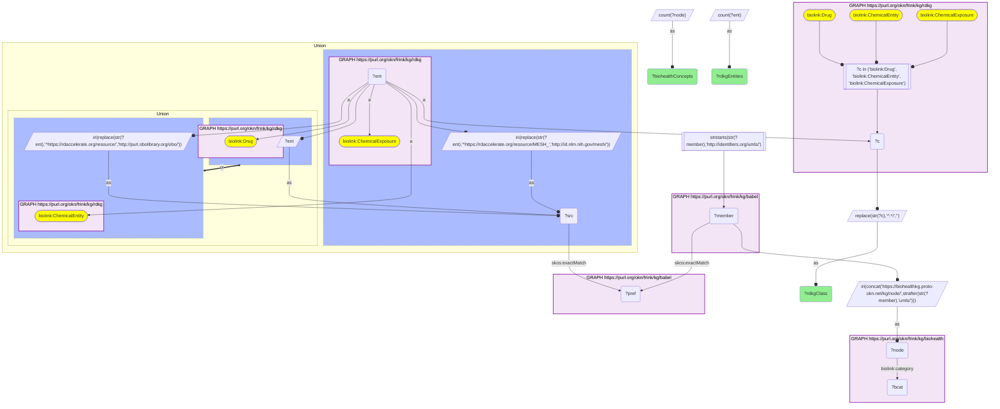
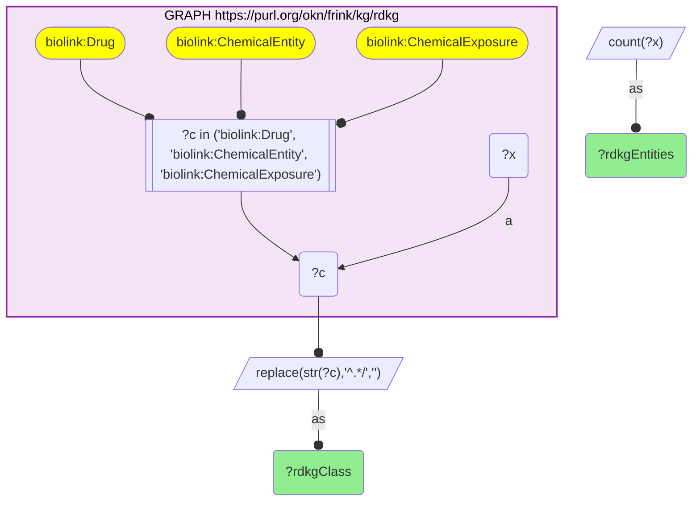
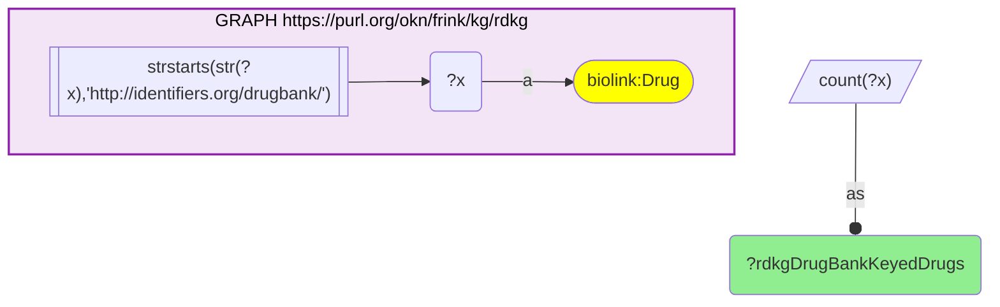

# C37-Q2: biohealth×rdkg — 2,387 RDKG chemical entities reach a BioHealth concept: 2,011 drugs, 362 of 474 chemical exposures and 14 of 21 chemicals

- **Date:** 2026-10-13
- **Model:** claude-opus-5-5
- **SPARQL endpoint:** https://apps.okn.us/federation/sparql
- **Generated by:** mcp-okn v0.1.0 (build 3195263)
- **Contents:** 3 queries · 3 query diagrams

## Knowledge graphs used

- `rdkg` — <https://purl.org/okn/frink/kg/rdkg>
- `babel` — <https://purl.org/okn/frink/kg/babel>
- `biohealth` — <https://purl.org/okn/frink/kg/biohealth>

## Conversation

👤 **User**

Same crosswalk, coverage angle: how many of RDKG's drugs, chemical exposures and chemicals reach a BioHealth concept through Babel?

---

🧠 **Assistant**

**2,387 RDKG chemical entities reach a BioHealth concept through babel: 2,011 drugs, 362 of the 474 chemical exposures and 14 of the 21 chemicals.**

| RDKG class | Reaching BioHealth | BioHealth concepts | All in RDKG |
|---|---|---|---|
| Drug | 2,011 | 2,309 | 16,875 |
| ChemicalExposure | 362 | 383 | 474 |
| ChemicalEntity | 14 | 18 | 21 |

**Why only 2,011 of 16,875 drugs.** Only 2,074 of RDKG's drug nodes are DrugBank-keyed (the last query), and babel can start only from an id it knows. Nearly all of those reach BioHealth.

**Exposures map well.** RDKG keys exposures on MeSH ids, and MeSH sits in the same babel cliques as UMLS, so 76% of exposures reach a BioHealth concept, connecting RDKG's exposure–disease edges to the literature's statements about the same chemical.

**Join form.** DrugBank IRI, or rdaccelerate CHEBI/MeSH IRI rewritten to the OBO / MeSH form → babel → UMLS → BioHealth node.

## SPARQL queries executed

#### Query 1

_2026-10-14T06:59:26+00:00 · `rdkg`, `babel`, `biohealth`_

```sparql
PREFIX biolink: <https://w3id.org/biolink/vocab/>
PREFIX rdfs: <http://www.w3.org/2000/01/rdf-schema#>
PREFIX rdf: <http://www.w3.org/1999/02/22-rdf-syntax-ns#>
PREFIX obo: <http://purl.obolibrary.org/obo/>
PREFIX spoke: <https://purl.org/okn/frink/kg/spoke-okn/schema/>
SELECT ?rdkgClass (COUNT(DISTINCT ?ent) AS ?rdkgEntities) (COUNT(DISTINCT ?node) AS ?biohealthConcepts) WHERE {
  { SELECT DISTINCT ?ent ?member WHERE {
    { SELECT DISTINCT ?ent ?pref WHERE {
        { SELECT DISTINCT ?ent ?src WHERE { { GRAPH <https://purl.org/okn/frink/kg/rdkg> { ?ent a <https://w3id.org/biolink/vocab/Drug> } BIND(?ent AS ?src) } UNION { GRAPH <https://purl.org/okn/frink/kg/rdkg> { ?ent a <https://w3id.org/biolink/vocab/ChemicalEntity> } BIND(IRI(REPLACE(STR(?ent),'^https://rdaccelerate.org/resource/','http://purl.obolibrary.org/obo/')) AS ?src) } UNION { GRAPH <https://purl.org/okn/frink/kg/rdkg> { ?ent a <https://w3id.org/biolink/vocab/ChemicalExposure> } BIND(IRI(REPLACE(STR(?ent),'^https://rdaccelerate.org/resource/MESH_','http://id.nlm.nih.gov/mesh/')) AS ?src) } } }
        GRAPH <https://purl.org/okn/frink/kg/babel> { ?src <http://www.w3.org/2004/02/skos/core#exactMatch> ?pref } } }
    GRAPH <https://purl.org/okn/frink/kg/babel> { ?member <http://www.w3.org/2004/02/skos/core#exactMatch> ?pref } } }
  FILTER(STRSTARTS(STR(?member),'http://identifiers.org/umls/'))
  BIND(IRI(CONCAT('https://biohealthkg.proto-okn.net/kg/node/', STRAFTER(STR(?member),'umls/'))) AS ?node)
  GRAPH <https://purl.org/okn/frink/kg/biohealth> { ?node <https://w3id.org/biolink/vocab/category> ?bcat }
  GRAPH <https://purl.org/okn/frink/kg/rdkg> { ?ent a ?c FILTER(?c IN (biolink:Drug, biolink:ChemicalEntity, biolink:ChemicalExposure)) }
  BIND(REPLACE(STR(?c),'^.*/','') AS ?rdkgClass)
} GROUP BY ?rdkgClass ORDER BY DESC(?rdkgEntities)
```



_3 row(s)_

| rdkgClass | rdkgEntities | biohealthConcepts |
| --- | --- | --- |
| Drug | 2011 | 2309 |
| ChemicalExposure | 362 | 383 |
| ChemicalEntity | 14 | 18 |

#### Query 2

_2026-10-14T06:59:27+00:00 · `rdkg`_

```sparql
PREFIX biolink: <https://w3id.org/biolink/vocab/>
PREFIX rdfs: <http://www.w3.org/2000/01/rdf-schema#>
PREFIX rdf: <http://www.w3.org/1999/02/22-rdf-syntax-ns#>
PREFIX obo: <http://purl.obolibrary.org/obo/>
PREFIX spoke: <https://purl.org/okn/frink/kg/spoke-okn/schema/>
SELECT ?rdkgClass (COUNT(DISTINCT ?x) AS ?rdkgEntities) WHERE {
  GRAPH <https://purl.org/okn/frink/kg/rdkg> { ?x a ?c FILTER(?c IN (biolink:Drug, biolink:ChemicalEntity, biolink:ChemicalExposure)) }
  BIND(REPLACE(STR(?c),'^.*/','') AS ?rdkgClass)
} GROUP BY ?rdkgClass
```



_3 row(s)_

| rdkgClass | rdkgEntities |
| --- | --- |
| ChemicalEntity | 21 |
| ChemicalExposure | 474 |
| Drug | 16875 |

#### Query 3

_2026-10-14T06:59:27+00:00 · `rdkg`_

```sparql
PREFIX biolink: <https://w3id.org/biolink/vocab/>
PREFIX rdfs: <http://www.w3.org/2000/01/rdf-schema#>
PREFIX rdf: <http://www.w3.org/1999/02/22-rdf-syntax-ns#>
PREFIX obo: <http://purl.obolibrary.org/obo/>
PREFIX spoke: <https://purl.org/okn/frink/kg/spoke-okn/schema/>
SELECT (COUNT(DISTINCT ?x) AS ?rdkgDrugBankKeyedDrugs) WHERE { GRAPH <https://purl.org/okn/frink/kg/rdkg> { ?x a biolink:Drug FILTER(STRSTARTS(STR(?x),'http://identifiers.org/drugbank/')) } }
```



_1 row(s)_

| rdkgDrugBankKeyedDrugs |
| --- |
| 2074 |
