# C38-Q1: biohealth×spoke-okn (chemicals via Babel) — SPOKE-OKN treating compounds against BioHealth's literature: fluorouracil 28 SPOKE diseases vs 1,003 BioHealth conditions; carbonic acid 22 vs 0

- **Date:** 2026-10-13
- **Model:** claude-opus-5-5
- **SPARQL endpoint:** https://apps.okn.us/federation/sparql
- **Generated by:** mcp-okn v0.1.0 (build 3195263)
- **Contents:** 1 query · 1 query diagram

## Knowledge graphs used

- `spoke-okn` — <https://purl.org/okn/frink/kg/spoke-okn>
- `babel` — <https://purl.org/okn/frink/kg/babel>
- `biohealth` — <https://purl.org/okn/frink/kg/biohealth>

## Conversation

👤 **User**

For SPOKE-OKN compounds with a TREATS edge, mapped to BioHealth through Babel, how do SPOKE's treated diseases compare with BioHealth's literature 'treats' assertions?

---

🧠 **Assistant**

**For SPOKE-OKN compounds with a TREATS edge, BioHealth's literature usually records many more uses: fluorouracil treats 28 SPOKE diseases and 1,003 BioHealth conditions. Some SPOKE treating compounds have no BioHealth treatment assertion at all (carbonic acid, 22 SPOKE diseases, 0).**

| SPOKE-OKN compound | SPOKE diseases treated | BioHealth conditions "treated" |
|---|---|---|
| Fluorouracil | 28 | 1,003 |
| Carbonic Acid | 22 | 0 |
| Calcium | 15 | 496 |
| 2-Methylpyridine | 7 | 0 |
| Iodine | 7 | 395 |
| Copper | 7 | 757 |
| Phenytoin | 6 | 546 |
| Methane | 6 | 58 |
| Ethanol | 4 | 1,769 |
| Nitroglycerin | 4 | 449 |

**What the zeros mean.** Carbonic acid and 2-methylpyridine reach a BioHealth concept, but no literature statement in BioHealth says that concept treats anything; SPOKE's TREATS edges for them come from its own sources. The comparison flags where a SPOKE edge has no literature support in BioHealth, and where the literature reports far more than SPOKE curates.

**Join form.** SPOKE-OKN compound node (InChIKey IRI rewritten to `http://identifiers.org/inchikey/{key}`, or a CHEBI IRI) → babel → UMLS → BioHealth node.

## SPARQL queries executed

#### Query 1

_2026-10-14T06:59:27+00:00 · `spoke-okn`, `babel`, `biohealth`_

```sparql
PREFIX biolink: <https://w3id.org/biolink/vocab/>
PREFIX rdfs: <http://www.w3.org/2000/01/rdf-schema#>
PREFIX rdf: <http://www.w3.org/1999/02/22-rdf-syntax-ns#>
PREFIX obo: <http://purl.obolibrary.org/obo/>
PREFIX spoke: <https://purl.org/okn/frink/kg/spoke-okn/schema/>
# SPOKE-OKN compounds with a TREATS edge, mapped to BioHealth through babel: SPOKE's curated
# treated diseases against BioHealth's literature 'treats' statements.
SELECT ?ent (SAMPLE(?nm) AS ?spokeCompound) ?spokeTreats (COUNT(DISTINCT ?o) AS ?biohealthTreats) WHERE {
  { SELECT ?ent (COUNT(DISTINCT ?dz) AS ?spokeTreats) WHERE {
      { SELECT DISTINCT ?ent WHERE { { SELECT DISTINCT ?ent ?member WHERE {
    { SELECT DISTINCT ?ent ?pref WHERE {
        { SELECT DISTINCT ?ent ?src WHERE { GRAPH <https://purl.org/okn/frink/kg/spoke-okn> { ?ent a <https://w3id.org/biolink/vocab/ChemicalEntity> } BIND(IRI(REPLACE(STR(?ent),'^http://rdf.ncbi.nlm.nih.gov/pubchem/inchikey/','http://identifiers.org/inchikey/')) AS ?src) } }
        GRAPH <https://purl.org/okn/frink/kg/babel> { ?src <http://www.w3.org/2004/02/skos/core#exactMatch> ?pref } } }
    GRAPH <https://purl.org/okn/frink/kg/babel> { ?member <http://www.w3.org/2004/02/skos/core#exactMatch> ?pref } } }
        FILTER(STRSTARTS(STR(?member),'http://identifiers.org/umls/'))
  BIND(IRI(CONCAT('https://biohealthkg.proto-okn.net/kg/node/', STRAFTER(STR(?member),'umls/'))) AS ?node)
  GRAPH <https://purl.org/okn/frink/kg/biohealth> { ?node <https://w3id.org/biolink/vocab/category> ?bcat } } }
      GRAPH <https://purl.org/okn/frink/kg/spoke-okn> { ?ent spoke:TREATS_CtD ?dz }
  } GROUP BY ?ent ORDER BY DESC(?spokeTreats) LIMIT 15 }
  { SELECT DISTINCT ?ent ?node WHERE { { SELECT DISTINCT ?ent ?member WHERE {
    { SELECT DISTINCT ?ent ?pref WHERE {
        { SELECT DISTINCT ?ent ?src WHERE { GRAPH <https://purl.org/okn/frink/kg/spoke-okn> { ?ent a <https://w3id.org/biolink/vocab/ChemicalEntity> } BIND(IRI(REPLACE(STR(?ent),'^http://rdf.ncbi.nlm.nih.gov/pubchem/inchikey/','http://identifiers.org/inchikey/')) AS ?src) } }
        GRAPH <https://purl.org/okn/frink/kg/babel> { ?src <http://www.w3.org/2004/02/skos/core#exactMatch> ?pref } } }
    GRAPH <https://purl.org/okn/frink/kg/babel> { ?member <http://www.w3.org/2004/02/skos/core#exactMatch> ?pref } } }
    FILTER(STRSTARTS(STR(?member),'http://identifiers.org/umls/'))
  BIND(IRI(CONCAT('https://biohealthkg.proto-okn.net/kg/node/', STRAFTER(STR(?member),'umls/'))) AS ?node)
  GRAPH <https://purl.org/okn/frink/kg/biohealth> { ?node <https://w3id.org/biolink/vocab/category> ?bcat } } }
  GRAPH <https://purl.org/okn/frink/kg/spoke-okn> { OPTIONAL { ?ent rdfs:label ?nm } }
  OPTIONAL { GRAPH <https://purl.org/okn/frink/kg/biohealth> { ?st rdf:subject ?node ; rdf:predicate biolink:treats ; rdf:object ?o } }
} GROUP BY ?ent ?spokeTreats ORDER BY DESC(?spokeTreats)
```

```mermaid
graph TD
classDef projected fill:lightgreen;
classDef literal fill:orange;
classDef iri fill:yellow;
  q0v13("?bcat")
  q0v1("?biohealthTreats"):::projected 
  q0v14("?dz")
  q0v4("?ent"):::projected 
  q0v9("?member")
  q0v15("?nm")
  q0v10("?node")
  q0v17("?o")
  q0v12("?pref")
  q0v2("?spokeCompound"):::projected 
  q0v3("?spokeTreats"):::projected 
  q0v11("?src")
  q0v16("?st")
  q0f0[["strstarts(str(?member),'http://identifiers.org/umls/')"]]
  q0f0 --> q0v9
  subgraph q0graph0["GRAPH https://purl.org/okn/frink/kg/spoke-okn"]
    style q0graph0 fill:#f3e5f5,stroke:#8e24aa,stroke-width:2px,color:#000;
    q0graph0c2(["biolink:ChemicalEntity"]):::iri 
    q0v4 --"a"--> q0graph0c2
  end
  q0bind0[/"iri(replace(str(?ent),'^http://rdf.ncbi.nlm.nih.gov/pubchem/inchikey/','http://identifiers.org/inchikey/'))"/]
  q0v4 --o q0bind0
  q0bind0 --as--o q0v11
  subgraph q0graph1["GRAPH https://purl.org/okn/frink/kg/babel"]
    style q0graph1 fill:#f3e5f5,stroke:#8e24aa,stroke-width:2px,color:#000;
    q0v11 --"skos:exactMatch"--> q0v12
  end
  subgraph q0graph2["GRAPH https://purl.org/okn/frink/kg/babel"]
    style q0graph2 fill:#f3e5f5,stroke:#8e24aa,stroke-width:2px,color:#000;
    q0v9 --"skos:exactMatch"--> q0v12
  end
  q0bind1[/"iri(concat('https://biohealthkg.proto-okn.net/kg/node/',strafter(str(?member),'umls/')))"/]
  q0v9 --o q0bind1
  q0bind1 --as--o q0v10
  subgraph q0graph3["GRAPH https://purl.org/okn/frink/kg/biohealth"]
    style q0graph3 fill:#f3e5f5,stroke:#8e24aa,stroke-width:2px,color:#000;
    q0v10 --"biolink:category"--> q0v13
  end
  subgraph q0graph4["GRAPH https://purl.org/okn/frink/kg/spoke-okn"]
    style q0graph4 fill:#f3e5f5,stroke:#8e24aa,stroke-width:2px,color:#000;
    q0v4 --"spoke:TREATS_CtD"--> q0v14
  end
  q0f1[["strstarts(str(?member),'http://identifiers.org/umls/')"]]
  q0f1 --> q0v9
  subgraph q0graph5["GRAPH https://purl.org/okn/frink/kg/spoke-okn"]
    style q0graph5 fill:#f3e5f5,stroke:#8e24aa,stroke-width:2px,color:#000;
    q0graph5c2(["biolink:ChemicalEntity"]):::iri 
    q0v4 --"a"--> q0graph5c2
  end
  q0bind2[/"iri(replace(str(?ent),'^http://rdf.ncbi.nlm.nih.gov/pubchem/inchikey/','http://identifiers.org/inchikey/'))"/]
  q0v4 --o q0bind2
  q0bind2 --as--o q0v11
  subgraph q0graph6["GRAPH https://purl.org/okn/frink/kg/babel"]
    style q0graph6 fill:#f3e5f5,stroke:#8e24aa,stroke-width:2px,color:#000;
    q0v11 --"skos:exactMatch"--> q0v12
  end
  subgraph q0graph7["GRAPH https://purl.org/okn/frink/kg/babel"]
    style q0graph7 fill:#f3e5f5,stroke:#8e24aa,stroke-width:2px,color:#000;
    q0v9 --"skos:exactMatch"--> q0v12
  end
  q0bind3[/"iri(concat('https://biohealthkg.proto-okn.net/kg/node/',strafter(str(?member),'umls/')))"/]
  q0v9 --o q0bind3
  q0bind3 --as--o q0v10
  subgraph q0graph8["GRAPH https://purl.org/okn/frink/kg/biohealth"]
    style q0graph8 fill:#f3e5f5,stroke:#8e24aa,stroke-width:2px,color:#000;
    q0v10 --"biolink:category"--> q0v13
  end
  subgraph q0graph9["GRAPH https://purl.org/okn/frink/kg/spoke-okn"]
    style q0graph9 fill:#f3e5f5,stroke:#8e24aa,stroke-width:2px,color:#000;
    subgraph q0optionalgraph90["(optional)"]
    style q0optionalgraph90 fill:#bbf,stroke-dasharray: 5 5,color:#000;
      q0v4 -."rdfs:label".-> q0v15
    end
  end
  subgraph q0optional1["(optional)"]
  style q0optional1 fill:#bbf,stroke-dasharray: 5 5,color:#000;
    subgraph q0graph10["GRAPH https://purl.org/okn/frink/kg/biohealth"]
      style q0graph10 fill:#f3e5f5,stroke:#8e24aa,stroke-width:2px,color:#000;
      q0graph10c2(["biolink:treats"]):::iri 
      q0v16 --"rdf:predicate"--> q0graph10c2
      q0v16 --"rdf:object"--> q0v17
      q0v16 --"rdf:subject"--> q0v10
    end
  end
```



_15 row(s)_

| ent | spokeCompound | spokeTreats | biohealthTreats |
| --- | --- | --- | --- |
| http://rdf.ncbi.nlm.nih.gov/pubchem/inchikey/GHASVSINZRGABV-UHFFFAOYSA-N | Fluorouracil | 28 | 1003 |
| http://rdf.ncbi.nlm.nih.gov/pubchem/inchikey/BVKZGUZCCUSVTD-UHFFFAOYSA-N | Carbonic Acid | 22 | 0 |
| http://rdf.ncbi.nlm.nih.gov/pubchem/inchikey/OYPRJOBELJOOCE-UHFFFAOYSA-N | Calcium | 15 | 496 |
| http://rdf.ncbi.nlm.nih.gov/pubchem/inchikey/BSKHPKMHTQYZBB-UHFFFAOYSA-N | 2-Methylpyridine | 7 | 0 |
| http://rdf.ncbi.nlm.nih.gov/pubchem/inchikey/PNDPGZBMCMUPRI-UHFFFAOYSA-N | Iodine | 7 | 395 |
| http://rdf.ncbi.nlm.nih.gov/pubchem/inchikey/RYGMFSIKBFXOCR-UHFFFAOYSA-N | Copper | 7 | 757 |
| http://rdf.ncbi.nlm.nih.gov/pubchem/inchikey/CXOFVDLJLONNDW-UHFFFAOYSA-N | Phenytoin | 6 | 546 |
| http://rdf.ncbi.nlm.nih.gov/pubchem/inchikey/VNWKTOKETHGBQD-UHFFFAOYSA-N | Methane | 6 | 58 |
| http://rdf.ncbi.nlm.nih.gov/pubchem/inchikey/KFZMGEQAYNKOFK-UHFFFAOYSA-N | Isopropyl Alcohol | 4 | 86 |
| http://rdf.ncbi.nlm.nih.gov/pubchem/inchikey/LFQSCWFLJHTTHZ-UHFFFAOYSA-N | Ethanol | 4 | 1769 |
| http://rdf.ncbi.nlm.nih.gov/pubchem/inchikey/LPXPTNMVRIOKMN-UHFFFAOYSA-M | Sodium Nitrite | 4 | 95 |
| http://rdf.ncbi.nlm.nih.gov/pubchem/inchikey/SNIOPGDIGTZGOP-UHFFFAOYSA-N | Nitroglycerin | 4 | 449 |
| http://rdf.ncbi.nlm.nih.gov/pubchem/inchikey/GQPLMRYTRLFLPF-UHFFFAOYSA-N | Nitrous Oxide | 3 | 206 |
| http://rdf.ncbi.nlm.nih.gov/pubchem/inchikey/GRYLNZFGIOXLOG-UHFFFAOYSA-N | Nitric Acid | 3 | 4 |
| http://rdf.ncbi.nlm.nih.gov/pubchem/inchikey/IJGRMHOSHXDMSA-UHFFFAOYSA-N | Nitrogen | 3 | 106 |
