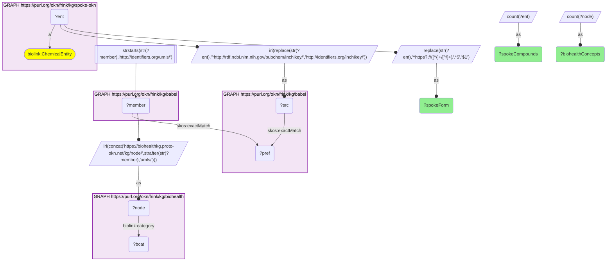
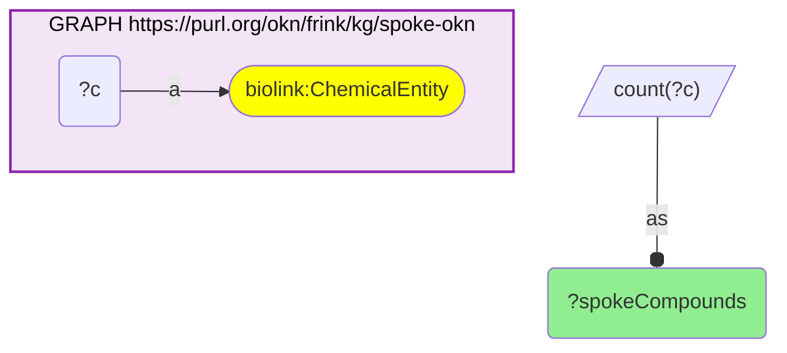

# C38-Q2: biohealth×spoke-okn — 608 of SPOKE-OKN's 798 compounds (76%) reach a BioHealth concept through Babel

- **Date:** 2026-10-13
- **Model:** claude-opus-5-5
- **SPARQL endpoint:** https://apps.okn.us/federation/sparql
- **Generated by:** mcp-okn v0.1.0 (build 3195263)
- **Contents:** 2 queries · 2 query diagrams

## Knowledge graphs used

- `spoke-okn` — <https://purl.org/okn/frink/kg/spoke-okn>
- `babel` — <https://purl.org/okn/frink/kg/babel>
- `biohealth` — <https://purl.org/okn/frink/kg/biohealth>

## Conversation

👤 **User**

Same crosswalk, coverage angle: how many SPOKE-OKN compounds reach a BioHealth concept through Babel, by SPOKE's compound identifier form?

---

🧠 **Assistant**

**608 of SPOKE-OKN's 798 compounds (76%) reach a BioHealth concept through babel: 601 keyed by InChIKey and 7 by CHEBI.**

| SPOKE-OKN compound form | Compounds reaching BioHealth | BioHealth concepts |
|---|---|---|
| InChIKey (`rdf.ncbi.nlm.nih.gov/pubchem`) | 601 | 632 |
| CHEBI (`purl.obolibrary.org/obo`) | 7 | 7 |

| Measure | Count |
|---|---|
| SPOKE-OKN compounds | 798 |

**A second chemical link between the two graphs.** SPOKE-OKN and BioHealth already joined on diseases and social determinants; this adds chemicals, so SPOKE's compound–gene and compound–disease edges can be read next to BioHealth's literature statements about the same substance.

**Join form.** InChIKey or CHEBI IRI → babel → UMLS → BioHealth node.

## SPARQL queries executed

#### Query 1

_2026-10-14T06:59:27+00:00 · `spoke-okn`, `babel`, `biohealth`_

```sparql
PREFIX biolink: <https://w3id.org/biolink/vocab/>
PREFIX rdfs: <http://www.w3.org/2000/01/rdf-schema#>
PREFIX rdf: <http://www.w3.org/1999/02/22-rdf-syntax-ns#>
PREFIX obo: <http://purl.obolibrary.org/obo/>
PREFIX spoke: <https://purl.org/okn/frink/kg/spoke-okn/schema/>
SELECT ?spokeForm (COUNT(DISTINCT ?ent) AS ?spokeCompounds) (COUNT(DISTINCT ?node) AS ?biohealthConcepts) WHERE {
  { SELECT DISTINCT ?ent ?member WHERE {
    { SELECT DISTINCT ?ent ?pref WHERE {
        { SELECT DISTINCT ?ent ?src WHERE { GRAPH <https://purl.org/okn/frink/kg/spoke-okn> { ?ent a <https://w3id.org/biolink/vocab/ChemicalEntity> } BIND(IRI(REPLACE(STR(?ent),'^http://rdf.ncbi.nlm.nih.gov/pubchem/inchikey/','http://identifiers.org/inchikey/')) AS ?src) } }
        GRAPH <https://purl.org/okn/frink/kg/babel> { ?src <http://www.w3.org/2004/02/skos/core#exactMatch> ?pref } } }
    GRAPH <https://purl.org/okn/frink/kg/babel> { ?member <http://www.w3.org/2004/02/skos/core#exactMatch> ?pref } } }
  FILTER(STRSTARTS(STR(?member),'http://identifiers.org/umls/'))
  BIND(IRI(CONCAT('https://biohealthkg.proto-okn.net/kg/node/', STRAFTER(STR(?member),'umls/'))) AS ?node)
  GRAPH <https://purl.org/okn/frink/kg/biohealth> { ?node <https://w3id.org/biolink/vocab/category> ?bcat }
  BIND(REPLACE(STR(?ent),'^https?://([^/]+/[^/]+)/.*$','$1') AS ?spokeForm)
} GROUP BY ?spokeForm ORDER BY DESC(?spokeCompounds)
```



_2 row(s)_

| spokeForm | spokeCompounds | biohealthConcepts |
| --- | --- | --- |
| rdf.ncbi.nlm.nih.gov/pubchem | 601 | 632 |
| purl.obolibrary.org/obo | 7 | 7 |

#### Query 2

_2026-10-14T06:59:28+00:00 · `spoke-okn`_

```sparql
PREFIX biolink: <https://w3id.org/biolink/vocab/>
PREFIX rdfs: <http://www.w3.org/2000/01/rdf-schema#>
PREFIX rdf: <http://www.w3.org/1999/02/22-rdf-syntax-ns#>
PREFIX obo: <http://purl.obolibrary.org/obo/>
PREFIX spoke: <https://purl.org/okn/frink/kg/spoke-okn/schema/>
SELECT (COUNT(DISTINCT ?c) AS ?spokeCompounds) WHERE { GRAPH <https://purl.org/okn/frink/kg/spoke-okn> { ?c a biolink:ChemicalEntity } }
```



_1 row(s)_

| spokeCompounds |
| --- |
| 798 |
