# C39-Q1: spoke-okn×prokn (chemicals via Babel) — SPOKE-OKN treating compounds with ProKN protein targets: phenytoin and lithium (2 targets each), fluorouracil (28 SPOKE diseases, 1 target)

- **Date:** 2026-10-13
- **Model:** claude-opus-5-5
- **SPARQL endpoint:** https://apps.okn.us/federation/sparql
- **Generated by:** mcp-okn v0.1.0 (build 3195263)
- **Contents:** 1 query · 1 query diagram

## Knowledge graphs used

- `spoke-okn` — <https://purl.org/okn/frink/kg/spoke-okn>
- `babel` — <https://purl.org/okn/frink/kg/babel>
- `prokn` — <https://purl.org/okn/frink/kg/prokn>

## Conversation

👤 **User**

Which SPOKE-OKN compounds with a TREATS edge reach a ProKN compound through Babel, and how many ProKN protein targets does each have?

---

🧠 **Assistant**

**Only eight SPOKE-OKN compounds that carry a TREATS edge reach a ProKN compound with a protein target. Phenytoin and lithium have two targets each; fluorouracil treats the most SPOKE diseases (28) but has one ProKN target here.**

| SPOKE-OKN compound | SPOKE diseases treated | ProKN targets |
|---|---|---|
| Phenytoin | 6 | 2 |
| Lithium | 2 | 2 |
| Ozone | 2 | 1 |
| Fluorouracil | 28 | 1 |
| Methylpyrrolidone | 1 | 1 |
| Nitroglycerin | 4 | 1 |
| Pentobarbital | 1 | 1 |
| Thiabendazole | 1 | 1 |

**Why so few.** A compound has to pass three filters: a SPOKE-OKN TREATS edge, a babel route into ProKN (278 compounds do, see the coverage question), and a target edge on the ProKN record it lands on. Only eight pass all three. Read the counts as what the two graphs share, not as how many targets these drugs have.

**Targets counted** are ProKN's `up:activity` and `biolink:directly_physically_interacts_with` edges from the compound.

**Join form.** SPOKE-OKN compound node (an InChIKey, ChEMBL or CHEBI IRI) → babel clique → member in ChEMBL, PubChem, DrugCentral or HMDB form → rewritten to ProKN's IRI for that form. Both babel hops are staged in nested DISTINCT subqueries.

## SPARQL queries executed

#### Query 1

_2026-10-14T06:53:13+00:00 · `spoke-okn`, `babel`, `prokn`_

```sparql
PREFIX biolink: <https://w3id.org/biolink/vocab/>
PREFIX rdfs: <http://www.w3.org/2000/01/rdf-schema#>
PREFIX skos: <http://www.w3.org/2004/02/skos/core#>
PREFIX up: <http://purl.uniprot.org/core/>
PREFIX obo: <http://purl.obolibrary.org/obo/>
PREFIX oa: <http://www.w3.org/ns/oa#>
PREFIX coso: <http://w3id.org/coso/v1/contaminoso#>
PREFIX sockg: <https://idir.uta.edu/sockg-ontology#>
PREFIX aop: <http://aopkb.org/aop_ontology#>
PREFIX dc: <http://purl.org/dc/elements/1.1/>
PREFIX meshv: <http://id.nlm.nih.gov/mesh/vocab#>
PREFIX spoke: <https://purl.org/okn/frink/kg/spoke-okn/schema/>
# SPOKE-OKN compounds with a TREATS edge, mapped to ProKN compounds through babel, ranked by
# the number of ProKN protein targets.
SELECT ?ent (SAMPLE(?nm) AS ?spokeCompound) (COUNT(DISTINCT ?dz) AS ?spokeDiseasesTreated) (COUNT(DISTINCT ?prot) AS ?proknTargets) WHERE {
  { SELECT DISTINCT ?ent ?cpd WHERE { { SELECT DISTINCT ?ent ?member WHERE {
    { SELECT DISTINCT ?ent ?pref WHERE {
        { SELECT DISTINCT ?ent ?src WHERE { GRAPH <https://purl.org/okn/frink/kg/spoke-okn> { ?ent a <https://w3id.org/biolink/vocab/ChemicalEntity> ; spoke:TREATS_CtD ?dz } BIND(IRI(REPLACE(STR(?ent),'^http://rdf.ncbi.nlm.nih.gov/pubchem/inchikey/','http://identifiers.org/inchikey/')) AS ?src) } }
        GRAPH <https://purl.org/okn/frink/kg/babel> { ?src <http://www.w3.org/2004/02/skos/core#exactMatch> ?pref } } }
    GRAPH <https://purl.org/okn/frink/kg/babel> { ?member <http://www.w3.org/2004/02/skos/core#exactMatch> ?pref } } }
    FILTER(REGEX(STR(?member),'^http://(identifiers\\.org/(chembl\\.compound|pubchem\\.compound|hmdb)|drugcentral\\.org/drugcard)/'))
  BIND(IRI(REPLACE(REPLACE(REPLACE(REPLACE(STR(?member),
    '^http://identifiers.org/chembl.compound/','https://www.ebi.ac.uk/chembl/explore/compound/'),
    '^http://identifiers.org/pubchem.compound/','https://pubchem.ncbi.nlm.nih.gov/compound/'),
    '^http://drugcentral.org/drugcard/','https://drugcentral.org/drugcard/'),
    '^http://identifiers.org/hmdb/','https://hmdb.ca/metabolites/')) AS ?cpd)
  GRAPH <https://purl.org/okn/frink/kg/prokn> { ?cpd a ?ptype } } }
  GRAPH <https://purl.org/okn/frink/kg/prokn> { { ?cpd up:activity ?prot } UNION { ?cpd <https://w3id.org/biolink/vocab/directly_physically_interacts_with> ?prot } }
  GRAPH <https://purl.org/okn/frink/kg/spoke-okn> { ?ent spoke:TREATS_CtD ?dz . OPTIONAL { ?ent rdfs:label ?nm } }
} GROUP BY ?ent ORDER BY DESC(?proknTargets) LIMIT 15
```

```mermaid
graph TD
classDef projected fill:lightgreen;
classDef literal fill:orange;
classDef iri fill:yellow;
  q0v10("?cpd")
  q0v12("?dz")
  q0v4("?ent"):::projected 
  q0v9("?member")
  q0v16("?nm")
  q0v13("?pref")
  q0v1("?proknTargets"):::projected 
  q0v15("?prot")
  q0v14("?ptype")
  q0v3("?spokeCompound"):::projected 
  q0v2("?spokeDiseasesTreated"):::projected 
  q0v11("?src")
  q0f0[["regex(str(?member),'^http://(identifiers\.org/(chembl\.compound|pubchem\.compound|hmdb)|drugcentral\.org/drugcard)/')"]]
  q0f0 --> q0v9
  subgraph q0graph0["GRAPH https://purl.org/okn/frink/kg/spoke-okn"]
    style q0graph0 fill:#f3e5f5,stroke:#8e24aa,stroke-width:2px,color:#000;
    q0graph0c2(["biolink:ChemicalEntity"]):::iri 
    q0v4 --"a"--> q0graph0c2
    q0v4 --"spoke:TREATS_CtD"--> q0v12
  end
  q0bind0[/"iri(replace(str(?ent),'^http://rdf.ncbi.nlm.nih.gov/pubchem/inchikey/','http://identifiers.org/inchikey/'))"/]
  q0v4 --o q0bind0
  q0bind0 --as--o q0v11
  subgraph q0graph1["GRAPH https://purl.org/okn/frink/kg/babel"]
    style q0graph1 fill:#f3e5f5,stroke:#8e24aa,stroke-width:2px,color:#000;
    q0v11 --"skos:exactMatch"--> q0v13
  end
  subgraph q0graph2["GRAPH https://purl.org/okn/frink/kg/babel"]
    style q0graph2 fill:#f3e5f5,stroke:#8e24aa,stroke-width:2px,color:#000;
    q0v9 --"skos:exactMatch"--> q0v13
  end
  q0bind1[/"iri(replace(replace(replace(replace(str(?member),'^http://identifiers.org/chembl.compound/','https://www.ebi.ac.uk/chembl/explore/compound/'),'^http://identifiers.org/pubchem.compound/','https://pubchem.ncbi.nlm.nih.gov/compound/'),'^http://drugcentral.org/drugcard/','https://drugcentral.org/drugcard/'),'^http://identifiers.org/hmdb/','https://hmdb.ca/metabolites/'))"/]
  q0v9 --o q0bind1
  q0bind1 --as--o q0v10
  subgraph q0graph3["GRAPH https://purl.org/okn/frink/kg/prokn"]
    style q0graph3 fill:#f3e5f5,stroke:#8e24aa,stroke-width:2px,color:#000;
    q0v10 --"a"--> q0v14
  end
  subgraph q0graph4["GRAPH https://purl.org/okn/frink/kg/prokn"]
    style q0graph4 fill:#f3e5f5,stroke:#8e24aa,stroke-width:2px,color:#000;
    subgraph q0uniongraph40[" Union "]
    style q0uniongraph40 color:#000;
      q0v10 --"biolink:directly_physically_interacts_with"--> q0v15
    subgraph q0uniongraph40r[" "]
      style q0uniongraph40r fill:#abf,stroke-dasharray: 3 3;
      q0v10 --"up:activity"--> q0v15
    end
    end
  end
  subgraph q0graph5["GRAPH https://purl.org/okn/frink/kg/spoke-okn"]
    style q0graph5 fill:#f3e5f5,stroke:#8e24aa,stroke-width:2px,color:#000;
    q0v4 --"spoke:TREATS_CtD"--> q0v12
    subgraph q0optionalgraph50["(optional)"]
    style q0optionalgraph50 fill:#bbf,stroke-dasharray: 5 5,color:#000;
      q0v4 -."rdfs:label".-> q0v16
    end
  end
  q0bind2[/"count(?dz)"/]
  q0bind2 --as--o q0v2
  q0bind3[/"count(?prot)"/]
  q0bind3 --as--o q0v1
```



_8 row(s)_

| ent | spokeCompound | spokeDiseasesTreated | proknTargets |
| --- | --- | --- | --- |
| http://rdf.ncbi.nlm.nih.gov/pubchem/inchikey/CXOFVDLJLONNDW-UHFFFAOYSA-N | Phenytoin | 6 | 2 |
| http://rdf.ncbi.nlm.nih.gov/pubchem/inchikey/WHXSMMKQMYFTQS-UHFFFAOYSA-N | Lithium | 2 | 2 |
| http://rdf.ncbi.nlm.nih.gov/pubchem/inchikey/CBENFWSGALASAD-UHFFFAOYSA-N | Ozone | 2 | 1 |
| http://rdf.ncbi.nlm.nih.gov/pubchem/inchikey/GHASVSINZRGABV-UHFFFAOYSA-N | Fluorouracil | 28 | 1 |
| http://rdf.ncbi.nlm.nih.gov/pubchem/inchikey/SECXISVLQFMRJM-UHFFFAOYSA-N | Methylpyrrolidone | 1 | 1 |
| http://rdf.ncbi.nlm.nih.gov/pubchem/inchikey/SNIOPGDIGTZGOP-UHFFFAOYSA-N | Nitroglycerin | 4 | 1 |
| http://rdf.ncbi.nlm.nih.gov/pubchem/inchikey/WEXRUCMBJFQVBZ-UHFFFAOYSA-N | Pentobarbital | 1 | 1 |
| http://rdf.ncbi.nlm.nih.gov/pubchem/inchikey/WJCNZQLZVWNLKY-UHFFFAOYSA-N | Thiabendazole | 1 | 1 |
