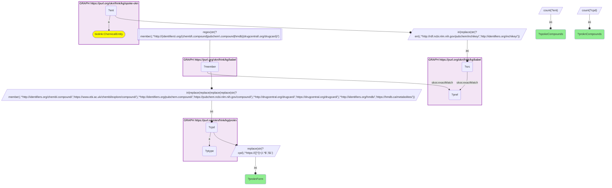

# C39-Q2: spoke-okn×prokn — Babel reaches 278 SPOKE-OKN compounds in ProKN, against 143 through the InChIKey join; 251 match a ProKN PubChem compound, 139 a ChEMBL one, 25 a DrugCentral drug

- **Date:** 2026-10-13
- **Model:** claude-opus-5-5
- **SPARQL endpoint:** https://apps.okn.us/federation/sparql
- **Generated by:** mcp-okn v0.1.0 (build 3195263)
- **Contents:** 2 queries · 2 query diagrams

## Knowledge graphs used

- `spoke-okn` — <https://purl.org/okn/frink/kg/spoke-okn>
- `babel` — <https://purl.org/okn/frink/kg/babel>
- `prokn` — <https://purl.org/okn/frink/kg/prokn>

## Conversation

👤 **User**

Same crosswalk, coverage angle: how many SPOKE-OKN compounds reach ProKN through Babel, through which ProKN identifier form, and how does that compare with the direct InChIKey join?

---

🧠 **Assistant**

**Babel takes 278 SPOKE-OKN compounds into ProKN, nearly twice the 143 that the direct InChIKey join reaches. 251 of them land on a ProKN PubChem compound, 139 on a ChEMBL compound and 25 on a DrugCentral drug; a compound can land on more than one.**

| Route | SPOKE-OKN compounds reaching ProKN |
|---|---|
| through babel | 278 |
| direct InChIKey match (crosswalk C11) | 143 |

| ProKN identifier form matched | SPOKE-OKN compounds | ProKN compounds |
|---|---|---|
| PubChem (`pubchem.ncbi.nlm.nih.gov`) | 251 | 251 |
| ChEMBL (`www.ebi.ac.uk`) | 139 | 142 |
| DrugCentral (`drugcentral.org`) | 25 | 25 |

**Why babel finds more.** The InChIKey join needs both graphs to state the same structure key. ProKN keys compounds several ways (PubChem CID, ChEMBL id, DrugCentral id), and babel knows all of a compound's ids, so it reaches ProKN records that carry no InChIKey.

**Join form.** SPOKE-OKN compound node → babel clique → ChEMBL / PubChem / DrugCentral / HMDB member → ProKN IRI. The InChIKey route remains crosswalk C11; this is a second, wider route between the same two graphs.

## SPARQL queries executed

#### Query 1

_2026-10-14T06:53:13+00:00 · `spoke-okn`, `babel`, `prokn`_

```sparql
PREFIX biolink: <https://w3id.org/biolink/vocab/>
PREFIX rdfs: <http://www.w3.org/2000/01/rdf-schema#>
PREFIX skos: <http://www.w3.org/2004/02/skos/core#>
PREFIX up: <http://purl.uniprot.org/core/>
PREFIX obo: <http://purl.obolibrary.org/obo/>
PREFIX oa: <http://www.w3.org/ns/oa#>
PREFIX coso: <http://w3id.org/coso/v1/contaminoso#>
PREFIX sockg: <https://idir.uta.edu/sockg-ontology#>
PREFIX aop: <http://aopkb.org/aop_ontology#>
PREFIX dc: <http://purl.org/dc/elements/1.1/>
PREFIX meshv: <http://id.nlm.nih.gov/mesh/vocab#>
PREFIX spoke: <https://purl.org/okn/frink/kg/spoke-okn/schema/>
# SPOKE-OKN compounds reaching ProKN through babel, by the ProKN identifier form that matched.
SELECT ?proknForm (COUNT(DISTINCT ?ent) AS ?spokeCompounds) (COUNT(DISTINCT ?cpd) AS ?proknCompounds) WHERE {
  { SELECT DISTINCT ?ent ?member WHERE {
    { SELECT DISTINCT ?ent ?pref WHERE {
        { SELECT DISTINCT ?ent ?src WHERE { GRAPH <https://purl.org/okn/frink/kg/spoke-okn> { ?ent a <https://w3id.org/biolink/vocab/ChemicalEntity> } BIND(IRI(REPLACE(STR(?ent),'^http://rdf.ncbi.nlm.nih.gov/pubchem/inchikey/','http://identifiers.org/inchikey/')) AS ?src) } }
        GRAPH <https://purl.org/okn/frink/kg/babel> { ?src <http://www.w3.org/2004/02/skos/core#exactMatch> ?pref } } }
    GRAPH <https://purl.org/okn/frink/kg/babel> { ?member <http://www.w3.org/2004/02/skos/core#exactMatch> ?pref } } }
  FILTER(REGEX(STR(?member),'^http://(identifiers\\.org/(chembl\\.compound|pubchem\\.compound|hmdb)|drugcentral\\.org/drugcard)/'))
  BIND(IRI(REPLACE(REPLACE(REPLACE(REPLACE(STR(?member),
    '^http://identifiers.org/chembl.compound/','https://www.ebi.ac.uk/chembl/explore/compound/'),
    '^http://identifiers.org/pubchem.compound/','https://pubchem.ncbi.nlm.nih.gov/compound/'),
    '^http://drugcentral.org/drugcard/','https://drugcentral.org/drugcard/'),
    '^http://identifiers.org/hmdb/','https://hmdb.ca/metabolites/')) AS ?cpd)
  GRAPH <https://purl.org/okn/frink/kg/prokn> { ?cpd a ?ptype }
  BIND(REPLACE(STR(?cpd),'^https://([^/]+)/.*$','$1') AS ?proknForm)
} GROUP BY ?proknForm ORDER BY DESC(?spokeCompounds)
```



_3 row(s)_

| proknForm | spokeCompounds | proknCompounds |
| --- | --- | --- |
| pubchem.ncbi.nlm.nih.gov | 251 | 251 |
| www.ebi.ac.uk | 139 | 142 |
| drugcentral.org | 25 | 25 |

#### Query 2

_2026-10-14T06:53:13+00:00 · `spoke-okn`, `babel`, `prokn`_

```sparql
PREFIX biolink: <https://w3id.org/biolink/vocab/>
PREFIX rdfs: <http://www.w3.org/2000/01/rdf-schema#>
PREFIX skos: <http://www.w3.org/2004/02/skos/core#>
PREFIX up: <http://purl.uniprot.org/core/>
PREFIX obo: <http://purl.obolibrary.org/obo/>
PREFIX oa: <http://www.w3.org/ns/oa#>
PREFIX coso: <http://w3id.org/coso/v1/contaminoso#>
PREFIX sockg: <https://idir.uta.edu/sockg-ontology#>
PREFIX aop: <http://aopkb.org/aop_ontology#>
PREFIX dc: <http://purl.org/dc/elements/1.1/>
PREFIX meshv: <http://id.nlm.nih.gov/mesh/vocab#>
PREFIX spoke: <https://purl.org/okn/frink/kg/spoke-okn/schema/>
SELECT ?viaBabel ?viaInChIKey WHERE {
  { SELECT (COUNT(DISTINCT ?ent) AS ?viaBabel) WHERE { { SELECT DISTINCT ?ent ?member WHERE {
    { SELECT DISTINCT ?ent ?pref WHERE {
        { SELECT DISTINCT ?ent ?src WHERE { GRAPH <https://purl.org/okn/frink/kg/spoke-okn> { ?ent a <https://w3id.org/biolink/vocab/ChemicalEntity> } BIND(IRI(REPLACE(STR(?ent),'^http://rdf.ncbi.nlm.nih.gov/pubchem/inchikey/','http://identifiers.org/inchikey/')) AS ?src) } }
        GRAPH <https://purl.org/okn/frink/kg/babel> { ?src <http://www.w3.org/2004/02/skos/core#exactMatch> ?pref } } }
    GRAPH <https://purl.org/okn/frink/kg/babel> { ?member <http://www.w3.org/2004/02/skos/core#exactMatch> ?pref } } }
    FILTER(REGEX(STR(?member),'^http://(identifiers\\.org/(chembl\\.compound|pubchem\\.compound|hmdb)|drugcentral\\.org/drugcard)/'))
  BIND(IRI(REPLACE(REPLACE(REPLACE(REPLACE(STR(?member),
    '^http://identifiers.org/chembl.compound/','https://www.ebi.ac.uk/chembl/explore/compound/'),
    '^http://identifiers.org/pubchem.compound/','https://pubchem.ncbi.nlm.nih.gov/compound/'),
    '^http://drugcentral.org/drugcard/','https://drugcentral.org/drugcard/'),
    '^http://identifiers.org/hmdb/','https://hmdb.ca/metabolites/')) AS ?cpd)
  GRAPH <https://purl.org/okn/frink/kg/prokn> { ?cpd a ?ptype } } }
  { SELECT (COUNT(DISTINCT ?c) AS ?viaInChIKey) WHERE { GRAPH <https://purl.org/okn/frink/kg/spoke-okn> { ?c a <https://w3id.org/biolink/vocab/ChemicalEntity> . FILTER(CONTAINS(STR(?c),'/inchikey/')) BIND(REPLACE(STR(?c),'.*/inchikey/','') AS ?ik) }
      GRAPH <https://purl.org/okn/frink/kg/prokn> { ?p <https://chemkg.github.io/chemrof/inchi_key_string> ?ik } } }
}
```



```mermaid
graph TD
classDef projected fill:lightgreen;
classDef literal fill:orange;
classDef iri fill:yellow;
  q1v10("?c")
  q1v4("?cpd")
  q1v6("?ent")
  q1v11("?ik")
  q1v3("?member")
  q1v12("?p")
  q1v7("?pref")
  q1v8("?ptype")
  q1v5("?src")
  q1v1("?viaBabel"):::projected 
  q1v9("?viaInChIKey"):::projected 
  q1f0[["regex(str(?member),'^http://(identifiers\.org/(chembl\.compound|pubchem\.compound|hmdb)|drugcentral\.org/drugcard)/')"]]
  q1f0 --> q1v3
  subgraph q1graph0["GRAPH https://purl.org/okn/frink/kg/spoke-okn"]
    style q1graph0 fill:#f3e5f5,stroke:#8e24aa,stroke-width:2px,color:#000;
    q1graph0c2(["biolink:ChemicalEntity"]):::iri 
    q1v6 --"a"--> q1graph0c2
  end
  q1bind0[/"iri(replace(str(?ent),'^http://rdf.ncbi.nlm.nih.gov/pubchem/inchikey/','http://identifiers.org/inchikey/'))"/]
  q1v6 --o q1bind0
  q1bind0 --as--o q1v5
  subgraph q1graph1["GRAPH https://purl.org/okn/frink/kg/babel"]
    style q1graph1 fill:#f3e5f5,stroke:#8e24aa,stroke-width:2px,color:#000;
    q1v5 --"skos:exactMatch"--> q1v7
  end
  subgraph q1graph2["GRAPH https://purl.org/okn/frink/kg/babel"]
    style q1graph2 fill:#f3e5f5,stroke:#8e24aa,stroke-width:2px,color:#000;
    q1v3 --"skos:exactMatch"--> q1v7
  end
  q1bind1[/"iri(replace(replace(replace(replace(str(?member),'^http://identifiers.org/chembl.compound/','https://www.ebi.ac.uk/chembl/explore/compound/'),'^http://identifiers.org/pubchem.compound/','https://pubchem.ncbi.nlm.nih.gov/compound/'),'^http://drugcentral.org/drugcard/','https://drugcentral.org/drugcard/'),'^http://identifiers.org/hmdb/','https://hmdb.ca/metabolites/'))"/]
  q1v3 --o q1bind1
  q1bind1 --as--o q1v4
  subgraph q1graph3["GRAPH https://purl.org/okn/frink/kg/prokn"]
    style q1graph3 fill:#f3e5f5,stroke:#8e24aa,stroke-width:2px,color:#000;
    q1v4 --"a"--> q1v8
  end
  q1bind2[/"count(?c)"/]
  q1bind2 --as--o q1v1
  subgraph q1graph4["GRAPH https://purl.org/okn/frink/kg/spoke-okn"]
    style q1graph4 fill:#f3e5f5,stroke:#8e24aa,stroke-width:2px,color:#000;
    q1graph4c2(["biolink:ChemicalEntity"]):::iri 
    q1graph4f1[["contains(str(?c),'/inchikey/')"]]
    q1graph4f1 --> q1v10
    q1v10 --"a"--> q1graph4c2
    q1graph4bind3[/"replace(str(?c),'.*/inchikey/','')"/]
    q1v10 --o q1graph4bind3
    q1graph4bind3 --as--o q1v11
  end
  subgraph q1graph5["GRAPH https://purl.org/okn/frink/kg/prokn"]
    style q1graph5 fill:#f3e5f5,stroke:#8e24aa,stroke-width:2px,color:#000;
    q1v12 --"https://chemkg.github.io/chemrof/inchi_key_string"--> q1v11
  end
  q1bind4[/"count(?c)"/]
  q1bind4 --as--o q1v9
```

_1 row(s)_

| viaBabel | viaInChIKey |
| --- | --- |
| 278 | 143 |
