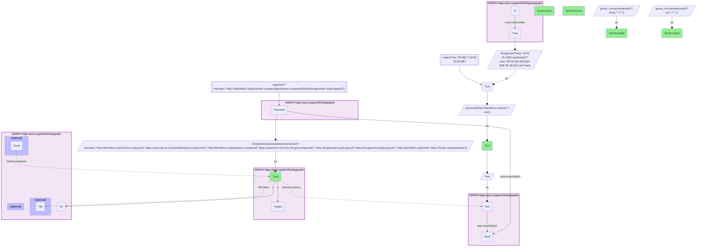

# C40-Q1: sawgraph×prokn (CAS via Babel) — six SAWGraph contaminants reach ProKN, all as Metabolomics Workbench metabolites measured in tissues (PFOS in blood, milk, heart and liver), none with a protein target

- **Date:** 2026-10-13
- **Model:** claude-opus-5-5
- **SPARQL endpoint:** https://apps.okn.us/federation/sparql
- **Generated by:** mcp-okn v0.1.0 (build 3195263)
- **Contents:** 1 query · 1 query diagram

## Knowledge graphs used

- `sawgraph` — <https://purl.org/okn/frink/kg/sawgraph>
- `babel` — <https://purl.org/okn/frink/kg/babel>
- `prokn` — <https://purl.org/okn/frink/kg/prokn>

## Conversation

👤 **User**

Which SAWGraph contaminants reach a ProKN compound through Babel, and what does ProKN record about them?

---

🧠 **Assistant**

**Six SAWGraph contaminants reach ProKN through babel, and ProKN holds every one as a metabolite record from Metabolomics Workbench (type `NCIT_C61154`, source `DDKG_MW`), linked to the tissues or fluids it was measured in, not to a protein target. PFOS, for example, is recorded in blood, milk, heart and liver.**

| SAWGraph CAS | ProKN compound | Measured in (ProKN `produces` edges) |
|---|---|---|
| 1763-23-1 (PFOS) | PubChem 74483 | blood (UBERON_0000178), milk (UBERON_0001913), heart, liver |
| 335-67-1 (PFOA) | PubChem 9554 | blood, urine (UBERON_0001088), uterus (UBERON_0000995), fibroblast (CL_0000057) |
| 307-24-4 (PFHxA) | PubChem 67542 | blood, bone element (UBERON_0001474) |
| 375-85-9 (PFHpA) | PubChem 67818 | blood, bone element |
| 2706-90-3 (PFPeA) | PubChem 75921 | blood, urine |
| 86479-06-3 (hexaflumuron) | PubChem 91741 | urine, muscle tissue (UBERON_0002385) |

**What it shows.** These are human exposure measurements: ProKN says where the chemical has been detected in the body, while SAWGraph says where it has been detected in the environment. Together they connect environmental PFAS data to biomonitoring studies.

**Why the catalog used to say zero.** The earlier check looked only for ChEMBL ids, and these compounds are in ProKN under their PubChem ids.

**Join form.** SAWGraph `coso:casNumber` (dashes rebuilt) → `http://identifiers.org/cas/{CAS}` → babel clique → `http://identifiers.org/pubchem.compound/{cid}` → ProKN `https://pubchem.ncbi.nlm.nih.gov/compound/{cid}`.

## SPARQL queries executed

#### Query 1

_2026-10-14T06:53:14+00:00 · `sawgraph`, `babel`, `prokn`_

```sparql
PREFIX biolink: <https://w3id.org/biolink/vocab/>
PREFIX rdfs: <http://www.w3.org/2000/01/rdf-schema#>
PREFIX skos: <http://www.w3.org/2004/02/skos/core#>
PREFIX up: <http://purl.uniprot.org/core/>
PREFIX obo: <http://purl.obolibrary.org/obo/>
PREFIX oa: <http://www.w3.org/ns/oa#>
PREFIX coso: <http://w3id.org/coso/v1/contaminoso#>
PREFIX sockg: <https://idir.uta.edu/sockg-ontology#>
PREFIX aop: <http://aopkb.org/aop_ontology#>
PREFIX dc: <http://purl.org/dc/elements/1.1/>
PREFIX meshv: <http://id.nlm.nih.gov/mesh/vocab#>
PREFIX spoke: <https://purl.org/okn/frink/kg/spoke-okn/schema/>
# SAWGraph contaminants (CAS) that reach a ProKN compound through babel: how ProKN types each
# one, which source it comes from, and the anatomical sites ProKN says produce it.
SELECT ?ent ?cpd (SAMPLE(?lbl) AS ?proknLabel) (GROUP_CONCAT(DISTINCT REPLACE(STR(?ty),'^.*/','') ; SEPARATOR=", ") AS ?proknTypes)
       (SAMPLE(?src) AS ?proknSource) (GROUP_CONCAT(DISTINCT REPLACE(STR(?anat),'^.*/','') ; SEPARATOR=", ") AS ?producedBy) WHERE {
  { SELECT DISTINCT ?ent ?cpd WHERE { { SELECT DISTINCT ?ent ?member WHERE {
    { SELECT DISTINCT ?ent ?pref WHERE {
        { SELECT DISTINCT ?ent ?src WHERE { GRAPH <https://purl.org/okn/frink/kg/sawgraph> { ?s <http://w3id.org/coso/v1/contaminoso#casNumber> ?raw } BIND(IF(REGEX(STR(?raw),'^[0-9]{5,10}$'), REPLACE(STR(?raw),'^([0-9]+)([0-9]{2})([0-9])$','$1-$2-$3'), STR(?raw)) AS ?cas) FILTER(REGEX(?cas,'^[0-9]{2,7}-[0-9]{2}-[0-9]$')) BIND(IRI(CONCAT('http://identifiers.org/cas/', ?cas)) AS ?ent) BIND(?ent AS ?src) } }
        GRAPH <https://purl.org/okn/frink/kg/babel> { ?src <http://www.w3.org/2004/02/skos/core#exactMatch> ?pref } } }
    GRAPH <https://purl.org/okn/frink/kg/babel> { ?member <http://www.w3.org/2004/02/skos/core#exactMatch> ?pref } } }
    FILTER(REGEX(STR(?member),'^http://(identifiers\\.org/(chembl\\.compound|pubchem\\.compound|hmdb)|drugcentral\\.org/drugcard)/'))
  BIND(IRI(REPLACE(REPLACE(REPLACE(REPLACE(STR(?member),
    '^http://identifiers.org/chembl.compound/','https://www.ebi.ac.uk/chembl/explore/compound/'),
    '^http://identifiers.org/pubchem.compound/','https://pubchem.ncbi.nlm.nih.gov/compound/'),
    '^http://drugcentral.org/drugcard/','https://drugcentral.org/drugcard/'),
    '^http://identifiers.org/hmdb/','https://hmdb.ca/metabolites/')) AS ?cpd)
  GRAPH <https://purl.org/okn/frink/kg/prokn> { ?cpd a ?ptype } } }
  GRAPH <https://purl.org/okn/frink/kg/prokn> { ?cpd a ?ty . OPTIONAL { ?cpd rdfs:label ?lbl } OPTIONAL { ?cpd <http://purl.org/dc/terms/source> ?src }
    OPTIONAL { ?anat <https://w3id.org/biolink/vocab/produces> ?cpd } }
} GROUP BY ?ent ?cpd ORDER BY ?ent
```



_6 row(s)_

| ent | cpd | proknLabel | proknTypes | proknSource | producedBy |
| --- | --- | --- | --- | --- | --- |
| http://identifiers.org/cas/1763-23-1 | https://pubchem.ncbi.nlm.nih.gov/compound/74483 | perfluorooctane sulfonic acid_74483.0 | NCIT_C61154 | DDKG_MW | UBERON_0000178, UBERON_0001913, Anatomy_Heart, Anatomy_Liver |
| http://identifiers.org/cas/2706-90-3 | https://pubchem.ncbi.nlm.nih.gov/compound/75921 | perfluoropentanoic acid_75921.0 | NCIT_C61154 | DDKG_MW | UBERON_0000178, UBERON_0001088 |
| http://identifiers.org/cas/307-24-4 | https://pubchem.ncbi.nlm.nih.gov/compound/67542 | perfluorohexanoic acid_67542.0 | NCIT_C61154 | DDKG_MW | UBERON_0000178, UBERON_0001474 |
| http://identifiers.org/cas/335-67-1 | https://pubchem.ncbi.nlm.nih.gov/compound/9554 | perfluorooctanoic acid_9554.0 | NCIT_C61154 | DDKG_MW | CL_0000057, UBERON_0000178, UBERON_0000995, UBERON_0001088 |
| http://identifiers.org/cas/375-85-9 | https://pubchem.ncbi.nlm.nih.gov/compound/67818 | Perfluoroheptanoic acid_67818 | NCIT_C61154 | DDKG_MW | UBERON_0000178, UBERON_0001474 |
| http://identifiers.org/cas/86479-06-3 | https://pubchem.ncbi.nlm.nih.gov/compound/91741 | Hexaflumuron_91741 | NCIT_C61154 | DDKG_MW | UBERON_0001088, UBERON_0002385 |
