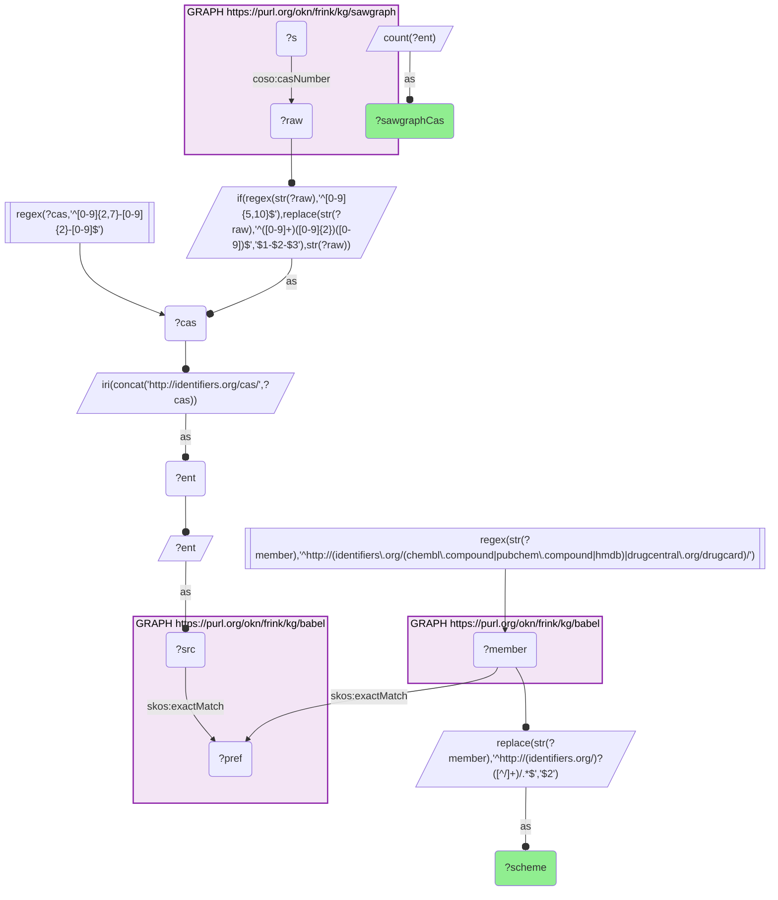
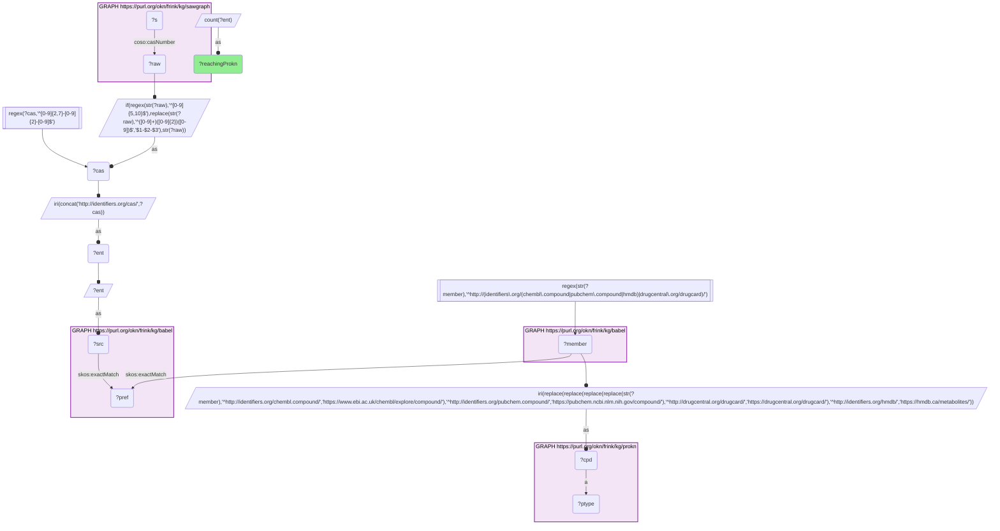

# C40-Q2: sawgraph×prokn — all 112 Babel-resolved SAWGraph CAS numbers have a PubChem member but only 21 a ChEMBL one; six reach ProKN, through its PubChem ids

- **Date:** 2026-10-13
- **Model:** claude-opus-5-5
- **SPARQL endpoint:** https://apps.okn.us/federation/sparql
- **Generated by:** mcp-okn v0.1.0 (build 3195263)
- **Contents:** 2 queries · 2 query diagrams

## Knowledge graphs used

- `sawgraph` — <https://purl.org/okn/frink/kg/sawgraph>
- `babel` — <https://purl.org/okn/frink/kg/babel>
- `prokn` — <https://purl.org/okn/frink/kg/prokn>

## Conversation

👤 **User**

Same crosswalk, coverage angle: which Babel identifier schemes carry SAWGraph's contaminants toward ProKN, and how many arrive?

---

🧠 **Assistant**

**All 112 babel-resolved SAWGraph CAS numbers have a PubChem member, but only 21 have a ChEMBL member and 15 an HMDB member. Six arrive in ProKN, all through ProKN's PubChem ids.**

| babel member scheme toward ProKN | SAWGraph CAS numbers |
|---|---|
| PubChem compound | 112 |
| ChEMBL compound | 21 |
| HMDB | 15 |

| Measure | Count |
|---|---|
| SAWGraph CAS numbers reaching a ProKN compound | 6 |

**This replaces a recorded non-join.** The catalog listed sawgraph × prokn as a verified zero after testing only the ChEMBL route: the 21 ChEMBL members are not ProKN compounds. Testing every ProKN identifier form finds the six PubChem matches. The link is small but real.

**Join form.** CAS → babel clique → PubChem / ChEMBL / DrugCentral / HMDB member → ProKN IRI in that form.

## SPARQL queries executed

#### Query 1

_2026-10-14T06:53:14+00:00 · `sawgraph`, `babel`_

```sparql
PREFIX biolink: <https://w3id.org/biolink/vocab/>
PREFIX rdfs: <http://www.w3.org/2000/01/rdf-schema#>
PREFIX skos: <http://www.w3.org/2004/02/skos/core#>
PREFIX up: <http://purl.uniprot.org/core/>
PREFIX obo: <http://purl.obolibrary.org/obo/>
PREFIX oa: <http://www.w3.org/ns/oa#>
PREFIX coso: <http://w3id.org/coso/v1/contaminoso#>
PREFIX sockg: <https://idir.uta.edu/sockg-ontology#>
PREFIX aop: <http://aopkb.org/aop_ontology#>
PREFIX dc: <http://purl.org/dc/elements/1.1/>
PREFIX meshv: <http://id.nlm.nih.gov/mesh/vocab#>
PREFIX spoke: <https://purl.org/okn/frink/kg/spoke-okn/schema/>
# Which babel member scheme carries SAWGraph's contaminants into ProKN.
SELECT ?scheme (COUNT(DISTINCT ?ent) AS ?sawgraphCas) WHERE {
  { SELECT DISTINCT ?ent ?member WHERE {
    { SELECT DISTINCT ?ent ?pref WHERE {
        { SELECT DISTINCT ?ent ?src WHERE { GRAPH <https://purl.org/okn/frink/kg/sawgraph> { ?s <http://w3id.org/coso/v1/contaminoso#casNumber> ?raw } BIND(IF(REGEX(STR(?raw),'^[0-9]{5,10}$'), REPLACE(STR(?raw),'^([0-9]+)([0-9]{2})([0-9])$','$1-$2-$3'), STR(?raw)) AS ?cas) FILTER(REGEX(?cas,'^[0-9]{2,7}-[0-9]{2}-[0-9]$')) BIND(IRI(CONCAT('http://identifiers.org/cas/', ?cas)) AS ?ent) BIND(?ent AS ?src) } }
        GRAPH <https://purl.org/okn/frink/kg/babel> { ?src <http://www.w3.org/2004/02/skos/core#exactMatch> ?pref } } }
    GRAPH <https://purl.org/okn/frink/kg/babel> { ?member <http://www.w3.org/2004/02/skos/core#exactMatch> ?pref } } }
  FILTER(REGEX(STR(?member),'^http://(identifiers\\.org/(chembl\\.compound|pubchem\\.compound|hmdb)|drugcentral\\.org/drugcard)/'))
  BIND(REPLACE(STR(?member),'^http://(identifiers.org/)?([^/]+)/.*$','$2') AS ?scheme)
} GROUP BY ?scheme ORDER BY DESC(?sawgraphCas)
```



_3 row(s)_

| scheme | sawgraphCas |
| --- | --- |
| pubchem.compound | 112 |
| chembl.compound | 21 |
| hmdb | 15 |

#### Query 2

_2026-10-14T06:53:14+00:00 · `sawgraph`, `babel`, `prokn`_

```sparql
PREFIX biolink: <https://w3id.org/biolink/vocab/>
PREFIX rdfs: <http://www.w3.org/2000/01/rdf-schema#>
PREFIX skos: <http://www.w3.org/2004/02/skos/core#>
PREFIX up: <http://purl.uniprot.org/core/>
PREFIX obo: <http://purl.obolibrary.org/obo/>
PREFIX oa: <http://www.w3.org/ns/oa#>
PREFIX coso: <http://w3id.org/coso/v1/contaminoso#>
PREFIX sockg: <https://idir.uta.edu/sockg-ontology#>
PREFIX aop: <http://aopkb.org/aop_ontology#>
PREFIX dc: <http://purl.org/dc/elements/1.1/>
PREFIX meshv: <http://id.nlm.nih.gov/mesh/vocab#>
PREFIX spoke: <https://purl.org/okn/frink/kg/spoke-okn/schema/>
SELECT (COUNT(DISTINCT ?ent) AS ?reachingProkn) WHERE {
  { SELECT DISTINCT ?ent ?member WHERE {
    { SELECT DISTINCT ?ent ?pref WHERE {
        { SELECT DISTINCT ?ent ?src WHERE { GRAPH <https://purl.org/okn/frink/kg/sawgraph> { ?s <http://w3id.org/coso/v1/contaminoso#casNumber> ?raw } BIND(IF(REGEX(STR(?raw),'^[0-9]{5,10}$'), REPLACE(STR(?raw),'^([0-9]+)([0-9]{2})([0-9])$','$1-$2-$3'), STR(?raw)) AS ?cas) FILTER(REGEX(?cas,'^[0-9]{2,7}-[0-9]{2}-[0-9]$')) BIND(IRI(CONCAT('http://identifiers.org/cas/', ?cas)) AS ?ent) BIND(?ent AS ?src) } }
        GRAPH <https://purl.org/okn/frink/kg/babel> { ?src <http://www.w3.org/2004/02/skos/core#exactMatch> ?pref } } }
    GRAPH <https://purl.org/okn/frink/kg/babel> { ?member <http://www.w3.org/2004/02/skos/core#exactMatch> ?pref } } }
  FILTER(REGEX(STR(?member),'^http://(identifiers\\.org/(chembl\\.compound|pubchem\\.compound|hmdb)|drugcentral\\.org/drugcard)/'))
  BIND(IRI(REPLACE(REPLACE(REPLACE(REPLACE(STR(?member),
    '^http://identifiers.org/chembl.compound/','https://www.ebi.ac.uk/chembl/explore/compound/'),
    '^http://identifiers.org/pubchem.compound/','https://pubchem.ncbi.nlm.nih.gov/compound/'),
    '^http://drugcentral.org/drugcard/','https://drugcentral.org/drugcard/'),
    '^http://identifiers.org/hmdb/','https://hmdb.ca/metabolites/')) AS ?cpd)
  GRAPH <https://purl.org/okn/frink/kg/prokn> { ?cpd a ?ptype }
}
```



_1 row(s)_

| reachingProkn |
| --- |
| 6 |
