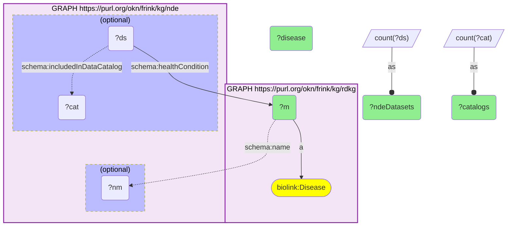
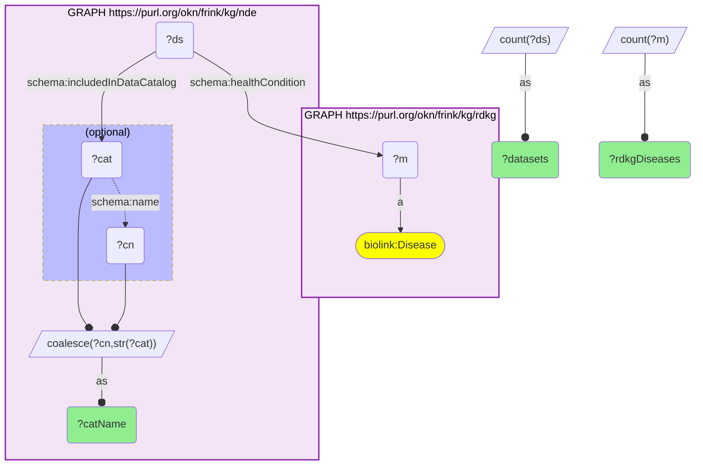

# D44-Q1: nde×rdkg (MONDO) — RDKG diseases with the most NIAID Data Ecosystem datasets: cancer 17,374, neoplasm 12,102, breast neoplasm 6,990; NCBI GEO supplies 96,296 of the tagged datasets

- **Date:** 2026-10-13
- **Model:** claude-opus-5-5
- **SPARQL endpoint:** https://apps.okn.us/federation/sparql
- **Generated by:** mcp-okn v0.1.0 (build 3195263)
- **Contents:** 2 queries · 2 query diagrams

## Knowledge graphs used

- `rdkg` — <https://purl.org/okn/frink/kg/rdkg>
- `nde` — <https://purl.org/okn/frink/kg/nde>

## Conversation

👤 **User**

Which RDKG diseases have the most datasets in the NIAID Data Ecosystem (NDE), joined on the MONDO id, and which data catalogs hold them?

---

🧠 **Assistant**

**The RDKG diseases with the most datasets in the NIAID Data Ecosystem are broad cancer and neoplasm terms (cancer 17,374 datasets, neoplasm 12,102, breast neoplasm 6,990). NCBI GEO supplies most of the tagged datasets: 96,296, covering 2,829 of the diseases.**

| Disease (MONDO) | NDE datasets | Catalogs |
|---|---|---|
| cancer | 17,374 | 5 |
| neoplasm | 12,102 | 3 |
| breast neoplasm | 6,990 | 5 |
| leukemia | 3,954 | 3 |
| prostate cancer | 2,974 | 2 |
| diabetes mellitus | 2,487 | 5 |
| acute myeloid leukemia | 2,449 | 4 |
| COVID-19 | 2,141 | 8 |
| colorectal cancer | 2,010 | 4 |
| rheumatoid arthritis | 2,006 | 4 |

**By catalog:**

| Catalog | Datasets | RDKG diseases |
|---|---|---|
| NCBI GEO | 96,296 | 2,829 |
| Vivli | 3,824 | 439 |
| ImmPort | 1,044 | 112 |
| Project Tycho | 503 | 64 |
| Zenodo | 503 | 64 |
| RADx Data Hub | 178 | 31 |
| ImmuneSpace | 157 | 38 |
| VDJServer | 59 | 52 |

**What the join gives.** RDKG carries the disease's genes, phenotypes and treatments; NDE says which public datasets study it and where they are held. COVID-19 is spread over the most catalogs (8), reflecting the pandemic-era data hubs (RADx, Project Tycho) alongside GEO.

**Read the counts with the MONDO hierarchy in mind.** NDE tags a dataset with the term its source used, so a breast-cancer study tagged "cancer" counts there, not under breast cancer. Totals for a disease family need MONDO's subclasses, which ubergraph supplies.

**Join form.** NDE's `schema:healthCondition` objects are MONDO IRIs, the same IRIs RDKG uses for its disease nodes, so the join needs no rewrite.

## SPARQL queries executed

#### Query 1

_2026-10-14T06:48:15+00:00 · `rdkg`, `nde`_

```sparql
PREFIX biolink: <https://w3id.org/biolink/vocab/>
PREFIX rdfs: <http://www.w3.org/2000/01/rdf-schema#>
PREFIX skos: <http://www.w3.org/2004/02/skos/core#>
PREFIX up: <http://purl.uniprot.org/core/>
PREFIX obo: <http://purl.obolibrary.org/obo/>
PREFIX schema: <http://schema.org/>
SELECT ?m (SAMPLE(?nm) AS ?disease) (COUNT(DISTINCT ?ds) AS ?ndeDatasets) (COUNT(DISTINCT ?cat) AS ?catalogs) WHERE {
  { SELECT DISTINCT ?m WHERE { GRAPH <https://purl.org/okn/frink/kg/rdkg> { ?m a biolink:Disease } } }
  GRAPH <https://purl.org/okn/frink/kg/nde> { ?ds schema:healthCondition ?m . OPTIONAL { ?ds schema:includedInDataCatalog ?cat } OPTIONAL { ?m schema:name ?nm } }
} GROUP BY ?m ORDER BY DESC(?ndeDatasets) LIMIT 15
```



_15 row(s) — showing first 3_

| m | disease | ndeDatasets | catalogs |
| --- | --- | --- | --- |
| http://purl.obolibrary.org/obo/MONDO_0004992 | cancer | 17374 | 5 |
| http://purl.obolibrary.org/obo/MONDO_0005070 | neoplasm | 12102 | 3 |
| http://purl.obolibrary.org/obo/MONDO_0021100 | breast neoplasm | 6990 | 5 |

#### Query 2

_2026-10-14T06:48:15+00:00 · `rdkg`, `nde`_

```sparql
PREFIX biolink: <https://w3id.org/biolink/vocab/>
PREFIX rdfs: <http://www.w3.org/2000/01/rdf-schema#>
PREFIX skos: <http://www.w3.org/2004/02/skos/core#>
PREFIX up: <http://purl.uniprot.org/core/>
PREFIX obo: <http://purl.obolibrary.org/obo/>
PREFIX schema: <http://schema.org/>
SELECT ?catName (COUNT(DISTINCT ?ds) AS ?datasets) (COUNT(DISTINCT ?m) AS ?rdkgDiseases) WHERE {
  { SELECT DISTINCT ?m WHERE { GRAPH <https://purl.org/okn/frink/kg/rdkg> { ?m a biolink:Disease } } }
  GRAPH <https://purl.org/okn/frink/kg/nde> { ?ds schema:healthCondition ?m ; schema:includedInDataCatalog ?cat . OPTIONAL { ?cat schema:name ?cn } BIND(COALESCE(?cn, STR(?cat)) AS ?catName) }
} GROUP BY ?catName ORDER BY DESC(?datasets) LIMIT 15
```



_8 row(s)_

| catName | datasets | rdkgDiseases |
| --- | --- | --- |
| NCBI GEO | 96296 | 2829 |
| Vivli | 3824 | 439 |
| ImmPort | 1044 | 112 |
| Project Tycho | 503 | 64 |
| Zenodo | 503 | 64 |
| RADx Data Hub | 178 | 31 |
| ImmuneSpace | 157 | 38 |
| VDJServer | 59 | 52 |
