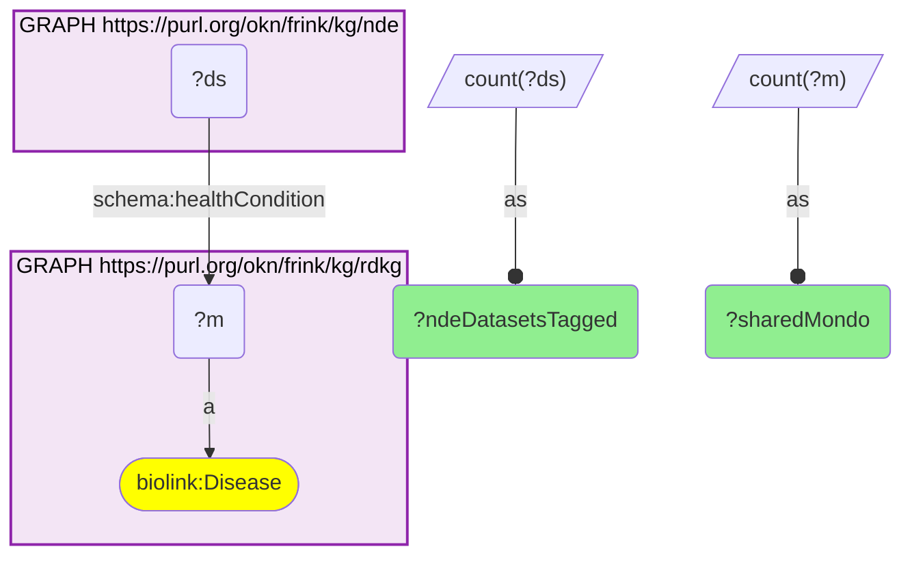
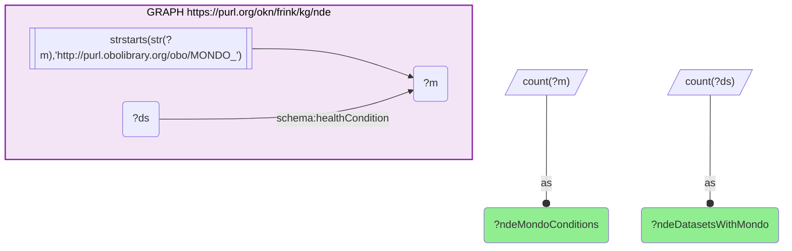

# D44-Q2: nde×rdkg — 2,907 of NDE's 3,364 MONDO health conditions (86%) are RDKG diseases, tagging 101,904 of 113,181 MONDO-tagged datasets

- **Date:** 2026-10-13
- **Model:** claude-opus-5-5
- **SPARQL endpoint:** https://apps.okn.us/federation/sparql
- **Generated by:** mcp-okn v0.1.0 (build 3195263)
- **Contents:** 2 queries · 2 query diagrams

## Knowledge graphs used

- `rdkg` — <https://purl.org/okn/frink/kg/rdkg>
- `nde` — <https://purl.org/okn/frink/kg/nde>

## Conversation

👤 **User**

Same crosswalk, coverage angle: how many of NDE's MONDO health conditions are RDKG diseases, and how many datasets do they tag?

---

🧠 **Assistant**

**2,907 of the NIAID Data Ecosystem's 3,364 MONDO health conditions (86%) are RDKG diseases, and they tag 101,904 of NDE's 113,181 MONDO-tagged datasets (90%).**

| Measure | Count |
|---|---|
| NDE MONDO health conditions | 3,364 |
| of which are RDKG diseases | 2,907 |
| NDE datasets tagged with a MONDO condition | 113,181 |
| of which tagged with a shared disease | 101,904 |

**RDKG covers almost all of NDE's disease vocabulary.** RDKG's disease set is broad (22,176 MONDO terms, rare and common), so most conditions that dataset curators tag in NDE are already in it. The other 457 conditions are MONDO terms outside RDKG's disease set.

**What this enables.** A rare-disease question in RDKG (its genes, phenotypes, treatments) can be followed by "which public datasets study it" in NDE without any identifier mapping, and a dataset found in NDE can be put in its disease context through RDKG.

**Join form.** `schema:healthCondition` (NDE) → MONDO IRI = RDKG `biolink:Disease` node. No rewrite.

## SPARQL queries executed

#### Query 1

_2026-10-14T06:48:15+00:00 · `rdkg`, `nde`_

```sparql
PREFIX biolink: <https://w3id.org/biolink/vocab/>
PREFIX rdfs: <http://www.w3.org/2000/01/rdf-schema#>
PREFIX skos: <http://www.w3.org/2004/02/skos/core#>
PREFIX up: <http://purl.uniprot.org/core/>
PREFIX obo: <http://purl.obolibrary.org/obo/>
PREFIX schema: <http://schema.org/>
SELECT (COUNT(DISTINCT ?m) AS ?sharedMondo) (COUNT(DISTINCT ?ds) AS ?ndeDatasetsTagged) WHERE {
  { SELECT DISTINCT ?m WHERE { GRAPH <https://purl.org/okn/frink/kg/rdkg> { ?m a biolink:Disease } } }
  GRAPH <https://purl.org/okn/frink/kg/nde> { ?ds schema:healthCondition ?m }
}
```



_1 row(s)_

| sharedMondo | ndeDatasetsTagged |
| --- | --- |
| 2907 | 101904 |

#### Query 2

_2026-10-14T06:48:15+00:00 · `nde`_

```sparql
PREFIX biolink: <https://w3id.org/biolink/vocab/>
PREFIX rdfs: <http://www.w3.org/2000/01/rdf-schema#>
PREFIX skos: <http://www.w3.org/2004/02/skos/core#>
PREFIX up: <http://purl.uniprot.org/core/>
PREFIX obo: <http://purl.obolibrary.org/obo/>
PREFIX schema: <http://schema.org/>
SELECT (COUNT(DISTINCT ?m) AS ?ndeMondoConditions) (COUNT(DISTINCT ?ds) AS ?ndeDatasetsWithMondo) WHERE {
  GRAPH <https://purl.org/okn/frink/kg/nde> { ?ds schema:healthCondition ?m FILTER(STRSTARTS(STR(?m),'http://purl.obolibrary.org/obo/MONDO_')) }
}
```



_1 row(s)_

| ndeMondoConditions | ndeDatasetsWithMondo |
| --- | --- |
| 3364 | 113181 |
