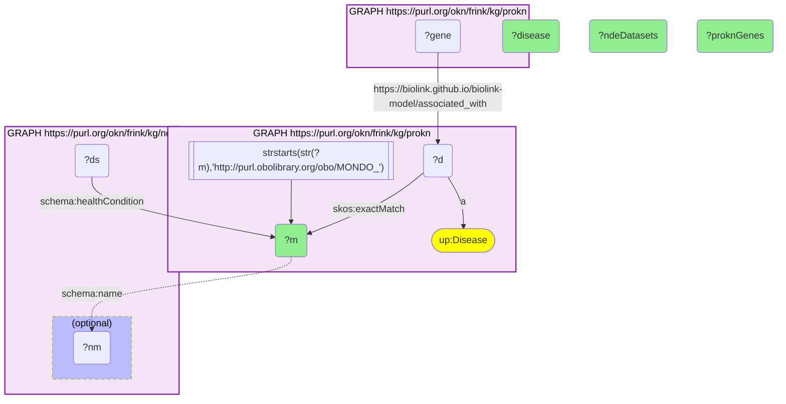

# D45-Q1: nde×prokn (MONDO) — diseases with both ProKN gene associations and NDE datasets: leukemia (3,954 datasets, 150 genes), prostate cancer (2,974, 37), melanoma (2,492, 13)

- **Date:** 2026-10-13
- **Model:** claude-opus-5-5
- **SPARQL endpoint:** https://apps.okn.us/federation/sparql
- **Generated by:** mcp-okn v0.1.0 (build 3195263)
- **Contents:** 1 query · 1 query diagram

## Knowledge graphs used

- `prokn` — <https://purl.org/okn/frink/kg/prokn>
- `nde` — <https://purl.org/okn/frink/kg/nde>

## Conversation

👤 **User**

For diseases that ProKN associates with genes, how many NIAID Data Ecosystem datasets study each, joined on the MONDO id?

---

🧠 **Assistant**

**Among diseases ProKN associates with genes, leukemia has the most NIAID Data Ecosystem datasets (3,954) and also the most ProKN genes in this list (150). Prostate cancer (2,974 datasets, 37 genes) and melanoma (2,492, 13) follow.**

| Disease (MONDO) | NDE datasets | ProKN genes |
|---|---|---|
| leukemia | 3,954 | 150 |
| prostate cancer | 2,974 | 37 |
| melanoma | 2,492 | 13 |
| acute myeloid leukemia | 2,449 | 76 |
| hepatocellular carcinoma | 2,209 | 14 |
| ovarian cancer | 1,870 | 67 |
| lymphoma | 1,710 | 108 |
| type 2 diabetes mellitus | 1,149 | 13 |
| plasma cell myeloma | 1,115 | 14 |
| non-small cell lung carcinoma | 979 | 23 |
| pancreatitis | 975 | 7 |
| amyotrophic lateral sclerosis | 740 | 53 |
| Parkinson disease | 678 | 2 |
| systemic lupus erythematosus | 594 | 11 |
| autism | 547 | 2 |

**Data volume and gene knowledge do not track each other.** Parkinson disease and autism each have hundreds of datasets but only 2 ProKN gene associations; ALS has fewer datasets (740) but 53 genes. ProKN's gene associations come from its curated sources, so this is a statement about those sources, not about how much is known.

**Scope.** Only diseases with at least one ProKN gene association are ranked (ProKN's `associated_with` edge from a gene to the disease record), so very broad terms like "cancer", which carry no direct gene association there, do not appear.

**Join form.** ProKN `up:Disease` → `skos:exactMatch` → MONDO IRI = NDE `schema:healthCondition` object. No rewrite.

## SPARQL queries executed

#### Query 1

_2026-10-14T06:48:16+00:00 · `prokn`, `nde`_

```sparql
PREFIX biolink: <https://w3id.org/biolink/vocab/>
PREFIX rdfs: <http://www.w3.org/2000/01/rdf-schema#>
PREFIX skos: <http://www.w3.org/2004/02/skos/core#>
PREFIX up: <http://purl.uniprot.org/core/>
PREFIX obo: <http://purl.obolibrary.org/obo/>
PREFIX schema: <http://schema.org/>
SELECT ?m (SAMPLE(?nm) AS ?disease) (COUNT(DISTINCT ?ds) AS ?ndeDatasets) ?proknGenes WHERE {
  { SELECT ?m (COUNT(DISTINCT ?gene) AS ?proknGenes) WHERE { { SELECT DISTINCT ?d ?m WHERE { GRAPH <https://purl.org/okn/frink/kg/prokn> { ?d a up:Disease ; skos:exactMatch ?m FILTER(STRSTARTS(STR(?m),'http://purl.obolibrary.org/obo/MONDO_')) } } }
      GRAPH <https://purl.org/okn/frink/kg/prokn> { ?gene <https://biolink.github.io/biolink-model/associated_with> ?d } } GROUP BY ?m }
  GRAPH <https://purl.org/okn/frink/kg/nde> { ?ds schema:healthCondition ?m . OPTIONAL { ?m schema:name ?nm } }
} GROUP BY ?m ?proknGenes ORDER BY DESC(?ndeDatasets) LIMIT 15
```



_15 row(s)_

| m | disease | ndeDatasets | proknGenes |
| --- | --- | --- | --- |
| http://purl.obolibrary.org/obo/MONDO_0005059 | leukemia | 3954 | 150 |
| http://purl.obolibrary.org/obo/MONDO_0008315 | prostate cancer | 2974 | 37 |
| http://purl.obolibrary.org/obo/MONDO_0005105 | melanoma | 2492 | 13 |
| http://purl.obolibrary.org/obo/MONDO_0018874 | acute myeloid leukemia | 2449 | 76 |
| http://purl.obolibrary.org/obo/MONDO_0007256 | hepatocellular carcinoma | 2209 | 14 |
| http://purl.obolibrary.org/obo/MONDO_0008170 | ovarian cancer | 1870 | 67 |
| http://purl.obolibrary.org/obo/MONDO_0005062 | lymphoma | 1710 | 108 |
| http://purl.obolibrary.org/obo/MONDO_0005148 | type 2 diabetes mellitus | 1149 | 13 |
| http://purl.obolibrary.org/obo/MONDO_0009693 | plasma cell myeloma | 1115 | 14 |
| http://purl.obolibrary.org/obo/MONDO_0005233 | non-small cell lung carcinoma | 979 | 23 |
| http://purl.obolibrary.org/obo/MONDO_0004982 | pancreatitis | 975 | 7 |
| http://purl.obolibrary.org/obo/MONDO_0004976 | amyotrophic lateral sclerosis | 740 | 53 |
| http://purl.obolibrary.org/obo/MONDO_0005180 | Parkinson disease | 678 | 2 |
| http://purl.obolibrary.org/obo/MONDO_0007915 | systemic lupus erythematosus | 594 | 11 |
| http://purl.obolibrary.org/obo/MONDO_0005260 | autism | 547 | 2 |
