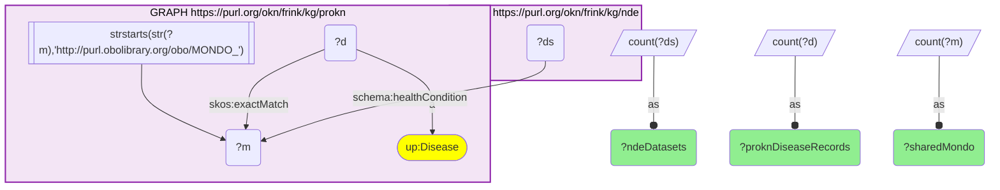
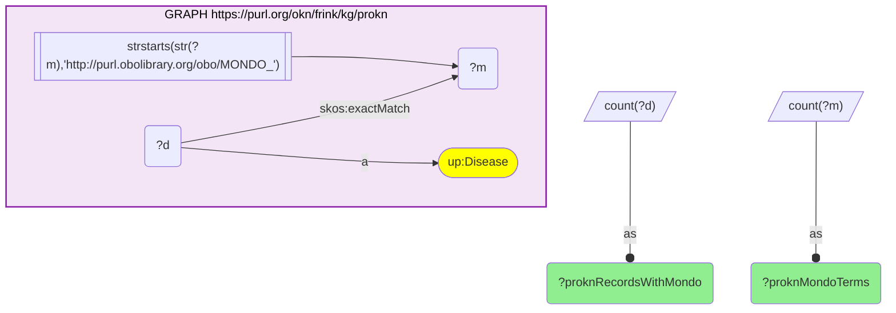

# D45-Q2: nde×prokn — 756 MONDO diseases shared (814 ProKN disease records), tagging 61,164 NDE datasets

- **Date:** 2026-10-13
- **Model:** claude-opus-5-5
- **SPARQL endpoint:** https://apps.okn.us/federation/sparql
- **Generated by:** mcp-okn v0.1.0 (build 3195263)
- **Contents:** 2 queries · 2 query diagrams

## Knowledge graphs used

- `prokn` — <https://purl.org/okn/frink/kg/prokn>
- `nde` — <https://purl.org/okn/frink/kg/nde>

## Conversation

👤 **User**

Same crosswalk, coverage angle: how many diseases do ProKN and NDE share on MONDO, and how many NDE datasets do they tag?

---

🧠 **Assistant**

**ProKN and the NIAID Data Ecosystem share 756 diseases on the MONDO id, held on 814 ProKN disease records, and those diseases tag 61,164 NDE datasets.**

| Measure | Count |
|---|---|
| shared MONDO diseases | 756 |
| ProKN disease records carrying them | 814 |
| NDE datasets tagged with them | 61,164 |

**Why fewer than RDKG.** Only 3,147 of ProKN's disease records carry a MONDO id at all (see the second query), so the joinable set is small; RDKG, whose disease vocabulary is far broader, shares 2,907 diseases with NDE (crosswalk A32).

**More records than diseases.** 814 ProKN records carry the 756 MONDO ids, so some MONDO terms sit on more than one ProKN disease record. Count diseases on the MONDO id, not on ProKN's record.

**Join form.** ProKN `up:Disease` → `skos:exactMatch` → MONDO IRI = NDE `schema:healthCondition` object.

## SPARQL queries executed

#### Query 1

_2026-10-14T06:48:16+00:00 · `prokn`, `nde`_

```sparql
PREFIX biolink: <https://w3id.org/biolink/vocab/>
PREFIX rdfs: <http://www.w3.org/2000/01/rdf-schema#>
PREFIX skos: <http://www.w3.org/2004/02/skos/core#>
PREFIX up: <http://purl.uniprot.org/core/>
PREFIX obo: <http://purl.obolibrary.org/obo/>
PREFIX schema: <http://schema.org/>
SELECT (COUNT(DISTINCT ?m) AS ?sharedMondo) (COUNT(DISTINCT ?d) AS ?proknDiseaseRecords) (COUNT(DISTINCT ?ds) AS ?ndeDatasets) WHERE {
  { SELECT DISTINCT ?d ?m WHERE { GRAPH <https://purl.org/okn/frink/kg/prokn> { ?d a up:Disease ; skos:exactMatch ?m FILTER(STRSTARTS(STR(?m),'http://purl.obolibrary.org/obo/MONDO_')) } } }
  GRAPH <https://purl.org/okn/frink/kg/nde> { ?ds schema:healthCondition ?m }
}
```



_1 row(s)_

| sharedMondo | proknDiseaseRecords | ndeDatasets |
| --- | --- | --- |
| 756 | 814 | 61164 |

#### Query 2

_2026-10-14T06:48:16+00:00 · `prokn`_

```sparql
PREFIX biolink: <https://w3id.org/biolink/vocab/>
PREFIX rdfs: <http://www.w3.org/2000/01/rdf-schema#>
PREFIX skos: <http://www.w3.org/2004/02/skos/core#>
PREFIX up: <http://purl.uniprot.org/core/>
PREFIX obo: <http://purl.obolibrary.org/obo/>
PREFIX schema: <http://schema.org/>
SELECT (COUNT(DISTINCT ?d) AS ?proknRecordsWithMondo) (COUNT(DISTINCT ?m) AS ?proknMondoTerms) WHERE { { SELECT DISTINCT ?d ?m WHERE { GRAPH <https://purl.org/okn/frink/kg/prokn> { ?d a up:Disease ; skos:exactMatch ?m FILTER(STRSTARTS(STR(?m),'http://purl.obolibrary.org/obo/MONDO_')) } } } }
```



_1 row(s)_

| proknRecordsWithMondo | proknMondoTerms |
| --- | --- |
| 3147 | 3191 |
