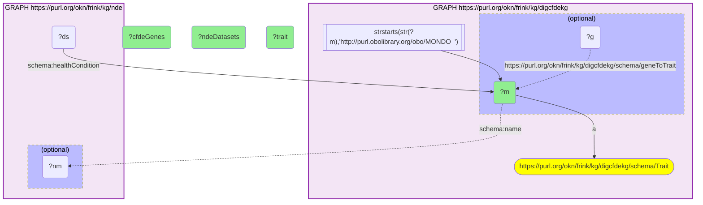

# D46-Q1: digcfdekg×nde (MONDO) — CFDE traits with the most NDE datasets: cancer (17,374 datasets, 322 genes), diabetes mellitus (2,487, 130), COVID-19 (2,141, 723); multiple sclerosis has the most genes (1,059) for 797 datasets

- **Date:** 2026-10-13
- **Model:** claude-opus-5-5
- **SPARQL endpoint:** https://apps.okn.us/federation/sparql
- **Generated by:** mcp-okn v0.1.0 (build 3195263)
- **Contents:** 1 query · 1 query diagram

## Knowledge graphs used

- `digcfdekg` — <https://purl.org/okn/frink/kg/digcfdekg>
- `nde` — <https://purl.org/okn/frink/kg/nde>

## Conversation

👤 **User**

Which CFDE REVEAL (digcfdekg) disease traits have the most NIAID Data Ecosystem datasets, joined on the MONDO id, and how many genes does digcfdekg associate with each?

---

🧠 **Assistant**

**The CFDE REVEAL traits with the most NIAID Data Ecosystem datasets are cancer (17,374 datasets), diabetes mellitus (2,487) and COVID-19 (2,141). The gene counts run differently: multiple sclerosis has the most digcfdekg genes in the list (1,059) for 797 datasets.**

| Trait (MONDO) | NDE datasets | digcfdekg genes |
|---|---|---|
| cancer | 17,374 | 322 |
| diabetes mellitus | 2,487 | 130 |
| COVID-19 | 2,141 | 723 |
| colorectal cancer | 2,010 | 632 |
| lymphoma | 1,710 | 4 |
| squamous cell carcinoma | 1,482 | 88 |
| type 2 diabetes mellitus | 1,149 | 849 |
| autoimmune disease | 1,055 | 440 |
| tuberculosis | 954 | 98 |
| multiple sclerosis | 797 | 1,059 |
| colonic neoplasm | 794 | 41 |
| chronic obstructive pulmonary disease | 738 | 974 |
| drug-induced liver injury | 681 | 3 |
| Parkinson disease | 678 | 432 |
| heart failure | 677 | 770 |

**Two kinds of evidence for the same trait.** digcfdekg's gene-to-trait links are statistically inferred from genomic data (GWAS-style), so polygenic traits such as multiple sclerosis, COPD and type 2 diabetes collect many genes. NDE counts the public datasets that study the trait. Together they point to where gene-level hypotheses could be tested against existing data: COPD and heart failure have hundreds of genes and hundreds of datasets.

**Join form.** digcfdekg's trait nodes are MONDO IRIs, the same IRIs NDE uses on `schema:healthCondition`, so no rewrite is needed.

## SPARQL queries executed

#### Query 1

_2026-10-14T06:48:17+00:00 · `digcfdekg`, `nde`_

```sparql
PREFIX biolink: <https://w3id.org/biolink/vocab/>
PREFIX rdfs: <http://www.w3.org/2000/01/rdf-schema#>
PREFIX skos: <http://www.w3.org/2004/02/skos/core#>
PREFIX up: <http://purl.uniprot.org/core/>
PREFIX obo: <http://purl.obolibrary.org/obo/>
PREFIX schema: <http://schema.org/>
SELECT ?m (SAMPLE(?nm) AS ?trait) (COUNT(DISTINCT ?ds) AS ?ndeDatasets) ?cfdeGenes WHERE {
  { SELECT ?m (COUNT(DISTINCT ?g) AS ?cfdeGenes) WHERE { GRAPH <https://purl.org/okn/frink/kg/digcfdekg> { ?m a <https://purl.org/okn/frink/kg/digcfdekg/schema/Trait> FILTER(STRSTARTS(STR(?m),'http://purl.obolibrary.org/obo/MONDO_'))
      OPTIONAL { ?g <https://purl.org/okn/frink/kg/digcfdekg/schema/geneToTrait> ?m } } } GROUP BY ?m }
  GRAPH <https://purl.org/okn/frink/kg/nde> { ?ds schema:healthCondition ?m . OPTIONAL { ?m schema:name ?nm } }
} GROUP BY ?m ?cfdeGenes ORDER BY DESC(?ndeDatasets) LIMIT 15
```



_15 row(s)_

| m | trait | ndeDatasets | cfdeGenes |
| --- | --- | --- | --- |
| http://purl.obolibrary.org/obo/MONDO_0004992 | cancer | 17374 | 322 |
| http://purl.obolibrary.org/obo/MONDO_0005015 | diabetes mellitus | 2487 | 130 |
| http://purl.obolibrary.org/obo/MONDO_0100096 | COVID-19 | 2141 | 723 |
| http://purl.obolibrary.org/obo/MONDO_0005575 | colorectal cancer | 2010 | 632 |
| http://purl.obolibrary.org/obo/MONDO_0005062 | lymphoma | 1710 | 4 |
| http://purl.obolibrary.org/obo/MONDO_0005096 | squamous cell carcinoma | 1482 | 88 |
| http://purl.obolibrary.org/obo/MONDO_0005148 | type 2 diabetes mellitus | 1149 | 849 |
| http://purl.obolibrary.org/obo/MONDO_0007179 | autoimmune disease | 1055 | 440 |
| http://purl.obolibrary.org/obo/MONDO_0018076 | tuberculosis | 954 | 98 |
| http://purl.obolibrary.org/obo/MONDO_0005301 | multiple sclerosis | 797 | 1059 |
| http://purl.obolibrary.org/obo/MONDO_0005401 | colonic neoplasm | 794 | 41 |
| http://purl.obolibrary.org/obo/MONDO_0005002 | chronic obstructive pulmonary disease | 738 | 974 |
| http://purl.obolibrary.org/obo/MONDO_0005359 | drug-induced liver injury | 681 | 3 |
| http://purl.obolibrary.org/obo/MONDO_0005180 | Parkinson disease | 678 | 432 |
| http://purl.obolibrary.org/obo/MONDO_0005252 | heart failure | 677 | 770 |
