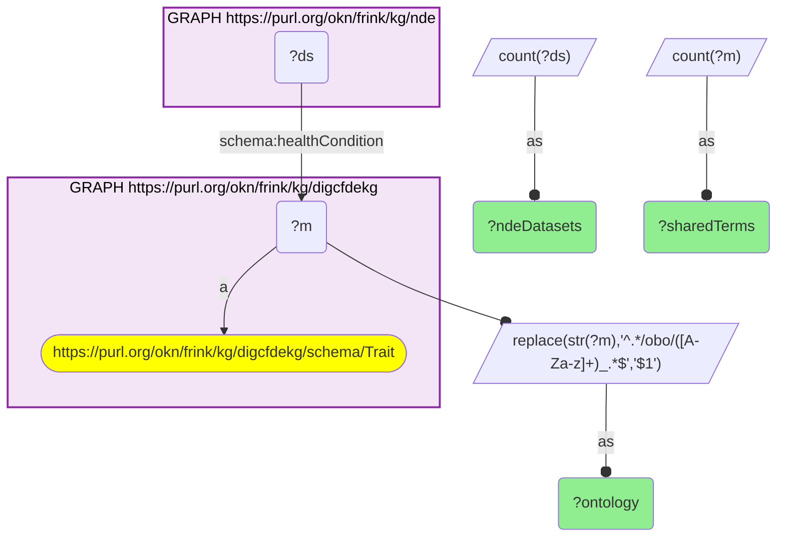
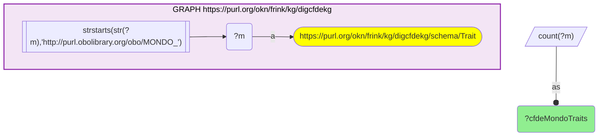

# D46-Q2: digcfdekg×nde — 158 of digcfdekg's 226 MONDO traits (70%) are NDE health conditions, tagging 38,810 datasets; 13 HP traits add 894 more

- **Date:** 2026-10-13
- **Model:** claude-opus-5-5
- **SPARQL endpoint:** https://apps.okn.us/federation/sparql
- **Generated by:** mcp-okn v0.1.0 (build 3195263)
- **Contents:** 2 queries · 2 query diagrams

## Knowledge graphs used

- `digcfdekg` — <https://purl.org/okn/frink/kg/digcfdekg>
- `nde` — <https://purl.org/okn/frink/kg/nde>

## Conversation

👤 **User**

Same crosswalk, coverage angle: how many digcfdekg traits are NDE health conditions, by ontology, and how many datasets do they tag?

---

🧠 **Assistant**

**158 of digcfdekg's 226 MONDO disease traits (70%) are NIAID Data Ecosystem health conditions, tagging 38,810 datasets. 13 HP phenotype traits add 894 more datasets.**

| Ontology | Shared terms | NDE datasets |
|---|---|---|
| MONDO | 158 | 38,810 |
| HP | 13 | 894 |

| Measure | Count |
|---|---|
| digcfdekg MONDO traits | 226 |

**What the join adds.** digcfdekg links each trait to the genes and gene sets it infers; NDE lists the datasets that study the trait. The join turns a trait's gene list into a pointer to data that could test it.

**Scope.** The crosswalk is counted on MONDO (158); the HP rows are the same mechanism on phenotype terms and are reported separately. digcfdekg's other trait vocabularies (EFO, CHEBI, Orphanet and others) are not NDE condition terms and do not join here.

**Join form.** Same MONDO or HP IRI on both sides (digcfdekg trait node, NDE `schema:healthCondition`).

## SPARQL queries executed

#### Query 1

_2026-10-14T06:48:17+00:00 · `digcfdekg`, `nde`_

```sparql
PREFIX biolink: <https://w3id.org/biolink/vocab/>
PREFIX rdfs: <http://www.w3.org/2000/01/rdf-schema#>
PREFIX skos: <http://www.w3.org/2004/02/skos/core#>
PREFIX up: <http://purl.uniprot.org/core/>
PREFIX obo: <http://purl.obolibrary.org/obo/>
PREFIX schema: <http://schema.org/>
SELECT ?ontology (COUNT(DISTINCT ?m) AS ?sharedTerms) (COUNT(DISTINCT ?ds) AS ?ndeDatasets) WHERE {
  { SELECT DISTINCT ?m WHERE { GRAPH <https://purl.org/okn/frink/kg/digcfdekg> { ?m a <https://purl.org/okn/frink/kg/digcfdekg/schema/Trait> } } }
  GRAPH <https://purl.org/okn/frink/kg/nde> { ?ds schema:healthCondition ?m }
  BIND(REPLACE(STR(?m),'^.*/obo/([A-Za-z]+)_.*$','$1') AS ?ontology)
} GROUP BY ?ontology ORDER BY DESC(?sharedTerms)
```



_2 row(s)_

| ontology | sharedTerms | ndeDatasets |
| --- | --- | --- |
| MONDO | 158 | 38810 |
| HP | 13 | 894 |

#### Query 2

_2026-10-14T06:48:17+00:00 · `digcfdekg`_

```sparql
PREFIX biolink: <https://w3id.org/biolink/vocab/>
PREFIX rdfs: <http://www.w3.org/2000/01/rdf-schema#>
PREFIX skos: <http://www.w3.org/2004/02/skos/core#>
PREFIX up: <http://purl.uniprot.org/core/>
PREFIX obo: <http://purl.obolibrary.org/obo/>
PREFIX schema: <http://schema.org/>
SELECT (COUNT(DISTINCT ?m) AS ?cfdeMondoTraits) WHERE { GRAPH <https://purl.org/okn/frink/kg/digcfdekg> { ?m a <https://purl.org/okn/frink/kg/digcfdekg/schema/Trait> FILTER(STRSTARTS(STR(?m),'http://purl.obolibrary.org/obo/MONDO_')) } }
```



_1 row(s)_

| cfdeMondoTraits |
| --- |
| 226 |
