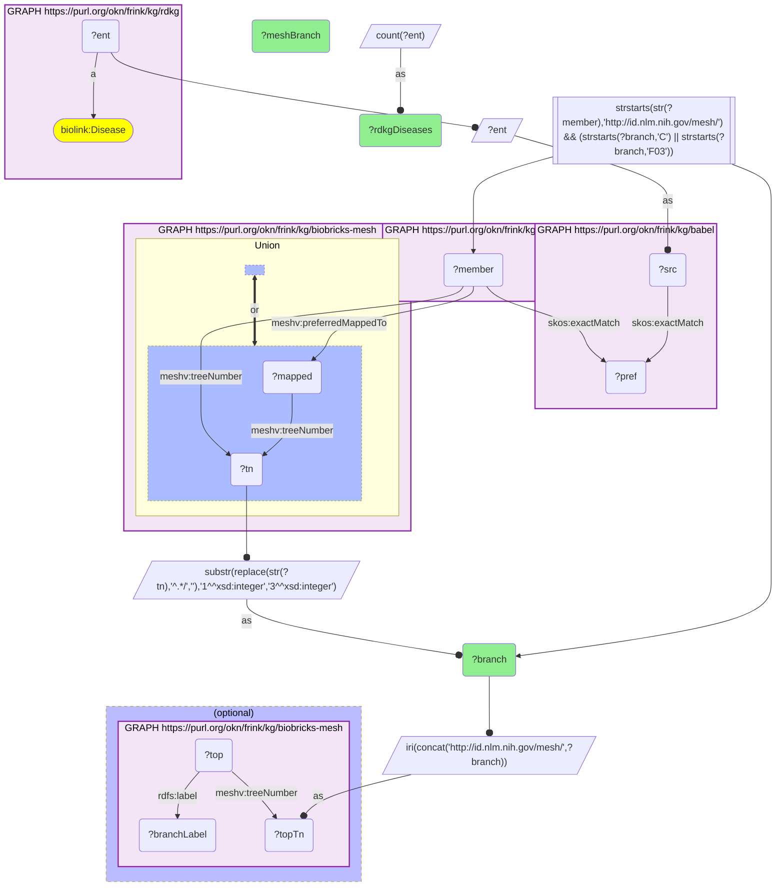

# D47-Q1: biobricks-mesh×rdkg (MONDO→MeSH via Babel) — RDKG diseases by MeSH category: congenital/hereditary (C16) 3,664, nervous system (C10) 2,341, signs and symptoms (C23) 1,747

- **Date:** 2026-10-13
- **Model:** claude-opus-5-5
- **SPARQL endpoint:** https://apps.okn.us/federation/sparql
- **Generated by:** mcp-okn v0.1.0 (build 3195263)
- **Contents:** 1 query · 1 query diagram

## Knowledge graphs used

- `rdkg` — <https://purl.org/okn/frink/kg/rdkg>
- `babel` — <https://purl.org/okn/frink/kg/babel>
- `biobricks-mesh` — <https://purl.org/okn/frink/kg/biobricks-mesh>

## Conversation

👤 **User**

Through Babel, which MeSH disease categories hold the most RDKG diseases?

---

🧠 **Assistant**

**Through babel, RDKG's diseases fall mostly into MeSH's congenital, hereditary and neonatal category (C16, 3,664 diseases), nervous-system diseases (C10, 2,341) and pathological conditions, signs and symptoms (C23, 1,747).**

| MeSH category | RDKG diseases |
|---|---|
| C16 Congenital, Hereditary, and Neonatal Diseases and Abnormalities | 3,664 |
| C10 Nervous System Diseases | 2,341 |
| C23 Pathological Conditions, Signs and Symptoms | 1,747 |
| C05 Musculoskeletal Diseases | 1,652 |
| C18 Nutritional and Metabolic Diseases | 984 |
| C17 Skin and Connective Tissue Diseases | 958 |
| C11 Eye Diseases | 912 |
| C04 Neoplasms | 778 |
| C14 Cardiovascular Diseases | 691 |
| C01 Infections | 672 |
| C12 Urogenital Diseases | 663 |
| C15 Hemic and Lymphatic Diseases | 531 |
| F03 Mental Disorders | 530 |

Category labels are read from biobricks-mesh (the descriptor at each top tree number).

**The profile is that of a rare-disease graph.** Inherited and congenital conditions lead, with neurological and musculoskeletal disorders next, the usual shape of Mendelian disease catalogues. A disease counts in every category its MeSH record sits in, so rows overlap.

**What MeSH adds.** RDKG has MONDO's own hierarchy; MeSH adds the categories PubMed indexes under, so an RDKG disease set can be matched to literature by MeSH heading, and a MeSH category can be turned into an RDKG disease list.

**Join form.** RDKG disease (MONDO IRI) → babel clique → `http://id.nlm.nih.gov/mesh/{id}` member = biobricks-mesh record. A supplementary disease record (`C…`) is placed by the descriptor it maps to (`meshv:preferredMappedTo`).

## SPARQL queries executed

#### Query 1

_2026-10-14T06:56:33+00:00 · `rdkg`, `babel`, `biobricks-mesh`_

```sparql
PREFIX biolink: <https://w3id.org/biolink/vocab/>
PREFIX rdfs: <http://www.w3.org/2000/01/rdf-schema#>
PREFIX rdf: <http://www.w3.org/1999/02/22-rdf-syntax-ns#>
PREFIX skos: <http://www.w3.org/2004/02/skos/core#>
PREFIX up: <http://purl.uniprot.org/core/>
PREFIX schema: <http://schema.org/>
PREFIX meshv: <http://id.nlm.nih.gov/mesh/vocab#>
SELECT ?branch (SAMPLE(?branchLabel) AS ?meshBranch) (COUNT(DISTINCT ?ent) AS ?rdkgDiseases) WHERE {
  { SELECT DISTINCT ?ent ?branch WHERE {
    { SELECT DISTINCT ?ent ?member WHERE {
    { SELECT DISTINCT ?ent ?pref WHERE {
        { SELECT DISTINCT ?ent ?src WHERE { GRAPH <https://purl.org/okn/frink/kg/rdkg> { ?ent a <https://w3id.org/biolink/vocab/Disease> } BIND(?ent AS ?src) } }
        GRAPH <https://purl.org/okn/frink/kg/babel> { ?src <http://www.w3.org/2004/02/skos/core#exactMatch> ?pref } } }
    GRAPH <https://purl.org/okn/frink/kg/babel> { ?member <http://www.w3.org/2004/02/skos/core#exactMatch> ?pref } } }
    FILTER(STRSTARTS(STR(?member),'http://id.nlm.nih.gov/mesh/'))
  GRAPH <https://purl.org/okn/frink/kg/biobricks-mesh> { { ?member meshv:treeNumber ?tn } UNION { ?member meshv:preferredMappedTo ?mapped . ?mapped meshv:treeNumber ?tn } }
  BIND(SUBSTR(REPLACE(STR(?tn),'^.*/',''),1,3) AS ?branch)
    FILTER(STRSTARTS(?branch,'C') || STRSTARTS(?branch,'F03')) } }
  BIND(IRI(CONCAT('http://id.nlm.nih.gov/mesh/', ?branch)) AS ?topTn)
  OPTIONAL { GRAPH <https://purl.org/okn/frink/kg/biobricks-mesh> { ?top meshv:treeNumber ?topTn ; rdfs:label ?branchLabel } }
  
} GROUP BY ?branch ORDER BY DESC(?rdkgDiseases) LIMIT 15
```



_15 row(s)_

| branch | meshBranch | rdkgDiseases |
| --- | --- | --- |
| C16 | Congenital, Hereditary, and Neonatal Diseases and Abnormalities | 3664 |
| C10 | Nervous System Diseases | 2341 |
| C23 | Pathological Conditions, Signs and Symptoms | 1747 |
| C05 | Musculoskeletal Diseases | 1652 |
| C18 | Nutritional and Metabolic Diseases | 984 |
| C17 | Skin and Connective Tissue Diseases | 958 |
| C11 | Eye Diseases | 912 |
| C04 | Neoplasms | 778 |
| C14 | Cardiovascular Diseases | 691 |
| C01 | Infections | 672 |
| C12 | Urogenital Diseases | 663 |
| C15 | Hemic and Lymphatic Diseases | 531 |
| F03 | Mental Disorders | 530 |
| C19 | Endocrine System Diseases | 481 |
| C07 | Stomatognathic Diseases | 408 |
