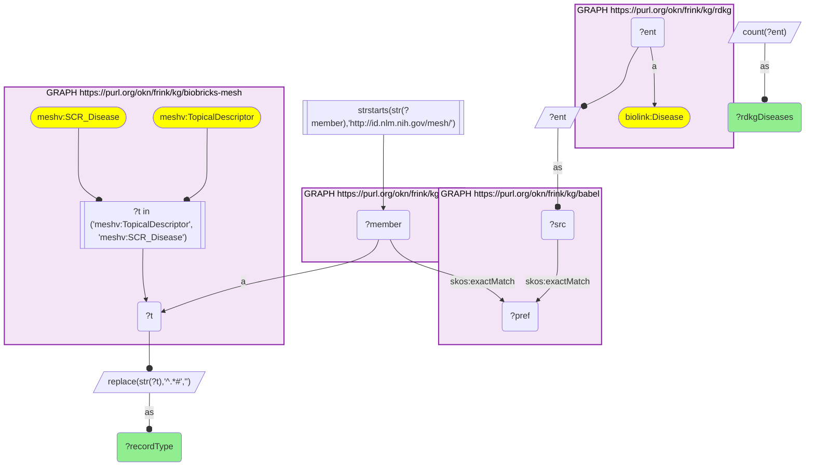
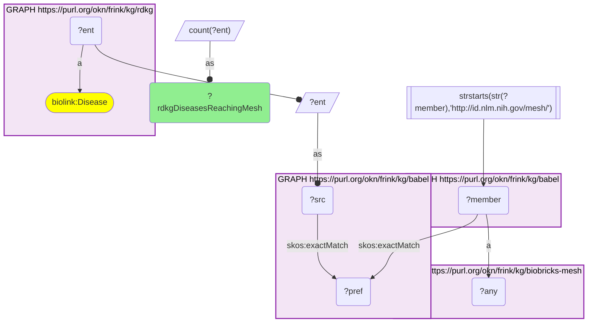
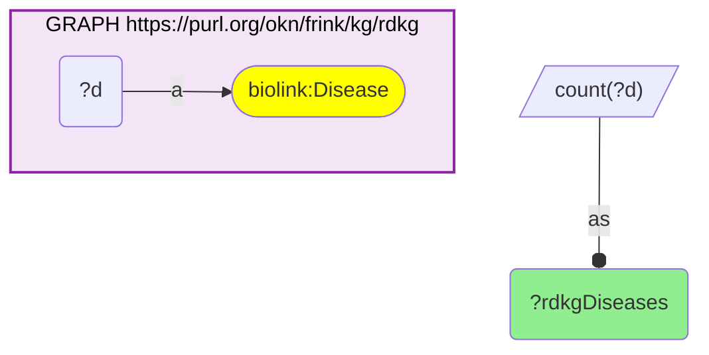

# D47-Q2: biobricks-mesh×rdkg — 7,934 of RDKG's 26,106 disease nodes reach a MeSH record through Babel, 5,004 of them through a supplementary disease record

- **Date:** 2026-10-13
- **Model:** claude-opus-5-5
- **SPARQL endpoint:** https://apps.okn.us/federation/sparql
- **Generated by:** mcp-okn v0.1.0 (build 3195263)
- **Contents:** 3 queries · 3 query diagrams

## Knowledge graphs used

- `rdkg` — <https://purl.org/okn/frink/kg/rdkg>
- `babel` — <https://purl.org/okn/frink/kg/babel>
- `biobricks-mesh` — <https://purl.org/okn/frink/kg/biobricks-mesh>

## Conversation

👤 **User**

Same crosswalk, coverage angle: how many RDKG diseases reach a MeSH record through Babel, and is it a main descriptor or a supplementary disease record?

---

🧠 **Assistant**

**7,934 of RDKG's 26,106 disease nodes reach a MeSH record through babel. 5,004 land on a supplementary disease record and 3,037 on a main descriptor; some reach both.**

| Measure | Count |
|---|---|
| RDKG disease nodes | 26,106 |
| reaching a biobricks-mesh record | 7,934 |
| through a supplementary disease record (SCR_Disease) | 5,004 |
| through a descriptor (TopicalDescriptor) | 3,037 |

**Supplementary records carry the rare diseases.** MeSH gives most rare diseases a supplementary concept record rather than a full descriptor, which is why more RDKG diseases land there. Each supplementary record points to the descriptor it is indexed under.

**Why not more.** Many RDKG nodes are grouped or very specific MONDO terms that have no MeSH equivalent in babel, and RDKG also has nodes outside MONDO's main namespace.

**Join form.** MONDO IRI → babel → MeSH member; both babel hops are staged in nested DISTINCT subqueries.

## SPARQL queries executed

#### Query 1

_2026-10-14T06:56:33+00:00 · `rdkg`, `babel`, `biobricks-mesh`_

```sparql
PREFIX biolink: <https://w3id.org/biolink/vocab/>
PREFIX rdfs: <http://www.w3.org/2000/01/rdf-schema#>
PREFIX rdf: <http://www.w3.org/1999/02/22-rdf-syntax-ns#>
PREFIX skos: <http://www.w3.org/2004/02/skos/core#>
PREFIX up: <http://purl.uniprot.org/core/>
PREFIX schema: <http://schema.org/>
PREFIX meshv: <http://id.nlm.nih.gov/mesh/vocab#>
SELECT ?recordType (COUNT(DISTINCT ?ent) AS ?rdkgDiseases) WHERE {
  { SELECT DISTINCT ?ent ?member WHERE {
    { SELECT DISTINCT ?ent ?pref WHERE {
        { SELECT DISTINCT ?ent ?src WHERE { GRAPH <https://purl.org/okn/frink/kg/rdkg> { ?ent a <https://w3id.org/biolink/vocab/Disease> } BIND(?ent AS ?src) } }
        GRAPH <https://purl.org/okn/frink/kg/babel> { ?src <http://www.w3.org/2004/02/skos/core#exactMatch> ?pref } } }
    GRAPH <https://purl.org/okn/frink/kg/babel> { ?member <http://www.w3.org/2004/02/skos/core#exactMatch> ?pref } } }
  FILTER(STRSTARTS(STR(?member),'http://id.nlm.nih.gov/mesh/'))
  GRAPH <https://purl.org/okn/frink/kg/biobricks-mesh> { ?member a ?t FILTER(?t IN (meshv:TopicalDescriptor, meshv:SCR_Disease)) }
  BIND(REPLACE(STR(?t),'^.*#','') AS ?recordType)
} GROUP BY ?recordType ORDER BY DESC(?rdkgDiseases)
```



_2 row(s)_

| recordType | rdkgDiseases |
| --- | --- |
| SCR_Disease | 5004 |
| TopicalDescriptor | 3037 |

#### Query 2

_2026-10-14T06:56:33+00:00 · `rdkg`, `babel`, `biobricks-mesh`_

```sparql
PREFIX biolink: <https://w3id.org/biolink/vocab/>
PREFIX rdfs: <http://www.w3.org/2000/01/rdf-schema#>
PREFIX rdf: <http://www.w3.org/1999/02/22-rdf-syntax-ns#>
PREFIX skos: <http://www.w3.org/2004/02/skos/core#>
PREFIX up: <http://purl.uniprot.org/core/>
PREFIX schema: <http://schema.org/>
PREFIX meshv: <http://id.nlm.nih.gov/mesh/vocab#>
SELECT (COUNT(DISTINCT ?ent) AS ?rdkgDiseasesReachingMesh) WHERE {
  { SELECT DISTINCT ?ent ?member WHERE {
    { SELECT DISTINCT ?ent ?pref WHERE {
        { SELECT DISTINCT ?ent ?src WHERE { GRAPH <https://purl.org/okn/frink/kg/rdkg> { ?ent a <https://w3id.org/biolink/vocab/Disease> } BIND(?ent AS ?src) } }
        GRAPH <https://purl.org/okn/frink/kg/babel> { ?src <http://www.w3.org/2004/02/skos/core#exactMatch> ?pref } } }
    GRAPH <https://purl.org/okn/frink/kg/babel> { ?member <http://www.w3.org/2004/02/skos/core#exactMatch> ?pref } } }
  FILTER(STRSTARTS(STR(?member),'http://id.nlm.nih.gov/mesh/'))
  GRAPH <https://purl.org/okn/frink/kg/biobricks-mesh> { ?member a ?any }
}
```



_1 row(s)_

| rdkgDiseasesReachingMesh |
| --- |
| 7934 |

#### Query 3

_2026-10-14T06:56:33+00:00 · `rdkg`_

```sparql
PREFIX biolink: <https://w3id.org/biolink/vocab/>
PREFIX rdfs: <http://www.w3.org/2000/01/rdf-schema#>
PREFIX rdf: <http://www.w3.org/1999/02/22-rdf-syntax-ns#>
PREFIX skos: <http://www.w3.org/2004/02/skos/core#>
PREFIX up: <http://purl.uniprot.org/core/>
PREFIX schema: <http://schema.org/>
PREFIX meshv: <http://id.nlm.nih.gov/mesh/vocab#>
SELECT (COUNT(DISTINCT ?d) AS ?rdkgDiseases) WHERE { GRAPH <https://purl.org/okn/frink/kg/rdkg> { ?d a biolink:Disease } }
```



_1 row(s)_

| rdkgDiseases |
| --- |
| 26106 |
