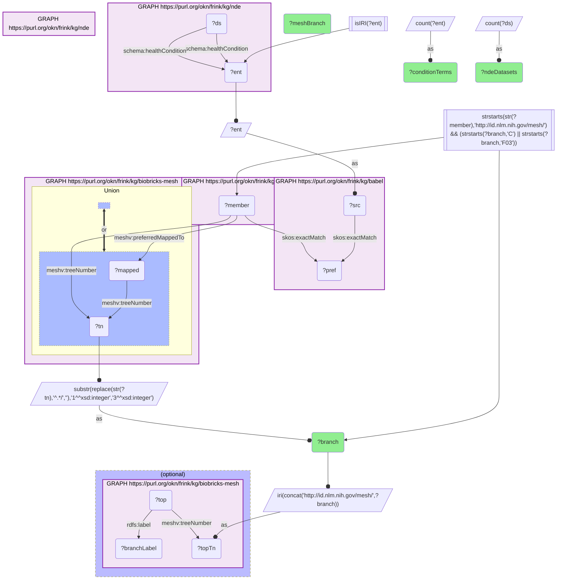

# D48-Q1: biobricks-mesh×nde (health condition→MeSH via Babel) — NDE datasets by MeSH category: neoplasms 55,087, signs and symptoms 27,508, nervous system 18,855, infections 16,008

- **Date:** 2026-10-13
- **Model:** claude-opus-5-5
- **SPARQL endpoint:** https://apps.okn.us/federation/sparql
- **Generated by:** mcp-okn v0.1.0 (build 3195263)
- **Contents:** 1 query · 1 query diagram

## Knowledge graphs used

- `nde` — <https://purl.org/okn/frink/kg/nde>
- `babel` — <https://purl.org/okn/frink/kg/babel>
- `biobricks-mesh` — <https://purl.org/okn/frink/kg/biobricks-mesh>

## Conversation

👤 **User**

Through Babel, how do the NIAID Data Ecosystem's datasets distribute over MeSH disease categories, by their health-condition terms?

---

🧠 **Assistant**

**Grouped by MeSH category through babel, the NIAID Data Ecosystem's datasets are led by neoplasms (55,087 datasets), followed by pathological conditions and signs (27,508), nervous-system diseases (18,855) and infections (16,008).**

| MeSH category | NDE condition terms | NDE datasets |
|---|---|---|
| C04 Neoplasms | 487 | 55,087 |
| C23 Pathological Conditions, Signs and Symptoms | 606 | 27,508 |
| C10 Nervous System Diseases | 774 | 18,855 |
| C01 Infections | 404 | 16,008 |
| C16 Congenital, Hereditary, and Neonatal Diseases and Abnormalities | 987 | 15,958 |
| C20 Immune System Diseases | 232 | 14,391 |
| C06 Digestive System Diseases | 233 | 13,278 |
| C17 Skin and Connective Tissue Diseases | 354 | 13,051 |
| C12 Urogenital Diseases | 290 | 12,939 |
| C14 Cardiovascular Diseases | 302 | 11,131 |

**Datasets and vocabulary diverge.** Congenital and hereditary conditions have the most distinct terms (987) but a third as many datasets as neoplasms; cancer studies are many per term. A dataset counts once per category its condition falls in.

**What the join is for.** MeSH categories give NDE a disease grouping that matches how the literature is indexed, without curating one: "all immune-system datasets" becomes a single MeSH branch.

**Join form.** NDE `schema:healthCondition` term (MONDO, NCIT, HP or DOID IRI) → babel → MeSH member → MeSH tree number.

## SPARQL queries executed

#### Query 1

_2026-10-14T06:56:34+00:00 · `nde`, `babel`, `biobricks-mesh`_

```sparql
PREFIX biolink: <https://w3id.org/biolink/vocab/>
PREFIX rdfs: <http://www.w3.org/2000/01/rdf-schema#>
PREFIX rdf: <http://www.w3.org/1999/02/22-rdf-syntax-ns#>
PREFIX skos: <http://www.w3.org/2004/02/skos/core#>
PREFIX up: <http://purl.uniprot.org/core/>
PREFIX schema: <http://schema.org/>
PREFIX meshv: <http://id.nlm.nih.gov/mesh/vocab#>
SELECT ?branch (SAMPLE(?branchLabel) AS ?meshBranch) (COUNT(DISTINCT ?ent) AS ?conditionTerms) (COUNT(DISTINCT ?ds) AS ?ndeDatasets) WHERE {
  { SELECT DISTINCT ?ent ?branch WHERE {
    { SELECT DISTINCT ?ent ?member WHERE {
    { SELECT DISTINCT ?ent ?pref WHERE {
        { SELECT DISTINCT ?ent ?src WHERE { GRAPH <https://purl.org/okn/frink/kg/nde> { ?ds <http://schema.org/healthCondition> ?ent } FILTER(isIRI(?ent)) BIND(?ent AS ?src) } }
        GRAPH <https://purl.org/okn/frink/kg/babel> { ?src <http://www.w3.org/2004/02/skos/core#exactMatch> ?pref } } }
    GRAPH <https://purl.org/okn/frink/kg/babel> { ?member <http://www.w3.org/2004/02/skos/core#exactMatch> ?pref } } }
    FILTER(STRSTARTS(STR(?member),'http://id.nlm.nih.gov/mesh/'))
  GRAPH <https://purl.org/okn/frink/kg/biobricks-mesh> { { ?member meshv:treeNumber ?tn } UNION { ?member meshv:preferredMappedTo ?mapped . ?mapped meshv:treeNumber ?tn } }
  BIND(SUBSTR(REPLACE(STR(?tn),'^.*/',''),1,3) AS ?branch)
    FILTER(STRSTARTS(?branch,'C') || STRSTARTS(?branch,'F03')) } }
  GRAPH <https://purl.org/okn/frink/kg/nde> { ?ds schema:healthCondition ?ent }
  BIND(IRI(CONCAT('http://id.nlm.nih.gov/mesh/', ?branch)) AS ?topTn)
  OPTIONAL { GRAPH <https://purl.org/okn/frink/kg/biobricks-mesh> { ?top meshv:treeNumber ?topTn ; rdfs:label ?branchLabel } }
} GROUP BY ?branch ORDER BY DESC(?ndeDatasets) LIMIT 15
```



_15 row(s)_

| branch | meshBranch | conditionTerms | ndeDatasets |
| --- | --- | --- | --- |
| C04 | Neoplasms | 487 | 55087 |
| C23 | Pathological Conditions, Signs and Symptoms | 606 | 27508 |
| C10 | Nervous System Diseases | 774 | 18855 |
| C01 | Infections | 404 | 16008 |
| C16 | Congenital, Hereditary, and Neonatal Diseases and Abnormalities | 987 | 15958 |
| C20 | Immune System Diseases | 232 | 14391 |
| C06 | Digestive System Diseases | 233 | 13278 |
| C17 | Skin and Connective Tissue Diseases | 354 | 13051 |
| C12 | Urogenital Diseases | 290 | 12939 |
| C14 | Cardiovascular Diseases | 302 | 11131 |
| C18 | Nutritional and Metabolic Diseases | 394 | 11116 |
| C08 | Respiratory Tract Diseases | 160 | 10011 |
| C15 | Hemic and Lymphatic Diseases | 278 | 9032 |
| C19 | Endocrine System Diseases | 177 | 8775 |
| F03 | Mental Disorders | 154 | 7539 |
