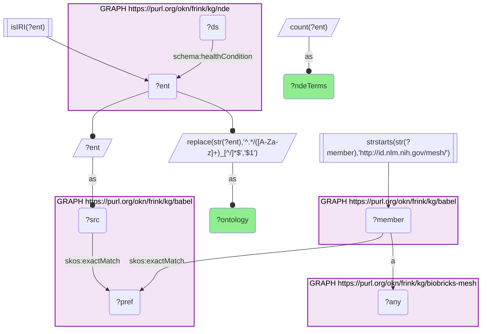
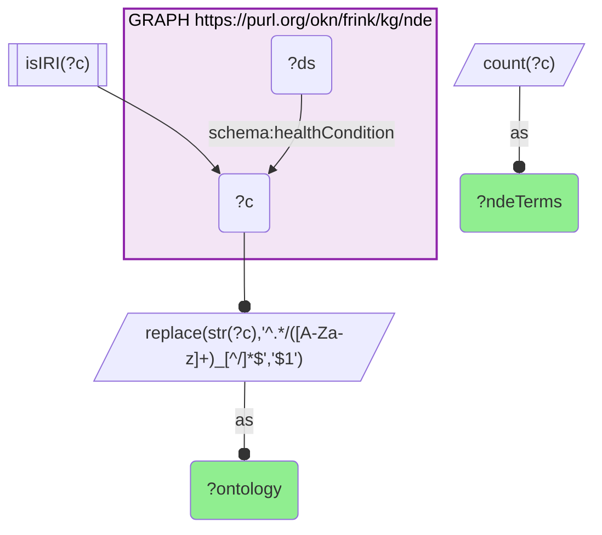

# D48-Q2: biobricks-mesh×nde — 3,467 NDE health-condition terms reach MeSH through Babel: 2,881 of 3,364 MONDO, 227 of 703 NCIT, 186 of 258 HP, 173 of 288 DOID

- **Date:** 2026-10-13
- **Model:** claude-opus-5-5
- **SPARQL endpoint:** https://apps.okn.us/federation/sparql
- **Generated by:** mcp-okn v0.1.0 (build 3195263)
- **Contents:** 2 queries · 2 query diagrams

## Knowledge graphs used

- `nde` — <https://purl.org/okn/frink/kg/nde>
- `babel` — <https://purl.org/okn/frink/kg/babel>
- `biobricks-mesh` — <https://purl.org/okn/frink/kg/biobricks-mesh>

## Conversation

👤 **User**

Same crosswalk, coverage angle: how many of NDE's health-condition terms reach a MeSH record through Babel, by the ontology of the NDE term?

---

🧠 **Assistant**

**3,467 of the NIAID Data Ecosystem's health-condition terms reach a MeSH record through babel. MONDO terms resolve best (2,881 of 3,364); NCIT terms least (227 of 703).**

| NDE term ontology | Terms reaching MeSH | All NDE terms |
|---|---|---|
| MONDO | 2,881 | 3,364 |
| NCIT | 227 | 703 |
| HP | 186 | 258 |
| DOID | 173 | 288 |

**NCIT trails.** Fewer than a third of NDE's NCIT terms have a MeSH member in their babel clique, so datasets tagged only with NCIT are the least reachable from MeSH.

**This is MeSH's broadest disease link.** NDE tags datasets with four ontologies, and babel brings all of them to one MeSH id.

**Join form.** NDE condition term → babel → `http://id.nlm.nih.gov/mesh/{id}`.

## SPARQL queries executed

#### Query 1

_2026-10-14T06:56:34+00:00 · `nde`, `babel`, `biobricks-mesh`_

```sparql
PREFIX biolink: <https://w3id.org/biolink/vocab/>
PREFIX rdfs: <http://www.w3.org/2000/01/rdf-schema#>
PREFIX rdf: <http://www.w3.org/1999/02/22-rdf-syntax-ns#>
PREFIX skos: <http://www.w3.org/2004/02/skos/core#>
PREFIX up: <http://purl.uniprot.org/core/>
PREFIX schema: <http://schema.org/>
PREFIX meshv: <http://id.nlm.nih.gov/mesh/vocab#>
SELECT ?ontology (COUNT(DISTINCT ?ent) AS ?ndeTerms) WHERE {
  { SELECT DISTINCT ?ent ?member WHERE {
    { SELECT DISTINCT ?ent ?pref WHERE {
        { SELECT DISTINCT ?ent ?src WHERE { GRAPH <https://purl.org/okn/frink/kg/nde> { ?ds <http://schema.org/healthCondition> ?ent } FILTER(isIRI(?ent)) BIND(?ent AS ?src) } }
        GRAPH <https://purl.org/okn/frink/kg/babel> { ?src <http://www.w3.org/2004/02/skos/core#exactMatch> ?pref } } }
    GRAPH <https://purl.org/okn/frink/kg/babel> { ?member <http://www.w3.org/2004/02/skos/core#exactMatch> ?pref } } }
  FILTER(STRSTARTS(STR(?member),'http://id.nlm.nih.gov/mesh/'))
  GRAPH <https://purl.org/okn/frink/kg/biobricks-mesh> { ?member a ?any }
  BIND(REPLACE(STR(?ent),'^.*/([A-Za-z]+)_[^/]*$','$1') AS ?ontology)
} GROUP BY ?ontology ORDER BY DESC(?ndeTerms)
```



_4 row(s) — showing first 3_

| ontology | ndeTerms |
| --- | --- |
| MONDO | 2881 |
| NCIT | 227 |
| HP | 186 |

#### Query 2

_2026-10-14T06:56:34+00:00 · `nde`_

```sparql
PREFIX biolink: <https://w3id.org/biolink/vocab/>
PREFIX rdfs: <http://www.w3.org/2000/01/rdf-schema#>
PREFIX rdf: <http://www.w3.org/1999/02/22-rdf-syntax-ns#>
PREFIX skos: <http://www.w3.org/2004/02/skos/core#>
PREFIX up: <http://purl.uniprot.org/core/>
PREFIX schema: <http://schema.org/>
PREFIX meshv: <http://id.nlm.nih.gov/mesh/vocab#>
SELECT ?ontology (COUNT(DISTINCT ?c) AS ?ndeTerms) WHERE {
  GRAPH <https://purl.org/okn/frink/kg/nde> { ?ds schema:healthCondition ?c } FILTER(isIRI(?c))
  BIND(REPLACE(STR(?c),'^.*/([A-Za-z]+)_[^/]*$','$1') AS ?ontology)
} GROUP BY ?ontology ORDER BY DESC(?ndeTerms) LIMIT 10
```



_4 row(s)_

| ontology | ndeTerms |
| --- | --- |
| MONDO | 3364 |
| NCIT | 703 |
| DOID | 288 |
| HP | 258 |
