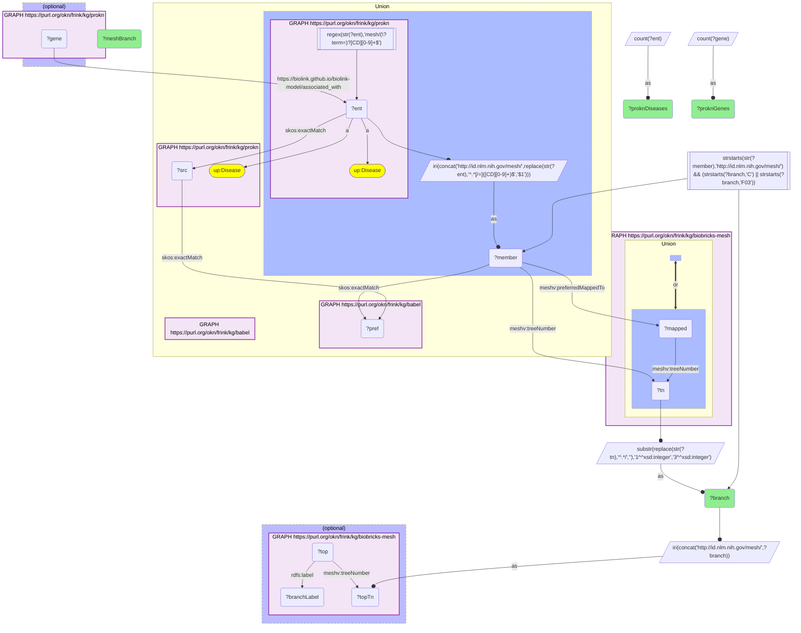

# D49-Q1: biobricks-mesh×prokn (MeSH, direct and via Babel) — ProKN disease records by MeSH category: congenital/hereditary 1,308 records with 2,606 associated genes, nervous system 857 with 1,376

- **Date:** 2026-10-13
- **Model:** claude-opus-5-5
- **SPARQL endpoint:** https://apps.okn.us/federation/sparql
- **Generated by:** mcp-okn v0.1.0 (build 3195263)
- **Contents:** 1 query · 1 query diagram

## Knowledge graphs used

- `prokn` — <https://purl.org/okn/frink/kg/prokn>
- `babel` — <https://purl.org/okn/frink/kg/babel>
- `biobricks-mesh` — <https://purl.org/okn/frink/kg/biobricks-mesh>

## Conversation

👤 **User**

Which MeSH disease categories hold the most ProKN disease records, reached directly or through Babel, and how many genes does ProKN associate with them?

---

🧠 **Assistant**

**ProKN's disease records reach MeSH mostly in the congenital and hereditary category (1,308 records, with 2,606 associated genes) and nervous-system diseases (857, 1,376 genes).**

| MeSH category | ProKN disease records | ProKN genes |
|---|---|---|
| C16 Congenital, Hereditary, and Neonatal Diseases and Abnormalities | 1,308 | 2,606 |
| C10 Nervous System Diseases | 857 | 1,376 |
| C23 Pathological Conditions, Signs and Symptoms | 583 | 884 |
| C18 Nutritional and Metabolic Diseases | 502 | 872 |
| C05 Musculoskeletal Diseases | 444 | 890 |
| C04 Neoplasms | 398 | 618 |
| C17 Skin and Connective Tissue Diseases | 334 | 442 |
| C11 Eye Diseases | 327 | 510 |
| C14 Cardiovascular Diseases | 303 | 469 |
| C12 Urogenital Diseases | 298 | 446 |
| C15 Hemic and Lymphatic Diseases | 258 | 668 |
| C01 Infections | 231 | 23 |

**Genes follow inherited disease.** ProKN's gene associations concentrate in hereditary conditions; infections have hundreds of disease records but only 23 associated genes.

**Two routes into MeSH.** 1,588 ProKN disease records are themselves MeSH ids and join directly; the rest get there through babel from their OMIM, MONDO or DOID ids (see the coverage question).

**Join form.** ProKN record IRI `https://www.ncbi.nlm.nih.gov/mesh/?term={id}` → `http://id.nlm.nih.gov/mesh/{id}`; otherwise `skos:exactMatch` id → babel → MeSH member.

## SPARQL queries executed

#### Query 1

_2026-10-14T06:56:35+00:00 · `prokn`, `babel`, `biobricks-mesh`_

```sparql
PREFIX biolink: <https://w3id.org/biolink/vocab/>
PREFIX rdfs: <http://www.w3.org/2000/01/rdf-schema#>
PREFIX rdf: <http://www.w3.org/1999/02/22-rdf-syntax-ns#>
PREFIX skos: <http://www.w3.org/2004/02/skos/core#>
PREFIX up: <http://purl.uniprot.org/core/>
PREFIX schema: <http://schema.org/>
PREFIX meshv: <http://id.nlm.nih.gov/mesh/vocab#>
# ProKN disease records reaching a MeSH record (directly when the record IRI is a MeSH id,
# otherwise through babel from its skos:exactMatch ids), grouped by MeSH disease category.
SELECT ?branch (SAMPLE(?branchLabel) AS ?meshBranch) (COUNT(DISTINCT ?ent) AS ?proknDiseases) (COUNT(DISTINCT ?gene) AS ?proknGenes) WHERE {
  { SELECT DISTINCT ?ent ?branch WHERE {
    { { SELECT DISTINCT ?ent ?member WHERE {
    { SELECT DISTINCT ?ent ?pref WHERE {
        { SELECT DISTINCT ?ent ?src WHERE { GRAPH <https://purl.org/okn/frink/kg/prokn> { ?ent a <http://purl.uniprot.org/core/Disease> ; <http://www.w3.org/2004/02/skos/core#exactMatch> ?src } } }
        GRAPH <https://purl.org/okn/frink/kg/babel> { ?src <http://www.w3.org/2004/02/skos/core#exactMatch> ?pref } } }
    GRAPH <https://purl.org/okn/frink/kg/babel> { ?member <http://www.w3.org/2004/02/skos/core#exactMatch> ?pref } } } } UNION { GRAPH <https://purl.org/okn/frink/kg/prokn> { ?ent a <http://purl.uniprot.org/core/Disease> FILTER(REGEX(STR(?ent),'mesh/(\\?term=)?[CD][0-9]+$')) } BIND(IRI(CONCAT('http://id.nlm.nih.gov/mesh/', REPLACE(STR(?ent),'^.*[/=]([CD][0-9]+)$','$1'))) AS ?member) }
    FILTER(STRSTARTS(STR(?member),'http://id.nlm.nih.gov/mesh/'))
  GRAPH <https://purl.org/okn/frink/kg/biobricks-mesh> { { ?member meshv:treeNumber ?tn } UNION { ?member meshv:preferredMappedTo ?mapped . ?mapped meshv:treeNumber ?tn } }
  BIND(SUBSTR(REPLACE(STR(?tn),'^.*/',''),1,3) AS ?branch)
    FILTER(STRSTARTS(?branch,'C') || STRSTARTS(?branch,'F03')) } }
  BIND(IRI(CONCAT('http://id.nlm.nih.gov/mesh/', ?branch)) AS ?topTn)
  OPTIONAL { GRAPH <https://purl.org/okn/frink/kg/biobricks-mesh> { ?top meshv:treeNumber ?topTn ; rdfs:label ?branchLabel } }
  OPTIONAL { GRAPH <https://purl.org/okn/frink/kg/prokn> { ?gene <https://biolink.github.io/biolink-model/associated_with> ?ent } }
} GROUP BY ?branch ORDER BY DESC(?proknDiseases) LIMIT 15
```



_15 row(s)_

| branch | meshBranch | proknDiseases | proknGenes |
| --- | --- | --- | --- |
| C16 | Congenital, Hereditary, and Neonatal Diseases and Abnormalities | 1308 | 2606 |
| C10 | Nervous System Diseases | 857 | 1376 |
| C23 | Pathological Conditions, Signs and Symptoms | 583 | 884 |
| C18 | Nutritional and Metabolic Diseases | 502 | 872 |
| C05 | Musculoskeletal Diseases | 444 | 890 |
| C04 | Neoplasms | 398 | 618 |
| C17 | Skin and Connective Tissue Diseases | 334 | 442 |
| C11 | Eye Diseases | 327 | 510 |
| C14 | Cardiovascular Diseases | 303 | 469 |
| C12 | Urogenital Diseases | 298 | 446 |
| C15 | Hemic and Lymphatic Diseases | 258 | 668 |
| C01 | Infections | 231 | 23 |
| C20 | Immune System Diseases | 212 | 253 |
| C19 | Endocrine System Diseases | 211 | 396 |
| C06 | Digestive System Diseases | 208 | 258 |
