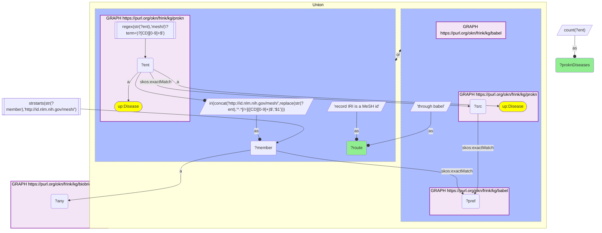
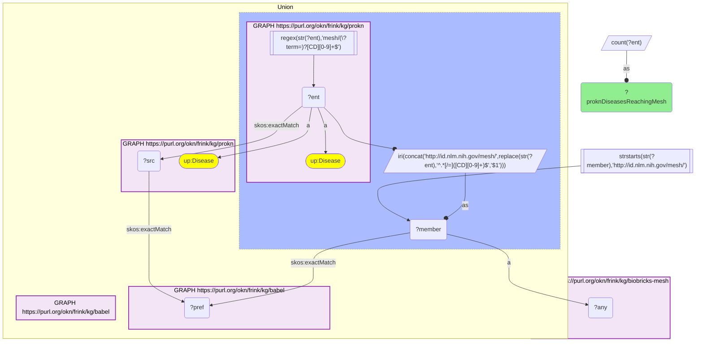
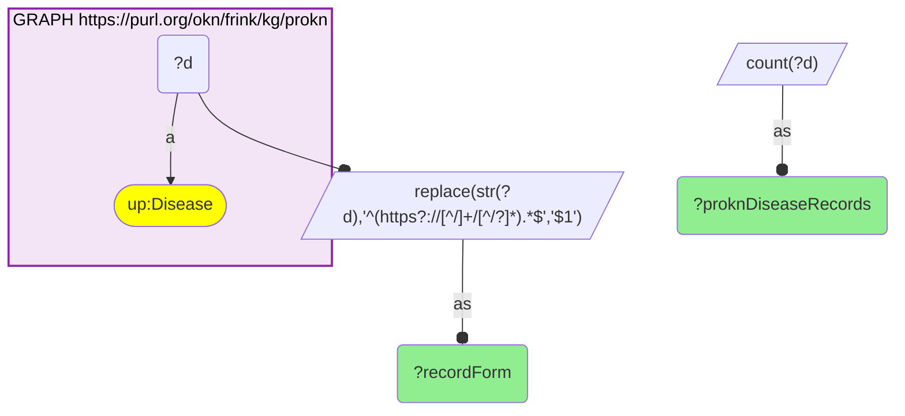

# D49-Q2: biobricks-mesh×prokn — 3,186 of ProKN's 8,596 disease records reach MeSH: 1,588 are MeSH-keyed records, 2,991 get there through Babel

- **Date:** 2026-10-13
- **Model:** claude-opus-5-5
- **SPARQL endpoint:** https://apps.okn.us/federation/sparql
- **Generated by:** mcp-okn v0.1.0 (build 3195263)
- **Contents:** 3 queries · 3 query diagrams

## Knowledge graphs used

- `prokn` — <https://purl.org/okn/frink/kg/prokn>
- `babel` — <https://purl.org/okn/frink/kg/babel>
- `biobricks-mesh` — <https://purl.org/okn/frink/kg/biobricks-mesh>

## Conversation

👤 **User**

Same crosswalk, coverage angle: how many ProKN disease records reach a MeSH record, directly or through Babel?

---

🧠 **Assistant**

**3,186 of ProKN's 8,596 disease records reach a biobricks-mesh record. 1,588 are MeSH-keyed records that join directly, and 2,991 get there through babel from their `skos:exactMatch` ids; most direct ones also have a babel route.**

| Route | ProKN disease records |
|---|---|
| record IRI is a MeSH id | 1,588 |
| through babel | 2,991 |
| either (the crosswalk) | 3,186 |

| ProKN disease record form | Records |
|---|---|
| OMIM (`https://www.omim.org/entry/…`) | 6,686 |
| MeSH (`https://www.ncbi.nlm.nih.gov/mesh/?term=…`) | 1,580 |
| OBO (`http://purl.obolibrary.org/obo/…`) | 316 |
| MeSH (`https://id.nlm.nih.gov/mesh/…`) | 14 |

**Why it was missed.** ProKN's MeSH-keyed disease records use the NCBI MeSH browser URL, not the `id.nlm.nih.gov` IRI that biobricks-mesh mints, so a shared-IRI scan sees no overlap. One rewrite joins them.

**OMIM records are the gap.** Most of ProKN's disease records are OMIM entries, and only those that babel can map to MeSH join; many have no MeSH counterpart there.

**Join form.** Direct: `https://www.ncbi.nlm.nih.gov/mesh/?term={id}` → `http://id.nlm.nih.gov/mesh/{id}`. Babel: `skos:exactMatch` id → clique → MeSH member.

## SPARQL queries executed

#### Query 1

_2026-10-14T06:56:35+00:00 · `prokn`, `babel`, `biobricks-mesh`_

```sparql
PREFIX biolink: <https://w3id.org/biolink/vocab/>
PREFIX rdfs: <http://www.w3.org/2000/01/rdf-schema#>
PREFIX rdf: <http://www.w3.org/1999/02/22-rdf-syntax-ns#>
PREFIX skos: <http://www.w3.org/2004/02/skos/core#>
PREFIX up: <http://purl.uniprot.org/core/>
PREFIX schema: <http://schema.org/>
PREFIX meshv: <http://id.nlm.nih.gov/mesh/vocab#>
SELECT ?route (COUNT(DISTINCT ?ent) AS ?proknDiseases) WHERE {
  { { SELECT DISTINCT ?ent ?member WHERE {
    { SELECT DISTINCT ?ent ?pref WHERE {
        { SELECT DISTINCT ?ent ?src WHERE { GRAPH <https://purl.org/okn/frink/kg/prokn> { ?ent a <http://purl.uniprot.org/core/Disease> ; <http://www.w3.org/2004/02/skos/core#exactMatch> ?src } } }
        GRAPH <https://purl.org/okn/frink/kg/babel> { ?src <http://www.w3.org/2004/02/skos/core#exactMatch> ?pref } } }
    GRAPH <https://purl.org/okn/frink/kg/babel> { ?member <http://www.w3.org/2004/02/skos/core#exactMatch> ?pref } } } BIND("through babel" AS ?route) }
  UNION { GRAPH <https://purl.org/okn/frink/kg/prokn> { ?ent a up:Disease FILTER(REGEX(STR(?ent),'mesh/(\\?term=)?[CD][0-9]+$')) }
           BIND(IRI(CONCAT('http://id.nlm.nih.gov/mesh/', REPLACE(STR(?ent),'^.*[/=]([CD][0-9]+)$','$1'))) AS ?member) BIND("record IRI is a MeSH id" AS ?route) }
  FILTER(STRSTARTS(STR(?member),'http://id.nlm.nih.gov/mesh/'))
  GRAPH <https://purl.org/okn/frink/kg/biobricks-mesh> { ?member a ?any }
} GROUP BY ?route
```



_2 row(s)_

| route | proknDiseases |
| --- | --- |
| record IRI is a MeSH id | 1588 |
| through babel | 2991 |

#### Query 2

_2026-10-14T06:56:36+00:00 · `prokn`, `babel`, `biobricks-mesh`_

```sparql
PREFIX biolink: <https://w3id.org/biolink/vocab/>
PREFIX rdfs: <http://www.w3.org/2000/01/rdf-schema#>
PREFIX rdf: <http://www.w3.org/1999/02/22-rdf-syntax-ns#>
PREFIX skos: <http://www.w3.org/2004/02/skos/core#>
PREFIX up: <http://purl.uniprot.org/core/>
PREFIX schema: <http://schema.org/>
PREFIX meshv: <http://id.nlm.nih.gov/mesh/vocab#>
SELECT (COUNT(DISTINCT ?ent) AS ?proknDiseasesReachingMesh) WHERE {
  { { SELECT DISTINCT ?ent ?member WHERE {
    { SELECT DISTINCT ?ent ?pref WHERE {
        { SELECT DISTINCT ?ent ?src WHERE { GRAPH <https://purl.org/okn/frink/kg/prokn> { ?ent a <http://purl.uniprot.org/core/Disease> ; <http://www.w3.org/2004/02/skos/core#exactMatch> ?src } } }
        GRAPH <https://purl.org/okn/frink/kg/babel> { ?src <http://www.w3.org/2004/02/skos/core#exactMatch> ?pref } } }
    GRAPH <https://purl.org/okn/frink/kg/babel> { ?member <http://www.w3.org/2004/02/skos/core#exactMatch> ?pref } } } } UNION { GRAPH <https://purl.org/okn/frink/kg/prokn> { ?ent a <http://purl.uniprot.org/core/Disease> FILTER(REGEX(STR(?ent),'mesh/(\\?term=)?[CD][0-9]+$')) } BIND(IRI(CONCAT('http://id.nlm.nih.gov/mesh/', REPLACE(STR(?ent),'^.*[/=]([CD][0-9]+)$','$1'))) AS ?member) }
  FILTER(STRSTARTS(STR(?member),'http://id.nlm.nih.gov/mesh/'))
  GRAPH <https://purl.org/okn/frink/kg/biobricks-mesh> { ?member a ?any }
}
```



_1 row(s)_

| proknDiseasesReachingMesh |
| --- |
| 3186 |

#### Query 3

_2026-10-14T06:56:36+00:00 · `prokn`_

```sparql
PREFIX biolink: <https://w3id.org/biolink/vocab/>
PREFIX rdfs: <http://www.w3.org/2000/01/rdf-schema#>
PREFIX rdf: <http://www.w3.org/1999/02/22-rdf-syntax-ns#>
PREFIX skos: <http://www.w3.org/2004/02/skos/core#>
PREFIX up: <http://purl.uniprot.org/core/>
PREFIX schema: <http://schema.org/>
PREFIX meshv: <http://id.nlm.nih.gov/mesh/vocab#>
SELECT ?recordForm (COUNT(DISTINCT ?d) AS ?proknDiseaseRecords) WHERE {
  GRAPH <https://purl.org/okn/frink/kg/prokn> { ?d a up:Disease } BIND(REPLACE(STR(?d),'^(https?://[^/]+/[^/?]*).*$','$1') AS ?recordForm)
} GROUP BY ?recordForm ORDER BY DESC(?proknDiseaseRecords)
```



_4 row(s)_

| recordForm | proknDiseaseRecords |
| --- | --- |
| https://www.omim.org/entry | 6686 |
| https://www.ncbi.nlm.nih.gov/mesh | 1580 |
| http://purl.obolibrary.org/obo | 316 |
| https://id.nlm.nih.gov/mesh | 14 |
