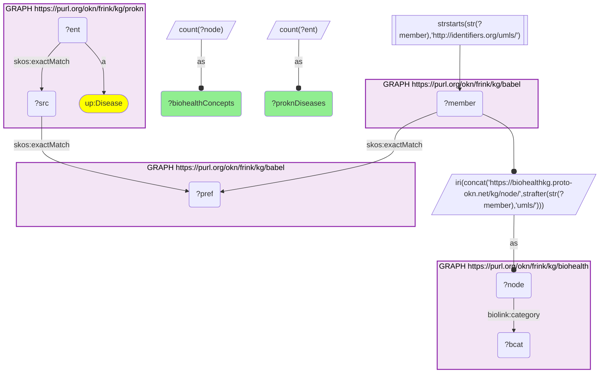
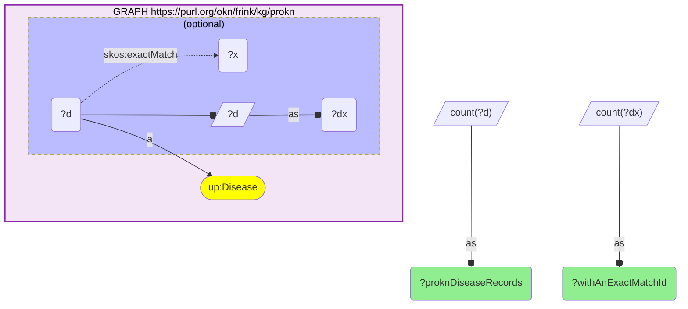

# D50-Q2: biohealth×prokn — 2,958 ProKN disease records reach 3,462 BioHealth UMLS concepts through Babel; until now the pair joined only on HP phenotypes

- **Date:** 2026-10-13
- **Model:** claude-opus-5-5
- **SPARQL endpoint:** https://apps.okn.us/federation/sparql
- **Generated by:** mcp-okn v0.1.0 (build 3195263)
- **Contents:** 2 queries · 2 query diagrams

## Knowledge graphs used

- `prokn` — <https://purl.org/okn/frink/kg/prokn>
- `babel` — <https://purl.org/okn/frink/kg/babel>
- `biohealth` — <https://purl.org/okn/frink/kg/biohealth>

## Conversation

👤 **User**

Same crosswalk, coverage angle: how many ProKN disease records reach a BioHealth UMLS concept through Babel, and how many BioHealth concepts do they land on?

---

🧠 **Assistant**

**2,958 of ProKN's disease records reach a BioHealth UMLS concept through babel, landing on 3,462 concepts. Until now BioHealth and ProKN joined only on HP phenotype terms.**

| Measure | Count |
|---|---|
| ProKN disease records | 8,596 |
| with a `skos:exactMatch` id | 4,320 |
| reaching a BioHealth concept through babel | 2,958 |
| BioHealth concepts reached | 3,462 |

**More concepts than records.** One disease can sit in more than one babel clique (a MeSH heading and a separate UMLS concept, for instance), so a record can land on two BioHealth concepts.

**The ceiling is ProKN's id coverage.** Only 4,320 ProKN disease records carry a `skos:exactMatch` id for babel to start from; two-thirds of those reach BioHealth.

**Join form.** `skos:exactMatch` id → babel → UMLS member → `https://biohealthkg.proto-okn.net/kg/node/{CUI}`.

## SPARQL queries executed

#### Query 1

_2026-10-14T06:56:37+00:00 · `prokn`, `babel`, `biohealth`_

```sparql
PREFIX biolink: <https://w3id.org/biolink/vocab/>
PREFIX rdfs: <http://www.w3.org/2000/01/rdf-schema#>
PREFIX rdf: <http://www.w3.org/1999/02/22-rdf-syntax-ns#>
PREFIX skos: <http://www.w3.org/2004/02/skos/core#>
PREFIX up: <http://purl.uniprot.org/core/>
PREFIX schema: <http://schema.org/>
PREFIX meshv: <http://id.nlm.nih.gov/mesh/vocab#>
SELECT (COUNT(DISTINCT ?ent) AS ?proknDiseases) (COUNT(DISTINCT ?node) AS ?biohealthConcepts) WHERE {
  { SELECT DISTINCT ?ent ?member WHERE {
    { SELECT DISTINCT ?ent ?pref WHERE {
        { SELECT DISTINCT ?ent ?src WHERE { GRAPH <https://purl.org/okn/frink/kg/prokn> { ?ent a <http://purl.uniprot.org/core/Disease> ; <http://www.w3.org/2004/02/skos/core#exactMatch> ?src } } }
        GRAPH <https://purl.org/okn/frink/kg/babel> { ?src <http://www.w3.org/2004/02/skos/core#exactMatch> ?pref } } }
    GRAPH <https://purl.org/okn/frink/kg/babel> { ?member <http://www.w3.org/2004/02/skos/core#exactMatch> ?pref } } }
  FILTER(STRSTARTS(STR(?member),'http://identifiers.org/umls/'))
  BIND(IRI(CONCAT('https://biohealthkg.proto-okn.net/kg/node/', STRAFTER(STR(?member),'umls/'))) AS ?node)
  GRAPH <https://purl.org/okn/frink/kg/biohealth> { ?node <https://w3id.org/biolink/vocab/category> ?bcat }
}
```



_1 row(s)_

| proknDiseases | biohealthConcepts |
| --- | --- |
| 2958 | 3462 |

#### Query 2

_2026-10-14T06:56:37+00:00 · `prokn`_

```sparql
PREFIX biolink: <https://w3id.org/biolink/vocab/>
PREFIX rdfs: <http://www.w3.org/2000/01/rdf-schema#>
PREFIX rdf: <http://www.w3.org/1999/02/22-rdf-syntax-ns#>
PREFIX skos: <http://www.w3.org/2004/02/skos/core#>
PREFIX up: <http://purl.uniprot.org/core/>
PREFIX schema: <http://schema.org/>
PREFIX meshv: <http://id.nlm.nih.gov/mesh/vocab#>
SELECT (COUNT(DISTINCT ?d) AS ?proknDiseaseRecords) (COUNT(DISTINCT ?dx) AS ?withAnExactMatchId) WHERE {
  GRAPH <https://purl.org/okn/frink/kg/prokn> { ?d a up:Disease . OPTIONAL { ?d skos:exactMatch ?x BIND(?d AS ?dx) } }
}
```



_1 row(s)_

| proknDiseaseRecords | withAnExactMatchId |
| --- | --- |
| 8596 | 4320 |
