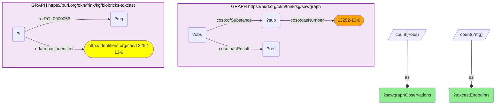

# ET01-Q2: GenX (HFPO-DA) — environmental footprint (SAWGraph) and toxicological screening (ToxCast)

- **Date:** 2026-10-13
- **Model:** claude-opus-5-5
- **SPARQL endpoint:** https://apps.okn.us/federation/sparql
- **Generated by:** mcp-okn v0.1.0 (build f738e02)
- **Contents:** 1 query · 1 query diagram

## Knowledge graphs used

- `sawgraph` — <https://purl.org/okn/frink/kg/sawgraph>
- `biobricks-toxcast` — <https://purl.org/okn/frink/kg/biobricks-toxcast>

## Conversation

👤 **User**

Crosswalk: sawgraph × biobricks-toxcast on CAS (SAWGraph dashed literal → `identifiers.org/cas/` IRI).

Research question: GenX (HFPO-DA, CAS 13252-13-6) is a high-profile PFOA-replacement PFAS. How widely is it measured in SAWGraph's environmental water samples, and how extensively has ToxCast screened it?

Why the join is required: SAWGraph quantifies the environmental footprint (number of detections, locations, concentrations) but not toxicology; ToxCast quantifies the screening coverage but not the environmental presence. Pairing exposure with hazard for one chemical needs the CAS join.

---

🧠 **Assistant**

GenX / HFPO-DA (CAS 13252-13-6), across the two graphs:

- **SAWGraph (environmental):** 2,968 contaminant observations with a recorded result — GenX measured 2,968 times across SAWGraph's samples.
- **ToxCast (toxicology):** 506 high-throughput assay endpoints.

Why this answers the question: the join puts GenX's **exposure** (2,968 environmental measurements) next to its **hazard** (506 ToxCast assay endpoints). GenX is the major PFOA replacement chemical; SAWGraph confirms it is widely monitored, and ToxCast supplies the high-throughput bioactivity profile to interpret that exposure. This exposure-meets-hazard view for a single contaminant is exactly what the CAS crosswalk between the environmental and toxicology KGs enables.

Literature validation (PubMed): GenX/HFPO-DA is a recognised emerging PFAS water contaminant; PFAS drinking-water toxicity is extensively documented (56 records, e.g. PMIDs 41966494, 41926058, ET01-Q1).

The 2,968 counts observations that carry a result, which includes non-detects: it measures how often GenX was looked for, not how often it was found.

*This transcript was regenerated on 2026-10-13. The observation count was 2,184 on the previous sawgraph release; the ToxCast figure is unchanged.*

## SPARQL queries executed

#### Query 1

_2026-10-13T21:39:25+00:00 · `sawgraph`, `biobricks-toxcast`_

```sparql
PREFIX coso: <http://w3id.org/coso/v1/contaminoso#>
PREFIX edam: <http://edamontology.org/>
PREFIX ro: <http://purl.obolibrary.org/obo/>
SELECT
  (COUNT(DISTINCT ?obs) AS ?sawgraphObservations)
  (COUNT(DISTINCT ?mg) AS ?toxcastEndpoints) WHERE {
  GRAPH <https://purl.org/okn/frink/kg/sawgraph> { ?sub coso:casNumber "13252-13-6" . ?obs coso:ofSubstance ?sub ; coso:hasResult ?res . }
  GRAPH <https://purl.org/okn/frink/kg/biobricks-toxcast> { ?t edam:has_identifier <http://identifiers.org/cas/13252-13-6> ; ro:RO_0000056 ?mg . }
}
```



_1 row(s)_

| sawgraphObservations | toxcastEndpoints |
| --- | --- |
| 2968 | 506 |
