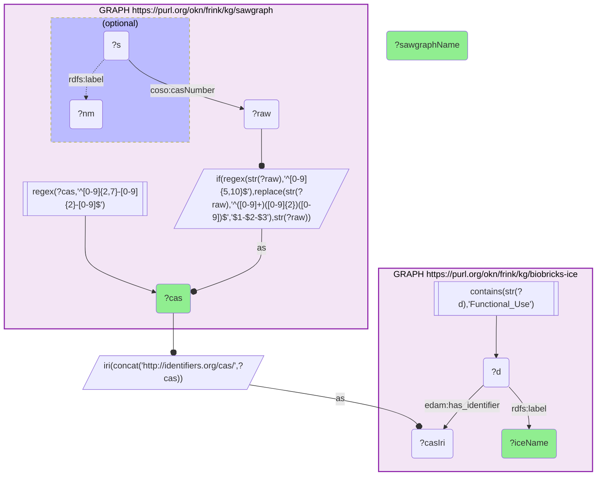

# ET02-Q1: Environmental PFAS (SAWGraph) resolved to EPA-CompTox identity via biobricks-ICE

- **Date:** 2026-10-13
- **Model:** claude-opus-5-5
- **SPARQL endpoint:** https://apps.okn.us/federation/sparql
- **Generated by:** mcp-okn v0.1.0 (build f738e02)
- **Contents:** 1 query · 1 query diagram

## Knowledge graphs used

- `sawgraph` — <https://purl.org/okn/frink/kg/sawgraph>
- `biobricks-ice` — <https://purl.org/okn/frink/kg/biobricks-ice>

## Conversation

👤 **User**

Crosswalk: sawgraph × biobricks-ice (EPA Integrated Chemical Environment), joined on **CAS number** (SAWGraph literal, dashes rebuilt where missing → `identifiers.org/cas/` IRI). (Crosswalk ET2.)

Research question: For the PFAS that SAWGraph measures, what does ICE record — the standardized chemical name and curated-data coverage of these environmental contaminants?

Why the join is required: SAWGraph identifies the contaminant only by CAS number; ICE resolves that CAS to a standardized chemical name and its curated-data categorization. Turning an environmental CAS into a fully-identified, categorized chemical needs the CAS join.

---

🧠 **Assistant**

**43 of the chemicals SAWGraph measures resolve through ICE to a standardized name in its Chemical Functional Use Categories dataset.** A selection, showing how ICE's name relates to SAWGraph's own label:

| CAS (SAWGraph) | SAWGraph label | ICE name |
|---|---|---|
| 1763-23-1 | PERFLUOROOCTANE SULFONIC ACID | Perfluorooctanesulfonic acid |
| 335-67-1 | PERFLUOROOCTANOIC ACID-LINEAR | Perfluorooctanoic acid |
| 355-46-4 | PERFLUOROHEXANE SULFONIC ACID | Perfluorohexanesulfonic acid |
| 375-73-5 | PERFLUOROBUTANE SULFONIC ACID | Perfluorobutanesulfonic acid |
| 27619-97-2 | (registry-style name, marked retired) | 6:2 Fluorotelomer sulfonic acid |
| 53826-12-3 | 6:2 FLUOROTELOMER CARBOXYLIC ACID | 2-(Perfluorohexyl)ethanoic acid |
| 113507-82-7 | PERFLUORO(2-ETHOXYETHANE)SULFONIC ACID | Perfluoro-2-ethoxyethanesulfonic acid |
| 76-14-2 | CFC-114 | 1,2-Dichloro-1,1,2,2-tetrafluoroethane |
| 272451-65-7 | (systematic amide name) | Flubendiamide |

The full 43-row result is below.

Why this answers the question: ICE turns SAWGraph's CAS numbers into consistently named chemicals. SAWGraph's own labels are a mixture — upper-case trade names, long registry-style systematic names, some marked as retired — and ICE supplies one standardized name per CAS. The 43 span the perfluoroalkyl sulfonic acids from C3 to C12 (with several also present as their sulfonate anions or potassium salts under separate CAS numbers), the perfluorocarboxylic acids from C5 to C18, the sulfonamides, fluorotelomer acids and sulfonates, and ether-based replacements. The identity resolution is only available through the CAS crosswalk between the environmental and chemical-safety KGs.

**What the join does not return.** This query returns ICE's name and confirms each chemical is in ICE's functional-use dataset. It does not return an EPA CompTox DTXSID — the earlier version of this example showed a DTXSID column that the query never populated, and it has been removed.

**Not everything here is a PFAS.** The matches include two chlorofluorocarbons (CFC-114 and dichlorodifluoromethane) and the pesticide flubendiamide — fluorinated compounds on SAWGraph's substance list that are not perfluoroalkyl substances.

**The normalization matters.** SAWGraph writes many CAS numbers without dashes; the query rebuilds them before building the IRI. On the raw literal this join returns 31 chemicals rather than 43, and on the previous SAWGraph release the earlier version of this example found 12.

Literature validation (PubMed): the perfluoroalkyl sulfonate series (PFHxS, PFOS, etc.) are the canonical PFAS water contaminants; PFAS drinking-water toxicity is extensively documented (56 records, ET01-Q1).

*This transcript was regenerated on 2026-10-13 against sawgraph v0.0.16 with the corrected CAS normalization.*

## SPARQL queries executed

#### Query 1

_2026-10-13T21:28:44+00:00 · `sawgraph`, `biobricks-ice`_

```sparql
PREFIX coso: <http://w3id.org/coso/v1/contaminoso#>
PREFIX edam: <http://edamontology.org/>
PREFIX rdfs: <http://www.w3.org/2000/01/rdf-schema#>
SELECT DISTINCT ?cas ?sawgraphName ?iceName WHERE {
  { SELECT ?cas (SAMPLE(?nm) AS ?sawgraphName) WHERE {
      GRAPH <https://purl.org/okn/frink/kg/sawgraph> {
        ?s coso:casNumber ?raw .
        OPTIONAL { ?s rdfs:label ?nm }
        # SAWGraph stores many CAS numbers without dashes: rebuild them before matching
        BIND(IF(REGEX(STR(?raw),'^[0-9]{5,10}$'),
                REPLACE(STR(?raw),'^([0-9]+)([0-9]{2})([0-9])$','$1-$2-$3'),
                STR(?raw)) AS ?cas)
        FILTER(REGEX(?cas,'^[0-9]{2,7}-[0-9]{2}-[0-9]$'))
      } } GROUP BY ?cas }
  BIND(IRI(CONCAT('http://identifiers.org/cas/', ?cas)) AS ?casIri)
  GRAPH <https://purl.org/okn/frink/kg/biobricks-ice> { ?d edam:has_identifier ?casIri ; rdfs:label ?iceName . FILTER(CONTAINS(STR(?d),'Functional_Use')) }
} ORDER BY ?iceName
```



_43 row(s)_

| cas | sawgraphName | iceName |
| --- | --- | --- |
| 76-14-2 | CFC-114 | 1,2-Dichloro-1,1,2,2-tetrafluoroethane |
| 53826-12-3 | 6:2 FLUOROTELOMER CARBOXYLIC ACID | 2-(Perfluorohexyl)ethanoic acid |
| 27854-31-5 | 8:2 FLUOROTELOMER CARBOXYLIC ACID | 2-(Perfluorooctyl)ethanoic acid |
| 379-90-8 | 3H-Perfluorobutanoic acid | 3H-Perfluorobutanoic acid |
| 27619-97-2 | 1-Octanesulfonic acid, 3,3,4,4,5,5,6,6,7,7,8,8,8-tridecafluoro-***retired***use 6:2 Fluorotelomer sulfonate acid | 6:2 Fluorotelomer sulfonic acid |
| 75-71-8 | CFC-12 | Dichlorodifluoromethane |
| 272451-65-7 | 1,2-Benzenedicarboxamide, N2-[1,1-dimethyl-2-(methylsulfonyl)ethyl]-3-iodo-N1-[2-methyl-4-[1,2,2,2-tetrafluoro-1-(trifluoromethyl)ethyl]phenyl]-***retired***use Flubendiamide | Flubendiamide |
| 4151-50-2 | N-ETHYL PERFLUOROOCTANE SULFONAMIDE | N-Ethylperfluorooctanesulfonamide |
| 31506-32-8 | 1-Octanesulfonamide, 1,1,2,2,3,3,4,4,5,5,6,6,7,7,8,8,8-heptadecafluoro-N-methyl-***retired***use N-methylperfluoro-1-octanesulfonamide | N-Methylperfluorooctanesulfonamide |
| 113507-82-7 | PERFLUORO(2-ETHOXYETHANE)SULFONIC ACID | Perfluoro-2-ethoxyethanesulfonic acid |
| 39492-91-6 | PERFLUORO-3,5,7,9,11-PENTAOXADODECANOIC ACID | Perfluoro-3,5,7,9,11-pentaoxadodecanoic acid |
| 30334-69-1 | Perfluorobutylsulfonamide | Perfluorobutanesulfonamide |
| 45187-15-3 | PERFLUOROBUTANE SULFONATE | Perfluorobutanesulfonate |
| 375-73-5 | PERFLUOROBUTANE SULFONIC ACID | Perfluorobutanesulfonic acid |
| 126105-34-8 | Perfluorodecanesulfonate | Perfluorodecanesulfonate |
| 335-77-3 | 1-Decanesulfonic acid, 1,1,2,2,3,3,4,4,5,5,6,6,7,7,8,8,9,9,10,10,10-heneicosafluoro- | Perfluorodecanesulfonic acid |
| 335-76-2 | PERFLUORODECANOIC ACID | Perfluorodecanoic acid |
| 79780-39-5 | PERFLUORODODECANE SULFONIC ACID | Perfluorododecanesulfonic acid |
| 307-55-1 | Perfluorolauric acid***retired***use Perfluorododecanoic acid | Perfluorododecanoic acid |
| 375-92-8 | PERFLUOROHEPTANE SULFONIC ACID | Perfluoroheptanesulfonic acid |
| 375-85-9 | PERFLUOROHEPTANOIC ACID | Perfluoroheptanoic acid |
| 67905-19-5 | Hexadecanoic acid, 2,2,3,3,4,4,5,5,6,6,7,7,8,8,9,9,10,10,11,11,12,12,13,13,14,14,15,15,16,16,16-hentriacontafluoro-***retired***use Perfluoropalmitic acid | Perfluorohexadecanoic acid |
| 41997-13-1 | PERFLUOROHEXANE SULFONAMIDE | Perfluorohexanesulfonamide |
| 108427-53-8 | 1-Hexanesulfonic acid, 1,1,2,2,3,3,4,4,5,5,6,6,6-tridecafluoro-, ion(1-) | Perfluorohexanesulfonate |
| 355-46-4 | PERFLUOROHEXANE SULFONIC ACID | Perfluorohexanesulfonic acid |
| 307-24-4 | PERFLUOROHEXANOIC ACID | Perfluorohexanoic acid |
| 474511-07-4 | PERFLUORONONANE SULFONATE | Perfluorononanesulfonate |
| 68259-12-1 | PERFLUORONONANE SULFONIC ACID | Perfluorononanesulfonic acid |
| 375-95-1 | PERFLUORONONANOIC ACID | Perfluorononanoic acid |
| 16517-11-6 | PERFLUOROOCTADECANOIC ACID | Perfluorooctadecanoic acid |
| 754-91-6 | PERFLUOROOCTANE SULFONAMIDE | Perfluorooctanesulfonamide |
| 45298-90-6 | PERFLUOROOCTANE SULFONATE | Perfluorooctanesulfonate |
| 1763-23-1 | PERFLUOROOCTANE SULFONIC ACID | Perfluorooctanesulfonic acid |
| 335-67-1 | PERFLUOROOCTANOIC ACID-LINEAR | Perfluorooctanoic acid |
| 2706-91-4 | PERFLUOROPENTANE SULFONIC ACID | Perfluoropentanesulfonic acid |
| 2706-90-3 | PERFLUOROPENTANOIC ACID | Perfluoropentanoic acid |
| 423-41-6 | 1-Propanesulfonic acid, 1,1,2,2,3,3,3-heptafluoro- | Perfluoropropanesulfonic acid |
| 376-06-7 | PERFLUOROTETRADECANOIC ACID | Perfluorotetradecanoic acid |
| 72629-94-8 | PERFLUOROTRIDECANOIC ACID | Perfluorotridecanoic acid |
| 2058-94-8 | PERFLUOROUNDECANOIC ACID | Perfluoroundecanoic acid |
| 117205-07-9 | Potassium 1,1,2,2-tetrafluoro-2-(pentafluoroethoxy)ethane-1-sulfonate | Potassium 1,1,2,2-tetrafluoro-2-(pentafluoroethoxy)ethane-1-sulfonate |
| 73606-19-6 | Potassium 9-chlorohexadecafluoro-3-oxanonane-1-sulfonate | Potassium 9-chlorohexadecafluoro-3-oxanonane-1-sulfonate |
| 3872-25-1 | 1-Pentanesulfonic acid, 1,1,2,2,3,3,4,4,5,5,5-undecafluoro-, potassium salt | Potassium perfluoropentanesulfonate |
