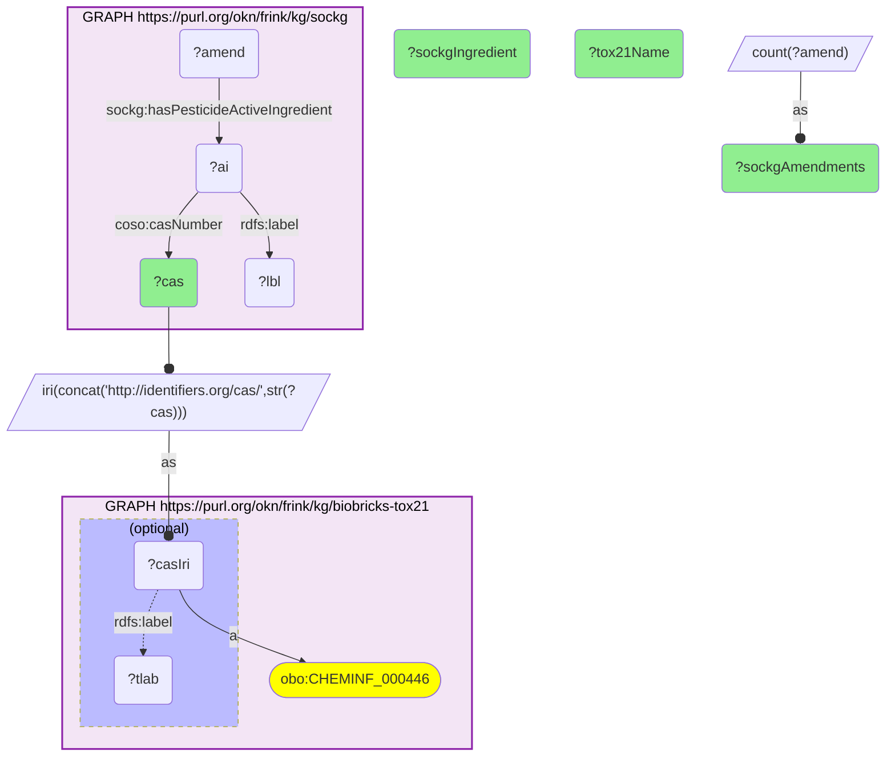

# ET05-Q1: sockg×biobricks-tox21 (CAS) — the most-applied SOCKG agrochemicals that Tox21 screened: S-metolachlor (815 amendments), atrazine (693), lambda-cyhalothrin (578), 2,4-D (524)

- **Date:** 2026-10-13
- **Model:** claude-opus-5-5
- **SPARQL endpoint:** https://apps.okn.us/federation/sparql
- **Generated by:** mcp-okn v0.1.0 (build 3195263)
- **Contents:** 1 query · 1 query diagram

## Knowledge graphs used

- `sockg` — <https://purl.org/okn/frink/kg/sockg>
- `biobricks-tox21` — <https://purl.org/okn/frink/kg/biobricks-tox21>

## Conversation

👤 **User**

Which pesticide active ingredients used in SOCKG's soil-carbon field experiments were screened in Tox21, and how often are they applied?

---

🧠 **Assistant**

**The agrochemicals SOCKG's soil-carbon experiments apply most often that Tox21 also screened are herbicides and one insecticide: S-metolachlor (815 management amendments), atrazine (693), lambda-cyhalothrin (578) and 2,4-D (524).**

| CAS | SOCKG active ingredient | Tox21 name | SOCKG amendments |
|---|---|---|---|
| 87392-12-9 | S-metolachlor | S-Metolachlor | 815 |
| 1912-24-9 | Atrazine | Atrazine | 693 |
| 91465-08-6 | Lambda-cyhalothrin | lambda-Cyhalothrin | 578 |
| 94-75-7 | 2,4-D | 2,4-Dichlorophenoxyacetic acid | 524 |
| 1689-84-5 | Bromoxynil | Bromoxynil | 377 |
| 104206-82-8 | Mesotrione | Mesotrione | 335 |
| 60-51-5 | Dimethoate | Dimethoate | 328 |
| 1918-00-9 | Dicamba | Dicamba | 260 |
| 25057-89-0 | Bentazon | Bentazone | 240 |
| 163515-14-8 | S-dimethenamid | Dimethenamid-P | 224 |

The full 15 rows are in the result table below.

**What the join is for.** SOCKG records which chemicals were applied to which experimental plots; Tox21 says each was screened, so the in-vitro activity profile of the pesticides on a field site can be looked up. The ranking is by how often SOCKG records an application, which reflects the experiments in SOCKG, not national use.

**Join form.** SOCKG's `coso:casNumber` literal on an `ActiveIngredient` → `http://identifiers.org/cas/{CAS}`, Tox21's chemical node. Amendments reach the ingredient through `sockg:hasPesticideActiveIngredient`.

## SPARQL queries executed

#### Query 1

_2026-10-14T06:53:09+00:00 · `sockg`, `biobricks-tox21`_

```sparql
PREFIX biolink: <https://w3id.org/biolink/vocab/>
PREFIX rdfs: <http://www.w3.org/2000/01/rdf-schema#>
PREFIX skos: <http://www.w3.org/2004/02/skos/core#>
PREFIX up: <http://purl.uniprot.org/core/>
PREFIX obo: <http://purl.obolibrary.org/obo/>
PREFIX oa: <http://www.w3.org/ns/oa#>
PREFIX coso: <http://w3id.org/coso/v1/contaminoso#>
PREFIX sockg: <https://idir.uta.edu/sockg-ontology#>
PREFIX aop: <http://aopkb.org/aop_ontology#>
PREFIX dc: <http://purl.org/dc/elements/1.1/>
PREFIX meshv: <http://id.nlm.nih.gov/mesh/vocab#>
PREFIX spoke: <https://purl.org/okn/frink/kg/spoke-okn/schema/>
# SOCKG pesticide active ingredients that Tox21 screened, ranked by how many SOCKG management
# amendments (field applications) use them.
SELECT ?cas (SAMPLE(?lbl) AS ?sockgIngredient) (SAMPLE(?tlab) AS ?tox21Name) (COUNT(DISTINCT ?amend) AS ?sockgAmendments) WHERE {
  GRAPH <https://purl.org/okn/frink/kg/sockg> { ?ai coso:casNumber ?cas ; rdfs:label ?lbl . ?amend sockg:hasPesticideActiveIngredient ?ai }
  BIND(IRI(CONCAT('http://identifiers.org/cas/', STR(?cas))) AS ?casIri)
  GRAPH <https://purl.org/okn/frink/kg/biobricks-tox21> { ?casIri a obo:CHEMINF_000446 . OPTIONAL { ?casIri rdfs:label ?tlab } }
} GROUP BY ?cas ORDER BY DESC(?sockgAmendments) LIMIT 15
```



_15 row(s)_

| cas | sockgIngredient | tox21Name | sockgAmendments |
| --- | --- | --- | --- |
| 87392-12-9 | S-metolachlor; CAS No. 87392-12-9 | S-Metolachlor | 815 |
| 1912-24-9 | Atrazine; CAS No. 1912-24-9 | Atrazine | 693 |
| 91465-08-6 | Lambda-cyhalothrin; CAS No. 91465-08-6 | lambda-Cyhalothrin | 578 |
| 94-75-7 | 2,4-D; CAS No. 94-75-7 | 2,4-Dichlorophenoxyacetic acid | 524 |
| 1689-84-5 | Bromoxynil; CAS No. 1689-84-5 | Bromoxynil | 377 |
| 104206-82-8 | Mesotrione; CAS No. 104206-82-8 | Mesotrione | 335 |
| 60-51-5 | Dimethoate; CAS No. 60-51-5 | Dimethoate | 328 |
| 1918-00-9 | Dicamba; CAS No. 1918-00-9 | Dicamba | 260 |
| 25057-89-0 | Bentazon; CAS No. 25057-89-0 | Bentazone | 240 |
| 163515-14-8 | S-dimethenamid; CAS No. 163515-14-8 | Dimethenamid-P | 224 |
| 34256-82-1 | Acetochlor; CAS No. 34256-82-1 | Acetochlor | 212 |
| 79538-32-2 | Tefluthrine; CSA No. 79538-32-2 | Tefluthrin | 209 |
| 81335-77-5 | Imazethapyr; CAS No. 81335-77-5 | Imazethapyr | 187 |
| 99129-21-2 | Clethodim; CAS No. 99129-21-2 | Clethodim | 172 |
| 175013-18-0 | Pyraclostrobin; CAS No. 175013-18-0 | Pyraclostrobin | 164 |
