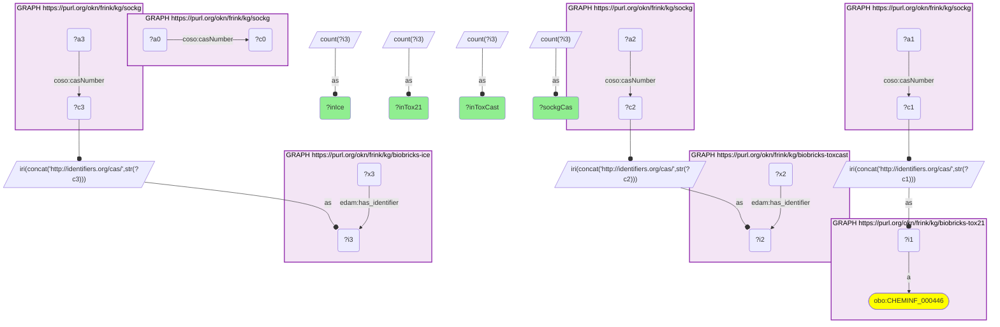

# ET05-Q2: sockg×biobricks-tox21 — 55 of SOCKG's 82 agrochemical CAS numbers are in Tox21 (ToxCast 59, ICE 68)

- **Date:** 2026-10-13
- **Model:** claude-opus-5-5
- **SPARQL endpoint:** https://apps.okn.us/federation/sparql
- **Generated by:** mcp-okn v0.1.0 (build 3195263)
- **Contents:** 1 query · 1 query diagram

## Knowledge graphs used

- `sockg` — <https://purl.org/okn/frink/kg/sockg>
- `biobricks-tox21` — <https://purl.org/okn/frink/kg/biobricks-tox21>
- `biobricks-toxcast` — <https://purl.org/okn/frink/kg/biobricks-toxcast>
- `biobricks-ice` — <https://purl.org/okn/frink/kg/biobricks-ice>

## Conversation

👤 **User**

Same crosswalk, coverage angle: how many of SOCKG's agrochemicals are in Tox21, compared with ToxCast and ICE?

---

🧠 **Assistant**

**55 of SOCKG's 82 agrochemical CAS numbers are in Tox21. The other two screening graphs reach a few more: ToxCast 59 and ICE 68.**

| Graph | SOCKG CAS numbers present |
|---|---|
| SOCKG (all) | 82 |
| Tox21 | 55 |
| ToxCast | 59 |
| ICE | 68 |

**This completes SOCKG's links to the tox screening graphs.** SOCKG already joined ToxCast and ICE on the CAS number; Tox21 was missing. The three libraries overlap but are not the same, so a chemical absent from one may be in another.

**Join form.** `coso:casNumber` literal → `http://identifiers.org/cas/{CAS}`.

## SPARQL queries executed

#### Query 1

_2026-10-14T06:53:10+00:00 · `sockg`, `biobricks-tox21`, `biobricks-toxcast`, `biobricks-ice`_

```sparql
PREFIX biolink: <https://w3id.org/biolink/vocab/>
PREFIX rdfs: <http://www.w3.org/2000/01/rdf-schema#>
PREFIX skos: <http://www.w3.org/2004/02/skos/core#>
PREFIX up: <http://purl.uniprot.org/core/>
PREFIX obo: <http://purl.obolibrary.org/obo/>
PREFIX oa: <http://www.w3.org/ns/oa#>
PREFIX coso: <http://w3id.org/coso/v1/contaminoso#>
PREFIX sockg: <https://idir.uta.edu/sockg-ontology#>
PREFIX aop: <http://aopkb.org/aop_ontology#>
PREFIX dc: <http://purl.org/dc/elements/1.1/>
PREFIX meshv: <http://id.nlm.nih.gov/mesh/vocab#>
PREFIX spoke: <https://purl.org/okn/frink/kg/spoke-okn/schema/>
# SOCKG's CAS numbers and how many each of the three tox screening graphs carries.
SELECT ?sockgCas ?inTox21 ?inToxCast ?inIce WHERE {
  { SELECT (COUNT(DISTINCT ?c0) AS ?sockgCas) WHERE { GRAPH <https://purl.org/okn/frink/kg/sockg> { ?a0 coso:casNumber ?c0 } } }
  { SELECT (COUNT(DISTINCT ?i1) AS ?inTox21) WHERE { GRAPH <https://purl.org/okn/frink/kg/sockg> { ?a1 coso:casNumber ?c1 } BIND(IRI(CONCAT('http://identifiers.org/cas/', STR(?c1))) AS ?i1)
      GRAPH <https://purl.org/okn/frink/kg/biobricks-tox21> { ?i1 a obo:CHEMINF_000446 } } }
  { SELECT (COUNT(DISTINCT ?i2) AS ?inToxCast) WHERE { GRAPH <https://purl.org/okn/frink/kg/sockg> { ?a2 coso:casNumber ?c2 } BIND(IRI(CONCAT('http://identifiers.org/cas/', STR(?c2))) AS ?i2)
      GRAPH <https://purl.org/okn/frink/kg/biobricks-toxcast> { ?x2 <http://edamontology.org/has_identifier> ?i2 } } }
  { SELECT (COUNT(DISTINCT ?i3) AS ?inIce) WHERE { GRAPH <https://purl.org/okn/frink/kg/sockg> { ?a3 coso:casNumber ?c3 } BIND(IRI(CONCAT('http://identifiers.org/cas/', STR(?c3))) AS ?i3)
      GRAPH <https://purl.org/okn/frink/kg/biobricks-ice> { ?x3 <http://edamontology.org/has_identifier> ?i3 } } }
}
```



_1 row(s)_

| sockgCas | inTox21 | inToxCast | inIce |
| --- | --- | --- | --- |
| 82 | 55 | 59 | 68 |
