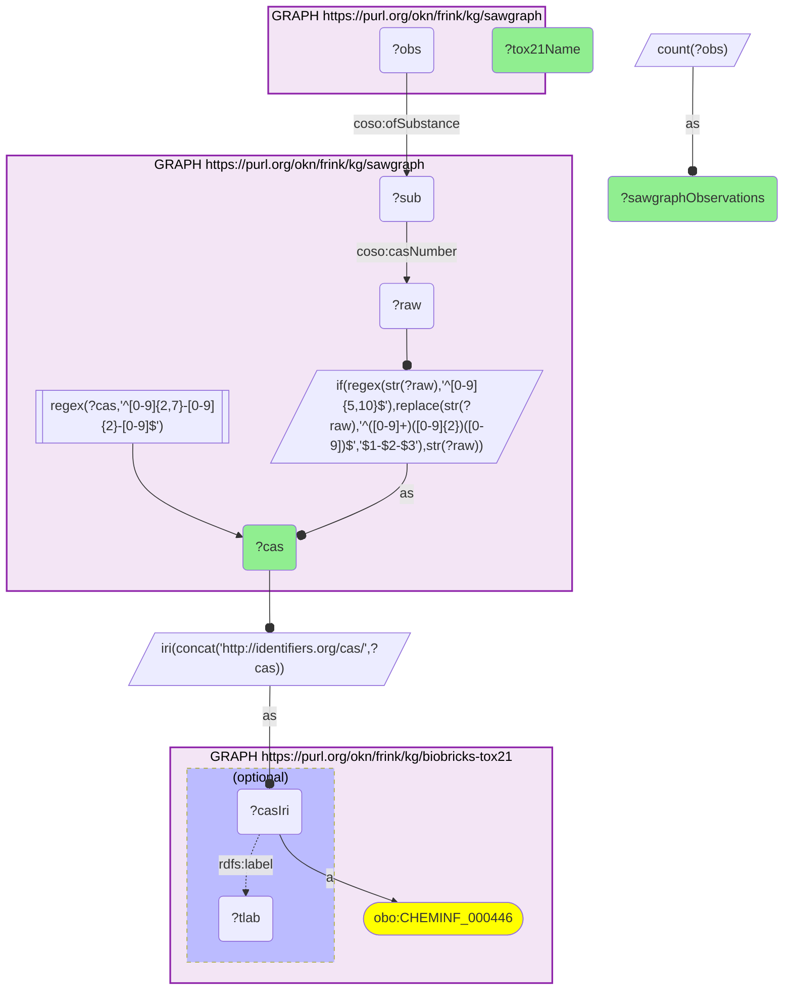

# ET06-Q1: sawgraph×biobricks-tox21 (CAS) — 11 SAWGraph contaminants are Tox21 chemicals; eight PFAS carry 27,000–32,000 observations each (PFOS 31,957, PFOA 28,685)

- **Date:** 2026-10-13
- **Model:** claude-opus-5-5
- **SPARQL endpoint:** https://apps.okn.us/federation/sparql
- **Generated by:** mcp-okn v0.1.0 (build 3195263)
- **Contents:** 1 query · 1 query diagram

## Knowledge graphs used

- `sawgraph` — <https://purl.org/okn/frink/kg/sawgraph>
- `biobricks-tox21` — <https://purl.org/okn/frink/kg/biobricks-tox21>

## Conversation

👤 **User**

Which contaminants measured in SAWGraph were screened in Tox21, and how many SAWGraph observations does each have?

---

🧠 **Assistant**

**Eleven contaminants measured in SAWGraph were screened in Tox21. Eight are PFAS with roughly 27,000 to 32,000 SAWGraph observations each, led by PFOS (31,957) and PFOA (28,685); the other three are fluorinated insecticides (sulfluramid, hexaflumuron, flubendiamide) with far fewer observations.**

| CAS | Tox21 name | SAWGraph observations |
|---|---|---|
| 1763-23-1 | PFOS | 31,957 |
| 335-67-1 | PFOA | 28,685 |
| 754-91-6 | PFOSA | 28,321 |
| 375-95-1 | PFNA | 28,006 |
| 375-85-9 | Perfluoroheptanoic acid | 27,894 |
| 335-76-2 | PFDA | 27,555 |
| 307-24-4 | PFHxA | 27,192 |
| 2058-94-8 | Perfluoroundecanoic acid | 27,073 |
| 4151-50-2 | Sulfluramid | 4,454 |
| 86479-06-3 | Hexaflumuron | 74 |
| 272451-65-7 | Flubendiamide | 39 |

**What it gives.** The eight legacy PFAS that SAWGraph measures most are exactly the ones with Tox21 screening data, so environmental measurements of them can be read next to their in-vitro activity. The many newer PFAS SAWGraph also measures are mostly not in Tox21.

**Join form.** SAWGraph `coso:casNumber` (dashes rebuilt where the literal is undashed) → `http://identifiers.org/cas/{CAS}`; observations reach the substance through `coso:ofSubstance`.

## SPARQL queries executed

#### Query 1

_2026-10-14T06:53:10+00:00 · `sawgraph`, `biobricks-tox21`_

```sparql
PREFIX biolink: <https://w3id.org/biolink/vocab/>
PREFIX rdfs: <http://www.w3.org/2000/01/rdf-schema#>
PREFIX skos: <http://www.w3.org/2004/02/skos/core#>
PREFIX up: <http://purl.uniprot.org/core/>
PREFIX obo: <http://purl.obolibrary.org/obo/>
PREFIX oa: <http://www.w3.org/ns/oa#>
PREFIX coso: <http://w3id.org/coso/v1/contaminoso#>
PREFIX sockg: <https://idir.uta.edu/sockg-ontology#>
PREFIX aop: <http://aopkb.org/aop_ontology#>
PREFIX dc: <http://purl.org/dc/elements/1.1/>
PREFIX meshv: <http://id.nlm.nih.gov/mesh/vocab#>
PREFIX spoke: <https://purl.org/okn/frink/kg/spoke-okn/schema/>
# SAWGraph contaminants that Tox21 screened, with the number of SAWGraph observations of each.
SELECT ?cas (SAMPLE(?tlab) AS ?tox21Name) (COUNT(DISTINCT ?obs) AS ?sawgraphObservations) WHERE {
  { SELECT DISTINCT ?sub ?cas WHERE { GRAPH <https://purl.org/okn/frink/kg/sawgraph> { ?sub coso:casNumber ?raw . BIND(IF(REGEX(STR(?raw),'^[0-9]{5,10}$'), REPLACE(STR(?raw),'^([0-9]+)([0-9]{2})([0-9])$','$1-$2-$3'), STR(?raw)) AS ?cas)
      FILTER(REGEX(?cas,'^[0-9]{2,7}-[0-9]{2}-[0-9]$')) } } }
  BIND(IRI(CONCAT('http://identifiers.org/cas/', ?cas)) AS ?casIri)
  GRAPH <https://purl.org/okn/frink/kg/biobricks-tox21> { ?casIri a obo:CHEMINF_000446 . OPTIONAL { ?casIri rdfs:label ?tlab } }
  GRAPH <https://purl.org/okn/frink/kg/sawgraph> { ?obs coso:ofSubstance ?sub }
} GROUP BY ?cas ORDER BY DESC(?sawgraphObservations)
```



_11 row(s)_

| cas | tox21Name | sawgraphObservations |
| --- | --- | --- |
| 1763-23-1 | PFOS | 31957 |
| 335-67-1 | PFOA | 28685 |
| 754-91-6 | PFOSA | 28321 |
| 375-95-1 | PFNA | 28006 |
| 375-85-9 | Perfluoroheptanoic acid | 27894 |
| 335-76-2 | PFDA | 27555 |
| 307-24-4 | PFHxA | 27192 |
| 2058-94-8 | Perfluoroundecanoic acid | 27073 |
| 4151-50-2 | Sulfluramid | 4454 |
| 86479-06-3 | Hexaflumuron | 74 |
| 272451-65-7 | Flubendiamide | 39 |
