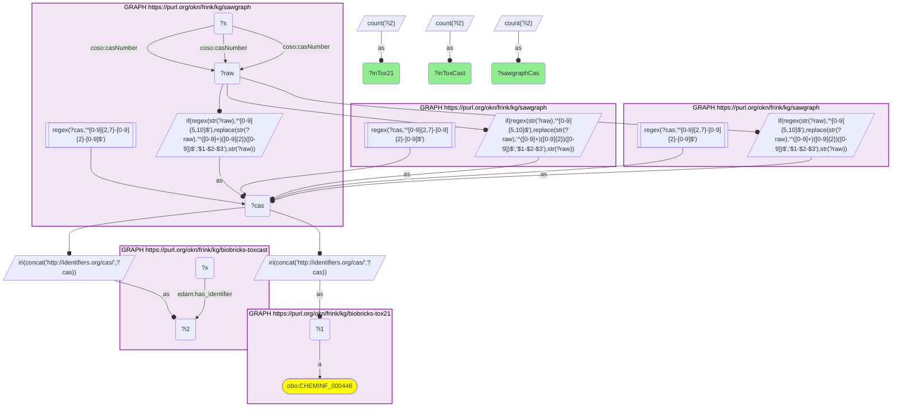

# ET06-Q2: sawgraph×biobricks-tox21 — 11 of SAWGraph's 114 contaminant CAS numbers are in Tox21, against 34 in ToxCast

- **Date:** 2026-10-13
- **Model:** claude-opus-5-5
- **SPARQL endpoint:** https://apps.okn.us/federation/sparql
- **Generated by:** mcp-okn v0.1.0 (build 3195263)
- **Contents:** 1 query · 1 query diagram

## Knowledge graphs used

- `sawgraph` — <https://purl.org/okn/frink/kg/sawgraph>
- `biobricks-tox21` — <https://purl.org/okn/frink/kg/biobricks-tox21>
- `biobricks-toxcast` — <https://purl.org/okn/frink/kg/biobricks-toxcast>

## Conversation

👤 **User**

Same crosswalk, coverage angle: how many SAWGraph contaminants are in Tox21, compared with ToxCast?

---

🧠 **Assistant**

**11 of SAWGraph's 114 contaminant CAS numbers are in Tox21, against 34 in ToxCast.**

| Graph | SAWGraph CAS numbers present |
|---|---|
| SAWGraph (all) | 114 |
| Tox21 | 11 |
| ToxCast | 34 |

**ToxCast is the better partner for SAWGraph's contaminants.** It reaches three times as many as Tox21, so its library covers more of the PFAS that SAWGraph measures. Tox21 still covers the most-measured legacy PFAS (see the companion question).

**Join form.** SAWGraph `coso:casNumber` (undashed literals rebuilt as `NNNNN-NN-N`) → `http://identifiers.org/cas/{CAS}`.

## SPARQL queries executed

#### Query 1

_2026-10-14T06:53:11+00:00 · `sawgraph`, `biobricks-tox21`, `biobricks-toxcast`_

```sparql
PREFIX biolink: <https://w3id.org/biolink/vocab/>
PREFIX rdfs: <http://www.w3.org/2000/01/rdf-schema#>
PREFIX skos: <http://www.w3.org/2004/02/skos/core#>
PREFIX up: <http://purl.uniprot.org/core/>
PREFIX obo: <http://purl.obolibrary.org/obo/>
PREFIX oa: <http://www.w3.org/ns/oa#>
PREFIX coso: <http://w3id.org/coso/v1/contaminoso#>
PREFIX sockg: <https://idir.uta.edu/sockg-ontology#>
PREFIX aop: <http://aopkb.org/aop_ontology#>
PREFIX dc: <http://purl.org/dc/elements/1.1/>
PREFIX meshv: <http://id.nlm.nih.gov/mesh/vocab#>
PREFIX spoke: <https://purl.org/okn/frink/kg/spoke-okn/schema/>
SELECT ?sawgraphCas ?inTox21 ?inToxCast WHERE {
  { SELECT (COUNT(DISTINCT ?cas) AS ?sawgraphCas) WHERE { GRAPH <https://purl.org/okn/frink/kg/sawgraph> { ?s coso:casNumber ?raw . BIND(IF(REGEX(STR(?raw),'^[0-9]{5,10}$'), REPLACE(STR(?raw),'^([0-9]+)([0-9]{2})([0-9])$','$1-$2-$3'), STR(?raw)) AS ?cas)
      FILTER(REGEX(?cas,'^[0-9]{2,7}-[0-9]{2}-[0-9]$')) } } }
  { SELECT (COUNT(DISTINCT ?i1) AS ?inTox21) WHERE { { SELECT DISTINCT ?cas WHERE { GRAPH <https://purl.org/okn/frink/kg/sawgraph> { ?s coso:casNumber ?raw . BIND(IF(REGEX(STR(?raw),'^[0-9]{5,10}$'), REPLACE(STR(?raw),'^([0-9]+)([0-9]{2})([0-9])$','$1-$2-$3'), STR(?raw)) AS ?cas)
      FILTER(REGEX(?cas,'^[0-9]{2,7}-[0-9]{2}-[0-9]$')) } } }
      BIND(IRI(CONCAT('http://identifiers.org/cas/', ?cas)) AS ?i1) GRAPH <https://purl.org/okn/frink/kg/biobricks-tox21> { ?i1 a obo:CHEMINF_000446 } } }
  { SELECT (COUNT(DISTINCT ?i2) AS ?inToxCast) WHERE { { SELECT DISTINCT ?cas WHERE { GRAPH <https://purl.org/okn/frink/kg/sawgraph> { ?s coso:casNumber ?raw . BIND(IF(REGEX(STR(?raw),'^[0-9]{5,10}$'), REPLACE(STR(?raw),'^([0-9]+)([0-9]{2})([0-9])$','$1-$2-$3'), STR(?raw)) AS ?cas)
      FILTER(REGEX(?cas,'^[0-9]{2,7}-[0-9]{2}-[0-9]$')) } } }
      BIND(IRI(CONCAT('http://identifiers.org/cas/', ?cas)) AS ?i2) GRAPH <https://purl.org/okn/frink/kg/biobricks-toxcast> { ?x <http://edamontology.org/has_identifier> ?i2 } } }
}
```



_1 row(s)_

| sawgraphCas | inTox21 | inToxCast |
| --- | --- | --- |
| 114 | 11 | 34 |
