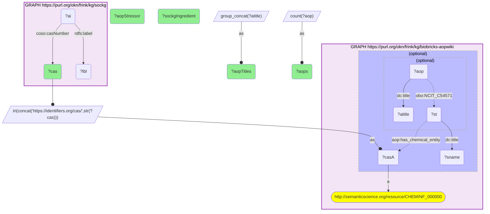

# ET07-Q1: sockg×biobricks-aopwiki (CAS) — 8 SOCKG agrochemicals are AOP-Wiki chemicals; only atrazine (3 AOPs) and chlorpyrifos (2) are stressors of an AOP, the six pyrethroids and triallate are not

- **Date:** 2026-10-13
- **Model:** claude-opus-5-5
- **SPARQL endpoint:** https://apps.okn.us/federation/sparql
- **Generated by:** mcp-okn v0.1.0 (build 3195263)
- **Contents:** 1 query · 1 query diagram

## Knowledge graphs used

- `sockg` — <https://purl.org/okn/frink/kg/sockg>
- `biobricks-aopwiki` — <https://purl.org/okn/frink/kg/biobricks-aopwiki>

## Conversation

👤 **User**

Which SOCKG agrochemicals are AOP-Wiki chemicals, and which Adverse Outcome Pathways name them as stressors?

---

🧠 **Assistant**

**Eight SOCKG agrochemicals are AOP-Wiki chemicals, but only two are stressors of an Adverse Outcome Pathway: atrazine (3 AOPs) and chlorpyrifos (2). The other six, five pyrethroid insecticides and the herbicide triallate, appear in AOP-Wiki without a linked AOP.**

| CAS | SOCKG ingredient | AOPs | AOP titles (from the returned list) |
|---|---|---|---|
| 1912-24-9 | Atrazine | 3 | glutathione conjugation → reproductive dysfunction via oxidative stress; GnRH pulse disruption |
| 2921-88-2 | Chlorpyrifos | 2 | IP3R/RyR co-activation → reduced IQ; inhibitor binding to … (see result table) |
| 2303-17-5 | Triallate | 0 | — |
| 52645-53-1 | Permethrin | 0 | — |
| 66230-04-4 | Esfenvalerate | 0 | — |
| 68359-37-5 | Cyfluthrin | 0 | — |
| 82657-04-3 | Bifenthrin | 0 | — |
| 91465-08-6 | Lambda-cyhalothrin | 0 | — |

**What it gives.** For atrazine and chlorpyrifos, SOCKG's field applications can be connected to documented adverse-outcome mechanisms. For the pyrethroids, AOP-Wiki holds the chemical but no pathway yet.

**Join form.** SOCKG `coso:casNumber` → `https://identifiers.org/cas/{CAS}`, AOP-Wiki's CAS hub node; stressors point to it with `aop:has_chemical_entity`, and AOPs to stressors with `NCIT_C54571`.

## SPARQL queries executed

#### Query 1

_2026-10-14T06:53:11+00:00 · `sockg`, `biobricks-aopwiki`_

```sparql
PREFIX biolink: <https://w3id.org/biolink/vocab/>
PREFIX rdfs: <http://www.w3.org/2000/01/rdf-schema#>
PREFIX skos: <http://www.w3.org/2004/02/skos/core#>
PREFIX up: <http://purl.uniprot.org/core/>
PREFIX obo: <http://purl.obolibrary.org/obo/>
PREFIX oa: <http://www.w3.org/ns/oa#>
PREFIX coso: <http://w3id.org/coso/v1/contaminoso#>
PREFIX sockg: <https://idir.uta.edu/sockg-ontology#>
PREFIX aop: <http://aopkb.org/aop_ontology#>
PREFIX dc: <http://purl.org/dc/elements/1.1/>
PREFIX meshv: <http://id.nlm.nih.gov/mesh/vocab#>
PREFIX spoke: <https://purl.org/okn/frink/kg/spoke-okn/schema/>
# SOCKG active ingredients that are AOP-Wiki chemicals, with the AOPs that name them as stressors.
SELECT ?cas (SAMPLE(?lbl) AS ?sockgIngredient) (SAMPLE(?sname) AS ?aopStressor) (COUNT(DISTINCT ?aop) AS ?aops)
       (GROUP_CONCAT(DISTINCT ?atitle; SEPARATOR=" | ") AS ?aopTitles) WHERE {
  GRAPH <https://purl.org/okn/frink/kg/sockg> { ?ai coso:casNumber ?cas ; rdfs:label ?lbl }
  BIND(IRI(CONCAT('https://identifiers.org/cas/', STR(?cas))) AS ?casA)
  GRAPH <https://purl.org/okn/frink/kg/biobricks-aopwiki> { ?casA a <http://semanticscience.org/resource/CHEMINF_000000> .
    OPTIONAL { ?st aop:has_chemical_entity ?casA ; dc:title ?sname . OPTIONAL { ?aop obo:NCIT_C54571 ?st ; dc:title ?atitle } } }
} GROUP BY ?cas ORDER BY DESC(?aops)
```



_8 row(s)_

| cas | sockgIngredient | aopStressor | aops | aopTitles |
| --- | --- | --- | --- | --- |
| 1912-24-9 | Atrazine; CAS No. 1912-24-9 | atrazine | 3 | Glutathione conjugation leading to reproductive dysfunction via oxidative stress \| GnRH pulse disruption leading to pituitary adenomas and carcinomas in the SD rat. \| GnRH pulse disruption leading to mammary adenomas and carcinomas in the SD rat. |
| 2921-88-2 | Chlorpyrifos; CAS No. 2921-88-2 | Chlorpyrifos | 2 | Co-activation of IP3R and RyR leads to reduced IQ through non-cholinergic mechanisms \|  Inhibitor binding to topoisomerase II leading to infant leukaemia |
| 2303-17-5 | Triallate; CAS No. 2303-17-5 | Tri-allate | 0 |  |
| 52645-53-1 | Permethrin; CAS No. 52645-53-1 | Permethrin | 0 |  |
| 66230-04-4 | Esfenvalerate; CAS No. 66230-04-4 | Esfenvalerate | 0 |  |
| 68359-37-5 | Cyfluthrin; CAS No. 68359-37-5 | Cyfluthrin | 0 |  |
| 82657-04-3 | Bifenthrin; CAS No. 82657-04-3 | Bifenthrin | 0 |  |
| 91465-08-6 | Lambda-cyhalothrin; CAS No. 91465-08-6 | Lambda-Cyhalothrin | 0 |  |
