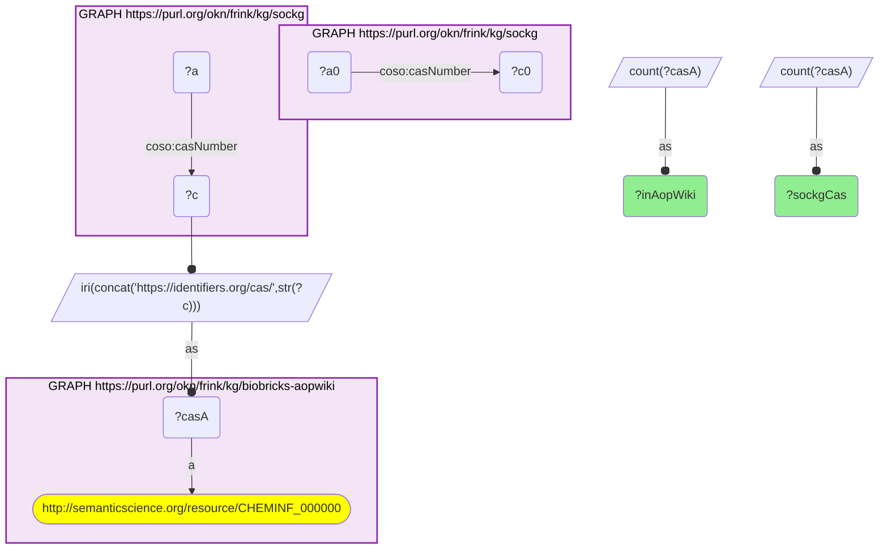

# ET07-Q2: sockg×biobricks-aopwiki — 8 of SOCKG's 82 agrochemical CAS numbers are in AOP-Wiki

- **Date:** 2026-10-13
- **Model:** claude-opus-5-5
- **SPARQL endpoint:** https://apps.okn.us/federation/sparql
- **Generated by:** mcp-okn v0.1.0 (build 3195263)
- **Contents:** 1 query · 1 query diagram

## Knowledge graphs used

- `sockg` — <https://purl.org/okn/frink/kg/sockg>
- `biobricks-aopwiki` — <https://purl.org/okn/frink/kg/biobricks-aopwiki>

## Conversation

👤 **User**

Same crosswalk, coverage angle: how many of SOCKG's agrochemicals does AOP-Wiki carry?

---

🧠 **Assistant**

**8 of SOCKG's 82 agrochemical CAS numbers are AOP-Wiki chemicals.**

| Measure | Count |
|---|---|
| SOCKG CAS numbers | 82 |
| in AOP-Wiki | 8 |

**A small but direct link.** AOP-Wiki's chemical list is short and chosen for mechanisms, so few field agrochemicals are in it. The join is still worth recording: it is the only route from SOCKG's management data to adverse-outcome mechanisms.

**Join form.** `coso:casNumber` literal → `https://identifiers.org/cas/{CAS}` (AOP-Wiki uses the `https` form).

## SPARQL queries executed

#### Query 1

_2026-10-14T06:53:12+00:00 · `sockg`, `biobricks-aopwiki`_

```sparql
PREFIX biolink: <https://w3id.org/biolink/vocab/>
PREFIX rdfs: <http://www.w3.org/2000/01/rdf-schema#>
PREFIX skos: <http://www.w3.org/2004/02/skos/core#>
PREFIX up: <http://purl.uniprot.org/core/>
PREFIX obo: <http://purl.obolibrary.org/obo/>
PREFIX oa: <http://www.w3.org/ns/oa#>
PREFIX coso: <http://w3id.org/coso/v1/contaminoso#>
PREFIX sockg: <https://idir.uta.edu/sockg-ontology#>
PREFIX aop: <http://aopkb.org/aop_ontology#>
PREFIX dc: <http://purl.org/dc/elements/1.1/>
PREFIX meshv: <http://id.nlm.nih.gov/mesh/vocab#>
PREFIX spoke: <https://purl.org/okn/frink/kg/spoke-okn/schema/>
SELECT ?sockgCas ?inAopWiki WHERE {
  { SELECT (COUNT(DISTINCT ?c0) AS ?sockgCas) WHERE { GRAPH <https://purl.org/okn/frink/kg/sockg> { ?a0 coso:casNumber ?c0 } } }
  { SELECT (COUNT(DISTINCT ?casA) AS ?inAopWiki) WHERE { GRAPH <https://purl.org/okn/frink/kg/sockg> { ?a coso:casNumber ?c } BIND(IRI(CONCAT('https://identifiers.org/cas/', STR(?c))) AS ?casA)
      GRAPH <https://purl.org/okn/frink/kg/biobricks-aopwiki> { ?casA a <http://semanticscience.org/resource/CHEMINF_000000> } } }
}
```



_1 row(s)_

| sockgCas | inAopWiki |
| --- | --- |
| 82 | 8 |
