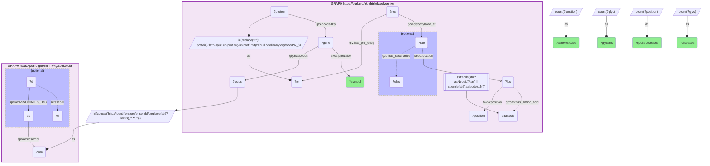

# G31-Q1: glygenkg×spoke-okn (Ensembl) — the genes whose proteins carry the most N-linked sites, and the diseases SPOKE associates with them

- **Date:** 2026-10-13
- **Model:** claude-opus-5-5
- **SPARQL endpoint:** https://apps.okn.us/federation/sparql
- **Generated by:** mcp-okn v0.1.0 (build d0aab94)
- **Contents:** 1 query · 1 query diagram

## Knowledge graphs used

- `glygenkg` — <https://purl.org/okn/frink/kg/glygenkg>
- `spoke-okn` — <https://purl.org/okn/frink/kg/spoke-okn>

## Conversation

👤 **User**

Take the 15 genes whose proteins have the most N-glycosylated (asparagine) residues in GlyGen. Which diseases does SPOKE associate with each gene?

---

🧠 **Assistant**

**All 15 genes are SPOKE genes; 12 carry at least one SPOKE disease association and 3 (CUBN, ATRN, CPD) carry none.**

| Gene | Asn residues (GlyGen) | Glycans on them | SPOKE diseases | Diseases |
|---|---|---|---|---|
| LRP1 | 48 | 168 | 5 | asthma; skin cancer; coronary artery disease; migraine; skin benign neoplasm |
| SORL1 | 29 | 95 | 3 | Alzheimer's disease; nervous system disease; epilepsy |
| PTPRC | 28 | 62 | 16 | viral infectious disease; lymphoid leukemia; acute myeloid leukemia; rheumatoid arthritis; leukemia; inflammatory bowel disease; non-Hodgkin lymphoma; asthma; lung cancer; nervous system disease; reticulosarcoma; diabetes mellitus; multiple sclerosis; dermatitis; breast cancer; liver disease |
| NPC1 | 23 | 21 | 4 | coronary artery disease; liver disease; arteriosclerosis; epilepsy |
| LAMA2 | 23 | 111 | 4 | gastroesophageal reflux disease; biliary tract cancer; epilepsy; cardiomyopathy |
| MMRN1 | 22 | 63 | 1 | Parkinson's disease |
| CUBN | 22 | 169 | 0 | |
| PTPRJ | 20 | 29 | 7 | urinary bladder cancer; hypertension; stomach cancer; colorectal carcinoma; kidney cancer; uterine cancer; colorectal cancer |
| ATRN | 19 | 113 | 0 | |
| LAMA5 | 19 | 153 | 2 | colorectal carcinoma; liver disease |
| LAMP1 | 19 | 318 | 2 | viral infectious disease; nervous system disease |
| CPD | 18 | 75 | 0 | |
| LRP2 | 18 | 185 | 6 | nervous system disease; chronic kidney disease; epilepsy; myopia; gout; prostate cancer |
| APOB | 17 | 109 | 12 | hypertension; nutrition disease; obesity; nervous system disease; cerebrovascular disease; peripheral artery disease; familial hypercholesterolemia; gastroesophageal reflux disease; arteriosclerosis; diabetes mellitus; coronary artery disease; liver disease |
| ENPEP | 17 | 140 | 3 | viral infectious disease; human immunodeficiency virus infectious disease; hypertension |

**Who these genes are.** Ranking by asparagine residues selects large cell-surface and extracellular proteins: the LDL-receptor family (LRP1, LRP2, SORL1), laminins (LAMA2, LAMA5), receptor tyrosine phosphatases (PTPRC, PTPRJ), a lysosomal membrane protein (LAMP1) and apolipoprotein B. The restriction to asparagine keeps the ranking on N-linked sites; GlyGen's serine and threonine records are a separate class that includes intracellular proteins.

**What SPOKE adds.** The disease lists follow the proteins' known biology in several rows: APOB with familial hypercholesterolemia, coronary artery disease and arteriosclerosis; SORL1 with Alzheimer's disease; PTPRC (CD45) with leukemias, lymphoma and autoimmune disease; LRP2 with chronic kidney disease. Number of glycosylation sites and number of associated diseases do not track each other: PTPRC has 16 diseases on 28 residues, LRP1 5 on 48.

**Limits.** `ASSOCIATES_DaG` is SPOKE's gene-disease association edge and is not specific to glycosylation; nothing here says the glycans are involved in the disease. A gene with no association (CUBN, ATRN, CPD) is absent from that edge type in SPOKE, not shown to be unrelated to disease.

**Join form.** glygenkg writes the gene locus as `http://rdf.ebi.ac.uk/resource/ensembl/{ENSG}`; SPOKE stores `http://identifiers.org/ensembl/{ENSG}` on its `ensembl` property. The bare id is extracted and SPOKE's form rebuilt.

## SPARQL queries executed

#### Query 1

_2026-10-14T02:24:26+00:00 · `glygenkg`, `spoke-okn`_

```sparql
PREFIX gly: <https://sparql.glygen.org/ontology/>
PREFIX gco: <http://purl.jp/bio/12/glyco/conjugate#>
PREFIX glycan: <http://purl.jp/bio/12/glyco/glycan#>
PREFIX faldo: <http://www.biohackathon.org/resource/faldo#>
PREFIX up: <http://purl.uniprot.org/core/>
PREFIX skos: <http://www.w3.org/2004/02/skos/core#>
PREFIX rdfs: <http://www.w3.org/2000/01/rdf-schema#>
PREFIX spoke: <https://purl.org/okn/frink/kg/spoke-okn/schema/>
SELECT ?symbol ?asnResidues ?glycans (COUNT(DISTINCT ?d) AS ?spokeDiseases)
       (GROUP_CONCAT(DISTINCT ?dl; SEPARATOR="; ") AS ?diseases) WHERE {
  { SELECT ?locus ?symbol (COUNT(DISTINCT ?position) AS ?asnResidues) (COUNT(DISTINCT ?glyc) AS ?glycans) WHERE {
      GRAPH <https://purl.org/okn/frink/kg/glygenkg> {
        ?protein up:encodedBy ?gene . ?gene gly:hasLocus ?locus ; skos:prefLabel ?symbol .
        BIND(IRI(REPLACE(STR(?protein),'http://purl.uniprot.org/uniprot/','http://purl.obolibrary.org/obo/PR_')) AS ?pr)
        ?rec gly:has_pro_entry ?pr ; gco:glycosylated_at ?site .
        ?site faldo:location ?loc . ?loc faldo:position ?position ; glycan:has_amino_acid ?aaNode .
        FILTER(STRENDS(STR(?aaNode),'/Asn') || STRENDS(STR(?aaNode),'/N'))
        OPTIONAL { ?site gco:has_saccharide ?glyc }
      } } GROUP BY ?locus ?symbol ORDER BY DESC(?asnResidues) LIMIT 15 }
  BIND(IRI(CONCAT('http://identifiers.org/ensembl/', REPLACE(STR(?locus),'^.*/',''))) AS ?ens)
  GRAPH <https://purl.org/okn/frink/kg/spoke-okn> {
    ?x spoke:ensembl ?ens .
    OPTIONAL { ?d spoke:ASSOCIATES_DaG ?x ; rdfs:label ?dl }
  }
} GROUP BY ?symbol ?asnResidues ?glycans ORDER BY DESC(?asnResidues)
```



_15 row(s)_

| symbol | asnResidues | glycans | spokeDiseases | diseases |
| --- | --- | --- | --- | --- |
| LRP1 | 48 | 168 | 5 | asthma; skin cancer; coronary artery disease; migraine; skin benign neoplasm |
| SORL1 | 29 | 95 | 3 | Alzheimer's disease; nervous system disease; epilepsy |
| PTPRC | 28 | 62 | 16 | viral infectious disease; lymphoid leukemia; acute myeloid leukemia; rheumatoid arthritis; leukemia; inflammatory bowel disease; non-Hodgkin lymphoma; asthma; lung cancer; nervous system disease; reticulosarcoma; diabetes mellitus; multiple sclerosis; dermatitis; breast cancer; liver disease |
| NPC1 | 23 | 21 | 4 | coronary artery disease; liver disease; arteriosclerosis; epilepsy |
| LAMA2 | 23 | 111 | 4 | gastroesophageal reflux disease; biliary tract cancer; epilepsy; cardiomyopathy |
| MMRN1 | 22 | 63 | 1 | Parkinson's disease |
| CUBN | 22 | 169 | 0 |  |
| PTPRJ | 20 | 29 | 7 | urinary bladder cancer; hypertension; stomach cancer; colorectal carcinoma; kidney cancer; uterine cancer; colorectal cancer |
| ATRN | 19 | 113 | 0 |  |
| LAMA5 | 19 | 153 | 2 | colorectal carcinoma; liver disease |
| LAMP1 | 19 | 318 | 2 | viral infectious disease; nervous system disease |
| CPD | 18 | 75 | 0 |  |
| LRP2 | 18 | 185 | 6 | nervous system disease; chronic kidney disease; epilepsy; myopia; gout; prostate cancer |
| APOB | 17 | 109 | 12 | hypertension; nutrition disease; obesity; nervous system disease; cerebrovascular disease; peripheral artery disease; familial hypercholesterolemia; gastroesophageal reflux disease; arteriosclerosis; diabetes mellitus; coronary artery disease; liver disease |
| ENPEP | 17 | 140 | 3 | viral infectious disease; human immunodeficiency virus infectious disease; hypertension |
