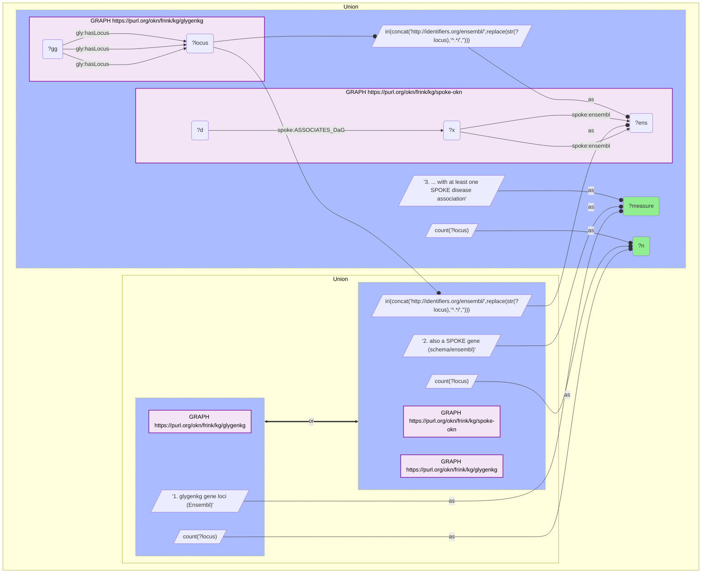

# G31-Q2: glygenkg×spoke-okn (Ensembl) — 7,315 of GlyGen's 7,959 gene loci are SPOKE genes; 3,311 carry a disease association

- **Date:** 2026-10-13
- **Model:** claude-opus-5-5
- **SPARQL endpoint:** https://apps.okn.us/federation/sparql
- **Generated by:** mcp-okn v0.1.0 (build d0aab94)
- **Contents:** 1 query · 1 query diagram

## Knowledge graphs used

- `glygenkg` — <https://purl.org/okn/frink/kg/glygenkg>
- `spoke-okn` — <https://purl.org/okn/frink/kg/spoke-okn>

## Conversation

👤 **User**

Same crosswalk, coverage angle: how many of glygenkg's Ensembl gene loci are SPOKE genes, and how many of those have a SPOKE disease association?

---

🧠 **Assistant**

**7,315 of glygenkg's 7,959 Ensembl gene loci (91.9%) are SPOKE genes, and 3,311 of them (45.3% of the shared set) have at least one SPOKE disease association.**

| Measure | Count |
|---|---|
| glygenkg gene loci (Ensembl) | 7,959 |
| also a SPOKE gene (`schema/ensembl`) | 7,315 (91.9%) |
| ... with at least one SPOKE disease association | 3,311 |

**Reading the three numbers.** 644 glygenkg loci have no SPOKE gene carrying that Ensembl id. Of the 7,315 that do, fewer than half are connected to a disease through `ASSOCIATES_DaG`, so a disease question over GlyGen genes can draw on 3,311 genes, 41.6% of glygenkg's loci.

**The denominator is loci, not proteins.** glygenkg has 8,112 proteins and 8,097 gene nodes, but only 7,959 genes carry an Ensembl locus (`gly:hasLocus`). The 138 genes without a locus cannot use this join at all; reach them through the protein instead (UniProt, for the graphs that have it).

**Join form.** Rebuild SPOKE's `http://identifiers.org/ensembl/{ENSG}` from glygenkg's `http://rdf.ebi.ac.uk/resource/ensembl/{ENSG}`. glygenkg's form is used by no other graph in the federation, so a direct join returns nothing.

## SPARQL queries executed

#### Query 1

_2026-10-14T02:24:27+00:00 · `glygenkg`, `spoke-okn`_

```sparql
PREFIX gly: <https://sparql.glygen.org/ontology/>
PREFIX gco: <http://purl.jp/bio/12/glyco/conjugate#>
PREFIX glycan: <http://purl.jp/bio/12/glyco/glycan#>
PREFIX faldo: <http://www.biohackathon.org/resource/faldo#>
PREFIX up: <http://purl.uniprot.org/core/>
PREFIX skos: <http://www.w3.org/2004/02/skos/core#>
PREFIX rdfs: <http://www.w3.org/2000/01/rdf-schema#>
PREFIX spoke: <https://purl.org/okn/frink/kg/spoke-okn/schema/>
SELECT ?measure ?n WHERE {
  { SELECT ("1. glygenkg gene loci (Ensembl)" AS ?measure) (COUNT(DISTINCT ?locus) AS ?n) WHERE { GRAPH <https://purl.org/okn/frink/kg/glygenkg> { ?gg gly:hasLocus ?locus } } }
  UNION
  { SELECT ("2. also a SPOKE gene (schema/ensembl)" AS ?measure) (COUNT(DISTINCT ?locus) AS ?n) WHERE {
      { SELECT DISTINCT ?locus WHERE { GRAPH <https://purl.org/okn/frink/kg/glygenkg> { ?gg gly:hasLocus ?locus } } }
      BIND(IRI(CONCAT('http://identifiers.org/ensembl/', REPLACE(STR(?locus),'^.*/',''))) AS ?ens)
      GRAPH <https://purl.org/okn/frink/kg/spoke-okn> { ?x spoke:ensembl ?ens } } }
  UNION
  { SELECT ("3. ... with at least one SPOKE disease association" AS ?measure) (COUNT(DISTINCT ?locus) AS ?n) WHERE {
      { SELECT DISTINCT ?locus WHERE { GRAPH <https://purl.org/okn/frink/kg/glygenkg> { ?gg gly:hasLocus ?locus } } }
      BIND(IRI(CONCAT('http://identifiers.org/ensembl/', REPLACE(STR(?locus),'^.*/',''))) AS ?ens)
      GRAPH <https://purl.org/okn/frink/kg/spoke-okn> { ?x spoke:ensembl ?ens . ?d spoke:ASSOCIATES_DaG ?x } } }
} ORDER BY ?measure
```



_3 row(s)_

| measure | n |
| --- | --- |
| 1. glygenkg gene loci (Ensembl) | 7959 |
| 2. also a SPOKE gene (schema/ensembl) | 7315 |
| 3. ... with at least one SPOKE disease association | 3311 |
