# G32-Q1: glygenkg×gene-expression-atlas-okn (Ensembl) — the genes with the most reported glycan structures, and how often GXA finds them differentially expressed

- **Date:** 2026-10-13
- **Model:** claude-opus-5-5
- **SPARQL endpoint:** https://apps.okn.us/federation/sparql
- **Generated by:** mcp-okn v0.1.0 (build d0aab94)
- **Contents:** 1 query · 1 query diagram

## Knowledge graphs used

- `glygenkg` — <https://purl.org/okn/frink/kg/glygenkg>
- `gene-expression-atlas-okn` — <https://purl.org/okn/frink/kg/gene-expression-atlas-okn>

## Conversation

👤 **User**

For the 12 genes whose proteins carry the most distinct glycan structures in GlyGen, how many Expression Atlas contrasts report the gene as differentially expressed, in how many studies, and in which direction?

---

🧠 **Assistant**

**All twelve glycan-richest genes are frequently differentially expressed in Expression Atlas: from 79 contrasts (PTGDS) to 497 (CLU).**

| Gene | Distinct glycans (GlyGen) | Glycosylated residues | GXA contrasts (adj. p < 0.05) | Up | Down | Studies |
|---|---|---|---|---|---|---|
| LAMP1 | 327 | 35 | 85 | 40 | 45 | 58 |
| PIGR | 320 | 11 | 168 | 92 | 76 | 87 |
| LAMP2 | 304 | 32 | 135 | 83 | 52 | 82 |
| LUM | 298 | 7 | 359 | 212 | 147 | 238 |
| CLU | 292 | 11 | 497 | 285 | 212 | 307 |
| HP | 287 | 7 | 165 | 87 | 78 | 99 |
| BGN | 275 | 7 | 247 | 165 | 82 | 158 |
| PSAP | 265 | 22 | 139 | 82 | 57 | 84 |
| FN1 | 263 | 30 | 470 | 286 | 184 | 291 |
| LTF | 246 | 4 | 216 | 156 | 60 | 143 |
| PTGDS | 222 | 8 | 79 | 42 | 37 | 50 |
| CP | 222 | 12 | 293 | 183 | 110 | 183 |

**What the two graphs say together.** GlyGen identifies the proteins whose glycosylation is most heterogeneous; Expression Atlas shows that the genes encoding them are among the commonly regulated ones. Clusterin (CLU) and fibronectin (FN1) change in 497 and 470 contrasts across about 300 studies each; lumican (LUM) in 359 across 238.

**Direction.** Up-regulation outnumbers down-regulation for eleven of the twelve; LAMP1 is the exception (40 up, 45 down). The skew is strongest for LTF (156 up, 60 down) and BGN (165 up, 82 down). These are counts over every contrast in the atlas, not a single condition, so they describe how often a gene moves, not what moves it.

**Why this is a useful pairing.** A change in the amount of a glycoprotein and a change in its glycoforms are different measurements. For these twelve genes both sources of variation are large: many reported glycan structures and frequent expression change. Neither graph links a specific glycan to a specific expression contrast.

**Join form.** The match is on the bare Ensembl gene id: the `ENSG` accession is taken from glygenkg's locus IRI and matched to the `biolink:id` literal on Expression Atlas gene nodes. That literal reaches the gene nodes that carry the differential-expression results; matching the Ensembl node IRI alone reaches fewer (see the coverage question).

## SPARQL queries executed

#### Query 1

_2026-10-14T02:24:28+00:00 · `glygenkg`, `gene-expression-atlas-okn`_

```sparql
PREFIX gly: <https://sparql.glygen.org/ontology/>
PREFIX gco: <http://purl.jp/bio/12/glyco/conjugate#>
PREFIX glycan: <http://purl.jp/bio/12/glyco/glycan#>
PREFIX faldo: <http://www.biohackathon.org/resource/faldo#>
PREFIX up: <http://purl.uniprot.org/core/>
PREFIX skos: <http://www.w3.org/2004/02/skos/core#>
PREFIX rdfs: <http://www.w3.org/2000/01/rdf-schema#>
PREFIX biolink: <https://w3id.org/biolink/vocab/>
PREFIX wobd: <http://purl.org/okn/wobd/>
SELECT ?symbol ?glycans ?sites (COUNT(DISTINCT ?assay) AS ?gxaContrasts)
       (COUNT(DISTINCT IF(?lfc > 0, ?assay, ?none)) AS ?up) (COUNT(DISTINCT IF(?lfc < 0, ?assay, ?none)) AS ?down)
       (COUNT(DISTINCT ?study) AS ?studies) WHERE {
  { SELECT ?locus ?symbol (COUNT(DISTINCT ?position) AS ?sites) (COUNT(DISTINCT ?glyc) AS ?glycans) WHERE {
      GRAPH <https://purl.org/okn/frink/kg/glygenkg> {
        ?protein up:encodedBy ?gene . ?gene gly:hasLocus ?locus ; skos:prefLabel ?symbol .
        BIND(IRI(REPLACE(STR(?protein),'http://purl.uniprot.org/uniprot/','http://purl.obolibrary.org/obo/PR_')) AS ?pr)
        ?rec gly:has_pro_entry ?pr ; gco:glycosylated_at ?site .
        ?site faldo:location ?loc . ?loc faldo:position ?position .
        OPTIONAL { ?site gco:has_saccharide ?glyc }
      } } GROUP BY ?locus ?symbol ORDER BY DESC(?glycans) LIMIT 12 }
  BIND(REPLACE(STR(?locus),'^.*/','') AS ?ensg)
  GRAPH <https://purl.org/okn/frink/kg/gene-expression-atlas-okn> {
    ?gx biolink:id ?ensg .
    ?stmt biolink:object ?gx ; biolink:subject ?assay ; wobd:log2fc ?lfc ; wobd:adj_p_value ?adjP .
    FILTER(?adjP < 0.05)
    ?study biolink:has_output ?assay .
  }
} GROUP BY ?symbol ?glycans ?sites ORDER BY DESC(?glycans)
```

```mermaid
graph TD
classDef projected fill:lightgreen;
classDef literal fill:orange;
classDef iri fill:yellow;
  q0v25("?adjP")
  q0v28("?assay")
  q0v2("?down"):::projected 
  q0v15("?ensg")
  q0v19("?gene")
  q0v24("?glyc")
  q0v6("?glycans"):::projected 
  q0v27("?gx")
  q0v4("?gxaContrasts"):::projected 
  q0v29("?lfc")
  q0v22("?loc")
  q0v16("?locus")
  q0v23("?position")
  q0v17("?pr")
  q0v18("?protein")
  q0v20("?rec")
  q0v21("?site")
  q0v5("?sites"):::projected 
  q0v26("?stmt")
  q0v1("?studies"):::projected 
  q0v30("?study")
  q0v7("?symbol"):::projected 
  q0v3("?up"):::projected 
  subgraph q0graph0["GRAPH https://purl.org/okn/frink/kg/glygenkg"]
    style q0graph0 fill:#f3e5f5,stroke:#8e24aa,stroke-width:2px,color:#000;
    q0v19 --"skos:prefLabel"--> q0v7
    q0v19 --"gly:hasLocus"--> q0v16
    q0v18 --"up:encodedBy"--> q0v19
    q0graph0bind0[/"iri(replace(str(?protein),'http://purl.uniprot.org/uniprot/','http://purl.obolibrary.org/obo/PR_'))"/]
    q0v18 --o q0graph0bind0
    q0graph0bind0 --as--o q0v17
    q0v20 --"gco:glycosylated_at"--> q0v21
    q0v21 --"faldo:location"--> q0v22
    q0v22 --"faldo:position"--> q0v23
    q0v20 --"gly:has_pro_entry"--> q0v17
    subgraph q0optionalgraph00["(optional)"]
    style q0optionalgraph00 fill:#bbf,stroke-dasharray: 5 5,color:#000;
      q0v21 -."gco:has_saccharide".-> q0v24
    end
  end
  q0bind1[/"count(?position)"/]
  q0bind1 --as--o q0v5
  q0bind2[/"count(?glyc)"/]
  q0bind2 --as--o q0v6
  q0bind3[/"replace(str(?locus),'^.*/','')"/]
  q0v16 --o q0bind3
  q0bind3 --as--o q0v15
  subgraph q0graph1["GRAPH https://purl.org/okn/frink/kg/gene-expression-atlas-okn"]
    style q0graph1 fill:#f3e5f5,stroke:#8e24aa,stroke-width:2px,color:#000;
    q0graph1f0[["?adjP < '0.05^^xsd:decimal'"]]
    q0graph1f0 --> q0v25
    q0v26 --"biolink:object"--> q0v27
    q0v26 --"biolink:subject"--> q0v28
    q0v26 --"wobd:adj_p_value"--> q0v25
    q0v26 --"wobd:log2fc"--> q0v29
    q0v27 --"biolink:id"--> q0v15
    q0v30 --"biolink:has_output"--> q0v28
  end
  q0bind4[/"count(?position)"/]
  q0bind4 --as--o q0v4
  q0bind5[/"count(?glyc)"/]
  q0bind5 --as--o q0v3
```



_12 row(s)_

| symbol | glycans | sites | gxaContrasts | up | down | studies |
| --- | --- | --- | --- | --- | --- | --- |
| LAMP1 | 327 | 35 | 85 | 40 | 45 | 58 |
| PIGR | 320 | 11 | 168 | 92 | 76 | 87 |
| LAMP2 | 304 | 32 | 135 | 83 | 52 | 82 |
| LUM | 298 | 7 | 359 | 212 | 147 | 238 |
| CLU | 292 | 11 | 497 | 285 | 212 | 307 |
| HP | 287 | 7 | 165 | 87 | 78 | 99 |
| BGN | 275 | 7 | 247 | 165 | 82 | 158 |
| PSAP | 265 | 22 | 139 | 82 | 57 | 84 |
| FN1 | 263 | 30 | 470 | 286 | 184 | 291 |
| LTF | 246 | 4 | 216 | 156 | 60 | 143 |
| PTGDS | 222 | 8 | 79 | 42 | 37 | 50 |
| CP | 222 | 12 | 293 | 183 | 110 | 183 |
