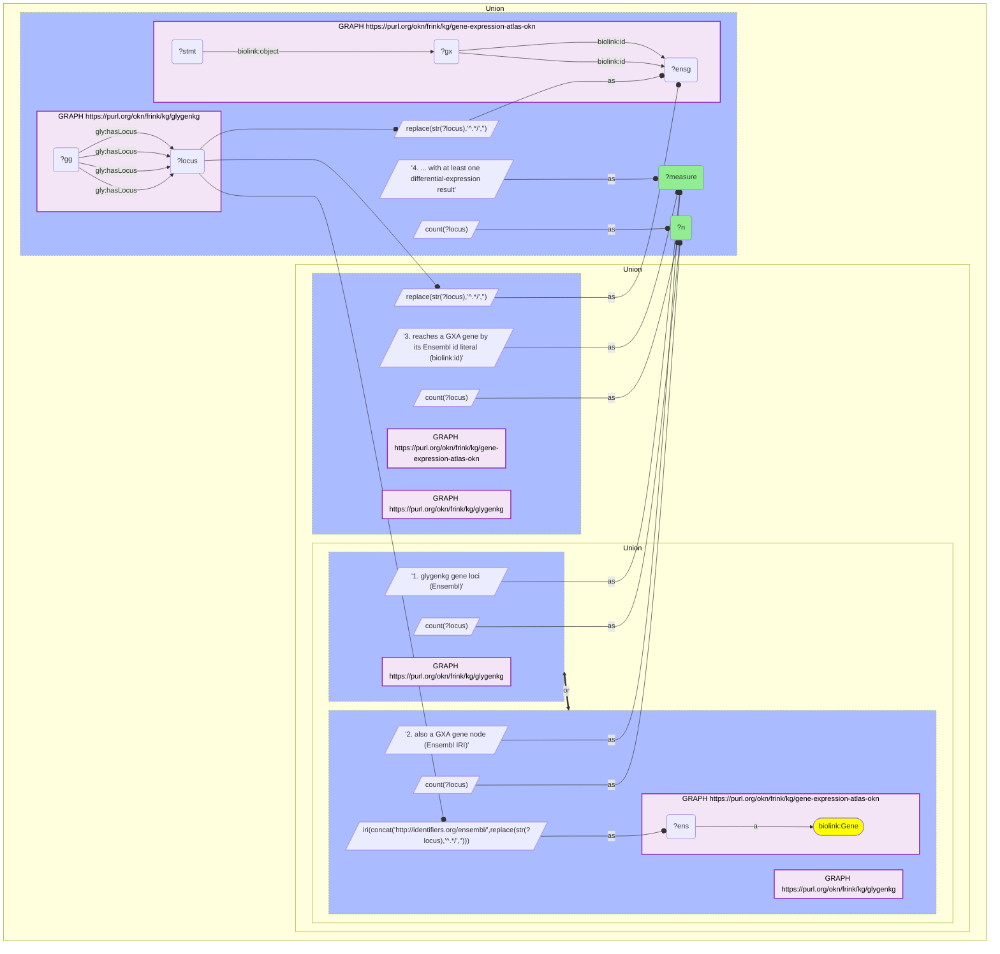

# G32-Q2: glygenkg×gene-expression-atlas-okn (Ensembl) — 7,393 of GlyGen's 7,959 gene loci are Expression Atlas gene nodes

- **Date:** 2026-10-13
- **Model:** claude-opus-5-5
- **SPARQL endpoint:** https://apps.okn.us/federation/sparql
- **Generated by:** mcp-okn v0.1.0 (build d0aab94)
- **Contents:** 1 query · 1 query diagram

## Knowledge graphs used

- `glygenkg` — <https://purl.org/okn/frink/kg/glygenkg>
- `gene-expression-atlas-okn` — <https://purl.org/okn/frink/kg/gene-expression-atlas-okn>

## Conversation

👤 **User**

Same crosswalk, coverage angle: how many of glygenkg's Ensembl gene loci are Expression Atlas genes, and how many of those have at least one differential-expression result?

---

🧠 **Assistant**

**It depends on which of Expression Atlas's two gene keys is used: 7,393 of glygenkg's 7,959 loci match a GXA gene node by Ensembl IRI, but 7,950 (99.9%) match by the Ensembl id literal, and 7,935 of those have a differential-expression result.**

| Measure | Count |
|---|---|
| glygenkg gene loci (Ensembl) | 7,959 |
| also a GXA gene node (Ensembl IRI) | 7,393 (92.9%) |
| reaches a GXA gene by its Ensembl id literal (`biolink:id`) | 7,950 (99.9%) |
| ... with at least one differential-expression result | 7,935 (99.7%) |

**Use the literal.** Expression Atlas gene nodes carry the Ensembl accession as a `biolink:id` string. Matching that string reaches 557 more glygenkg genes than matching the node IRI `http://identifiers.org/ensembl/{ENSG}`, and it is the route that leads to the differential-expression statements. The node-IRI join is a correct but smaller subset.

**Practically complete.** Nine glygenkg loci have no Expression Atlas gene under either key, and 15 more match a gene node that has no differential-expression result. Any expression question over GlyGen's genes is answerable for 7,935 of 7,959.

**Join form.** Take the `ENSG` accession from glygenkg's `http://rdf.ebi.ac.uk/resource/ensembl/{ENSG}` locus IRI with `REPLACE(STR(?locus),'^.*/','')` and bind it as the object of `biolink:id`.

## SPARQL queries executed

#### Query 1

_2026-10-14T02:24:28+00:00 · `glygenkg`, `gene-expression-atlas-okn`_

```sparql
PREFIX gly: <https://sparql.glygen.org/ontology/>
PREFIX gco: <http://purl.jp/bio/12/glyco/conjugate#>
PREFIX glycan: <http://purl.jp/bio/12/glyco/glycan#>
PREFIX faldo: <http://www.biohackathon.org/resource/faldo#>
PREFIX up: <http://purl.uniprot.org/core/>
PREFIX skos: <http://www.w3.org/2004/02/skos/core#>
PREFIX rdfs: <http://www.w3.org/2000/01/rdf-schema#>
PREFIX biolink: <https://w3id.org/biolink/vocab/>
SELECT ?measure ?n WHERE {
  { SELECT ("1. glygenkg gene loci (Ensembl)" AS ?measure) (COUNT(DISTINCT ?locus) AS ?n) WHERE { GRAPH <https://purl.org/okn/frink/kg/glygenkg> { ?gg gly:hasLocus ?locus } } }
  UNION
  { SELECT ("2. also a GXA gene node (Ensembl IRI)" AS ?measure) (COUNT(DISTINCT ?locus) AS ?n) WHERE {
      { SELECT DISTINCT ?locus WHERE { GRAPH <https://purl.org/okn/frink/kg/glygenkg> { ?gg gly:hasLocus ?locus } } }
      BIND(IRI(CONCAT('http://identifiers.org/ensembl/', REPLACE(STR(?locus),'^.*/',''))) AS ?ens)
      GRAPH <https://purl.org/okn/frink/kg/gene-expression-atlas-okn> { ?ens a biolink:Gene } } }
  UNION
  { SELECT ("3. reaches a GXA gene by its Ensembl id literal (biolink:id)" AS ?measure) (COUNT(DISTINCT ?locus) AS ?n) WHERE {
      { SELECT DISTINCT ?locus WHERE { GRAPH <https://purl.org/okn/frink/kg/glygenkg> { ?gg gly:hasLocus ?locus } } }
      BIND(REPLACE(STR(?locus),'^.*/','') AS ?ensg)
      GRAPH <https://purl.org/okn/frink/kg/gene-expression-atlas-okn> { ?gx biolink:id ?ensg } } }
  UNION
  { SELECT ("4. ... with at least one differential-expression result" AS ?measure) (COUNT(DISTINCT ?locus) AS ?n) WHERE {
      { SELECT DISTINCT ?locus WHERE { GRAPH <https://purl.org/okn/frink/kg/glygenkg> { ?gg gly:hasLocus ?locus } } }
      BIND(REPLACE(STR(?locus),'^.*/','') AS ?ensg)
      GRAPH <https://purl.org/okn/frink/kg/gene-expression-atlas-okn> { ?gx biolink:id ?ensg . ?stmt biolink:object ?gx } } }
} ORDER BY ?measure
```



_4 row(s)_

| measure | n |
| --- | --- |
| 1. glygenkg gene loci (Ensembl) | 7959 |
| 2. also a GXA gene node (Ensembl IRI) | 7393 |
| 3. reaches a GXA gene by its Ensembl id literal (biolink:id) | 7950 |
| 4. ... with at least one differential-expression result | 7935 |
