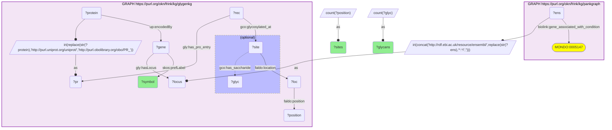
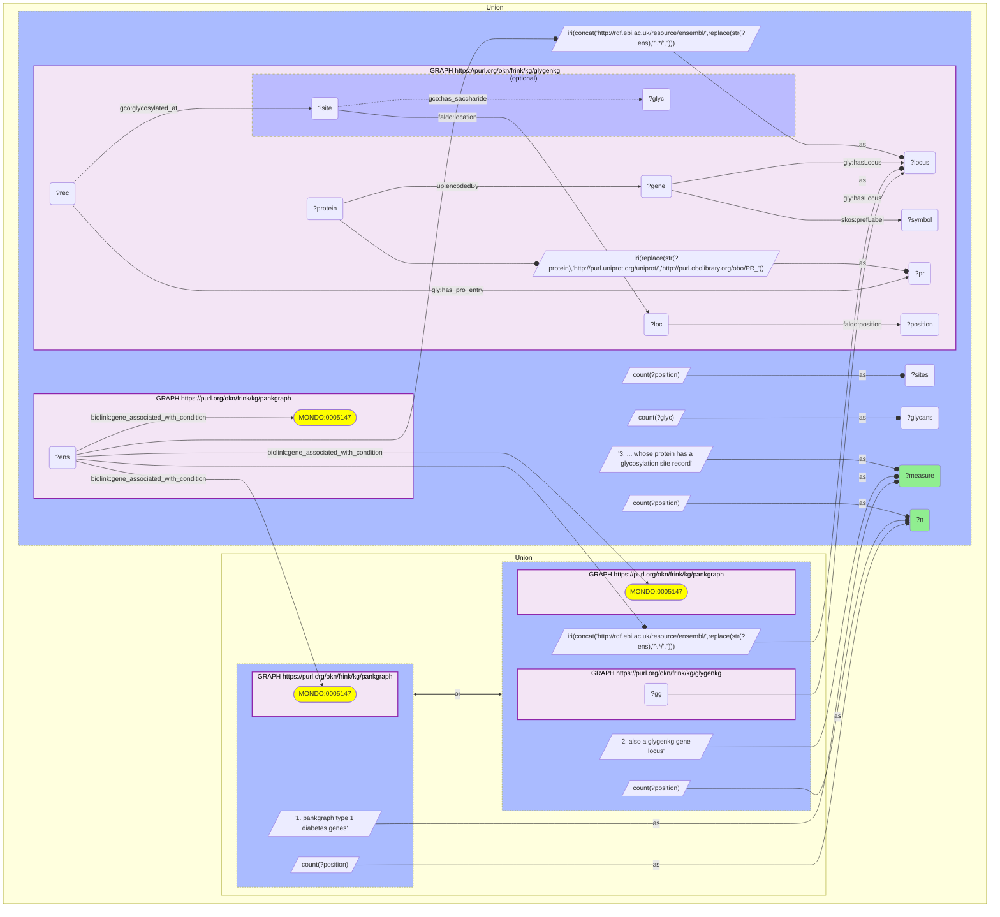

# G33-Q1: glygenkg×pankgraph (Ensembl) — PanKgraph's type 1 diabetes genes whose proteins are glycosylated

- **Date:** 2026-10-13
- **Model:** claude-opus-5-5
- **SPARQL endpoint:** https://apps.okn.us/federation/sparql
- **Generated by:** mcp-okn v0.1.0 (build d0aab94)
- **Contents:** 2 queries · 2 query diagrams

## Knowledge graphs used

- `pankgraph` — <https://purl.org/okn/frink/kg/pankgraph>
- `glygenkg` — <https://purl.org/okn/frink/kg/glygenkg>

## Conversation

👤 **User**

Which of PanKgraph's type 1 diabetes genes encode a protein with glycosylation site records in GlyGen, and how many glycosylated residues and distinct glycans does each carry?

---

🧠 **Assistant**

**73 of PanKgraph's 176 type 1 diabetes genes are glygenkg gene loci, and the proteins of 55 of them have site-level glycosylation records.** The table lists the 25 with the most distinct glycans.

| Gene | Glycosylated residues | Distinct glycans |
|---|---|---|
| PIGR | 11 | 320 |
| CD63 | 5 | 110 |
| HLA-DRB1 | 1 | 56 |
| HLA-A | 4 | 28 |
| CEL | 12 | 18 |
| CTSH | 6 | 12 |
| ITGB7 | 5 | 7 |
| IL2 | 1 | 6 |
| MICA | 4 | 4 |
| CD28 | 4 | 4 |
| AKAP11 | 21 | 3 |
| IL2RA | 8 | 3 |
| ZFYVE26 | 3 | 3 |
| FLI1 | 14 | 2 |
| BACH2 | 9 | 2 |
| ACAP1 | 4 | 2 |
| P2RX1 | 4 | 2 |
| ESYT1 | 3 | 2 |
| SLC61A1 | 2 | 2 |
| ATXN2L | 27 | 1 |
| KIF14 | 7 | 1 |
| AFF3 | 6 | 1 |
| RAPH1 | 5 | 1 |
| CD226 | 5 | 1 |
| FCAMR | 4 | 1 |

| Step | Count |
|---|---|
| pankgraph type 1 diabetes genes | 176 |
| also a glygenkg gene locus | 73 |
| ... whose protein has a glycosylation site record | 55 |

**Two kinds of entry.** The top of the list is cell-surface and secreted immune proteins with many glycan structures: PIGR (320), CD63 (110), the HLA molecules HLA-DRB1 and HLA-A, IL2 and its receptor IL2RA, CD28, CD226, ITGB7, MICA. Further down are genes with many residues but only one to three glycans (ATXN2L 27 residues and 1 glycan, AKAP11 21 and 3, FLI1 14 and 2, BACH2 9 and 2). That pattern, many sites sharing one or two glycans, is typical of GlyGen's serine/threonine O-GlcNAc records, which also cover intracellular proteins; the query does not test the glycan type.

**What the join adds.** PanKgraph says a gene is associated with type 1 diabetes; GlyGen says whether its protein product is a glycoprotein and how heterogeneous. HLA and the IL2/IL2RA pair are among the best-known type 1 diabetes loci, and here they appear with their glycosylation attached.

**Limits.** The glycans are those reported for the protein in general, not in islets or in diabetes. 103 of the 176 genes are not in glygenkg, which is a partial GlyGen release; absence is not evidence that a protein is unglycosylated.

## SPARQL queries executed

#### Query 1

_2026-10-14T02:24:29+00:00 · `pankgraph`, `glygenkg`_

```sparql
PREFIX gly: <https://sparql.glygen.org/ontology/>
PREFIX gco: <http://purl.jp/bio/12/glyco/conjugate#>
PREFIX glycan: <http://purl.jp/bio/12/glyco/glycan#>
PREFIX faldo: <http://www.biohackathon.org/resource/faldo#>
PREFIX up: <http://purl.uniprot.org/core/>
PREFIX skos: <http://www.w3.org/2004/02/skos/core#>
PREFIX rdfs: <http://www.w3.org/2000/01/rdf-schema#>
PREFIX biolink: <https://w3id.org/biolink/vocab/>
SELECT ?symbol ?sites ?glycans WHERE {
  GRAPH <https://purl.org/okn/frink/kg/pankgraph> { ?ens biolink:gene_associated_with_condition <http://purl.obolibrary.org/obo/MONDO_0005147> }
  BIND(IRI(CONCAT('http://rdf.ebi.ac.uk/resource/ensembl/', REPLACE(STR(?ens),'^.*/',''))) AS ?locus)
  { SELECT ?locus ?symbol (COUNT(DISTINCT ?position) AS ?sites) (COUNT(DISTINCT ?glyc) AS ?glycans) WHERE {
      GRAPH <https://purl.org/okn/frink/kg/glygenkg> {
        ?protein up:encodedBy ?gene . ?gene gly:hasLocus ?locus ; skos:prefLabel ?symbol .
        BIND(IRI(REPLACE(STR(?protein),'http://purl.uniprot.org/uniprot/','http://purl.obolibrary.org/obo/PR_')) AS ?pr)
        ?rec gly:has_pro_entry ?pr ; gco:glycosylated_at ?site .
        ?site faldo:location ?loc . ?loc faldo:position ?position .
        OPTIONAL { ?site gco:has_saccharide ?glyc }
      } } GROUP BY ?locus ?symbol  }
} ORDER BY DESC(?glycans) DESC(?sites) LIMIT 25
```



_25 row(s)_

| symbol | sites | glycans |
| --- | --- | --- |
| PIGR | 11 | 320 |
| CD63 | 5 | 110 |
| HLA-DRB1 | 1 | 56 |
| HLA-A | 4 | 28 |
| CEL | 12 | 18 |
| CTSH | 6 | 12 |
| ITGB7 | 5 | 7 |
| IL2 | 1 | 6 |
| MICA | 4 | 4 |
| CD28 | 4 | 4 |
| AKAP11 | 21 | 3 |
| IL2RA | 8 | 3 |
| ZFYVE26 | 3 | 3 |
| FLI1 | 14 | 2 |
| BACH2 | 9 | 2 |
| ACAP1 | 4 | 2 |
| P2RX1 | 4 | 2 |
| ESYT1 | 3 | 2 |
| SLC61A1 | 2 | 2 |
| ATXN2L | 27 | 1 |
| KIF14 | 7 | 1 |
| AFF3 | 6 | 1 |
| RAPH1 | 5 | 1 |
| CD226 | 5 | 1 |
| FCAMR | 4 | 1 |

#### Query 2

_2026-10-14T02:24:30+00:00 · `pankgraph`, `glygenkg`_

```sparql
PREFIX gly: <https://sparql.glygen.org/ontology/>
PREFIX gco: <http://purl.jp/bio/12/glyco/conjugate#>
PREFIX glycan: <http://purl.jp/bio/12/glyco/glycan#>
PREFIX faldo: <http://www.biohackathon.org/resource/faldo#>
PREFIX up: <http://purl.uniprot.org/core/>
PREFIX skos: <http://www.w3.org/2004/02/skos/core#>
PREFIX rdfs: <http://www.w3.org/2000/01/rdf-schema#>
PREFIX biolink: <https://w3id.org/biolink/vocab/>
SELECT ?measure ?n WHERE {
  { SELECT ("1. pankgraph type 1 diabetes genes" AS ?measure) (COUNT(DISTINCT ?ens) AS ?n) WHERE {
      GRAPH <https://purl.org/okn/frink/kg/pankgraph> { ?ens biolink:gene_associated_with_condition <http://purl.obolibrary.org/obo/MONDO_0005147> } } }
  UNION
  { SELECT ("2. also a glygenkg gene locus" AS ?measure) (COUNT(DISTINCT ?ens) AS ?n) WHERE {
      GRAPH <https://purl.org/okn/frink/kg/pankgraph> { ?ens biolink:gene_associated_with_condition <http://purl.obolibrary.org/obo/MONDO_0005147> }
      BIND(IRI(CONCAT('http://rdf.ebi.ac.uk/resource/ensembl/', REPLACE(STR(?ens),'^.*/',''))) AS ?locus)
      GRAPH <https://purl.org/okn/frink/kg/glygenkg> { ?gg gly:hasLocus ?locus } } }
  UNION
  { SELECT ("3. ... whose protein has a glycosylation site record" AS ?measure) (COUNT(DISTINCT ?ens) AS ?n) WHERE {
      GRAPH <https://purl.org/okn/frink/kg/pankgraph> { ?ens biolink:gene_associated_with_condition <http://purl.obolibrary.org/obo/MONDO_0005147> }
      BIND(IRI(CONCAT('http://rdf.ebi.ac.uk/resource/ensembl/', REPLACE(STR(?ens),'^.*/',''))) AS ?locus)
      { SELECT ?locus ?symbol (COUNT(DISTINCT ?position) AS ?sites) (COUNT(DISTINCT ?glyc) AS ?glycans) WHERE {
      GRAPH <https://purl.org/okn/frink/kg/glygenkg> {
        ?protein up:encodedBy ?gene . ?gene gly:hasLocus ?locus ; skos:prefLabel ?symbol .
        BIND(IRI(REPLACE(STR(?protein),'http://purl.uniprot.org/uniprot/','http://purl.obolibrary.org/obo/PR_')) AS ?pr)
        ?rec gly:has_pro_entry ?pr ; gco:glycosylated_at ?site .
        ?site faldo:location ?loc . ?loc faldo:position ?position .
        OPTIONAL { ?site gco:has_saccharide ?glyc }
      } } GROUP BY ?locus ?symbol  } } }
} ORDER BY ?measure
```



_3 row(s)_

| measure | n |
| --- | --- |
| 1. pankgraph type 1 diabetes genes | 176 |
| 2. also a glygenkg gene locus | 73 |
| 3. ... whose protein has a glycosylation site record | 55 |
